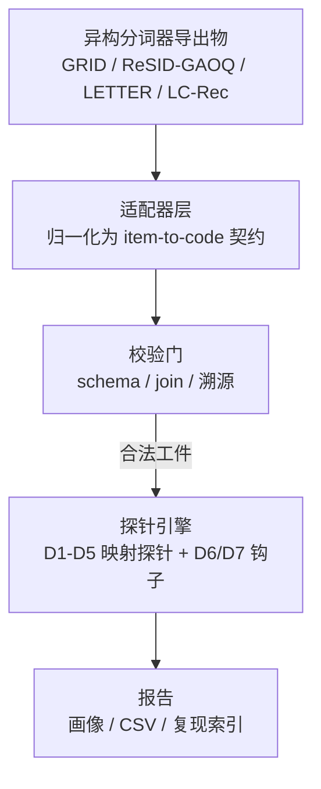
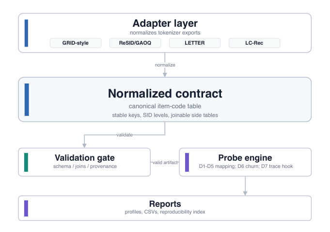

# SIDInspector: A Mapping-First Diagnostic Resource for Semantic-ID Tokenizers (映射优先的语义 ID 分词器诊断资源)

- **会议/期刊**: CIKM 2026 (Resource Track)
- **作者与机构**: Jiandong Ding, Heng Chang, Huijie Qin, Tianying Liu（华为技术有限公司）
- **推荐链路定位**: 召回（生成式检索的地址空间构建阶段，位于生成器训练之前）
- **研究方向**: 生成式推荐与离散语义 ID / 工业级评测基准与诊断资源
- **论文原文**: [https://arxiv.org/abs/2606.10375v2](https://arxiv.org/abs/2606.10375v2)
- **开源代码**: [https://github.com/jdding/sidinspector](https://github.com/jdding/sidininspector)

## TL;DR (1分钟核心速览)

生成式推荐中，SID 分词器导出的 item-to-code 映射已成为被反复复用的独立工件，但各仓库只给 checkpoint 或码本，覆盖率缺口、全码冲突、行为弱前缀、尾部压缩等问题往往要等下游生成器训练完才暴露。本文提出 SIDInspector：以统一适配器契约 + 校验门 + D1–D5 映射级探针，在训练前刻画工件的容量、可寻址性与行为对齐。在 23,742 个 Musical 同物品协议下，GRID 式容量提升使全码冲突率 D2 从 0.977 降至 0.779，ReSID/GAOQ 达 0.000，但 D3 邻域对齐仅 0.055–0.154，远低于类别前缀控制组的 0.447。

## Background & Motivation (背景与核心矛盾)

- **主流范式**: TIGER 类工作把物品映射为离散码序列，生成器直接生成候选 ID 而非全库打分；后续 RQ/协同量化、变长容量、漂移刷新等工作不断改写这一地址空间。
- **前人局限**: 其一，分词器发布物形态不一（仅 checkpoint、仅码本、仅中间特征），下游无法在训练前判断"是否所有物品都有合法码、多少物品共享全码"；其二，各论文自建检查脚本，指标口径混杂（码本使用率、下游排序、定性样例），证据不可横向比较。
- **核心洞察 (Key Insight)**: 聚合排序指标无法暴露导出的地址空间本身——死码、全码别名、行为弱前缀、尾部压缩、前缀扇出都是工件的直接属性，可被下游分数掩盖，却决定了生成器的搜索空间。
- **本文切入点**: 把"item-to-code 映射"固定为被检对象，用一套可复现的工件契约与探针族，在生成器训练前给出可比较的工件画像。

## Method (核心方法设计)

### 1. 整体框架 (Overall Architecture)

SIDInspector 将分词器导出物视为可检资源工件而非训练黑盒。最小输入是一张 `sid_assignments(item_id, sid_0, ..., sid_L)` 表，可选附带元数据、交互历史、刷新配对与生成器输出。适配器层把异构仓库归一化为统一契约（稳定 item key、一致 SID 层级、每层一个离散 token），校验门先检查物品数一致性、重复/缺失键、离散性、深度一致、可选表 join 与来源溯源，通过后才进入探针引擎输出 D1–D5 报告；配对映射启用 D6 时序漂移，生成轨迹表接入 D7 钩子。报告保留工件标签、数据集、覆盖率与溯源，使不同来源的行可在同一 schema 下比较。

<figure class="paper-figure" markdown="span">
  <figcaption>图1：SIDInspector 工作流程。适配器将四条 V0 工件线归一化为统一的 item-to-code 契约。验证先于 D1–D5 报告；成对映射支持 D6 变动，而 D7 仍为轨迹输入钩子。</figcaption>
</figure>

### 2. 关键设计拆解 (Key Designs)

1. **映射级探针族 D1–D5（把"地址空间质量"拆成可测信号）**：痛点在于单一排序分数无法定位工件缺陷。记物品 $i$ 的码序列 $z(i)=(z_1(i),\dots,z_L(i))$，层级前缀 $p_\ell(i)$，全码别名集 $A(c)=\{i\in\mathcal{I}: z(i)=c\}$。D1 利用率报告逐层使用、前缀计数与死码；D2 别名率定义为落入非单例全码桶的物品比例（注意是"物品在别名集中"的画像，而非重复码值个数）；D3 邻域对齐在训练交互上取每物品 top-$k$ 有向邻居，统计共享 $p_\ell(i)$ 的比例，按边加权平均；D4 按热度分头/中/尾统计全码容量与前缀结构分配；D5 报告 SID 长度、前缀扇出与 trie 式扩张压力。直觉：这些量都是映射的纯函数，无需训练生成器即可暴露结构性缺陷。

2. **解释指南与机制探针（把信号转成"下一步检查动作"）**：作者明确拒绝通用 pass/fail 阈值，表 1 为每个探针指定后续动作（如 D2 高 → 按热度与共现拆分别名组；D5 大 → 先固定宇宙结构再测服务栈延迟）。同时设计受控机制探针验证探针确实对已知机制敏感：交互限定别名探针中，哈希碰撞的共享用户提升为 1.19x，而共现行升至 3.86x；头部预留容量使头部唯一率 1.000 而尾部唯一率压至 0.028；变长深度下最大深度计数 12,010 对应实际生效 7,914。

3. **训练目标、负采样与推理效率**：本文为诊断资源，无训练损失与负采样；计算开销为一次全表扫描加交互共现统计，D3 需按用户构造有界训练交互对并取 top-$k$ 邻居，复杂度与交互量线性相关，可在 CPU 上于生成器训练前完成，避免 GPU 空耗。

## Experimental Setup & Evaluation Protocol (实验设置与评估协议)

- **数据集与预处理**: 主实验为同物品 Musical 协议（23,742 个物品），另有 All_Beauty 20k、Sports 20k、MovieLens schema 检查与 DACT 漂移检查；LETTER 与 LC-Rec 使用官方 item-index 工件（9,922 物品）。

| 数据集/工件 | #Items | 工件来源 | 说明 |
| :--- | :---: | :--- | :--- |
| Musical (同物品) | 23,742 | GRID 式 RQ-KMeans（FT 与 capacity 两档）、ReSID/GAOQ | 主对比，固定物品宇宙 |
| Musical 控制组 | 23,742 | 类别前缀、热度均衡、哈希碰撞、RQ-min | 校准 D2/D3/D4 量纲 |
| LETTER / LC-Rec | 9,922 | 官方 item-index 发布物 | 契约可移植性 |
| All_Beauty / Sports | 20k | GRID/RQ-KMeans 特征文本导出 | 跨域 D3 尺度检查 |

- **数据划分与防穿越 (Splitting Strategy)**: D3 仅使用**训练集交互**构造共现邻居，避免测试交互泄漏；固定重排器探针在 5,000 用户上进行。
- **排名评测协议 (Ranking Protocol)**: 非传统 Full-Ranking；D3 为前缀候选暴露诊断（level-1 加权共现前缀召回），并以固定重排器在 $K=20$ 下测 Recall/NDCG 的秩相关作为暴露侧校验，明确声明不等价于训练后生成器质量。
- **对比基线与超参设置**: 对比对象为四类分词器工件行与确定性控制行；GRID 式 FT 为 seed 42、三层宽度 64/64/64，capacity 档为 32/1280/1280 每层预算；显著性以 Spearman 秩相关与配对条件对比呈现。

## Key Experimental Results (实验关键数据)

### 1. 主实验对比 (Main Results)

同物品 Musical 协议下的工件画像（D2 全码别名率 ↓，D3 level-1 邻域对齐 ↑，D4 尾部唯一率 ↑）：

| 工件 | 唯一 SID 数 | D2 别名率 ↓ | D3 对齐 ↑ | D4 尾部 | D5 前缀计数（逐层） |
| :--- | :---: | :---: | :---: | :---: | :---: |
| GRID 式 FT | 3,749 | 0.977 | 0.055 | 0.370 | 64 / 3.4k / 3.7k |
| GRID 式 capacity | 9,874 | 0.779 | 0.080 | 0.639 | 32 / 9.3k / 9.9k |
| RQ-min 参考 | 17,247 | 0.440 | 0.065 | 0.883 | 32 / 2.4k / 17.2k |
| **ReSID/GAOQ** | **23,742** | **0.000** | **0.154** | **1.000** | 32 / 1.3k / 23.7k |
| 类别前缀（控制） | 23,742 | 0.000 | 0.447 | 1.000 | 30 / 83 / 313 / 23.7k |
| 热度均衡（控制） | 22,707 | 0.086 | 0.303 | 0.962 | 4 / 1.0k / 22.7k / 22.7k |
| 哈希碰撞（控制） | 256 | 1.000 | 0.004 | 0.032 | 256 / 256 / 256 / 256 |

### 2. 消融实验 (Ablation Study)

以"容量预算"与"机制控制"作为消融维度（配对条件内比较，非方法间比较）：

| 消融/机制条件 | 探针 | 观测响应 |
| :--- | :--- | :--- |
| GRID FT → capacity（预算 64³ → 32/1280/1280） | D2 / D3 | 别名率 0.977 → 0.779，D3 仅 0.055 → 0.080 |
| 哈希碰撞 → 共现碰撞（交互限定） | D2 | 共享用户提升 1.19x → 3.86x |
| 头部预留容量 | D1 / D4 | 头部唯一率 1.000，尾部唯一率 0.028 |
| 变长深度 | D5 | 最大深度计数 12,010 → 实际生效 7,914 |
| LETTER / LC-Rec 官方工件 | D2 / D3 | 均 9,897 唯一 SID，D3 分别 0.109 / 0.052 |

### 3. 关键实验发现 (Key Findings)

1. **容量与行为对齐是正交属性**：GRID 式预算扩大使 D2 从 0.977 降至 0.779、唯一码从 3,749 升至 9,874，但 D3 始终停留在 0.055–0.080 的窄带；说明"少冲突"不等于"前缀按用户共现聚类"，D2 与 D3 必须互补解读。
2. **零别名不等于好地址空间**：ReSID/GAOQ 与类别前缀控制组都做到 D2=0.000，但 D3 分别为 0.154 与 0.447，确定性类别前缀反而恢复更多 level-1 共现邻居——学习式或物品唯一地址并不自动带来行为对齐，这是仅看下游分数无法发现的缺口。
3. **D3 尺度强依赖数据集，但可作为暴露侧代理**：All_Beauty 上类别前缀控制达 0.968，而 GRID 特征文本行仅 0.081–0.090（seed 42–44）；固定重排器探针显示 D3 与 level-1 前缀候选召回秩相关为 Musical 0.976、All_Beauty 1.000，$K=20$ 下 Recall/NDCG 秩相关为 0.970/0.952 与 0.657/0.657，故 D3 应相对同数据集控制组解读，且只指示候选暴露而非最终排序质量。

## Highlights, Limitations & Rating (亮点、对比与审稿评价)

- **与代表作对比 (vs. Prior Work)**: 相比 TIGER 等只报告下游生成指标的工作，本文把被检对象前移到"导出映射"这一工件边界；相比 RecList、Elliot 等评测资源，它不评模型而是评地址空间；相比碰撞感知评测，它把别名、利用率、对齐、分配、结构成本拆成互不替代的五个探针，并显式区分"容量"与"行为对齐"。
- **可迁移亮点**: 其一，"适配器 + 校验门 + 探针"的三段式契约可直接迁移到 embedding 量化码本、多模态离散 token 等其他工件审计；其二，用确定性控制组（类别前缀、哈希碰撞）校准指标量纲的做法，值得在缺乏绝对阈值的诊断类工作中推广。
- **审稿级局限批判**: 其一，D2 只是映射画像而非因果伤害证据，D3 与固定重排器探针只测候选暴露，D5 不是服务延迟模型，D7 仅有输入钩子无实证结果，结论边界较窄；其二，主对比仅一个同物品数据集（Musical），GRID 行为受控复现而非端到端复现，且相关性分析基于 6–8 行的小样本，作者亦承认非总体估计。
- **四维评分**: 创新性 ⭐⭐⭐⭐ | 实验扎实度 ⭐⭐⭐ | 方法清晰度 ⭐⭐⭐⭐⭐ | 落地价值 ⭐⭐⭐⭐

