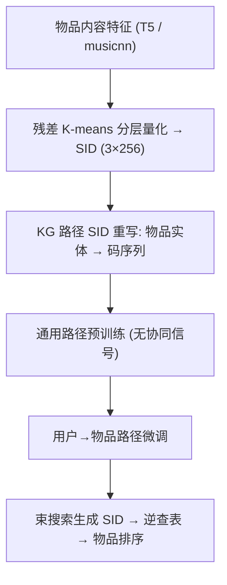
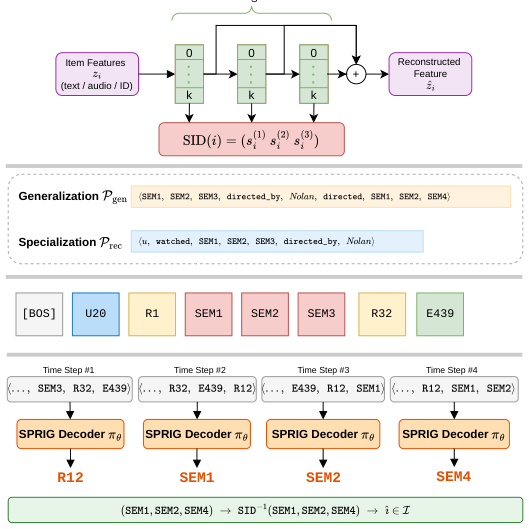

# SPRIG: Semantic-ID-enhanced Paths for Knowledge Graph-based Generative Recommendation (语义 ID 增强路径的知识图谱生成式推荐)

- **会议/期刊**: CIKM 2026 (short paper, 5 页)
- **作者与机构**: Justin Hangöbl, Marta Moscati, Alessandro B. Melchiorre, Shah Nawaz, Markus Schedl (JKU Linz 计算感知研究所 / Criteo AI Lab / Albatross AI)
- **推荐链路定位**: 端到端生成式（路径生成 + 束搜索候选排序）
- **研究方向**: 生成式推荐与离散语义 ID / 图神经网络与知识图谱推荐
- **论文原文**: [https://arxiv.org/abs/2610.06590v1](https://arxiv.org/abs/2610.06590v1)
- **开源代码**: [https://github.com/justinhangoebl/semantic-id-knowledge-graph-recommender](https://github.com/justinhangoebl/semantic-id-knowledge-graph-recommender)

## TL;DR (1分钟核心速览)

知识图谱路径生成式推荐（KGGLM 一系）把物品当作不透明原子 token，词表随目录线性膨胀且无法跨物品共享参数；而 TIGER 一系的语义 ID（SID）虽参数高效却缺乏关系接地。SPRIG 把每个物品实体在 KG 路径中重写为 RQ 分层码序列，用统一词表训练因果 Transformer 先预训练通用路径、再微调用户到物品路径。在 ML-1M / Onion 的逐用户时间序 60/20/20 划分、全库 Full-Ranking 协议下，nDCG@10 相对 KGGLM 分别提升约 44% 与 58%，同时物品词表从 2,984/18,415 压缩到固定 768，Onion 上参数少 19%、FLOPs 近减半。

## Background & Motivation (背景与核心矛盾)

- **主流范式**: 生成式推荐已从打分检索转向自回归生成物品标识；两条增强路线并行——SID 路线（TIGER/GRID）用内容派生的分层离散码替代随机初始化 ID，KG 路线（PGPR/KGGLM）在知识图谱上生成实体-关系路径以提供关系接地。
- **前人局限**: (i) SID 模型只有序列协同信号，缺少结构化关系上下文，无法解释"为何推荐"；(ii) KG 路径模型（KGGLM）仍用 `I123`、`I124` 这类原子 token，语义相近的《盗梦空间》与《星际穿越》在标识空间毫无关联，且物品嵌入表随 $|\mathcal{I}|$ 线性增长，参数无法共享、冷物品无泛化。
- **核心洞察 (Key Insight)**: 两条路线的缺陷恰好互补——SID 缺关系、KG 缺语义。若把 KG 路径中的物品实体原地展开为 SID 序列，则同一套因果解码器可同时学到"关系链规律"与"码本前缀相似性"，且物品相关词表被常数 $L_s\cdot K$ 上界锁定。
- **本文切入点**: 不改解码器、不改 KG，只改**路径的词表表示**——用 SID 重写路径（Eq.1），使词表与目录规模解耦。

## Method (核心方法设计)

### 1. 整体框架 (Overall Architecture)

SPRIG 沿用 KGGLM 的路径语言建模骨架，做三阶段改造：先离线用残差 K-means 将物品内容嵌入（ML-1M 用 T5 文本、Onion 用 musicnn 音频）量化为 $L_s=3$层、$K=256$码的分层 SID；再把 KG 中每次物品出现替换为其 SID 序列，得到统一词表$\mathcal{V}=\mathcal{V}_{sid}\cup\mathcal{V}_{ent}\cup\mathcal{V}_{rel}\cup\mathcal{V}_{special}$；随后用同一个 DistilGPT-2 因果解码器先在**通用路径**（起点为物品/属性、禁用用户-物品边）上预训练学关系结构，再在**用户到物品路径**上微调。推理时给定 `[BOS], u, watched`，模型自回归吐出 SID 序列，经逆查表映射回目录物品，多束路径按对数似然排序。

<figure class="paper-figure" markdown="span">
  <figcaption>图1：SPRIG 框架。物品特征被编码为分层语义 ID；SID 增强的 KG 路径（通用路径用于预训练，用户到物品路径用于微调）被分词后输入因果 Transformer 解码器，自回归地生成路径。第2节以具体的电影示例（《盗梦空间》《星际穿越》）贯穿全部四个阶段。</figcaption>
</figure>

### 2. 关键设计拆解 (Key Designs)

1. **SID 增强的路径重写（SID-augmented Path Rewriting）**：痛点是原子 ID 无法表达物品相似性且词表爆炸。给定原始路径 $p=\langle e_0,r_1,e_1,\dots,r_L,e_L\rangle$，逐位置替换
$\tilde{e}_\ell=\mathrm{SID}(e_\ell)\ \text{if}\ e_\ell\in\mathcal{I},\ \text{else}\ e_\ell$，
使 $\langle u,\text{watched},\text{Inception}\rangle$变为$\langle u,\text{watched},\text{SEM}_1,\text{SEM}_2,\text{SEM}_3\rangle$。直觉：共享前缀即共享参数，《盗梦空间》与《星际穿越》在前两层码上一致，仅末位不同，模型对长尾物品可借前缀邻居"继承"信号；同时$|\mathcal{V}|=L_s\cdot K+|\mathcal{U}|+|\mathcal{A}|+|\mathcal{R}|+|\mathcal{V}_{special}|$，物品项恒为 768。
2. **两阶段同图异分布训练（Generic Pretrain → User-to-Item Finetune）**：痛点是从零学路径语言样本效率低。预训练语料 $\mathcal{P}_{gen}$起点$e_0\in\mathcal{I}\cup\mathcal{A}$、仅走 KG 关系边、终点自由，纯学关系链与"属性实体↔SID 前缀"共现；微调语料$\mathcal{P}_{rec}$起点$e_0=u$、走全图含交互边、终点$e_L=i$。两阶段共用同一负对数似然目标，只是采样分布不同，因此关系知识与推荐目标在同一参数空间内平滑过渡。
3. **训练目标、负采样与推理效率**：总损失为逐 token 的 NLL
$\mathcal{L}(\theta;\mathcal{P})=-\frac{1}{|\mathcal{P}|}\sum_{\tilde{p}\in\mathcal{P}}\sum_{j=1}^{T}\log\pi_\theta(t_j\mid t_{<j})$，
**免负采样**（生成式范式天然规避 BPR/InfoNCE 采样偏差）。推理用 60 beams / 5 组、多样性惩罚 0.4、固定 3 跳、每用户至多 50 条候选路径，同物品取最高分路径。因物品词表被压缩，ML-1M 每步 FLOPs 少 11%，Onion 参数少 19%、FLOPs 近减半。

## Experimental Setup & Evaluation Protocol (实验设置与评估协议)

- **数据集与预处理**: Onion 由 LFM-2B 截取 2018 年 3–5 月交互并做迭代 $k$-core（$k=20$）过滤至用户/曲目集合稳定；ML-1M 采用 RecBole 的 KG 增强版本。

| 数据集 | #Users | #Items | #Interactions | 密度 | 特征/场景说明 |
| :--- | :---: | :---: | :---: | :---: | :--- |
| ML-1M | 6,040 | 2,984 | 932,295 | 0.05 | 电影；13,804 实体(12 类)、193,089 关系(11 类)，物品均度 64.86 |
| Onion | 12,784 | 18,415 | 1,375,341 | 0.01 | 音乐；26,701 实体(6 类)、172,232 关系(6 类)，物品均度 9.35 |

- **数据划分与防穿越 (Splitting Strategy)**: 逐用户**时间序 60/20/20 划分**，所有模型共享同一划分与预处理，严格防未来交互泄漏。
- **排名评测协议 (Ranking Protocol)**: **Full-Ranking 全库排序**，对每用户留出交互在完整目录上评估；生成式模型在束搜索候选路径上排序（非全目录打分），故 SASRec 仅作参考而非严格同协议对比。
- **对比基线与超参设置**: TopPop、SASRec（序列）、OpenP5（seq./coll.，原子 ID 生成式）、TIGER（GRID 变体，SID）、KGGLM（gen-only / gen+spec，直接前身）。骨干统一为 DistilGPT-2（6 层、12 头、$d=768$），SPRIG 仅调低学习率、缩短路径长度；预训练每实体 500 条 5 跳随机游走 × 3 epoch，微调每用户 200 条 3 跳路径；指标 @10，显著性用双侧配对 bootstrap（$p<0.05$）。

## Key Experimental Results (实验关键数据)

### 1. 主实验对比 (Main Results)

| Model | ML-1M nDCG | ML-1M MRR | ML-1M HR | Onion nDCG | Onion MRR | Onion HR |
| :--- | :---: | :---: | :---: | :---: | :---: | :---: |
| TopPop | 0.1086 | 0.1251 | 0.4396 | 0.0195 | 0.0487 | 0.1361 |
| SASRec | 0.1261 | 0.0912 | 0.2416 | **0.1892** | **0.1514** | **0.3072** |
| OpenP5 (seq.) | 0.0243 | 0.0158 | 0.0542 | 0.0029 | 0.0022 | 0.0050 |
| OpenP5 (coll.) | 0.0192 | 0.0130 | 0.0397 | 0.0185 | 0.0121 | 0.0401 |
| TIGER (GRID) | 0.0565 | 0.1324 | 0.2413 | 0.0252 | 0.0182 | 0.0480 |
| KGGLM (gen-only) | 0.0281 | 0.0709 | 0.1930 | 0.0134 | 0.0301 | 0.0770 |
| KGGLM (gen+spec) | 0.0864 | 0.1919 | 0.4407 | 0.0421 | 0.0911 | 0.2223 |
| **SPRIG (gen+spec)** | **0.1241** | **0.2874** | **0.5632** | **0.0669** | **0.1738** | 0.2653 |
| Improv. vs KGGLM | +43.6% | +49.8% | +27.8% | +58.9% | +90.8% | +19.3% |

### 2. 消融实验 (Ablation Study)

| 变体 | 关键结论 | 数值证据 |
| :--- | :--- | :--- |
| w/o 协同微调 (gen-only) | SID 前缀共享已带来增益 | ML-1M nDCG 0.0281→0.0375；Onion 0.0134→0.0140 |
| 量化器 RVQ / RQ-VAE / 残差 K-means | 对量化器不敏感 | 残差 K-means 最优，但领先幅度仅约 1% |
| 物品特征 musicnn vs. MFCC-BoW | 对内容特征质量敏感 | musicnn 在所有量化器下一致更优 |
| 词表/参数预算 | 词表与目录解耦 | 物品词表 2,984/18,415 → 768（约 4×/24× 压缩）；ML-1M 参数 56.1M vs 57.8M、FLOPs −11%；Onion 参数 −19%、FLOPs 近 −50% |

### 3. 关键实验发现 (Key Findings)

1. **增益来自 SID 而非 KG**：SPRIG 与 KGGLM 共享骨干与同一 KG 信号，仅物品表示不同，却在两数据集全部指标上显著更优（$p<0.05$），Onion nDCG 从 0.0421 跃至 0.0669，说明"语义化标识 + 对应解码"是真正的增量来源。
2. **压缩词表不损容量、反而随目录增大收益递增**：ML-1M 上参数几乎持平（56.1M vs 57.8M）却精度更高、FLOPs 少 11%；Onion 目录大 6 倍，参数省 19%、算力近减半，验证了"词表与 $|\mathcal{I}|$ 解耦"的规模化价值。
3. **SID 的参数共享在无协同信号时即生效**：gen-only 阶段 SPRIG 已全面超越 KGGLM gen-only（ML-1M nDCG +33%），说明长尾/稀疏物品可借前缀邻居继承信号；但 SASRec 在 Onion 上仍以 0.1892 nDCG 领先，暴露束搜索候选集（≤50 路径）与全目录打分的协议差异，以及采样路径丢弃了音乐强序列性的问题。

## Highlights & Limitations (亮点、对比与审稿批判)

- **与代表作对比 (vs. Prior Work)**: 相比 TIGER，SPRIG 保留 SID 的参数效率但补上多跳关系接地与可解释路径；相比 KGGLM，仅替换物品 token 表示即获大幅精度提升与词表压缩，改动极小、收益极大；相比 OpenP5 的原子 ID 生成式，SPRIG 在两种目录规模上均碾压（Onion nDCG 0.0669 vs 0.0185）。
- **可迁移亮点**: (i) "把结构化序列中的原子实体原地展开为分层码"这一重写技巧可迁移到会话推荐、Query 重写、多模态 KG 补全；(ii) 同图异分布的两阶段采样（去交互边预训练 / 含交互边微调）是低成本注入关系先验的通用配方。
- **审稿级局限批判**: (i) 生成式模型在 ≤50 条束搜索路径上排序，与 SASRec 的全目录 Full-Ranking 并非同协议，主表对比存在系统性偏置，且束宽/多样性惩罚等解码超参对结果影响未被敏感性分析覆盖；(ii) 路径终点是 SID 码而非具名实体，宣称的"可解释性"实际被削弱，作者亦承认需对齐码层级与属性实体才能恢复理由生成；此外冷启动仅停留在展望，缺少 cold-start 专用划分验证。

## Rating (四维评分)

- **方法创新性 (Novelty)**: ⭐⭐⭐⭐ （首个统一 SID 与 KG 路径推理的框架，思路简洁互补，但本质是表示层替换而非新学习范式）
- **评估协议与实验扎实度 (Protocol & Experiments)**: ⭐⭐⭐ （双域数据集 + 配对 bootstrap 显著性到位，但生成式束搜索与全库排序协议不一致，消融仅以文字叙述、缺独立表格与超参敏感性）
- **写作与数学规范度 (Clarity & Rigor)**: ⭐⭐⭐⭐ （5 页短文公式紧凑、词表规模分析清晰，贯穿电影示例便于理解；复杂度与解码开销仅给 FLOPs 未给延迟）
- **工业落地与复现价值 (Industrial & Practical Value)**: ⭐⭐⭐⭐ （代码开源、词表与目录解耦对大目录工业场景友好、算力近减半，但离线量化管线与束搜索在线延迟仍需实测）

