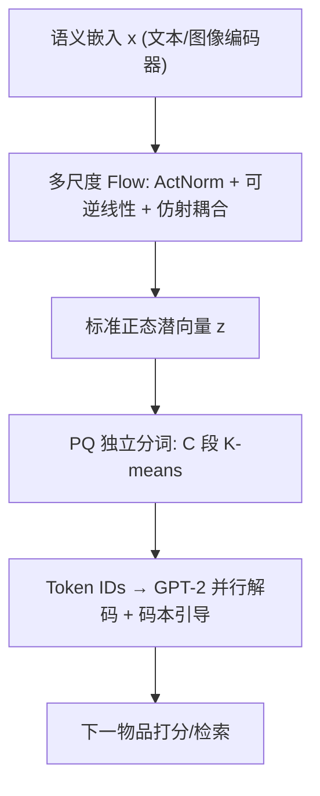
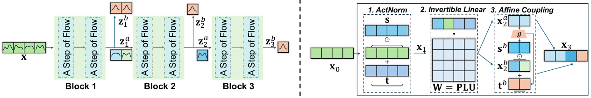

# Tlow: Flow-based Item Tokenizer for Recommendation (基于流的推荐物品分词器)

- **会议/期刊**: CIKM 2026 (Applied Research Track)
- **作者与机构**: Nian Li, Chonggang Song, Jingtao Ding, Lingling Yi, Yong Li, Qingmin Liao（清华大学、腾讯）
- **推荐链路定位**: 召回（语义ID生成 + 生成式检索）
- **研究方向**: 生成式推荐与离散语义ID / 冷启动与长尾推荐
- **论文原文**: [https://arxiv.org/abs/2608.24176v1](https://arxiv.org/abs/2608.24176v1)
- **开源代码**: [https://github.com/wjjln/Tlow](https://github.com/wjjln/Tlow)

## TL;DR (1分钟核心速览)

语义ID分词是替代随机物品ID、解决参数膨胀与冷启动的关键，但主流 RQ-VAE 因码本层级依赖导致解码必须串行，而 PQ/OPQ 类独立分词器又受制于语义嵌入的**维度相关性与各向异性分布**，量化误差大。本文提出 Tlow：用多尺度可逆流模型把语义嵌入变换为标准正态潜空间，使维度独立且分布简单，再对潜向量做 PQ 独立分词，并引入码本引导损失对齐 token 嵌入空间与码本空间。在 4 个 Amazon 数据集 Full-Ranking 协议下 R@10 最高相对提升 11.45%，微信线上新物品 CTR 提升 11.64%。

## Background & Motivation (背景与核心矛盾)

- **主流范式**: TIGER 用 RQ-VAE 对语义嵌入做残差层级量化生成语义ID，序列模型自回归解码下一物品的 token 序列；RPG/VQ-Rec 则用 PQ/OPQ 做独立分词以换取并行解码。
- **前人局限一（RQ-VAE 解码低效）**: 码本间存在强层级依赖，解码步数必须等于码本数，且码本坍缩/冲突问题使工业落地依赖大量调参经验。
- **前人局限二（PQ 类量化失配）**: 独立分词隐含"维度独立"假设，但语义嵌入维度高度相关；OPQ 的正交变换只能解到子空间级，子空间内维度仍相关。同时嵌入呈强各向异性、占据非均匀锥体，跨域/多模态下更形成分离簇，网格状码本拟合极差。
- **核心洞察 (Key Insight)**: 若能把任意语义嵌入**可逆地**映射到一个维度独立、分布统一（标准正态）的潜空间，则 PQ 的假设被真正满足，量化误差与语义混淆同时下降。图 1 显示同一首位 token 下，OPQ 混入 Metal/Jazz/Blues 等 225 个类目（熵 4.11），Tlow 仅 97 个类目（熵 2.71），语义纯度显著更高。
- **本文切入点**: 用 normalizing flow 做"分布整形"，把分词问题从"设计更好的量化器"转为"设计更好的被量化空间"。

## Method (核心方法设计)

### 1. 整体框架 (Overall Architecture)

Tlow 由两部分串联：**流变换器**与**PQ 分词器**。输入为预训练文本/图像编码器（sentence-t5-base，$d_s=768$）产出的语义嵌入$\mathbf{x}$；流变换器采用多尺度（multi-scale）架构，含$N$个 block、每 block$M$步 flow，每步由 ActNorm、可逆线性层、仿射耦合层组成，逐 block 切分出部分维度输出$\mathbf{z}_n^b$，最终拼接得潜向量$\mathbf{z}\in\mathbb{R}^{d_s}$，服从标准正态。随后对$\mathbf{z}$切$C$段做 K-means 得$C$个 token ID。下游用 2 层 GPT-2 序列模型，以$C$个并行解码头预测下一物品的$C$ 个 token，并以码本引导损失约束 token 嵌入空间。

<figure class="paper-figure" markdown="span">
  <figcaption>图 2：Tlow 架构示意图，其中 𝑁= 3 个块、𝑀= 2 条流，语义嵌入维度为 𝑑𝑠= 4（左）。“流的一步”处理维度为 𝑑= 4 的嵌入的示例（右）。</figcaption>
</figure>

### 2. 关键设计拆解 (Key Designs)

1. **多尺度可逆流变换（把嵌入"整形"成正态）**：痛点在于原始嵌入维度相关且分布偏斜，PQ 的网格码本无法贴合。Tlow 以精确对数似然训练，$\log p_\theta(\mathbf{x})=\log p_\theta(\mathbf{z})+\log|\det(\mathrm{d}\mathbf{z}/\mathrm{d}\mathbf{x})|$，其中第$n$个 block 只对切出的后半维$\mathbf{z}_n^b$建模高斯似然，均值方差由前半维经 MLP 预测：$[\boldsymbol{\mu}_n,\boldsymbol{\sigma}_n^2]=h(\mathbf{z}_n^a)$。可逆性保证语义信息无损（消融中 Random$\mathbf{z}$ 性能崩塌即反证），多尺度切分则让不同维度段承担不同"语义粒度"，天然匹配后续分段量化。

2. **PQ 独立分词 + 并行解码**：对 $\mathbf{z}$切为$[\mathbf{z}_1,\dots,\mathbf{z}_C]$，第$k$段取$c_k=\arg\min_{j}\|\mathbf{z}_k-\mathbf{c}_k^j\|_2$。因潜空间维度独立，各段可**同一次前向内并行解码**，解码步数为 1 而非$C$，直接消除 RQ-VAE 的串行瓶颈。物品嵌入由各段 token 嵌入均值聚合：$\mathbf{e}=\frac{1}{C}\sum_{k=1}^{C}\mathbf{E}_{k,c_k}$。

3. **码本引导（Codebook Guidance）**：已有工作（ETEGRec 等）做逐物品/逐序列的独立对齐，本文改为**对齐两个相似度矩阵张成的空间**：$\Phi_{k,i,j}=\cos(\mathbf{E}_{k,i},\mathbf{E}_{k,j})$，$\Psi_{k,i,j}=\cos(\mathbf{C}_{k,i},\mathbf{C}_{k,j})$，损失$\mathcal{L}_{sim}=\mathrm{MSE}(|\Phi-\Psi|)$。直觉是码本是语义原子信息的载体，让 token 嵌入的**相对几何结构**而非绝对坐标去模仿码本，能获得更可分的语义。总损失$\mathcal{L}=\mathcal{L}_{rec}+\lambda\mathcal{L}_{sim}$，$\mathcal{L}_{rec}$为$C$个 token 的并行 softmax 交叉熵（温度$\tau\in\{0.03,0.05,0.07\}$），**无需负采样**（全词表 softmax，词表仅$C\times S$）。

## Experimental Setup & Evaluation Protocol (实验设置与评估协议)

- **数据集与预处理**: Amazon Reviews 四个类目 + 跨域 Cloth-Sports；按时间排序构造序列，未额外做 k-core 过滤（沿用 TIGER/RPG 处理）。

| 数据集 | #Users | #Items | #Interactions | 平均序列长 | 场景说明 |
| :--- | :---: | :---: | :---: | :---: | :--- |
| Sports | 35,598 | 18,357 | 260,739 | 8.32 | 通用单域 |
| Beauty | 22,363 | 12,101 | 176,139 | 8.87 | 通用单域 |
| Toys | 19,412 | 11,924 | 148,185 | 8.63 | 通用单域 |
| CDs | 75,258 | 64,443 | 1,022,334 | 14.58 | 最大规模，用于冷启动分桶 |
| Cloth-Sports | 9,933+4,263 | 3,278+1,021 | 97,741+11,879 | 10.71 | 跨域，用户高度重叠 |

- **数据划分与防穿越**: `Leave-One-Out`——序列最后一项测试、倒数第二项验证。
- **排名评测协议**: 无偏 `Full-Ranking`（全库未交互物品排序），指标 Recall@{5,10}、NDCG@{5,10}，显著性用 paired t-test（$p<0.01$）。
- **对比基线与超参**: ID 类（Caser/GRU4Rec/HGN/BERT4Rec/SASRec/FDSA/S3-Rec）与分词类（RecJPQ/VQ-Rec/TIGER/ETEGRec/HSTU/RPG）；统一 $d_s=768$，$N=4,M=4$，$C\in\{16,32,64,96,128\}$，$S=256$，$d_m=448$。

## Key Experimental Results (实验关键数据)

### 1. 主实验对比 (Main Results)

| Model | Sports R@10 | Sports N@10 | Beauty R@10 | Beauty N@10 | Toys R@10 | Toys N@10 | CDs R@10 | CDs N@10 |
| :--- | :---: | :---: | :---: | :---: | :---: | :---: | :---: | :---: |
| SASRec (ID) | 0.0350 | 0.0192 | 0.0605 | 0.0318 | 0.0675 | 0.0374 | 0.0619 | 0.0263 |
| S3-Rec (ID) | 0.0385 | 0.0204 | 0.0647 | 0.0327 | 0.0700 | 0.0376 | 0.0375 | 0.0182 |
| VQ-Rec | 0.0300 | 0.0173 | 0.0664 | 0.0383 | 0.0737 | 0.0423 | 0.0520 | 0.0292 |
| TIGER (RQ-VAE) | 0.0400 | 0.0225 | 0.0648 | 0.0384 | 0.0712 | 0.0432 | 0.0748 | 0.0411 |
| HSTU | 0.0414 | 0.0215 | 0.0704 | 0.0389 | 0.0669 | 0.0357 | 0.0638 | 0.0346 |
| RPG (OPQ) | 0.0428 | 0.0246 | 0.0753 | 0.0437 | 0.0765 | 0.0440 | 0.0693 | 0.0395 |
| **Tlow** | **0.0477** | **0.0261** | **0.0786** | **0.0454** | **0.0864** | **0.0482** | **0.0801** | **0.0446** |
| Improv.% | +11.45 | +6.10 | +4.38 | +3.89 | +9.80 | +11.36 | +7.09 | +8.52 |

跨域（Cloth-Sports）与多模态（Sports + CLIP 图像）补充结果：跨域 Overall R@10 由 LLM4CDSR 的 0.4620、RPG 的 0.4766 提升至 **0.5558**；多模态 R@10 由 HM4SR 的 0.0469 提升至 **0.0521**（RPG 仅 0.0501）。

### 2. 消融实验 (Ablation Study)

| 变体 | Sports R@10 | Beauty R@10 | Toys R@10 | CDs R@10 | CDs N@10 |
| :--- | :---: | :---: | :---: | :---: | :---: |
| Tlow 完整 | **0.0477** | **0.0786** | **0.0864** | **0.0801** | **0.0446** |
| w/o $\mathcal{L}_{sim}$ | 0.0449 | 0.0764 | 0.0826 | 0.0756 | 0.0425 |
| Random $\mathbf{z}$ | 0.0202 | 0.0623 | 0.0571 | 0.0147 | 0.0074 |

### 3. 关键实验发现 (Key Findings)

1. **流变换是性能主引擎，码本引导是稳定增益**：去掉 $\mathcal{L}_{sim}$在 CDs 上 R@10 掉 5.6%（0.0801→0.0756），而把$\mathbf{z}$ 换成纯随机采样则崩塌至 0.0147（掉 81.6%），说明"可逆变换保留语义"是必要条件，码本引导只是锦上添花。
2. **同编码器下 RPG 并不稳定优于 TIGER**（Beauty R@10 0.0753 vs 0.0648 但 CDs 0.0693 vs 0.0748），而 Tlow 在四个数据集全部领先，证明瓶颈不在"独立分词"本身，而在**被量化空间的分布质量**——这是本文最有力的归因。
3. **冷启动与长尾收益最显著**：图 3 显示 Tlow 在全部用户交互深度分桶与物品流行度分桶上均优于 RPG；线上新物品 CTR 提升 11.64%（单域）高于整体 10.32%，且跨域场景头部账号曝光份额下降 1.15%，说明收益主要来自长尾扶持而非头部强化。

## Highlights & Limitations (亮点、对比与审稿批判)

- **与代表作对比 (vs. Prior Work)**: 与 TIGER 的本质区别是**放弃层级残差量化换取并行解码**，同时用流模型补回量化精度；与 RPG/OPQ 的区别是 OPQ 只做线性正交去相关，Tlow 做**非线性分布整形**，把"维度独立"从近似假设变为可训练目标；与 ETEGRec 的区别是对齐粒度从逐物品提升到**空间级相似度结构对齐**。
- **可迁移亮点**: (1) "先整形分布、再量化"的范式可直接迁移到向量检索的 ANN 量化（如 IVF-PQ 的预处理）；(2) 相似度矩阵级 MSE 对齐（$\Phi$vs$\Psi$）比逐样本对齐更抗噪，可用于任何"离散码本 + 连续嵌入"的联合训练场景。
- **审稿级局限批判**: (1) 论文明确**未做延迟/吞吐基准测试**，仅以"与 RPG 同为单步并行解码"论证效率，缺乏与 TIGER 的实测对比，削弱了核心动机的实证支撑；(2) 多模态场景增益偏弱（R@10 仅 +0.0052，N@5 甚至与 HM4SR 持平 0.0233），作者自承"单域多模态下边际有限"，且跨域实验中 Sports 子域 R@10 反而低于 LLM4CDSR（0.5312 vs 0.5507），说明分布变换并非在所有子分布上一致有效。

## Rating (四维评分)

- **方法创新性 (Novelty)**: ⭐⭐⭐⭐ （把 normalizing flow 引入语义ID分词，视角从"改量化器"转向"改被量化空间"，思路干净且有图 1 的语义纯度实证支撑）
- **评估协议与实验扎实度 (Protocol & Experiments)**: ⭐⭐⭐⭐ （四数据集 Full-Ranking + 跨域/多模态/冷启动分桶 + 微信线上 A/B 全链路验证，但缺解码效率实测与方差/多次运行报告）
- **写作与数学规范度 (Clarity & Rigor)**: ⭐⭐⭐⭐ （flow 各层 log-det 推导完整、并行解码的独立性论证清晰，但多尺度切分维度与 $C$ 的对应关系表述略含糊）
- **工业落地与复现价值 (Industrial & Practical Value)**: ⭐⭐⭐⭐⭐ （代码开源；token 嵌入仅 $C\times S=4096$ 对比数千万物品嵌入，单卡数分钟可分词千万级新物品，微信线上已验证，落地价值极高）

