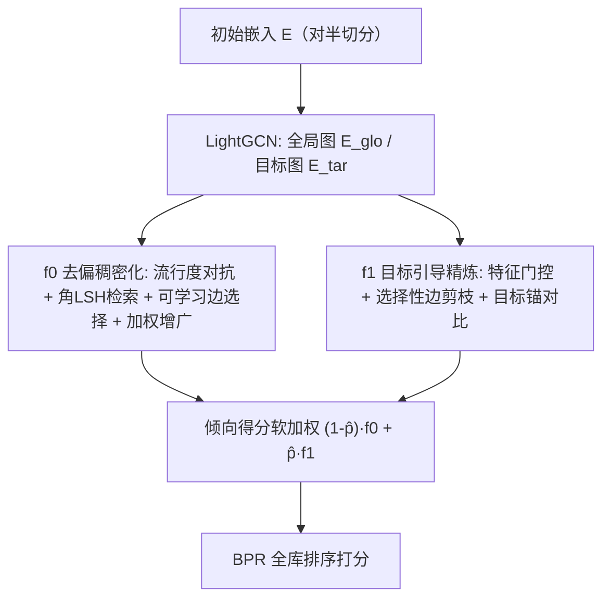
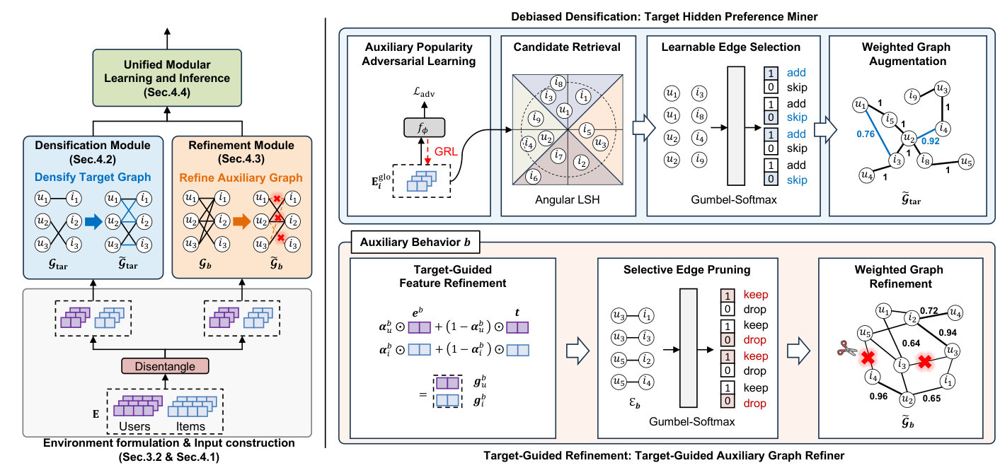

# Beyond Observed Auxiliary Relations: Environment-Conditioned Modeling for Multi-Behavior Recommendation (超越已观测辅助关系：面向多行为推荐的环境条件建模)

- **会议/期刊**: CIKM 2026
- **作者与机构**: Seunghan Lee, Susik Yoon, SeongKu Kang (Korea University); Hyunsik Yoo (UIUC); Jian Kang (MBZUAI)
- **推荐链路定位**: 召回（图表示学习 + 全库排序）
- **研究方向**: 图神经网络与知识图谱推荐 / 去偏公平与可信推荐
- **论文原文**: [https://arxiv.org/abs/2608.22920v1](https://arxiv.org/abs/2608.22920v1)
- **开源代码**: [https://github.com/LSH0411/BOAR](https://github.com/LSH0411/BOAR)

## TL;DR (1分钟核心速览)

多行为推荐 (MBR) 中辅助行为（点击/加购）存在两大固有缺陷：**缺失性**（大量真实购买物品无任何辅助行为观测，Tmall 训练集占 16.1%、测试集 16.38%）与**不可靠性**（辅助行为含大量与购买意图错位的噪声）。现有 GNN 方法（MEMBER 只处理缺失、HGIB/MuLe 只处理噪声）无法兼顾。本文提出 BOAR，以「辅助行为可观测性」为环境变量，将目标偏好按全期望公式分解为 $f_0$（去偏稠密化，挖掘隐藏偏好）与 $f_1$（目标引导剪枝，过滤噪声）两模块，并用倾向得分软加权融合。在 Tmall/Taobao/JData 的 Leave-One-Out 全库排序下，整体 HR@10 最高提升 7.82%，**无辅助观测目标物品上最高提升 44.2%**。

## Background & Motivation (背景与核心矛盾)

- **主流范式**: 将各行为建模为独立关系图，用 GNN 并行编码后聚合（MB-HGCN、CIGF、MEMBER、HGIB），辅以自监督/多任务学习增强目标行为（购买）预测。
- **前人局限 1（C1 缺失性）**: 辅助行为缺失**非随机**——受平台曝光策略与物品流行度驱动。GNN 在偏斜关系上传播会过度表征高频曝光物品；MEMBER 虽用自监督降低对辅助交互的依赖，但仍只依赖已观测辅助信号，无法显式发现「无辅助证据的隐藏目标物品」。
- **前人局限 2（C2 不可靠性）**: 点击可能源于误触或闲逛。MuLe 用注意力调节消息传递、HGIB 用信息瓶颈剪枝，但调控信号仅由辅助行为相似度弱引导，缺乏目标行为直接监督，过滤效果有限。
- **核心洞察 (Key Insight)**: 图 2 显示 Tmall 上目标交互中「有辅助观测 (Obs)」比「无辅助观测 (Unobs)」多出 80.7%，而 SOTA 方法在 Unobs 组上 HR@10 暴跌 79.2%–90.7%。说明**单一模型在极度不平衡数据下无法同时产出适配两种情形的重连信号**，必须按环境分流建模。
- **本文切入点**: 用全期望公式把目标偏好按辅助可观测性 $E_{ui}\in\{0,1\}$ 分解，两个轻量模块各司其职，再以倾向得分软加权融合——把「图重连」从无差别相似度操作改造为**环境条件化的互补重连**。

## Method (核心方法设计)

### 1. 整体框架 (Overall Architecture)

输入为用户/物品初始嵌入，经 LightGCN 在全局图 $\mathcal{G}_{glo}$（全部行为并集）与目标图 $\mathcal{G}_{tar}$ 上分别编码得 $\mathbf{E}_{glo}$、$\mathbf{E}_{tar}$；为不增参数，初始嵌入对半切分、两半分别过两个编码器。随后按环境分流：$f_0$ 在 $\mathbf{E}_{glo}$ 上做流行度对抗去偏 → 角 LSH 检索候选 → 可学习边选择 → 加权增广目标图，再以对比学习对齐原图/增广图嵌入；$f_1$ 对每个辅助行为图做目标锚定的特征门控与 Gumbel-Softmax 边剪枝，再以目标嵌入为固定锚做对比对齐，最后注意力聚合各行为嵌入。训练与推理均以倾向得分 $\hat p_{ui}$ 软加权两模块输出。

<figure class="paper-figure" markdown="span">
  <figcaption>图3：（左）BOAR 框架概览。（右）各模块中稠密化信号与精炼信号的构建，随后通过自监督对比学习引入。建议以彩色查看。</figcaption>
</figure>

### 2. 关键设计拆解 (Key Designs)

1. **环境条件分解与倾向软分配**：痛点是不平衡数据下单一模型偏向 Obs 组。作者按全期望公式 $\mathbb{E}[R_{ui}|u,i]=\sum_{e\in\{0,1\}}P(E_{ui}=e|u,i)\,\mathbb{E}[R_{ui}|u,i,E_{ui}=e]$ 分解，并以倾向估计 $\hat p_{ui}=\hat P(E_{ui}=1|u,i)$（轻量双线性分类器 + BCE 训练，1:1 负采样）作为软权重：$\mathcal{L}_{BOAR}=\mathbb{E}_{(u,i)}[(1-\hat p_{ui})\mathcal{L}_{f_0}+\hat p_{ui}\mathcal{L}_{f_1}]$。直觉：软分配让每个样本同时借用两模块的互补信号；消融显示硬 0-1 分配与可学习门控均显著劣化（后者在 Tmall Unobs 上从 0.1367 崩至 0.0609），因缺乏原理性依据导致训练不稳。

2. **去偏稠密化模块 $f_0$（对抗 + IPS 双重去偏）**：痛点是无辅助证据的物品永远进不了候选。三步：① 以物品辅助交互数是否超中位数为代理标签 $y_i$，经梯度反转层训练判别器，$\mathcal{L}_{adv}=\mathbb{E}[-\!y_i\log\hat y_i-(1-y_i)\log(1-\hat y_i)]$，压制嵌入中的流行度信息；② 角 LSH（单随机投影 + argmax，GPU 矩阵乘可算，碰撞概率单调于角度相似度而非 L2）检索 top-$n$ 候选，避免全对相似度计算；③ 线性层 + Gumbel-Softmax 输出 add/skip 掩码，按 $w_{ui}=\frac12(1+\cos)\cdot\exp(-\frac{1}{2\sigma^2}\|e_u-e_i\|^2)$ 加权增广目标图。排序损失用 SNIPS 重加权：$\mathcal{L}_{rank}=-\sum_{(u,i)}\sum_j \omega_{ui}\log\sigma(s_{ui}-s_{uj})$，$\omega_{ui}\propto 1/\hat p_{ui}$ 并自归一化降方差。增广图不直接当监督，而以 InfoNCE 对齐 $\mathbf{E}_{tar}$ 与 $\tilde{\mathbf{E}}_{tar}$，只保留双视图一致信号。

3. **目标引导精炼模块 $f_1$ 与训练目标**：痛点是以辅助相似度为导向的剪枝会误删有用边。先做特征级门控 $\mathbf{g}^b_x=\boldsymbol\alpha^b_x\odot\mathbf{e}^b_x+(1-\boldsymbol\alpha^b_x)\odot\mathbf{t}_x$（$\mathbf{t}_x=\text{detach}(\mathbf{e}^{tar}_x)$ 为固定锚，防止辅助噪声污染目标空间），再对每条辅助边用 Gumbel-Softmax 预测 keep/drop 并加权重建 $\tilde{\mathbf{A}}_b$；以目标锚做对比对齐 $\mathcal{L}_{refine}$，最后注意力聚合 $\mathbf{e}^{agg}_u=\sum_b\alpha^b_u\mathbf{e}^b_u$ 上算 BPR。总损失 $\mathcal{L}_{f_0}=\mathcal{L}_{rank}+\lambda_{adv}\mathcal{L}_{adv}+\lambda_{dense}\mathcal{L}_{dense}$，$\mathcal{L}_{f_1}=\mathcal{L}_{rank}+\lambda_{refine}\mathcal{L}_{refine}$；负采样为标准 BPR 未交互采样，稠密化仅在训练期执行，推理零额外开销。

## Experimental Setup & Evaluation Protocol (实验设置与评估协议)

- **数据集与预处理**: 三套公开 MBR 基准，目标行为均为 buy。

| 数据集 | #Users | #Items | #Interactions (Click/Collect/Cart/Buy) | 隐藏目标物品占比 | 场景说明 |
| :--- | :---: | :---: | :---: | :---: | :--- |
| Tmall | 41,738 | 11,953 | 1,813,498 / 221,514 / 1,996 / 255,586 | 16.38% | 阿里，四行为 |
| Taobao | 48,749 | 39,493 | 1,548,162 / – / 193,747 / 211,022 | 35.78% | 淘宝，三行为 |
| JData | 93,334 | 24,624 | 1,681,430 / 45,613 / 49,891 / 321,883 | 18.55% | 京东，四行为 |

- **数据划分与防穿越**: 沿用 `Leave-One-Out`——每用户最近一次交互为测试、次近一次为验证，其余训练。
- **排名评测协议**: 无偏 `Full-Ranking`（测试正样本 + 全部未交互物品排序），指标 HR@10 / NDCG@10，5 次随机种子取均值。额外按测试样本是否含辅助交互切分为 **General / Observed / Unobserved** 三档报告，Unobserved 即隐藏目标物品子集。
- **对比基线与超参**: 13 个基线（MF-BPR、LightGCN、LGCN-G、MB-GMN、CIGF、CRGCN、BCIPM、MB-HGCN、COPF、MuLe、HGIB、MEMBER、SHaRe），其中 SHaRe 为最直接的重连基线。统一 $d=64$（BOAR 每模块 32 维）、batch 1024、GNN 2 层、LSH 投影维 32、Gumbel 温度 0.2、$\lambda_{adv}=0.01$；$p<0.05$ t 检验标显著性。

## Key Experimental Results (实验关键数据)

### 1. 主实验对比 (Main Results)

| 数据集 | 设置 | 指标 | MEMBER | HGIB | SHaRe | **BOAR** | Improv.% |
| :--- | :--- | :--- | :---: | :---: | :---: | :---: | :---: |
| Tmall | General | HR@10 | 0.3507 | 0.2415 | 0.2158 | **0.3739** | +6.61% |
| Tmall | General | NDCG@10 | 0.1730 | 0.1274 | 0.1133 | **0.1821** | +5.26% |
| Tmall | Unobserved | HR@10 | 0.0948 | 0.0420 | 0.0727 | **0.1367** | +44.2% |
| Tmall | Observed | HR@10 | 0.4554 | 0.4527 | 0.4438 | **0.4587** | +0.72% |
| Taobao | General | HR@10 | 0.3183 | 0.2480 | 0.1842 | **0.3432** | +7.82% |
| Taobao | Unobserved | HR@10 | 0.0221 | 0.0252 | 0.0246 | **0.0352** | +39.7% |
| Taobao | Observed | HR@10 | 0.5279 | **0.5797** | 0.5435 | 0.5697 | −1.72% |
| JData | General | HR@10 | 0.6589 | 0.6502 | 0.6378 | **0.6971** | +5.80% |
| JData | General | NDCG@10 | 0.4332 | 0.4667 | 0.4584 | **0.4937** | +5.79% |
| JData | Unobserved | HR@10 | 0.3947 | 0.4566 | 0.4641 | **0.5438** | +17.2% |
| JData | Observed | HR@10 | 0.7383 | **0.7826** | 0.7663 | 0.7757 | −0.88% |

### 2. 消融实验 (Ablation Study)

| 变体 | Tmall-Unobs | Taobao-Unobs | JData-Unobs | Tmall-Obs | Taobao-Obs | JData-Obs |
| :--- | :---: | :---: | :---: | :---: | :---: | :---: |
| **BOAR** | **0.1367** | **0.0352** | **0.5438** | **0.4587** | **0.5697** | **0.7757** |
| w/o $\mathcal{L}_{dense}$ | 0.1081 | 0.0307 | 0.4768 | 0.4566 | 0.5607 | 0.7740 |
| w/o $\mathcal{L}_{adv}$ | 0.1328 | 0.0335 | 0.5320 | 0.4549 | 0.5592 | 0.7753 |
| w/o SNIPS | 0.1214 | 0.0338 | 0.5352 | 0.4565 | 0.5645 | 0.7730 |
| w/o TAGR | 0.1321 | 0.0342 | 0.5391 | 0.4497 | 0.5623 | 0.7691 |
| w/o $\mathcal{L}_{refine}$ | 0.1329 | 0.0344 | 0.5256 | 0.4445 | 0.5445 | 0.7636 |
| w/o Stop-gradient | 0.1290 | 0.0334 | 0.5345 | 0.4395 | 0.5426 | 0.7587 |
| Hard assignment | 0.1315 | 0.0295 | 0.5408 | 0.4559 | 0.5607 | 0.7738 |
| Learnable assignment | 0.0609 | 0.0202 | 0.4698 | 0.4360 | 0.5411 | 0.7689 |

### 3. 关键实验发现 (Key Findings)

1. **增益几乎全部来自隐藏目标物品**：Tmall Unobserved 上 BOAR 0.1367 vs. 次优 MEMBER 0.0948（+44.2%），而 Observed 档仅 +0.72%；Taobao/JData 的 Observed 档甚至略逊于 HGIB（−1.72%/−0.88%）。这印证了「容量分配权衡」——BOAR 把参数预算摊给两个环境，牺牲少量已观测物品精度换取隐藏偏好发现能力，最终 General 档仍全面最优。
2. **去偏是稠密化的必要条件，且表征级与预测级缺一不可**：去掉 $\mathcal{L}_{dense}$ 使 Tmall-Unobs 从 0.1367 掉到 0.1081（−20.9%），是 $f_0$ 内最大跌幅；单独去掉 $\mathcal{L}_{adv}$ 或 SNIPS 分别降至 0.1328 / 0.1214，说明 GRL 保证 LSH 检索出的是偏好对齐而非流行度相似的候选，IPS 则修正排序目标对高频曝光物品的偏置，二者互补（对应 Corollary A.3）。
3. **目标锚定与软分配是 $f_1$ 与融合的关键**：去掉 stop-gradient 使 Taobao-Obs 从 0.5697 跌至 0.5426（−4.8%），验证固定目标锚可防止辅助噪声反向污染目标空间；可学习门控分配在 Tmall-Unobs 上崩至 0.0609（−55.5%），远差于硬分配（0.1315），说明基于倾向的分配比无约束学习门更稳定。此外压力测试（图 4/图 5）显示随隐藏比例 $k$ 与注入噪声比例 $k$ 增大，BOAR 的性能衰减曲线最平缓。

## Highlights, Limitations & Rating (亮点、对比与审稿评价)

- **与代表作对比**: vs. **MEMBER**（混合专家 + 自监督处理 C1）：MEMBER 仍只在已观测辅助信号内做重加权，BOAR 则显式生成新的目标边以覆盖无辅助证据物品；vs. **HGIB**（信息瓶颈剪枝处理 C2）：HGIB 的剪枝信号仅由辅助相似度弱引导，BOAR 以目标嵌入为固定锚直接监督剪枝；vs. **SHaRe**（相似度重连，同时做剪枝与稠密化）：SHaRe 在三个数据集 General 档全面落后（Tmall 0.2158 vs. 0.3739），实证了「无差别相似度重连会放大 MBR 固有缺陷」这一核心论点。
- **可迁移亮点**: ① 用「可观测性倾向」作为软路由权重替代学习门控，可迁移到任何存在非随机缺失的多源/多场景融合；② 角 LSH + Gumbel-Softmax 可学习边选择，为大规模图重连提供了免全对相似度计算的工程范式。
- **审稿级局限批判**: ① 稠密化仅在训练期执行、推理用原图，意味着**新物品上线后无法即时获得增广边**，与「发现隐藏偏好」的初衷存在推理-训练不一致；② 倾向估计器本身用辅助图 LightGCN 嵌入训练，其准确性直接决定软分配质量，论文未给出倾向估计误差的敏感性分析；③ 三数据集均为电商购买场景，隐藏比例 16%–36%，对隐藏比例更高（如内容社区）的场景泛化性未知。
- **四维评分**: 创新性 ⭐⭐⭐⭐ | 实验扎实度 ⭐⭐⭐⭐⭐ | 方法清晰度 ⭐⭐⭐⭐ | 落地价值 ⭐⭐⭐⭐

