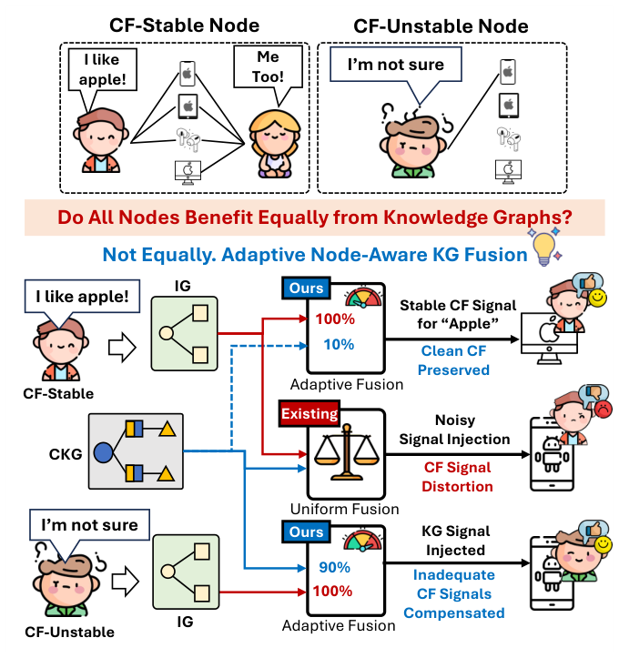
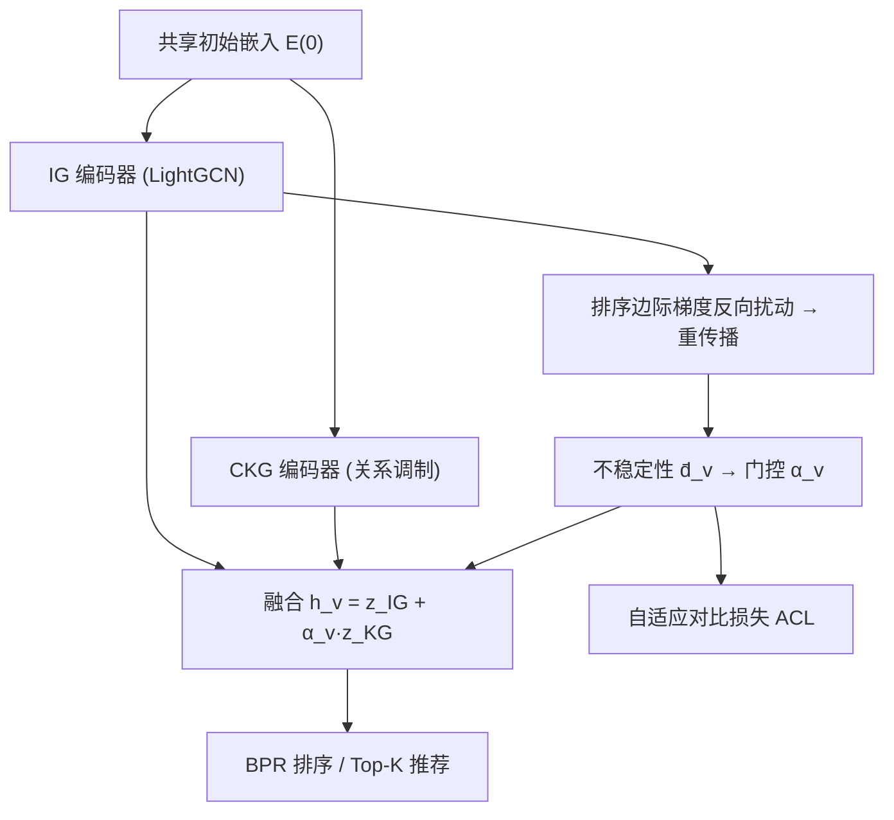

# Do All Nodes Benefit Equally from Knowledge Graphs? Adaptive Node-Aware KG Fusion for Recommendation (所有节点都同等受益于知识图谱吗？面向推荐的自适应节点感知 KG 融合)

- **会议/期刊**: CIKM 2026
- **作者与机构**: Jaehyun Park, Minseo Jeon, Daewon Gwak, Sunuk Kim, Hanvit Lee, Jinhong Jung (崇实大学 Soongsil University)
- **推荐链路定位**: 召回 (Top-K 排序)
- **研究方向**: 图神经网络与知识图谱推荐 / 自监督对比学习与交互去噪
- **论文原文**: [https://arxiv.org/abs/2609.05909v1](https://arxiv.org/abs/2609.05909v1)
- **开源代码**: [https://github.com/ssu-dmlab/AdaKG](https://github.com/ssu-dmlab/AdaKG)

## TL;DR (1分钟核心速览)

现有 KG 感知推荐把物品侧知识**无差别**注入所有节点，对 CF 信号本已可靠的节点反而造成干扰。AdaKG 用双视图编码器解耦 IG 与 CKG，以「排序感知对抗扰动下 IG 表征的漂移量」量化每个节点的 CF 不稳定性，再经单调门控 $\alpha_v$ 控制 KG 注入强度，并用 $\alpha_v$ 加权的自适应对比损失对齐两视图。在 4 个数据集、Recall@10/MRR@10 上取得平均排名 1.25/1.00，Amazon-Book Recall@10 相对最强基线 LightKG 提升 5.6%。

## Background & Motivation (背景与核心矛盾)

- **主流范式**: 一类工作（KGAT/KGIN）把 IG 与 KG 拼成协同知识图谱 CKG 后统一做 GNN 消息传递；另一类（KGCL/MCCLK/KGRec/LightKG）保持两图分离，用对比学习或图重构做对齐与去噪。
- **前人局限 1（信号混淆）**: 统一图传播或仅取单侧最终表征，使物品语义信号与协同信号在传播中互相污染，稠密数据集上多个 KG 方法甚至打不过纯 IG 的 LightGCN（如 MovieLens-1M 上 KGAT 0.1830 < LightGCN 0.1855）。
- **前人局限 2（判据错位）**: 现有方法默认「低度数/长尾节点才需要 KG」，但度数无法刻画交互的**一致性**——高度数但兴趣发散的节点同样 CF 不稳；且注入强度是全局超参，缺乏节点级控制。
- **核心洞察 (Key Insight)**: 若一个节点的 CF 表征在**削弱其排序边际的微小扰动**下几乎不动，说明其协同证据自洽充分；反之则说明该节点需要外部知识补位。即「不稳定性」可由表征对扰动的敏感度直接测出。
- **本文切入点**: 把 KG 注入强度从全局超参改造为节点级可学习门控，其输入特征由对抗扰动实验在线估计，无需额外标注。

<figure class="paper-figure" markdown="span">
  <figcaption>图1：AdaKG的动机。知识图谱中的物品侧知识并非对所有推荐节点同等有益。当节点具有可靠的协同过滤信号时，仅交互图即可提供充分的推荐证据，过度的知识图谱注入甚至可能干扰此类信号。相反，当节点的协同过滤信号不稳定时，知识图谱信息可作为补充证据，以弥补协同信号的不足。受此启发，AdaKG将交互图与知识图谱的角色分离，并为每个节点自适应地控制知识图谱注入强度。</figcaption>
</figure>

## Method (核心方法设计)

### 1. 整体框架 (Overall Architecture)

模型共享初始嵌入 $\mathbf{E}^{(0)}$，分别送入 IG 编码器（LightGCN，仅聚合 $l\ge1$ 层）与 CKG 编码器（关系调制聚合 + 用户侧聚合，聚合 $l\ge0$ 层并逐层 L2 归一化），得到 $\mathbf{Z}^{IG}$ 与 $\mathbf{Z}^{KG}$。训练时每个 mini-batch 额外做一次「排序边际梯度反向扰动 → 重传播」，用原始与扰动后 IG 表征的距离得到节点不稳定性 $\bar d_v$，经门控得 $\alpha_v$，按 $\mathbf{h}_v=\mathbf{z}^{IG}_v+\alpha_v\mathbf{z}^{KG}_v$ 融合，并以 $\mathrm{sg}(\alpha_v)$ 加权对比损失对齐两视图。推理阶段直接复用末轮缓存的 $\alpha_v$，无额外开销。

### 2. 关键设计拆解 (Key Designs)

1. **排序感知对抗扰动的不稳定性估计（IE）**：痛点是用度数当代理判据失真。做法是对 batch 内成对排序边际 $\mathcal{M}_{margin}(\mathcal{B})=\frac{1}{|\mathcal{B}|}\sum_{(u,i,j)}(s^{IG}_{u,i}-s^{IG}_{u,j})$ 求初始嵌入梯度，沿**反方向**扰动以削弱 CF 信号：
$$\tilde{\mathbf{e}}^{(0)}_v=\mathbf{e}^{(0)}_v-\epsilon\cdot\|\mathbf{e}^{(0)}_v\|_2\cdot\frac{\mathbf{g}_v}{\|\mathbf{g}_v\|_2},\quad \bar d_v=D(\mathbf{z}^{IG}_v,\tilde{\mathbf{z}}^{IG}_v)-\mu_b$$
只取梯度方向、按嵌入范数缩放步长，保证扰动幅度与节点自身尺度匹配；减 batch 均值 $\mu_b$ 使 $\bar d_v$ 成为批内相对量，天然适配不同稠密度数据集。直觉：扰动瞄准的是「排序证据最脆弱的方向」，漂移大即证据脆弱。

2. **自适应融合门控（AF）**：用 softplus 保证单调正缩放，使 $\alpha_v$ 随 $\bar d_v$ 单调递增：
$$\alpha_v=\sigma\!\big(\mathrm{softplus}(\gamma_t)\cdot\bar d_v\big),\quad \mathbf{h}_v=\mathbf{z}^{IG}_v+\alpha_v\,\mathbf{z}^{KG}_v$$
$\gamma_t$ 按 user/item 分类型共享，仅 2 个标量参数，避免逐节点过拟合；$\alpha_v$ 只乘在 KG 侧，确保 IG 始终是推荐主证据、KG 仅作可调辅助。

3. **自适应对比学习（ACL）与训练目标**：两视图独立编码后语义空间错位，直接相加融合效果差；但对 CF 充分节点做强对齐会抹掉协同信号。故以 IG 为锚、同节点 KG 为正样本、批内其他节点为负，用 $\mathrm{sg}(\alpha_v)$ 加权：
$$\ell(\mathcal{B}'_t)=-\frac{1}{|\mathcal{B}'_t|}\sum_{v}\mathrm{sg}(\alpha_v)\log\frac{\exp(\cos(\mathbf{z}^{IG}_v,\mathbf{z}^{KG}_v)/\tau)}{\sum_{k}\exp(\cos(\mathbf{z}^{IG}_v,\mathbf{z}^{KG}_k)/\tau)}$$
stop-gradient 使 $\alpha_v$ 只调节对齐强度而不被对比目标反传优化，防止门控被辅助损失「带偏」。总损失 $\mathcal{L}_{total}=\mathcal{L}_{BPR}+\lambda_{ACL}\mathcal{L}_{ACL}+\lambda_{reg}\|\Theta\|_2^2$，负样本为均匀随机采样（BPR 标准协议），无硬负采样。复杂度 $O(Ld(m+n))$，与 LightGCN 同阶。

## Experimental Setup & Evaluation Protocol (实验设置与评估协议)

- **数据集与预处理**: 沿用 LightKG/KGRec 的公开切分，未额外做 k-core 过滤：

| 数据集 | #Users | #Items | #Interactions | 密度 | KG 规模 (实体/关系/三元组) |
| :--- | :---: | :---: | :---: | :---: | :--- |
| Amazon-Book | 20,347 | 4,230 | 234,323 | 0.27% | 12,230 / 21 / 46,522 |
| MovieLens-1M | 6,039 | 3,499 | 573,637 | 2.71% | 77,799 / 51 / 378,151 |
| Book-Crossing | 11,018 | 9,059 | 24,644 | 0.02% | 77,904 / 27 / 151,500 |
| Last-FM | 1,873 | 3,847 | 21,173 | 0.29% | 9,367 / 62 / 15,518 |

- **数据划分与防穿越**: 按用户将交互随机划分为 **8:1:1** 训练/验证/测试（非全局时间戳切分，存在轻度未来信息泄漏风险，属该子领域惯例）。
- **排名评测协议**: 采用 **Full-Ranking 全库未交互排序**（RecBole 默认 Top-K 协议），指标 Recall@10 与 MRR@10；训练负采样为每正样本 1 个均匀随机负例。
- **对比基线与超参**: 1 个纯 IG 基线 LightGCN + 13 个 KG 方法（CFKG/CKE/RippleNet/MCRec/KGCN/KGNN-LS/KGAT/KGIN/MCCLK/KGRec/DiffKG/CL-SDKG/LightKG）。统一 $d=64$、batch=2048、Xavier 初始化，贝叶斯优化 30 轮，5 个随机种子取均值，配对 $t$ 检验 $p\le0.05$。

## Key Experimental Results (实验关键数据)

### 1. 主实验对比 (Main Results)

| 类型 | 方法 | Amazon-Book R@10 | Amazon-Book MRR | ML-1M R@10 | ML-1M MRR | Book-Crossing R@10 | Book-Crossing MRR | Last-FM R@10 | Last-FM MRR | 平均排名 |
| :--- | :--- | :---: | :---: | :---: | :---: | :---: | :---: | :---: | :---: | :---: |
| IG | LightGCN | 0.1980 | 0.1052 | 0.1855 | 0.3453 | 0.0468 | 0.0198 | 0.2695 | 0.1204 | 8.25/8.50 |
| +KG | KGAT | 0.1925 | 0.0997 | 0.1830 | 0.3412 | 0.0499 | 0.0233 | 0.2583 | 0.1152 | 10.00/10.00 |
| +KG | KGIN | 0.2090 | 0.1099 | 0.1969 | 0.3551 | 0.0801 | 0.0399 | 0.2727 | 0.1242 | 4.00/4.50 |
| +KG | KGRec | 0.2035 | 0.1094 | 0.1960 | 0.3570 | 0.1033 | 0.0540 | 0.2560 | 0.1118 | 5.00/4.75 |
| +KG | DiffKG | 0.2039 | 0.1116 | 0.1846 | 0.3428 | 0.0581 | 0.0318 | 0.2520 | 0.1192 | 8.00/7.25 |
| +KG | CL-SDKG | 0.2036 | 0.1134 | 0.1861 | 0.3428 | 0.0924 | 0.0532 | 0.2409 | 0.1054 | 6.50/6.50 |
| +KG | LightKG | 0.2148 | 0.1172 | 0.2039 | 0.3767 | **0.1144** | 0.0520 | 0.2976 | 0.1351 | 1.75/2.50 |
| +KG | **AdaKG** | **0.2269\*** | **0.1208\*** | **0.2111\*** | **0.3848\*** | 0.1112 | **0.0552\*** | **0.3053\*** | **0.1398\*** | **1.25/1.00** |
| | *Improv. vs LightKG* | +5.6% | +3.1% | +3.5% | +2.2% | −2.8% | +6.2% | +2.6% | +3.5% | — |

### 2. 消融实验 (Ablation Study)

| 变体 | Amazon-Book R@10 | ML-1M R@10 | Book-Crossing R@10 | Last-FM R@10 | 说明 |
| :--- | :---: | :---: | :---: | :---: | :--- |
| **AdaKG 完整** | **0.2269** | **0.2111** | **0.1112** | **0.3053** | 全组件 |
| w/o AF ($\alpha_v\equiv1$) | 下降 | 接近持平 | 明显下降 | 下降 | 固定比例融合 |
| w/o IE（改用度数启发式 $\sigma(-\log(|N_v|+1))$） | 下降 | 下降 | 下降 | 下降 | 度数≠不稳定性 |
| w/o ACL ($\lambda_{ACL}=0$) | 下降 | 下降 | 下降 | 下降 | 两视图未对齐 |
| 随机噪声扰动替代对抗扰动 | 0.2095 | — | 0.1120 | — | 对抗方向更有效 |
| 仅 IG 编码器 / 仅 CKG 编码器 | 均低于完整 | 均低于完整 | 均低于完整 | 均低于完整 | 两视图互补 |

### 3. 关键实验发现 (Key Findings)

1. **稠密场景下「少注入」才是正解**：MovieLens-1M 上 KGAT/KGNN-LS 等统一图方法 Recall@10 仅 0.159–0.183，全面落后纯 IG 的 LightGCN (0.1855)，而 AdaKG 达 0.2111——证明性能瓶颈不在 KG 信息量，而在无差别注入造成的 CF 信号污染。
2. **度数启发式确实不够用**：将 IE 替换为度数门控后所有数据集均掉点；定性分析进一步佐证——Last-FM 上 CF-stable 与 CF-unstable 用户交互度数相当（如 8 vs 9/11），但前者交互物品嵌入的组内平均距离 $\bar\Delta_{stable}$ 系统性更小，说明「兴趣一致性」而非「交互数量」才是判据。
3. **对齐强度需按节点调节，过强反噬**：$\lambda_{ACL}=0.5$ 时性能明显回落（两视图过度同质化，丧失互补性），最优 $\lambda_{ACL}$ 随数据集漂移；同时 $\epsilon$ 在 0.1→1.0 区间内性能单调上升，说明扰动越充分、节点间不稳定性区分度越高。效率上 AdaKG 每 epoch 耗时 2.19s/35.08s/1.09s/0.22s，远快于 KGRec（4.00/104.44/2.75/0.51），仅略慢于极轻量的 LightKG。

## Highlights, Limitations & Rating (亮点、对比与审稿评价)

- **与代表作对比 (vs. Prior Work)**: 与 KGAT/KGIN 的本质区别是**不在统一图上传播**，从源头切断信号混淆；与 KGCL/KGRec 的区别是它们只做「KG 侧去噪/重构」，仍全局注入，而 AdaKG 直接控制**注入强度**这一维度；与 LightKG 的区别是后者靠轻量关系标量降参，AdaKG 靠节点级门控做差异化，因而在稠密集上优势更明显（Book-Crossing 这种极稀疏集上 Recall 反被 LightKG 反超 2.8%）。
- **可迁移亮点**: ①「用排序边际的对抗梯度漂移量作为节点级可靠性打分」这一无监督探针，可直接移植到多模态融合权重、跨域迁移强度、序列/图双通道融合等任意「主信号 + 辅助信号」场景；②用 stop-gradient 让门控只调节辅助损失权重而不被其反传，是避免辅助目标污染主控变量的通用技巧。
- **审稿级局限批判**: ①不稳定性估计需每个 batch 额外一次反向传播 + 一次 IG 重传播，训练开销约翻倍（虽仍快于 KGRec），且 $\alpha_v$ 依赖 batch 内均值 $\mu_b$ 做中心化，对 batch 组成敏感、跨 batch 可比性存疑；②随机 8:1:1 划分而非时间切分，评测偏乐观；Book-Crossing 上 Recall@10 未胜 LightKG，说明极稀疏场景下门控可能把 $\alpha_v$ 推得过高、KG 噪声被放大；③$\epsilon$ 与 $\lambda_{ACL}$ 需逐数据集贝叶斯调参，且 $\epsilon$ 在测试区间内单调上升未见拐点，最优值可能落在搜索范围之外。
- **四维评分**: 创新性 ⭐⭐⭐⭐ | 实验扎实度 ⭐⭐⭐⭐ | 方法清晰度 ⭐⭐⭐⭐⭐ | 落地价值 ⭐⭐⭐⭐

