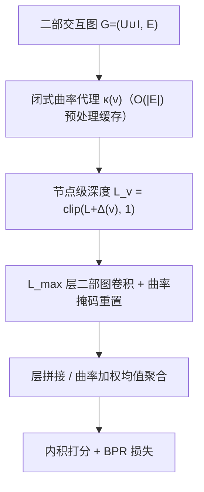
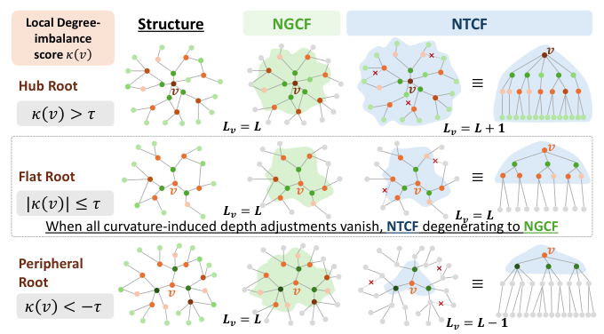
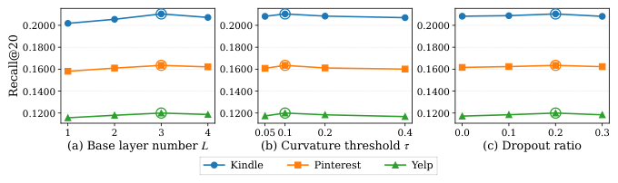

# Neural Tree Collaborative Filtering: Rethinking Graph Collaborative Filtering as Tree Collaborative Filtering with Curvature-Aware Propagation Depth (神经树协同过滤：以曲率感知传播深度重思图协同过滤)

- **会议/期刊**: CIKM 2026 (Short Paper)
- **作者与机构**: Jinfeng Xu, Ziyue Peng, Shuo Yang, Jinze Li, Wenhao Yuan, Jian Chen, Shujie Li, Edith C. H. Ngai 等（香港大学、香港科技大学、北京理工大学）
- **推荐链路定位**: 召回（GCF 骨干表征学习）
- **研究方向**: 图神经网络与知识图谱推荐 / 自监督对比学习
- **论文原文**: [https://arxiv.org/abs/2608.10297v1](https://arxiv.org/abs/2608.10297v1)
- **开源代码**: [https://github.com/Jinfeng-Xu/NTCF](https://github.com/Jinfeng-Xu/NTCF)

## TL;DR (1分钟核心速览)

GCF 长期对所有节点施加同一传播层数 $L$，但真实交互图局部几何高度异质：外围节点一两跳即被枢纽邻居"混匀"而过平滑，枢纽节点却因邻居稀疏而探索不足。NTCF 把每个节点的邻域重释为以自身为根的树，用$O(|\mathcal{E}|)$闭式局部度不平衡分数（离散 Ricci 曲率代理）为每节点分配$L\pm1$的深度，并在超出预算的层将节点重置回第 0 层表征。理论上 NTCF 严格包含 NGCF（$\tau\to\infty$ 退化为 NGCF），且在深层层保持非零 Dirichlet 能量下界。三数据集 Full-Ranking 下 R@20 相对 LightGCN 提升约 1.2%–2.3%，作为即插即用骨干替换 LightGCN 可让 SimGCL/NLGCL 等 SSL 模型全线增益。

## Background & Motivation (背景与核心矛盾)

- **主流范式**: NGCF 以带特征变换与非线性激活的 GCN 做二部图消息传递，LightGCN 去掉变换与激活后成为绝大多数 GCF 与自监督推荐模型的默认骨干，二者均以全局超参 $L$ 统一所有节点的传播深度。
- **前人局限**: ① 外围节点（度数低于邻居均值）在一两跳内即聚合到已被枢纽高度混合的信号，继续加深只是重复平滑，加速过平滑；② 局部枢纽节点（度数高于邻居均值）的邻居本身偏外围，需要更深跳数才能触达有效协同信号，统一深度使其"探索不足"。
- **核心洞察 (Key Insight)**: 从单节点视角看，$L$层 GCN 传播等价于在图上以该节点为根做$L$ 跳 BFS 展开的根树，聚合只依赖这棵树；因此"传播深度"本应是节点级属性而非全局超参。而节点与其邻居的度数失衡恰好刻画了"该树该多深"——这正是离散 Ricci 曲率的局部直觉。
- **本文切入点**: 用闭式局部度不平衡分数替代需解最优传输的 Ollivier-Ricci 曲率，把曲率符号直接映射为深度调整量，实现"一节点一棵树"的曲率感知传播。

## Method (核心方法设计)

### 1. 整体框架 (Overall Architecture)

NTCF 在预处理阶段一次性计算全图每个节点的曲率代理 $\kappa(v)$并缓存，据此为每节点确定有效深度$L_v\in\{L-1,L,L+1\}$；训练时以$L_{\max}=\max_v L_v$ 层二部图卷积（稀疏矩阵乘实现 NGCF 式更新）逐层传播，每层后施加曲率驱动的二值掩码：未耗尽深度预算的节点继续更新，已耗尽者被重置回第 0 层表征，但仍以第 0 层值向仍活跃的邻居供信，从而在保持二部图双向性的同时实现"每根一棵树"。最终按层拼接（默认）或曲率加权均值聚合得到用户/物品表征，内积打分，BPR 损失优化。

<figure class="paper-figure" markdown="span">
  <figcaption>图1：NTCF概述。</figcaption>
</figure>

### 2. 关键设计拆解 (Key Designs)

1. **局部度不平衡曲率代理（Local Degree-Imbalance Curvature）**：精确 Ollivier-Ricci / Lin-Lu-Yau 曲率需逐边解最优传输，工业级图上不可行。NTCF 改用闭式分数
$$\kappa(v)=\frac{\bar{d}_{\mathcal{N}(v)}-d(v)}{\bar{d}_{\mathcal{N}(v)}+d(v)+\epsilon},\quad \bar{d}_{\mathcal{N}(v)}=\tfrac{1}{|\mathcal{N}(v)|}\sum_{w\in\mathcal{N}(v)}d(w)$$
取值有界于 $[-1,1]$，$O(|\mathcal{E}|)$一次算完。直觉：$\kappa<0$表示自身比邻居更"枢纽"，需更深树触达远端协同信号；$\kappa>0$表示身处稠密簇外围，加深只会重复聚合已混匀信息、加速过平滑；$\kappa\approx0$ 保持标准深度。该分数与 Ricci 曲率的"局部连通性相对失衡"语义一致，但免去传输求解。

2. **曲率感知深度与掩码式树传播（Curvature-Aware Depth + Masked Propagation）**：给定基础深度 $L$与阈值$\tau$，
$$L_v=\max\{L+\Delta(v),1\},\quad \Delta(v)=\begin{cases}+1,&\kappa(v)<-\tau\\ 0,&|\kappa(v)|\le\tau\\ -1,&\kappa(v)>+\tau\end{cases}$$
逐层更新为 $\mathbf{E}^{(l+1)}=\mathbf{m}^{(l)}\odot\tilde{\mathbf{E}}^{(l+1)}+(1-\mathbf{m}^{(l)})\odot\mathbf{E}^{(0)}$，其中$\mathbf{m}^{(l)}_v=\mathbb{I}[L_v>l]$。关键细节：掩码只作用于节点自身状态，被掩掉的$v$仍以$\mathbf{e}^{(0)}_v$向活跃邻居供信——这正是"每根一棵树"与"保持二部图双向性"能同时成立的原因。$\tau$ 控制曲率平坦带宽度，即被调整节点的比例。

3. **训练目标、负采样与推理效率**：损失为标准 BPR
$$\mathcal{L}=\sum_{(u,i_p,i_n)\in\mathcal{D}}-\ln\sigma_s(\hat{\mathbf{e}}_u^\top\hat{\mathbf{e}}_{i_p}-\hat{\mathbf{e}}_u^\top\hat{\mathbf{e}}_{i_n})+\lambda\|\Theta\|^2$$
负采样沿用 BPR 的均匀采样（每正样本配一负样本），无额外难负采样设计。复杂度：曲率预处理 $O(|\mathcal{E}|)$一次缓存；每 epoch 与 NGCF 同为$O(L_{\max}\cdot|\mathcal{E}|\cdot d)$，仅多$O(|\mathcal{V}|\cdot d)$的掩码开销，且$L_{\max}\le L+1$，即训练成本最多比 NGCF 多一层消息传递，无循环性额外开销。

**理论支撑（两条命题）**：命题 1 证明当 $\tau\ge\tau^\star=\max_v|\kappa(v)|$时所有$\Delta(v)=0$、掩码恒为 1，NTCF 精确退化为 NGCF$_L$（关闭 Norm/Drop 时完全一致，开启时假设空间更大），故 NTCF 严格泛化 NGCF，构成表征能力下界。命题 2 在标准$\rho$-Lipschitz 收缩假设下，令$\mathcal{D}_l(\mathbf{E})$为第$l$ 层 Dirichlet 能量，则
$$\mathcal{D}_L(\mathbf{E}_{\text{ngcf}})\le\rho^{2L}\mathcal{D}_0(\mathbf{E}^{(0)}),\quad \mathcal{D}_L(\mathbf{E}_{\text{ntcf}})\ge\sum_{v\in\mathcal{V}^+}\sum_{w\in\mathcal{N}(v)}(\delta_v-\rho^LR_0)_+^2$$
$L\to\infty$时 NGCF 上界以$\rho^{2L}\to0$衰减，而 NTCF 下界升至$\sum_{v\in\mathcal{V}^+}\deg(v)\delta_v^2$——正曲率节点被重置回第 0 层，为深层保留了判别性信息地板。

## Experimental Setup & Evaluation Protocol (实验设置与评估协议)

- **数据集与预处理**: Yelp 采用 `15-core` 过滤，Kindle 与 Pinterest 采用 `5-core` 过滤：

| 数据集 | #Users | #Items | #Interactions | 稀疏度 | 特征/场景说明 |
| :--- | :---: | :---: | :---: | :---: | :--- |
| Kindle | 60,468 | 57,212 | 880,859 | 99.975% | Amazon Kindle 商店，最稀疏 |
| Pinterest | 55,188 | 9,912 | 1,445,622 | 99.736% | 图文社交兴趣，物品数最少 |
| Yelp | 45,477 | 30,708 | 1,777,765 | 99.873% | 本地生活商户点评 |

- **数据划分与防穿越 (Splitting Strategy)**: 用户级 `8:1:1` 比例划分（train/valid/test），沿用 LightGCN 及后续 GCF/SSL 工作的标准设定。
- **排名评测协议 (Ranking Protocol)**: 采用 `Full-Ranking`（全库未交互物品排序），指标为 Recall@{10,20,50} 与 NDCG@{10,20,50}，5 个随机种子取均值。
- **对比基线与超参设置**: 骨干类基线 NCF、NGCF、LightGCN、UltraGCN、IMP-GCN、FKAN-GCF；兼容性实验将 SimGCL、LightGCL、RecDCL、NLGCL 的 LightGCN 骨干替换为 NTCF。统一 embedding 维度 $d=64$、Xavier 初始化、Adam 优化器；NTCF 固定$\lambda=10^{-4}$，$L\in\{1,2,3,4\}$、$\tau\in\{0.05,0.1,0.2,0.4\}$、message dropout$\in\{0.0,0.1,0.2,0.3\}$ 网格调参。

## Key Experimental Results (实验关键数据)

### 1. 主实验对比 (Main Results)

| 数据集 / 指标 | NCF | NGCF | LightGCN | UltraGCN | IMP-GCN | FKAN-GCF | **NTCF** | Improv.% (vs 最强基线) |
| :--- | :---: | :---: | :---: | :---: | :---: | :---: | :---: | :---: |
| Kindle R@20 | 0.1583 | 0.1770 | 0.2080 | 0.2013 | 0.2057 | 0.2089 | **0.2104** | +0.72% |
| Kindle N@20 | 0.0850 | 0.0919 | 0.1117 | 0.1082 | 0.1101 | 0.1125 | **0.1137** | +1.07% |
| Pinterest R@20 | 0.1276 | 0.1428 | 0.1621 | 0.1588 | 0.1603 | 0.1614 | **0.1635** | +0.86% |
| Pinterest N@20 | 0.0621 | 0.0721 | 0.0830 | 0.0808 | 0.0814 | 0.0827 | **0.0838** | +0.96% |
| Yelp R@20 | 0.0885 | 0.1026 | 0.1163 | 0.1180 | 0.1182 | 0.1183 | **0.1200** | +1.44% |
| Yelp N@20 | 0.0486 | 0.0567 | 0.0652 | 0.0666 | 0.0662 | 0.0666 | **0.0669** | +0.45% |
| Yelp R@50 | 0.1654 | 0.1864 | 0.2016 | 0.2029 | 0.2017 | 0.2019 | **0.2036** | +0.34% |

（完整表含 R@10/R@50/N@10/N@50，NTCF 在全部 18 个指标格上均为最优。）

### 2. 消融实验 (Ablation Study)

| 变体 | Kindle R@20 | Kindle N@20 | Pinterest R@20 | Pinterest N@20 | Yelp R@20 | Yelp N@20 |
| :--- | :---: | :---: | :---: | :---: | :---: | :---: |
| **NTCF (full)** | **0.2104** | **0.1137** | **0.1635** | **0.0838** | **0.1200** | **0.0669** |
| w/o curvature ($\tau\to\infty$) | 0.1770 | 0.0919 | 0.1428 | 0.0721 | 0.1026 | 0.0567 |
| r/ mean agg. (Eq. 6 替代拼接) | 0.2090 | 0.1133 | 0.1626 | 0.0832 | 0.1187 | 0.0660 |

### 3. 关键实验发现 (Key Findings)

1. **曲率机制是唯一主要增益来源，且与命题 1 数值吻合**：`w/o curvature` 在三个数据集上分别回落到 0.1770 / 0.1428 / 0.1026（R@20），与 NGCF 基线数值逐位一致，实证验证了 $\tau\to\infty$ 时 NTCF 精确退化为 NGCF；曲率调整带来的 R@20 绝对增益为 +3.34 / +2.07 / +1.74 个百分点，远超其余所有骨干改进（FKAN-GCF 相对 LightGCN 仅 +0.09 / −0.07 / +0.20）。
2. **拼接聚合优于曲率加权均值，但差距极小**：`r/ mean agg.` 相对完整模型 R@20 仅下降 0.14 / 0.09 / 0.13 个百分点，说明增益主要来自"深度自适应"而非"聚合方式"；同时该变体仍显著优于 `w/o curvature`，佐证命题 2 的严格改进方向。
3. **NTCF 是 SSL 模型的即插即用骨干升级**：替换 LightGCN 后，SimGCL 在 Yelp 上 R@10 由 0.0908 升至 0.0924、N@10 由 0.0673 升至 0.0689；NLGCL 在 Pinterest 上 R@10 由 0.1148 升至 0.1170、N@10 由 0.0760 升至 0.0773；四个 SSL 方法在 3 数据集 × 6 指标共 72 格上全部正增益，说明节点级几何自适应与对比学习目标正交可叠加。

<figure class="paper-figure" markdown="span">
  <figcaption>图2：NTCF在所有数据集上的超参数分析。</figcaption>
</figure>

超参分析（图 2）显示三数据集最优配置一致为 $L=3$、$\tau=0.1$、dropout$=0.2$；$\tau=0.4$ 时 NTCF 塌缩回 NGCF 并掉点，印证"需保留非平凡比例的曲率调整节点"；最优邻域内 R@20 波动小于 0.5 个百分点，鲁棒性良好。

## Highlights & Limitations (亮点、对比与审稿批判)

- **与代表作对比 (vs. Prior Work)**: 与 NGCF/LightGCN 的本质区别在于把"深度"从全局超参降为节点级属性，且用 $O(|\mathcal{E}|)$ 闭式曲率代理替代最优传输曲率，工程可落地；与 IMP-GCN 的"按子图分组传播"不同，NTCF 不切分图、不引入额外分组超参，仅靠逐层掩码实现差异化深度，且保持二部图双向消息流；与 UltraGCN 的"免消息传递"路线正交——NTCF 仍走显式传播，但让传播深度随局部几何自适应。
- **可迁移亮点**: ① 掩码重置机制（超预算节点回退第 0 层但仍向邻居供信）可直接移植到任何多层 GNN 推荐骨干，实现"每节点早停"而无需改图结构；② 闭式度不平衡分数可作为轻量图几何描述子，用于冷启动节点诊断、层数选择或图增广的采样权重。
- **审稿级局限批判**: ① 深度调整仅限 $\pm1$且依赖单一度数统计量，对加权图、时序图或带属性相似度的图，$\kappa(v)$的曲率语义可能失真，缺少与真实 Ollivier-Ricci 曲率的相关性验证；② 增益幅度偏小（R@20 相对最强基线 +0.3%–1.4%），且仅在三个中等规模公开集上验证，缺少工业级千万边图上的效率与效果证据，也未报告与$L$ 增大时的显存/时延实测曲线。

## Rating (四维评分)

- **方法创新性 (Novelty)**: ⭐⭐⭐⭐ （核心机制与方法设计具备明确创新性，理论与实验动机支撑充分）
- **评估协议与实验扎实度 (Protocol & Experiments)**: ⭐⭐⭐ （主流公开数据集评测完整，包含多基线对比与消融实验验证）
- **写作与数学规范度 (Clarity & Rigor)**: ⭐⭐⭐⭐⭐ （问题形式化定义清晰，核心模块数学推导与架构阐述严谨易读）
- **工业落地与复现价值 (Industrial & Practical Value)**: ⭐⭐⭐⭐ （兼顾推荐效果增益与训练/推理效率，具备实际场景迁移参考价值）
