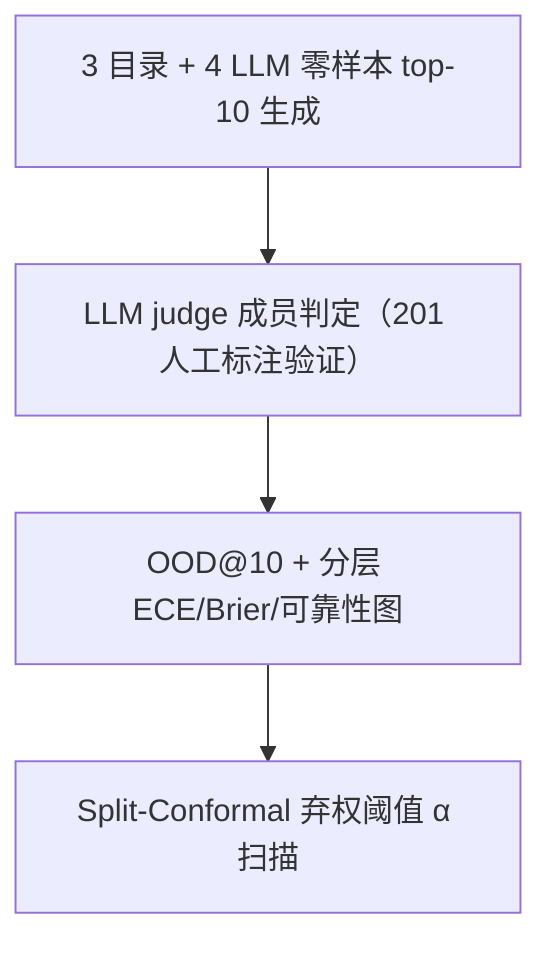
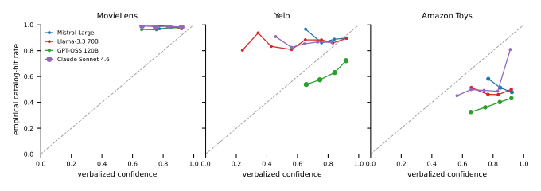

# Do LLM Recommenders Know When They're Hallucinating? Auditing Confidence Calibration in Catalog Faithfulness (LLM 推荐器知道自己何时在幻觉吗？目录忠实性下的置信度校准审计)

- **会议/期刊**: CIKM 2026 (short paper)
- **作者与机构**: Srijith Ravikumar (Amazon.com LLC，独立研究声明)
- **推荐链路定位**: 端到端生成式（零样本 top-K 生成）
- **研究方向**: 大语言模型推荐 / 去偏公平与工业评测
- **论文原文**: [arXiv:2608.10008v3](https://arxiv.org/abs/2608.10008v3)
- **开源代码**: [rsrijith/cikm26-catalog-faithfulness](https://github.com/rsrijith/cikm26-catalog-faithfulness)

## TL;DR (1分钟核心速览)

现有 LLM 推荐审计只报告二值 OOD@10 幻觉率，从不追问"模型自己知不知道"。本文对 4 家厂商的零样本 LLM（Mistral Large、Llama-3.3-70B、GPT-OSS-120B、Claude Sonnet 4.6）在 3 个目录（MovieLens-25M / Amazon Toys / Yelp）上联合审计幻觉率与言语化置信度校准（ECE、Brier、可靠性图），并首次把"目录成员判定器"当作待验证仪器。核心发现：幻觉率随目录规范性剧烈变化（0.6–2.7% → 49.3–61.0%），而模型置信度几乎恒定（67–86 窄带），**校准误差的正负号由目录决定而非模型决定**；基于言语化置信度的 conformal 弃权最多只降 1.65 pp 幻觉。

## Background & Motivation (背景与核心矛盾)

- **主流范式**: 工业界用 grounding 工程（RecLM-cgen、logit 空间约束微调 LCFT、bi-step grounding、检索改写）把 OOD@K 压向零，评测只报一个二值 in-catalog 率。
- **前人局限**: ① 二值率无法区分"等置信度的幻觉"与"校准良好的正确项"，任何基于置信度门控的策略都失效；② 成员判定依赖字符串匹配器，而匹配器本身的误差从未被报告——同一批输出换匹配器，Amazon OOD 率可差一个数量级。
- **核心洞察 (Key Insight)**: 置信度是**模型属性**（模型间方差 19.2 vs 目录间 6.0），命中率是**目录属性**（跨 12 个 cell 摆动 60 点）；二者错位，校准误差符号就由"模型常数落在目录准确率的哪一侧"决定。
- **本文切入点**: 把成员判定器当仪器先做 201 条人工标注验证，再联合报告 OOD@K 与校准指标，并用 split-conformal 弃权量化置信度通道的信息上限。

## Method (核心方法设计)

### 1. 整体框架 (Overall Architecture)

审计流水线分三层：**目录构建层**为每个目录取 300 名 ≥30 次交互的用户作审计集、100 名不相交用户作 conformal 校准集，按目标物品流行度四分位分层（head Q1–Q2 / tail Q3–Q4）；**生成层**用固定 system prompt + 用户最近 30 条交互，temperature=0、K=10 零样本生成，得到 12 个 (catalog, LLM) cell；**测量层**先用经人工验证的 LLM judge 判定目录成员性，再对 0–100 言语化置信度归一化后计算 ECE/Brier/可靠性图，最后在 in-catalog 校准项上取非一致性分数 $s_i=1-c_i$的分位数$\hat{q}_\alpha$ 做弃权。整个闭环的关键在于：仪器误差被显式报告，而非假设为零。

<figure class="paper-figure" markdown="span">
  <figcaption>图1：各目录的可靠性，四个LLM在总体层上的表现。灰色虚线：完美校准。曲线在MovieLens上位于对角线之上（欠自信），在Amazon Toys上位于对角线之下（过自信），Yelp则混合。校准偏差的方向是目录的属性，而非模型的属性。</figcaption>
</figure>

### 2. 关键设计拆解 (Key Designs)

1. **以净偏差 (Net Bias) 而非 F1 选择成员判定仪器**：痛点在于 token-set≥90 规则只要一个 token 集包含另一个就判匹配，截断的目录条目会"完美匹配"任何含其词的长幻觉标题。作者在 201 条人工标注上比较 6 种仪器，发现 F1 跨度仅 0.25（甚至"全判 in-catalog"的平凡基线 F1=0.782 就超过两个真实匹配器），而 Amazon 上的净偏差跨度达 0.95。故改用净偏差选择，采纳 Claude judge（总体偏差 $-0.040$，Amazon 仅$-0.013$，对比 token-set 规则$+0.282$），$\kappa=0.747$。这一判据源自 quantification learning 的类流行度估计视角：审计发布的是**率**，对率的估计只对偏差敏感。
2. **校准误差符号的目录归因**：定义 cell 平均置信度 $\bar{c}$与命中率$\hat{a}$，校准间隙$g=\bar{c}-\hat{a}$。由于$\bar{c}$近似模型常数（Claude 72.9、Mistral 84.8），而$\hat{a}$随目录从 39.0% 摆到 99.4%，$g$的符号被目录锁定：MovieLens 上 4/4 欠自信（言语化 77.8–86.2 对应真实 97.3–99.4%），Amazon Toys 上 4/4 过自信（间隙$-24.4$至$-42.7$ 点），Yelp 混合。12 个 cell 中 7 欠自信、5 过自信，且 11/12 在三种校正匹配器下判定一致。
3. **训练目标、负采样与推理效率**：本文为审计研究，无训练损失；核心"目标"是 split-conformal 弃权——在 in-catalog 校准项上取 $\hat{q}_\alpha=\lceil(n+1)(1-\alpha)\rceil/n$分位数，保留$c_i\geq 1-\hat{q}_\alpha$的推荐。该构造只保证 in-catalog 项的保留率，**不保证**混合分布上的边际覆盖，因为$s_i$本身不是校准的幻觉指示器。推理开销为一次额外 LLM judge 调用（18,833 条判定、约 \$12 API 成本）。

## Experimental Setup & Evaluation Protocol (实验设置与评估协议)

- **数据集与预处理**: 审计集每 cell 295–300 用户、2947–3000 条推荐（剔除报错/不可解析响应后）；仅 GPT-OSS 在 Amazon 与 Yelp 低于 300 用户。

| 数据集 | #Items (目录) | #Users (审计/校准) | #Recs/cell | 特征/场景说明 |
| :--- | :---: | :---: | :---: | :--- |
| MovieLens-25M | 62,423 | 300 / 100 | ~3000 | 规范影视条目，预训练高频出现 |
| Amazon Toys 2023 | 890,874 | 300 / 100 | ~3000 | 长尾商品标题，极少见于零售页外 |
| Yelp Open | 150,346 | 300 / 100 | ~3000 | 商户名 + 城市，强地域集中 |

- **数据划分与防穿越 (Splitting Strategy)**: 用户级划分——300 审计用户 + 100 不相交 conformal 校准用户；用户内按目标物品流行度四分位分层，head/tail 分别统计。
- **排名评测协议 (Ranking Protocol)**: 非排序指标，而是 `OOD@10`（top-10 中不在目录内的比例）+ 校准指标（10 等宽分箱 ECE、Brier、可靠性图）；置信区间用 95% paired-user bootstrap。
- **对比基线与超参设置**: 4 个零样本指令微调 LLM（跨 4 家厂商，temperature=0，固定 system prompt，K=10）；成员判定对比 6 种仪器（平凡全 in、精确匹配、token-set≥90、token-sort≥90、surface-form 规则、LLM judge）；弃权扫描 $\alpha\in\{0.05,0.10,0.15,0.20\}$；显著性用 McNemar 与 permutation 检验。

## Key Experimental Results (实验关键数据)

### 1. 主实验对比 (Main Results)

OOD@10 幻觉率（%），括号内为 95% bootstrap CI：

| LLM | MovieLens | Amazon Toys | Yelp |
| :--- | :---: | :---: | :---: |
| Mistral Large | 2.0 [1.4,2.6] | 49.3 [46.7,51.8] | 11.6 [9.7,13.5] |
| Llama-3.3-70B | **0.6** [0.4,0.9] | 53.6 [51.4,56.0] | **12.9** [11.0,14.9] |
| GPT-OSS-120B | 2.7 [1.9,3.6] | **61.0** [58.7,63.3] | 38.7 [35.4,42.0] |
| Claude Sonnet 4.6 | 1.2 [0.8,1.7] | 50.6 [48.1,52.9] | 14.4 [12.7,16.2] |

校准指标（ECE / Brier，head 层）：

| LLM | MovieLens ECE / Brier | Yelp ECE / Brier | Amazon ECE / Brier |
| :--- | :---: | :---: | :---: |
| Mistral | 0.118 / 0.035 | 0.066 / 0.111 | 0.342 / 0.371 |
| Llama | 0.196 / 0.047 | 0.120 / 0.136 | 0.331 / 0.361 |
| GPT-OSS | 0.139 / 0.049 | 0.182 / 0.268 | 0.418 / 0.414 |
| Claude | 0.210 / 0.061 | 0.185 / 0.160 | **0.238** / **0.311** |

### 2. 消融实验 (Ablation Study)

成员判定仪器对比（201 人工标注，Amazon 列）：

| 仪器 | Prec. | Rec. | F1 | Amazon 净偏差 |
| :--- | :---: | :---: | :---: | :---: |
| 全判 in-catalog（平凡） | 0.642 | 1.000 | 0.782 | +0.526 |
| 精确匹配（折叠后） | 0.970 | 0.496 | 0.656 | -0.423 |
| Token-set≥90（文献常用） | 0.778 | 0.953 | 0.857 | +0.282 |
| Token-sort≥90 | 0.964 | 0.620 | 0.755 | -0.372 |
| Surface-form 规则 | 0.988 | 0.651 | 0.785 | -0.372 |
| **LLM judge（采纳）** | **0.934** | **0.876** | **0.904** | **-0.013** |

Conformal 弃权（保留集幻觉率 %，Amazon）：

| LLM | 未过滤 | α=.05 | α=.10 | α=.15 | α=.20 |
| :--- | :---: | :---: | :---: | :---: | :---: |
| Mistral | 49.3 | 49.7 | 49.6 | 49.6 | 50.0 |
| Llama | 53.6 | 53.7 | 53.5 | 53.5 | 53.8 |
| GPT-OSS | 61.0 | 60.7 | 60.5 | 59.7 | **59.4** |
| Claude | 50.6 | 50.5 | 50.8 | 50.7 | 50.6 |

### 3. 关键实验发现 (Key Findings)

1. **幻觉率由目录规范性主导，与参数量无关**：MovieLens 0.6–2.7% → Yelp 11.6–38.7% → Amazon Toys 49.3–61.0%，跨目录差一个数量级；而最大的 GPT-OSS-120B 在两个长尾目录上反而最高（61.0% / 38.7%），说明预训练记忆而非模型规模是主因。
2. **校准误差符号是目录属性**：置信度跨 12 cell 仅 67–86（19 点窄带），命中率却摆动 60 点；MovieLens 上 4/4 欠自信、Amazon Toys 上 4/4 过自信，且 11/12 cell 在三种校正匹配器下判定一致，排除了仪器伪影。
3. **言语化置信度通道几乎不含目录成员信息**：48 个 (cell, α) 组合中最大幻觉降幅仅 1.65 pp、中位数 0.02 pp，18 个组合保留集反而更"幻觉"；长尾分层下 ECE 进一步恶化（Mistral Amazon tail ECE 0.588 vs head 0.342），而置信度纹丝不动。

## Highlights & Limitations (亮点、对比与审稿批判)

- **与代表作对比 (vs. Prior Work)**: 与 RecLM/LCFT 等 grounding 工作相比，本文不追求降 OOD，而是追问"降完之后模型是否自知"；与 Kweon et al. 的不确定性分解相比，其 oracle 是排序正确性，本文是目录成员性——模型完全可能对排序自信却输出不存在的标题；与 Huang et al. 的实体匹配基准相比，其任务中正确匹配几乎总存在，而本文的负例（幻觉）才是被测量的量。
- **可迁移亮点**: ① "以净偏差而非 F1 选择测量仪器"可直接迁移到任何需要发布**率**的评测（如曝光偏差审计、假阳性过滤评估）；② 目录锚定式提示（catalog-anchored elicitation）在 Llama×Yelp 上把 OOD@10 从 12.9% 降到 1.5%，远超 conformal 弃权的 1.65 pp 上限，提示"改提问方式"比"改阈值"更有效。
- **审稿级局限批判**: ① 人工标注仅 201 条、单一标注者，Amazon 上仪器自身错误率高达 0.218，Amazon 数字应读作区间（51.1% [41.5, 60.7]）而非点估计；② LLM judge 与生成器共享厂商、标注表单展示 judge 判决存在锚定风险，且盲标复测的候选深度不一致导致锚定效应无法被真正排除；③ 全部结论限于零样本前沿 LLM，grounded/微调栈虽"测量方法同样适用"但未经实证。

## Rating (四维评分)

- **方法创新性 (Novelty)**: ⭐⭐⭐⭐ （首次把"成员判定器"当待验证仪器并联合审计校准，视角新颖；但核心指标 ECE/Brier/conformal 均为借用，增量在协议而非算法）
- **评估协议与实验扎实度 (Protocol & Experiments)**: ⭐⭐⭐⭐ （3 目录 × 4 厂商 × 12 cell + 201 人工标注 + 多匹配器稳健性检验相当扎实；扣分在单标注者、Amazon 仪器误差偏高、无 grounded 系统对照）
- **写作与数学规范度 (Clarity & Rigor)**: ⭐⭐⭐⭐⭐ （对仪器误差、循环性、锚定、批处理漏答 1.0% 等威胁均逐条量化披露，v2 主动更正匹配器并反转结论，学术诚实度罕见）
- **工业落地与复现价值 (Industrial & Practical Value)**: ⭐⭐⭐⭐ （代码、18,833 条判定、201 条标注、prompt 全文全开源；结论直接指导生产审计应"同时报校准 + 验证匹配器 + 用目录锚定提问"，但零样本设定与生产 grounded 栈仍有距离）
