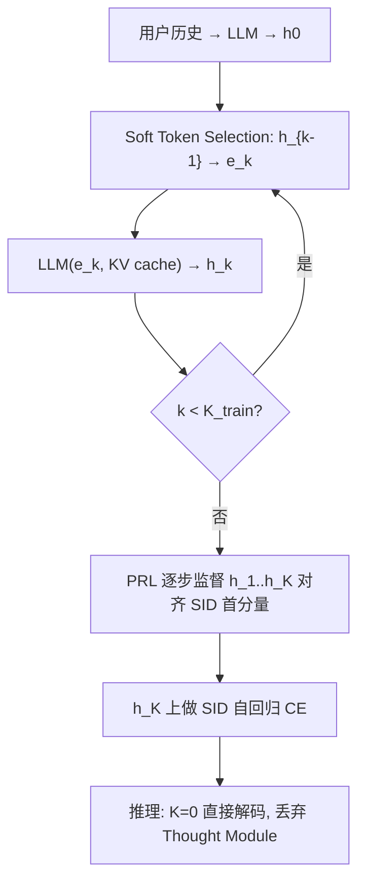
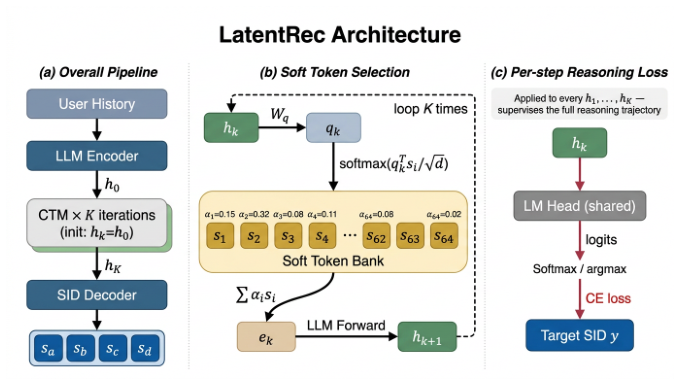

# Do Recommenders Need to Think in Words? Latent Reasoning for Efficient LLM-Based Recommendation (推荐系统真的需要用文字思考吗？面向高效 LLM 推荐的隐式推理)

- **会议/期刊**: CIKM 2026 (Short Paper)
- **作者与机构**: Hongyang Su, Beibei Kong, Lei Cheng, Chengxiang Zhuo, Zang Li（腾讯）
- **推荐链路定位**: 端到端生成式（SID 自回归解码）
- **研究方向**: 大语言模型推荐 / 生成式推荐与离散语义 ID
- **论文原文**: [https://arxiv.org/abs/2611.07866v1](https://arxiv.org/abs/2611.07866v1)
- **开源代码**: 暂未开源

## TL;DR (1分钟核心速览)

LLM 推荐器普遍在每次预测前生成 CoT 文本（或隐式推理步）来"激活推理能力"，代价是每次请求数十到上百 token 的额外解码。本文提出 LatentRec：把推理从**推理期**搬到**训练期**——用一个 2.5M 参数的 Continuous Thought Module 在训练时对隐状态迭代 $K$步，并用 Per-step Reasoning Loss 通过共享 LM head 逐步监督每个中间状态对齐目标 SID 首分量；训练完成后模块可直接丢弃，推理时$K=0$ 零额外开销。在 Amazon Beauty/Toys/Sports 的 Leave-One-Out + Full-Ranking 协议下，HR@10 相对 CoT 蒸馏基线提升 4.0–5.0%，单样本延迟从 10.80s 降至 0.59s（18.3×）。

## Background & Motivation (背景与核心矛盾)

- **主流范式**: LLM 生成式推荐（TIGER 系）将物品编码为层次化 Semantic ID，并越来越多地在解码前生成 CoT 文本轨迹（CoT 蒸馏）或做隐式推理 rollout，以激活 LLM 的推理能力。
- **前人局限**: 其一，推理能力被绑定在**推理期产物**上（文本 token 或隐状态 rollout），每次推荐都要重复付费，batch=1 时 CoT 需 128 token、约 $256P$ FLOPs；其二，数学/逻辑域的隐式推理方法（COCONUT、CODI）直接把原始隐状态回灌为输入，在 SID 解码场景下会因表征空间错配而失效。
- **核心洞察 (Key Insight)**: 作者实测 Qwen3-1.7B 末层隐状态 L2 范数约 45，而输入嵌入仅约 3，存在 **~14× 范数鸿沟**；若每个中间状态都要经 LM head 映射回 SID 词表，原始隐状态回灌会让逐步 logits 随 $K$增大而漂离词表（实测首个 epoch 即发散，$L>200$ 触发早停）。
- **本文切入点**: 既然推理的价值可能来自"训练信号"而非"推理时计算"，那就用**训练期逐步头监督**替代推理期推理产物，并配一个把隐状态投影回输入嵌入流形的软 Token 选择算子来消除范数鸿沟。

## Method (核心方法设计)

### 1. 整体框架 (Overall Architecture)

LatentRec 从 CoT 蒸馏得到的 Qwen3-1.7B checkpoint 出发（仅训练 LoRA rank 16 与 2.5M 的 Thought Module，主干冻结）。训练时：用户历史经 LLM 得到 $h_0$，Continuous Thought Module 迭代$K_{\text{train}}$步，每步先用 Soft Token Selection 把$h_{k-1}$投影为输入嵌入空间中的软 token$e_k$，再送入 LLM（复用累积 KV cache）得到$h_k$；每个$h_k$经共享 LM head 与温度退火被 PRL 监督对齐目标 SID 首分量，最终$h_{K_{\text{train}}}$再做标准 SID 自回归交叉熵。推理时直接令$K=0$，从$h_0$ 解码，Thought Module 完全弃用。

<figure class="paper-figure" markdown="span">
  <figcaption>图1：LatentRec 架构。(a) 整体流程。(b) 软 Token 选择将每个隐藏状态投影到 LLM 的输入嵌入分布中。(c) 逐步推理损失通过共享 LM head 对目标的第一 SID 分量监督每个中间状态。</figcaption>
</figure>

### 2. 关键设计拆解 (Key Designs)

1. **Soft Token Selection (STS)：把隐状态拉回输入嵌入流形**：痛点是 14× 范数鸿沟使原始隐状态回灌 + 头监督必然发散。做法是维护 $N=64$个从词表初始化的可学习软 token$\mathbf{S}\in\mathbb{R}^{N\times d}$，用注意力式凸组合投影：
$$e_k=\sum_{i}\alpha_i^{(k)}\mathbf{s}_i,\quad \alpha_i^{(k)}=\frac{\exp(\mathbf{q}_k^\top\mathbf{s}_i/\sqrt{d})}{\sum_j\exp(\mathbf{q}_k^\top\mathbf{s}_j/\sqrt{d})},\ \mathbf{q}_k=\mathbf{W}_q h_k$$
凸组合同时匹配**范数与方向**（标量缩放只匹配范数），且 $\alpha_i\in(0,1)$ 天然有界梯度，无需额外归一化层。

2. **Per-step Reasoning Loss (PRL)：把 ReaRec 的渐进监督移植到 LLM SID 解码器**：数学/逻辑域的隐式推理不监督中间步，中间状态缺乏任务梯度；ReaRec 在 SR-encoder 上用物品嵌入内积打分，无法直接用于 LLM。PRL 改为每步都过共享 LM head 对齐目标 SID 的**首分量** $y_1$（RQ-VAE 码本中最粗的路由信号），并配线性退火温度：
$$\mathcal{L}_{\text{PRL}}=\frac{1}{K}\sum_{k=1}^{K}\text{CE}\big(\text{LM\_head}(h_k)/T_k,\ y_1\big),\quad T_k=T_b+T_s\big(1-k/K\big)$$
早期高温松弛、末步低温锐化。只监督首分量是为避免 teacher-forcing 目标 SID 前缀、把隐式 rollout 耦合到固定解码路径。

3. **训练目标、负采样与推理效率**：总损失 $\mathcal{L}=\mathcal{L}_{\text{CE}}+\lambda\mathcal{L}_{\text{PRL}}$（$\lambda=0.1$），$\mathcal{L}_{\text{CE}}$为完整 SID 序列的自回归交叉熵；生成式全库 beam search 框架下**无显式负采样**。推理开销：$K=0$时零额外 FLOPs，$K=1$时约$2P$（$P$ 为一次 LLM 前向）。

## Experimental Setup & Evaluation Protocol (实验设置与评估协议)

- **数据集与预处理**: Amazon Review 2014 `5-core`，物品用 4 层 RQ-VAE SID 编码（码本 256，Sinkhorn 去重后 0% 碰撞）：

| 数据集 | #Users | #Items | 稀疏度/密度 | 特征/场景说明 |
| :--- | :---: | :---: | :---: | :--- |
| Beauty | 22.4K | 12.1K | 5-core 过滤 | 美妆，语言先验信号强 |
| Toys | 19.4K | 11.9K | 5-core 过滤 | 玩具，语言先验信号强 |
| Sports | 35.6K | 18.4K | 5-core 过滤 | 运动户外，语言先验较弱 |

- **数据划分与防穿越 (Splitting Strategy)**: `Leave-One-Out`（最后一件交互为测试目标）。
- **排名评测协议 (Ranking Protocol)**: 无偏 `Full-Ranking`（全库未交互物品排序），beam width = 50，指标 HR@{5,10} 与 NDCG@{5,10}。
- **对比基线与超参设置**: 判别式 GRU4Rec / SASRec / BERT4Rec / HGN；SID 生成式 TIGER；隐式推理 ReaRec；同骨干 CoT 蒸馏基线 LLM-CoT SFT（GPT-4 生成推理轨迹，两法共享同一 teacher）。LoRA rank 16、$K_{\text{train}}=2$、$\lambda=0.1$、$T_b=1,T_s=5$、lr 5e-6/5e-5、batch 64、3 epochs、2×H20 + DeepSpeed ZeRO-2。

## Key Experimental Results (实验关键数据)

### 1. 主实验对比 (Main Results)

| Method | Beauty HR@10 | Toys HR@10 | Sports HR@10 | Beauty N@10 | Toys N@10 | Sports N@10 |
| :--- | :---: | :---: | :---: | :---: | :---: | :---: |
| GRU4Rec | 0.0613 | 0.0492 | 0.0298 | 0.0330 | 0.0289 | 0.0164 |
| SASRec | 0.0541 | 0.0609 | 0.0272 | 0.0264 | 0.0276 | 0.0121 |
| HGN | 0.0630 | 0.0649 | 0.0305 | 0.0356 | 0.0359 | 0.0162 |
| TIGER | 0.0565 | 0.0496 | 0.0302 | 0.0299 | 0.0261 | 0.0166 |
| ReaRec | 0.0563 | 0.0632 | 0.0285 | 0.0292 | 0.0293 | 0.0131 |
| LLM-CoT SFT | 0.0625 | 0.0639 | 0.0297 | 0.0369 | 0.0376 | 0.0163 |
| **LatentRec K=0** | **0.0656** | **0.0668** | **0.0309** | **0.0398** | **0.0403** | **0.0174** |
| LatentRec K=1 | 0.0660 | 0.0664 | 0.0307 | 0.0400 | 0.0402 | 0.0172 |
| **Improv. vs CoT SFT** | **+5.0%** | **+4.5%** | **+4.0%** | +7.9% | +7.2% | +6.7% |

### 2. 消融实验 (Ablation Study)

Beauty 数据集、$K=0$ 推理、同一 CoT SFT checkpoint 与匹配训练配置：

| 配置 | HR@10 | 相对上一行增量 |
| :--- | :---: | :---: |
| CoT SFT (起点) | 0.0625 | — |
| + 继续 LoRA-CE (仅 SID CE) | 0.0629 | +0.64% |
| + Thought Module & STS (无 PRL) | 0.0633 | +0.64% |
| **+ PRL (LatentRec K=0)** | **0.0656** | **+3.63%** |
| LatentRec K=1 | 0.0660 | +0.61% |

### 3. 关键实验发现 (Key Findings)

1. **PRL 是绝对主导项，且增益不来自"首 token 分类"本身**：继续 LoRA-CE 已通过标准 SID CE 监督了首分量，仅得 +0.64%；叠加 PRL 再涨 +3.63%，三组件以近似乘性方式复合为 +5.0%（$1.0064\times1.0064\times1.0363\approx1.0496$）。说明增益来自**多步深监督对 LoRA 适配器的塑形**，而非推理期真的"想了$K$ 步"。
2. **CoT 预训练是深 rollout 的"表征底座"，但对 $K=0$部署非必需**：表 2 显示两 base 在$K=0$同为 0.0656，但无 CoT 初始化在$K=2/4/8/16$ 分别掉 2.6%/5.0%/8.2%/11.1%，CoT base 始终在 3.4% 内。即 CoT 的价值被重新定位为 warm-start 稳定性，而非推理能力本身。
3. **推理深度收益随 $K_{\text{train}}$缩放，$K=1$是跨数据集最优推理深度**：$K_{\text{train}}=2$给出最强$K=0$底座（0.0656 vs$K_{\text{train}}=16$的 0.0636），短链让 PRL 监督更贴近最终预测；$K_{\text{train}}=2$时仅$K=1$有增益，$K_{\text{train}}=16$时增益才延伸到$K=4$。成本侧，$K=0$ 为 0.59s/样本 vs CoT SFT 10.80s，18.3× 加速。

## Highlights & Limitations (亮点、对比与审稿批判)

- **与代表作对比 (vs. Prior Work)**: 与 **LLM-CoT SFT** 的本质区别是把推理成本从"每次请求"移到"一次性训练"，且精度反超；与 **ReaRec** 的区别是监督目标从 SR-encoder 的物品嵌入内积改为 LLM 共享 LM head 对 SID 首分量，并额外解决 14× 范数鸿沟；与 **COCONUT/CODI** 的区别是原始隐状态回灌在本场景会发散，STS 是 load-bearing 组件而非可选装饰。
- **可迁移亮点**: (1) "训练期深监督 + 推理期零开销"的范式可直接套用到任何 SID 生成式推荐器（如 TIGER、LC-Rec）的微调阶段；(2) 用可学习软 token 凸组合做"隐状态→输入嵌入流形"的投影，是解决 LLM 中间层表征回灌错配的通用轻量手段（仅 2.5M 参数）。
- **审稿级局限批判**: (1) 实验面窄——单一骨干（Qwen3-1.7B）、单一 CoT teacher（GPT-4）、三个同源 Amazon 电商域，跨骨干/跨域（影视、新闻、音乐）泛化未验证；(2) 只监督 SID 首分量，深层码位仍靠标准 CE，且 $K\ge1$ 推理无一致收益意味着"隐式推理"名不副实，本质是结构化深监督；此外延迟仅在 batch=1 单卡测量，未给出批量服务下的吞吐对比。

## Rating (四维评分)

- **方法创新性 (Novelty)**: ⭐⭐⭐⭐ （"推理搬到训练期"的问题重构很有洞察力，STS 针对 14× 范数鸿沟的设计有明确物理直觉与失败模式佐证，但 PRL 本身是 ReaRec 渐进监督的跨域适配）
- **评估协议与实验扎实度 (Protocol & Experiments)**: ⭐⭐⭐ （Leave-One-Out + Full-Ranking + beam=50 协议规范、消融控制严格且给出乘性分解，但仅 3 个同源数据集、单骨干单 teacher，无显著性检验与线上验证）
- **写作与数学规范度 (Clarity & Rigor)**: ⭐⭐⭐⭐ （5 页短文结构紧凑，公式与算法 1 完整，温度退火与只监督首分量的动机交代清楚，复杂度 $K\times P$ 分析明确）
- **工业落地与复现价值 (Industrial & Practical Value)**: ⭐⭐⭐⭐ （18.3× 延迟下降且精度不降、模块可丢弃、仅 2.5M 参数与 LoRA 微调，工程部署价值高；扣分在于代码未开源、需 GPT-4 蒸馏 CoT 作为起点）
