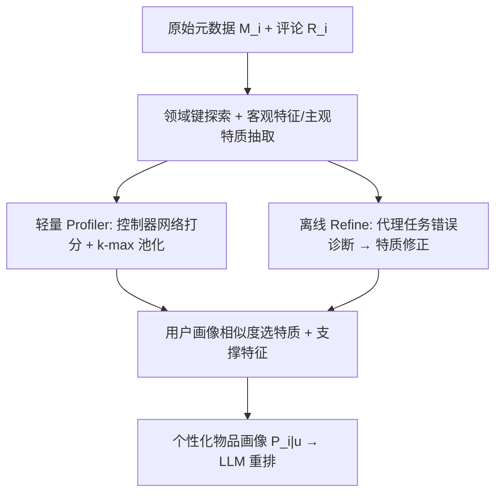
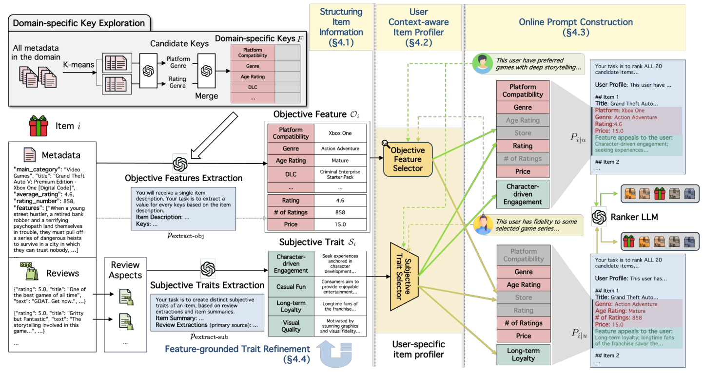

# Profiling What Matters: Context-Aware Item Profiles from Large-Scale Metadata for LLM Recommenders (为 LLM 推荐器构建上下文感知的物品画像：只呈现真正重要的信息)

- **会议/期刊**: CIKM 2026
- **作者与机构**: Dojun Hwang, Seunghan Lee, Cheonyoung Park, Sara Yu, SeongKu Kang (Korea University & KT Corporation)
- **推荐链路定位**: 重排 (Reranking)
- **研究方向**: 大语言模型推荐 / CTR 特征交叉
- **论文原文**: [论文原文链接](https://arxiv.org/abs/2608.20801v1)
- **开源代码**: [开源代码仓库链接](https://github.com/rgbeing/CAIRO)

## TL;DR (1分钟核心速览)

LLM 重排中物品侧信息利用不足：真实元数据海量异构、关键特征因物品而异、更因用户而异，而现有方法只用标题、固定属性或静态摘要。CAIRO 先将元数据与评论结构化为客观特征与主观特质，再用协同信号训练的轻量选择器为每个用户-物品对挑选 top-k 特征与最对齐特质，构建上下文相关画像。在 Amazon 三域、20 候选（1 正 19 负）重排协议下，nDCG@5 相对最强基线 M-LLM3Rec 提升 3.1%–10.0%，加 Refine 后最高达 17.9%。

## Background & Motivation (背景与核心矛盾)

- **主流范式**: LLM 重排普遍采用 prompt 增强范式，用户侧画像（历史、评论、人口统计）研究充分，物品侧则多依赖标题或少量手工属性。
- **前人局限**: ① 直接注入全部元数据会超出上下文预算并引入噪声，实验显示 `+Feat` 变体反而低于仅用标题的 LLMRank；② 固定摘要方案（如每物品抽 10 个关键词）无法识别物品特异显著特征（如 360Hz 刷新率仅对游戏显示器有区分度）；③ 静态画像对所有用户相同，忽略同一物品对不同用户卖点不同（AirPods Max 的生态兼容 vs 降噪）。
- **核心洞察 (Key Insight)**: 特征重要性可从协同信号中自动量化——训练时对预测有贡献的特征即重要特征，无需人工规则；且"给什么信息"比"给多少信息"更关键。
- **本文切入点**: 用离线轻量 profiler 替代在线 LLM 推理做信息筛选，兼顾个性化与低延迟。

## Method (核心方法设计)

### 1. 整体框架 (Overall Architecture)

CAIRO 分四步闭环：① 离线用 LLM 将异构元数据/评论结构化为客观特征字典 $O_i$ 与多面主观特质集 $S_i$；② 训练轻量 profiler（MLP 打分器 + 控制器网络），从协同信号学习特征重要性；③ 在线对每个用户-物品对做矩阵化并行选择，拼装个性化画像并构造重排 prompt；④ 可选离线 Refine 阶段，用代理任务错误诊断修正主观特质。在线阶段无任何 LLM 调用，仅轻量矩阵运算。

<figure class="paper-figure" markdown="span">
  <figcaption>图2：CAIRO框架概览。˜I𝑗⊆I𝑗，并让LLM为每个聚类识别代表性键：</figcaption>
</figure>

### 2. 关键设计拆解 (Key Designs)

1. **领域键探索与结构化抽取（解决 C1 海量异构）**：直接让 LLM 生成键易幻觉且覆盖不全。改为对元数据 BGE-M3 嵌入做 k-means（$k_{items}=20$），每簇采样少量物品让 LLM 提候选键，再统一"重评估+合并"（如 Water-proof 与 Water-resistance 合并），不做频率过滤以保留稀疏但信息量大的键，最终 $|\mathcal{F}|$ 为 30–50。抽取时要求 LLM 先验证元数据中有证据才赋值，否则输出 null，抑制幻觉。主观特质则从评论抽取四方面（购买目的、使用场景、满意度、品类偏好），再以客观特征为锚推理出 3–7 条多面特质，每条附约 2 个支撑特征。

2. **协同信号驱动的特征选择器（解决 C2/C3）**：语义相似度无法刻画特征间的协同贡献。将用户画像、各特征、用户/物品 ID 嵌入拼接为 $e_{ui}$，控制器网络输出重要性权重并重加权：
$$\mathbf{w}=\mathrm{softmax}(g_w(e_{ui})),\quad \tilde{e}_{ui}=[w_{f_1}h_{f_1};\dots;w_{P_u}h_{P_u};w_u h_u;w_i h_i]$$
以 BCE 损失与 2 层 MLP 推荐器联合训练，使高权重自然流向对预测最有贡献的特征；推理时对 $\mathbf{w}$ 做 $k$-max 池化（$k=4$）选出 top 特征。主观特质则用用户画像与特质嵌入的余弦相似度取 argmax，并并入其支撑特征（每画像共约 5 个客观特征）。

3. **训练目标、负采样与推理效率**：总损失即上述 BCE $\mathcal{L}=-\sum_{(u,i)}[y\log\hat{y}+(1-y)\log(1-\hat{y})]$，负样本为未观测交互（隐式反馈），无额外难负采样设计。在线仅需一次前向矩阵运算，实测每用户画像构建 0.21–0.32s，而 RAG 式 REAP 需 315–816s。

## Experimental Setup & Evaluation Protocol (实验设置与评估协议)

- **数据集与预处理**: Amazon 三域，各采样 20–30 万交互，用户与物品均 `5-core` 过滤，剔除缺标题/元数据物品；画像仅用训练数据生成以防泄漏。

| 数据集 | #Users | #Items | #Interactions | 稀疏度 | 特征/场景说明 |
| :--- | :---: | :---: | :---: | :---: | :--- |
| Video Games | 31,937 | 9,233 | 263,782 | 99.91% | 11 公共字段 + 266 可选字段 |
| Sports and Outdoors | 30,734 | 19,549 | 232,923 | 99.96% | 11 公共字段 + 964 可选字段 |
| Electronics | 30,403 | 13,711 | 223,173 | 99.95% | 11 公共字段 + 705 可选字段 |

- **数据划分与防穿越 (Splitting Strategy)**: `Leave-One-Out`——最后一条交互测试、倒数第二条验证、其余训练；画像仅由训练集构建。
- **排名评测协议 (Ranking Protocol)**: `Sampled Ranking`，每用户 20 候选 = 1 真值 + 19 个 BPR-MF 负样本，顺序打乱消除位置偏置；指标 HR@5/10、nDCG@5/10。
- **对比基线与超参设置**: 传统模型 BPR/SASRec/BERT4Rec；特征模型 xDeepFM/AdaFS/REACTION；LLM 重排 LLMRank/EXP3RT/M-LLM3Rec 及其 `+Feat` 变体；RAG 式 REAP。统一 GPT-4o-mini，重排温度 0.2，$k_{items}=20$、$k=4$、$N_{cand}=2$，显著性 $p<0.05$。

## Key Experimental Results (实验关键数据)

### 1. 主实验对比 (Main Results)

| 方法 | VG nDCG@5 | VG HR@5 | SG nDCG@5 | SG HR@5 | Elec nDCG@5 | Elec HR@5 |
| :--- | :---: | :---: | :---: | :---: | :---: | :---: |
| SASRec | 0.1599 | 0.2205 | 0.1658 | 0.2203 | 0.1399 | 0.1835 |
| REACTION | 0.1404 | 0.2293 | 0.1271 | 0.2240 | 0.1055 | 0.1901 |
| LLMRank | 0.1626 | 0.2411 | 0.1652 | 0.2434 | 0.1214 | 0.1779 |
| LLMRank(+Feat) | 0.1122 | 0.1728 | 0.1114 | 0.1725 | 0.1070 | 0.1631 |
| EXP3RT | 0.1644 | 0.2414 | 0.1796 | 0.2630 | 0.1604 | 0.2276 |
| M-LLM3Rec | 0.1674 | 0.2578 | 0.1734 | 0.2667 | 0.1581 | 0.2422 |
| **CAIRO** | **0.1839** (+9.86%) | **0.2761** (+7.10%) | **0.1852** (+3.12%) | **0.2793** (+4.72%) | **0.1741** (+9.98%) | **0.2624** (+9.06%) |
| **CAIRO + Refine** | **0.1895** (+12.84%) | **0.2827** (+10.40%) | **0.1981** (+10.30%) | **0.2877** (+7.87%) | **0.1866** (+17.88%) | **0.2693** (+11.93%) |

（提升幅度相对最强基线 M-LLM3Rec；所有结果 $p<0.05$。）

### 2. 消融实验 (Ablation Study)

| 数据集 | 策略 | nDCG@5 | HR@5 | nDCG@10 | HR@10 |
| :--- | :--- | :---: | :---: | :---: | :---: |
| Video Games | K-Frequency | 0.1732 | 0.2585 | 0.2330 | 0.4461 |
| | T-Single | 0.1840 | 0.2723 | 0.2366 | 0.4370 |
| | O-Random | 0.1799 | 0.2701 | 0.2393 | 0.4503 |
| | O-All | 0.1782 | 0.2643 | 0.2304 | 0.4290 |
| | S-All | 0.1744 | 0.2555 | 0.2299 | 0.4302 |
| | **CAIRO** | **0.1843** | **0.2778** | **0.2438** | **0.4622** |
| Electronics | O-All | 0.1601 | 0.2279 | 0.2121 | 0.3918 |
| | S-All | 0.1674 | 0.2393 | 0.2208 | 0.4070 |
| | **CAIRO** | **0.1797** | **0.2571** | **0.2366** | **0.4359** |

### 3. 关键实验发现 (Key Findings)

1. **"少而准"胜过"多而全"**：Electronics 上 O-All 的 nDCG@5 仅 0.1601，比 CAIRO 低 10.9%，甚至低于仅用标题的 LLMRank（0.1214 之上有限），证明无差别注入特征会让 LLM 分心而非仅冗余；`+Feat` 变体全线劣化亦印证此点。
2. **协同信号优于语义相似度**：O-Sim（余弦选特征）在 Electronics 上 nDCG@5 为 0.1778，低于 CAIRO 的 0.1797，说明特征重要性需从交互模式学习，语义相近不等于决策相关。
3. **效率与效果双赢**：CAIRO 每用户画像耗时 0.21–0.32s，REAP(1-hop) 需 315–347s、REAP(5-hop) 达 737–816s，而 CAIRO 在 Electronics 上 HR@10 达 0.5214 反超 REAP 的 0.4800；且跨 Qwen2.5-3B 至 32B、Llama3.2-3B 至 8B 四模型均稳定领先，3B 小模型亦受益，说明结构化画像可补偿模型容量。

## Highlights, Limitations & Rating (亮点、对比与审稿评价)

- **与代表作对比 (vs. Prior Work)**: EXP3RT 从评论抽 liked/disliked 点、M-LLM3Rec 用动机导向关键词，二者均为静态画像且仅用少量公共字段；CAIRO 首次将"物品侧画像"做成用户条件化选择问题，并用协同信号替代启发式摘要。相比 REAP 的 agentic 多轮检索，CAIRO 以离线 profiler 换取两个数量级的延迟下降。
- **可迁移亮点**: ① 控制器网络 + k-max 池化从协同信号学特征重要性，可直接迁移到任何"海量特征需压缩进 prompt"的 LLM 场景；② 用代理 next-item 任务的预测错误反向诊断并修正文本画像，是低成本 prompt/画像优化的通用范式。
- **审稿级局限批判**: ① 评测为 20 候选的采样排序，未验证全库 Full-Ranking 或真实工业候选集下的增益，且负样本来自 BPR-MF 可能偏易；② 离线阶段依赖 GPT-4o-mini 做键探索与特质抽取，成本与领域迁移性（新域需重跑聚类与抽取）未充分讨论；③ Refine 阶段在 Sports 上 nDCG@5 提升明显（0.1852→0.1981）但在 Video Games 上增益有限，超参 $k$、$N_{cand}$ 敏感性缺失。
- **四维评分**: 创新性 ⭐⭐⭐⭐ | 实验扎实度 ⭐⭐⭐⭐ | 方法清晰度 ⭐⭐⭐⭐⭐ | 落地价值 ⭐⭐⭐⭐

