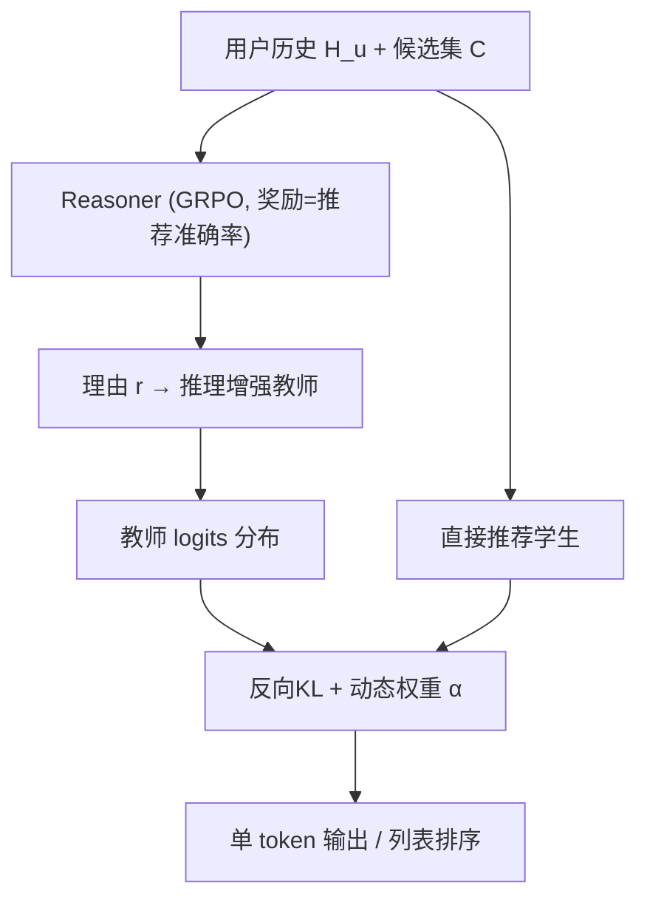
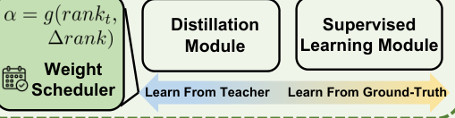

# SelfDR: Self-Distillation from Reasoning for LLM-Based Recommendation (从推理中自蒸馏的 LLM 推荐)

- **会议/期刊**: CIKM 2026
- **作者与机构**: Chumeng Jiang, Jiayin Wang, Xinjie Lin, Zhiqiang Guo, Min Zhang (清华大学 DCST / 泉城实验室), Hengliang Luo (美团)
- **推荐链路定位**: 重排 (Reranking)
- **研究方向**: 大语言模型推荐 / 列表级重排
- **论文原文**: [https://arxiv.org/abs/2609.03313v1](https://arxiv.org/abs/2609.03313v1)
- **开源代码**: [https://github.com/JiangDeccc/SelfDistillation](https://github.com/JiangDeccc/SelfDistillation)

## TL;DR (1分钟核心速览)

LLM 推荐中显式生成推理链（多步推理或 test-time CoT）虽能提升精度，却带来 2–6 倍的推理延迟，难以工业部署。SelfDR 提出"从推理中自蒸馏"：先用下游推荐准确率作奖励、以 GRPO 训练同源 Reasoner 生成针对性理由，拼入输入构成推理增强教师；再让同架构的直接推荐学生通过反向 KL 蒸馏 + 动态权重学习教师的审慎输出。在 3 个数据集的重排协议下，学生仅输出 1 个 token，$H_l@1$ 相对最强基线提升约 15%，推理耗时 109ms/条，与无推理的 SOFT 持平。

## Background & Motivation (背景与核心矛盾)

- **主流范式**: LLM 推荐分三支——零样本提示、监督微调、以及引入显式推理的"多步推理"（EXP3RT 分阶段抽取偏好/画像/打分）与"推理-推荐一体"（COT4Rec、RecSAVER、RecR1 在输出前生成推理链）。
- **前人局限**: ① 推理链使推理延迟从 ~110ms 升至 250–665ms，且需长输出 token；② 依赖外部强 LLM（DeepSeek-V3/GPT）生成推理标签，成本高且存在"强教师未必教出好学生"的认知鸿沟。
- **核心洞察**: 作者发现外部大模型生成的通用理由未必与推荐目标对齐，甚至引入噪声；而**同源小模型经任务奖励训练后，生成的针对性理由反而更可学、蒸馏后效果更好**（图 3、表 4 一致验证）。
- **本文切入点**: 把"推理"从推理期前移到训练期——用自产理由构造教师，再蒸馏回无推理的学生，实现"推理增益、推理零成本"。

## Method (核心方法设计)

### 1. 整体框架 (Overall Architecture)

SelfDR 分两阶段、三模型（共享 LLaMA-3.1-8B-Instruct 底座）。**阶段一**：Reasoner 以用户历史 $H_u$与真实下一物品$M_i$为输入生成理由$r_{u,i}$，该理由拼入推荐输入后由冻结的推荐 LLM 打分，预测正确性作为 GRPO 奖励回传，训练出"任务对齐"的 Reasoner；随后用其理由指令微调出推理增强教师。**阶段二**：同参数初始化的学生仅接收$H_u$与候选集$C_{u,i}$，通过反向 KL 对齐教师 logits 分布，并以动态权重平衡标签监督与蒸馏监督。推理时学生单次前向输出一个字符标识符，无任何理由生成。

<figure class="paper-figure" markdown="span">
  <figcaption>图2：SelfDR框架。以推荐性能为奖励训练一个推理器，为增强推理依据的教师模型生成高质量推理依据。随后，一个直接推荐的学生模型从教师的审慎输出中学习，以进行推理增强的排序，而无需显式推理依据。所有LLM共享同一基础模型。</figcaption>
</figure>

### 2. 关键设计拆解 (Key Designs)

1. **奖励对齐的 Reasoner 训练（GRPO + 防泄漏掩码）**：直接用用户评论当理由会引入大量无关信息且并非所有数据集都有评论。本文以推荐正确性为奖励 $Reward(r_{u,i})=Acc_{rec}(s_{u,i})$，用 GRPO 优化 Reasoner，避免"推理质量指标"与"推荐目标"错配；同时提示模型不得复述元数据，并对与物品标题连续重叠 ≥3 词的片段做细粒度掩码后再算奖励，阻断信息泄漏捷径。

2. **反向 KL 自蒸馏（学 logits 而非学标签）**：若只学教师生成的输出，等价于再学一遍标签，蒸馏退化。故对齐 softmax 前的 logits 分布，并采用反向 KL：
$$\mathcal{D}_{kd}=\sum_{j\in C_{u,i}}p_{\Theta_t}(\mathrm{CI}_j\mid H_u,C_{u,i},r_{u,i})\log\frac{p_{\Theta_t}(\mathrm{CI}_j\mid H_u,C_{u,i},r_{u,i})}{p_{\Theta_s}(\mathrm{CI}_j\mid H_u,C_{u,i})}$$
反向 KL 是 mode-seeking 的，促使学生在教师高概率区域集中，契合"候选集仅 20 个、需精准命中"的重排场景。

3. **动态权重与训练目标**：教师并非总可靠，故令 $\alpha$ 随教师排名与学生的相对关系自适应：
$$\alpha(rank_i^t,rank_i^s)=\alpha_{base}f(rank_i^t-k)\,\sigma\!\left(\tfrac{rank_i^s-rank_i^t}{\tau}\right)^{\beta\,\mathbb{I}(rank_i^t>rank_i^s)},\quad f(x)=1+\tanh(x/\gamma)$$
总损失 $\min_{\Theta_s}(1-\alpha)\mathcal{L}_{ce}+\alpha\mathcal{D}_{kd}$。当教师排名劣于学生时，$\beta$惩罚项显著压低$\alpha$，退回标签监督；教师排名接近阈值$k=5$时$f(\cdot)$ 平滑放大权重。离线蒸馏、教师冻结、学生单 token 输出，训练开销与常规微调同量级。

## Experimental Setup & Evaluation Protocol (实验设置与评估协议)

- **数据集与预处理**（均 `5-core` 过滤）：

| 数据集 | #Users | #Items | #Interactions | 密度 | 说明 |
| :--- | :---: | :---: | :---: | :---: | :--- |
| Clothing | 39,387 | 23,033 | 278,677 | 0.0307% | Amazon 服饰，含评论/属性 |
| Home | 66,519 | 28,237 | 551,682 | 0.0294% | Amazon 家居 |
| ML1M | 6,040 | 3,416 | 999,611 | 4.8448% | 电影评分，文本信号抽象 |

- **数据划分与防穿越**: `Leave-One-Out`；训练集再按时间前后半切分——前半训 Reasoner、后半做蒸馏，避免理由生成看到蒸馏样本。
- **排名评测协议**: `Reranking 设置`——SASRec 生成 top-20 候选，**正样本不保证在候选集中**（比随机负采样更贴近真实）。指标含生成准确率 $H_g@1$与按标识符 token log-prob 排序得到的$H_l@\{1,3,5\}$、$N_l@\{1,3,5\}$。
- **对比基线与超参**: 传统重排（PRM/SetRank/MIR/BGE/Jina）+ LLM 推荐（ZSRanker/SOFT/EXP3RT/COT4Rec/RecSAVER/RecR1），统一 LLaMA-3.1-8B-Instruct 底座；$k=5$，$\alpha_{base}=0.9$，$\beta\approx0.1$，$\tau,\gamma\in[1,2]$；三次种子平均，$p<0.05$ 显著性检验。

## Key Experimental Results (实验关键数据)

### 1. 主实验对比 (Main Results)

Clothing / Home 上 $H_l@1$与$N_l@5$（其余指标趋势一致）：

| 方法 | Clothing $H_l@1$| Clothing$N_l@5$| Home$H_l@1$| Home$N_l@5$| ML1M$H_l@1$ |
| :--- | :---: | :---: | :---: | :---: | :---: |
| Base Rank (SASRec) | 0.0047 | 0.0152 | 0.0049 | 0.0136 | 0.0507 |
| BGE (content) | 0.0079 | 0.0200 | 0.0068 | 0.0155 | 0.0513 |
| ZSRanker | 0.0047 | 0.0157 | 0.0049 | 0.0132 | 0.0507 |
| SOFT | 0.0113 | 0.0217 | 0.0136 | 0.0226 | 0.0753 |
| COT4Rec | 0.0112 | 0.0217 | 0.0142 | 0.0236 | 0.0717 |
| RecSAVER | 0.0095 | 0.0168 | 0.0117 | 0.0180 | 0.0377 |
| RecR1 | 0.0114 | 0.0191 | 0.0128 | 0.0193 | 0.0496 |
| **SelfDR** | **0.0132** | **0.0228** | **0.0148** | **0.0245** | **0.0845** |
| Improv. vs best | +15.8% | +5.1% | +4.2% | +3.8% | +12.2% |

生成准确率 $H_g@1$：Clothing 0.0118 / Home 0.0136 / ML1M 0.0735，均显著优于 RecR1（0.0114/0.0128/0.0515）与 COT4Rec（0.0100/0.0121/0.0575）。

### 2. 消融实验 (Ablation Study)

Clothing 数据集：

| 设置 | $H_g@1$|$H_l@1$|$H_l@3$|$N_l@3$|$N_l@5$ |
| :--- | :---: | :---: | :---: | :---: | :---: |
| Before SD（仅指令微调） | 0.0094 | 0.0112 | 0.0240 | 0.0186 | 0.0215 |
| Sup-Only（仅 CE） | 0.0092 | 0.0108 | 0.0236 | 0.0182 | 0.0214 |
| Dist-Only（仅蒸馏） | 0.0115 | 0.0132 | 0.0247 | 0.0198 | 0.0226 |
| Fixed-$\alpha$=0.5 | 0.0109 | 0.0124 | 0.0245 | 0.0194 | 0.0223 |
| **SelfDR（动态 $\alpha$）** | **0.0118** | **0.0132** | **0.0249** | **0.0200** | **0.0228** |

### 3. 关键实验发现 (Key Findings)

1. **自产理由胜过外部大模型**：以训练后 LLaMA 作 Reasoner，蒸馏后 $H_g@1$在 Clothing 达 0.0118，高于 GPT-4o-mini、Claude-3-Haiku、DeepSeek-V3 作 Reasoner 的结果；教师侧$H_g@1$ 亦以 0.552 居首（Claude 0.508、DeepSeek 0.478、GPT-5-Chat 0.429），说明"可学性"比"绝对能力"更关键。
2. **动态权重是稳定器而非锦上添花**：Fixed-$\alpha$与 Dist-Only 均劣于动态方案（$H_g@1$ 0.0109/0.0115 vs 0.0118），且 Sup-Only 因过拟合反低于 Before SD，证明教师噪声必须被逐样本门控。
3. **效率与泛化双赢**：推理 109.46ms/条、输出 1 token，与 SOFT 持平，远低于 RecSAVER 623ms、RecR1 665ms；跨域迁移（Clothing↔Home）蒸馏后 $H_g@1$ 从 0.0076→0.0095、0.0100→0.0115，说明学到的是可迁移排序知识而非数据集捷径。

## Highlights & Limitations (亮点、对比与审稿批判)

- **与代表作对比 (vs. Prior Work)**: 相较 COT4Rec/RecSAVER 的 test-time 推理，本文把推理成本一次性摊销到训练期；相较 SOFT 的"自生成课程数据"，本文蒸馏的是**推理增强后的 logits 分布**而非硬标签；相较传统 KD（DLLM2Rec/SLMRec），本文教师与学生同源同规模，规避了外部教师选择难题。
- **可迁移亮点**: ① 用下游指标作 GRPO 奖励来"定向生产"中间监督信号，可迁移至解释生成、查询改写等任务；② 基于教师/学生排名差的软门控权重，可直接用于任何离线蒸馏流水线。
- **审稿级局限批判**: ① 候选集仅 20、$k=5$，超参$k$ 与候选规模强耦合，未验证 top-50/100 的工业重排场景；② 两阶段流水线仍需先跑一遍 Reasoner 生成理由，训练总时长 54.18h 高于 SOFT 的 37.79h，且未报告 Reasoner 的显存占用与理由缓存成本；③ 仅在 8B 单一底座上验证，跨规模（1B/70B）适应性缺失。

## Rating (四维评分)

- **方法创新性 (Novelty)**: ⭐⭐⭐⭐ （"推理期→训练期"的范式迁移清晰，奖励对齐 Reasoner + 反向 KL 自蒸馏组合有新意，但单点技术均为已知组件的巧妙拼装）
- **评估协议与实验扎实度 (Protocol & Experiments)**: ⭐⭐⭐⭐ （三数据集 + 重排不保证正样本的严苛协议 + 生成/排序双视角 + 跨生成器与跨域验证，惟缺更大候选集与多底座实验）
- **写作与数学规范度 (Clarity & Rigor)**: ⭐⭐⭐⭐ （三范式对比图与公式推导清晰，动态权重设计动机交代充分，但 $\alpha$上界$\alpha_{max}$ 等符号未在正文完整定义）
- **工业落地与复现价值 (Industrial & Practical Value)**: ⭐⭐⭐⭐⭐ （推理零额外开销、代码开源、无需外部 LLM，直接契合线上重排延迟约束，落地路径最短）

