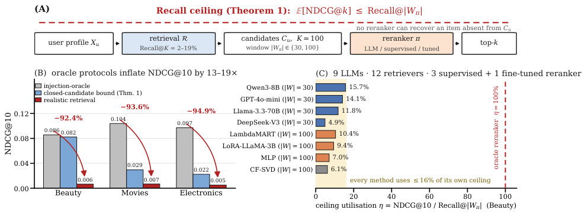
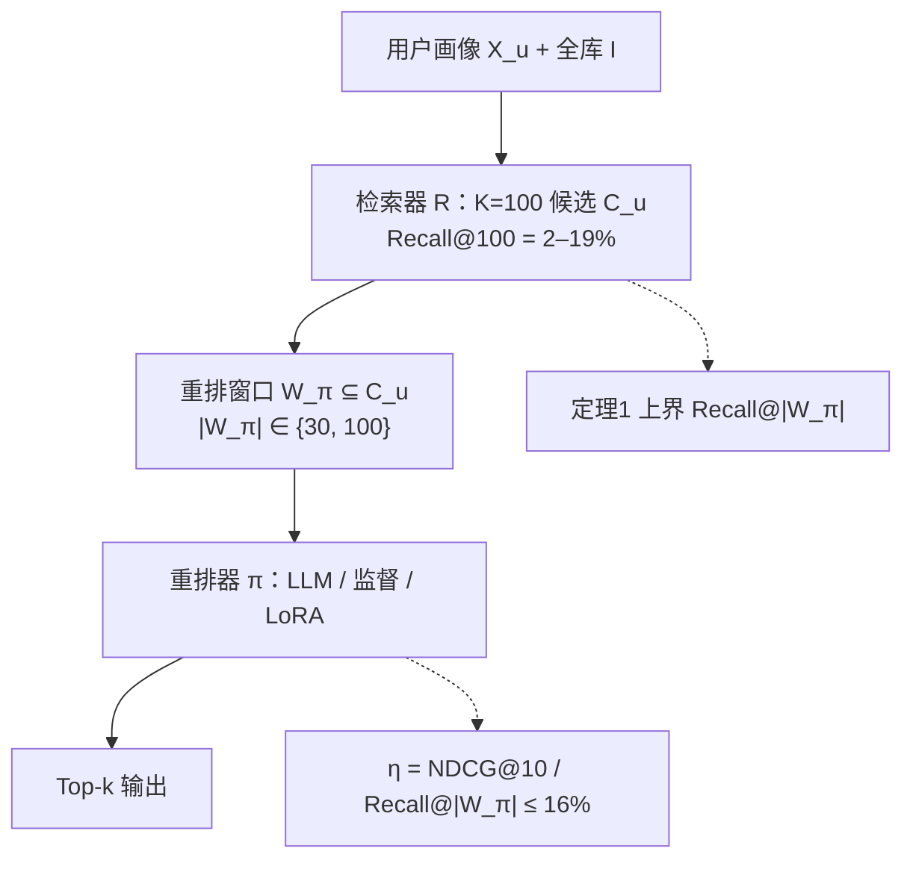

# The Recall Ceiling of LLM Recommendation Reranking (LLM 推荐重排的召回天花板)

- **会议/期刊**: CIKM 2026 (Oral)
- **作者与机构**: Zhaohui Wang, University of Southern California (Viterbi School of Engineering)
- **推荐链路定位**: 重排 (Reranking)，兼论召回-重排级联的瓶颈归属
- **研究方向**: 大语言模型推荐 / 去偏公平与工业评测
- **论文原文**: [https://arxiv.org/abs/2609.27953v1](https://arxiv.org/abs/2609.27953v1)
- **开源代码**: [https://github.com/GeoffreyWang1117/recall-ceiling-cikm2026](https://github.com/GeoffreyWang1117/recall-ceiling-cikm2026)

## TL;DR (1分钟核心速览)

本文是一篇**方法论批判 + 理论界定**论文，而非新模型论文。作者指出：大量 LLM 推荐重排工作采用"注入 Oracle"协议（把 ground-truth 塞进候选集或与采样负例对比打分），该协议在三个 Amazon 主数据集上把 NDCG@10 高估 **92–95%**。根因是**召回天花板**：真实检索在 K=100 时仅覆盖 2–19% 的相关物品，由重排不等式可证任意闭候选重排器满足 $\mathbb{E}[\mathrm{NDCG}@k] \le \mathrm{Recall}@|W_\pi|$。在 168× 参数跨度、12 种检索器、3 类监督重排器、LoRA 微调与 LLM+CF 融合的全维度压力测试下，**无一配置在 Beauty/Movies/Electronics 上显著超越 CF**。作者据此提出 RAEP 召回感知评测协议。

## Background & Motivation (背景与核心矛盾)

- **主流范式**: LLM 重排（zero-shot 列表重排、指令微调、LoRA 微调）被广泛报告在推荐任务上优于传统 CF，评测多采用"注入式 Oracle"或"采样负例打分"。
- **前人局限**: ① 注入协议使候选集召回率恒为 100%，彻底屏蔽了上游检索的失败；② 采样负例协议（1 正 vs 1000 负）同样使 scored set 内召回平凡为 1，二者都无法暴露部署时的真实性能。
- **核心洞察 (Key Insight)**: 重排器无法排序它看不见的物品。作者用**重排不等式 (rearrangement inequality)** 给出一个组合学（而非信息论）的紧上界，并进一步定义**天花板利用率 $\eta$**，从而把"召回失败"与"重排失败"两个耦合效应解耦。
- **本文切入点**: 不提出新重排器，而是量化 Oracle 与真实检索的鸿沟、证明该鸿沟在模型容量/训练信号/检索质量/评测范式/候选预算五个维度上均不可逾越，并给出可操作的评测协议 RAEP。

<figure class="paper-figure" markdown="span">
  <figcaption>图1：总览。(A) 检索-重排流水线；定理1以闭候选重排器自身窗口𝑊𝜋的召回率为其上top-𝑘NDCG的上界。(B) 在三个主要数据集上的注入预言机NDCG@10、闭候选上界与真实检索结果。(C) 在Beauty上，我们测试的每个重排器——零样本LLM、监督模型以及LoRA微调的LLaMA-3.2-3B——仅利用其自身上限的不到16%，且无一显著优于CF。由scripts/make_fig_overview.py根据发布的结果JSON生成。</figcaption>
</figure>

## Method (核心方法设计)

### 1. 整体框架 (Overall Architecture)

论文的分析闭环为：先定义闭候选重排器（输出仅为检索集 $C_u$ 子列表 $W_\pi$ 的置换，其余候选按检索序追加于下），再用定理 1 给出其上界，再用 $\eta$ 度量重排器对自身天花板的利用比例，最后以五维压力测试证伪"重排优化可破天花板"的假设，并落地为 RAEP 四组件协议（召回诊断分级 / RA-NDCG / $\eta$ / 自适应 K）。

### 2. 关键设计拆解 (Key Designs)

1. **定理 1：召回天花板（Recall Ceiling）**：针对"重排器能力"与"候选集质量"被混为一谈的痛点，作者对任意形如 $M@k(\sigma,Y_u)=\sum_{i\ge1} a_i b_i / Z(Y_u)$（$a_i\ge0$ 为增益、$b_1\ge b_2\ge\cdots\ge0$ 为位置折扣）的 top-k 指标，用重排不等式证明最优置换必为"把 $W_\pi\cap Y_u$ 全部前置"的 Oracle 置换，故

$$\mathbb{E}_u\big[M@k(\pi(C_u),Y_u)\big] \le \mathbb{E}_u\big[M^*@k(W_\pi,Y_u)\big].$$

   其价值在于**一个证明覆盖 NDCG/Hit/Recall/MAP/RBP/ERR**，无需逐指标分析；且上界由 $|W_\pi|$（重排器实际看到的窗口）而非检索预算 $K$ 决定——这是本文相对"检索决定重排"这一朴素直觉的关键增量。

2. **两个特化推论与 $\eta$ 利用率**：LOO 单正例下退化为 $\mathbb{E}[\mathrm{NDCG}@k] \le \mathrm{Recall}@|W_\pi|$（因 $\mathbb{E}[\mathrm{NDCG}|R_u{=}1]\le1$）；多正例下退化为恢复集 IDCG 比 $\mathbb{E}[\mathrm{IDCG}_k(|W_\pi\cap Y_u|)/\mathrm{IDCG}_k(|Y_u|)]$。据此定义

$$\eta_\pi=\frac{\mathbb{E}_{u:r_u>0}[\mathrm{NDCG}@k(\pi)]}{\mathbb{E}_{u:r_u>0}[\mathrm{NDCG}^*@k(W_\pi,Y_u)]},$$

   即重排器榨取了自身可达空间的多少。**必须用各自窗口作分母**：列表式 LLM 只看 top-30，若误用 Recall@100 作分母会把 $\eta$ 低估 2.6–2.8×（Beauty 上 Recall@30=3.21% vs Recall@100=8.23%）。

3. **训练目标、负采样与推理效率**：本文无自研损失函数；监督重排器（LambdaMART/RankNet/MLP）以 CF embedding 为特征、在**与评测用户不相交的 250 用户训练池**上训练（这是对前版数据泄漏的自我更正）。LoRA 配置为 LLaMA-3.2-3B-Instruct、$r{=}16/\alpha{=}32$ QLoRA、作用于 $\{q,k,v,o\}$ proj、pointwise 二分类头、3 epoch。推理成本方面：DeepSeek-V4 开启 thinking 后耗时 200–500 s/用户（vs 无思考 <1 s），成本约 37×（$4.75 vs $0.13 / 500 用户），而效果反而显著更差。

## Experimental Setup & Evaluation Protocol (实验设置与评估协议)

- **数据集与预处理**（Amazon 系列均 3-core 过滤 + 时序 LOO 划分；$|\mathcal{I}|$ 仅计训练集中出现的可检索物品）：

| 数据集 | #Users | #Items | #Interactions | 密度 | 特征/场景说明 |
| :--- | :---: | :---: | :---: | :---: | :--- |
| Beauty | 938 | 1,416 | 8,241 | 0.62% | 商品，含标题 |
| Movies | 1,998 | 53,709 | 358,587 | 0.33% | 商品，大目录 |
| Electronics | 2,000 | 28,981 | 183,913 | 0.32% | **ASIN-only，无标题（LLM 空对照）** |
| MovieLens-25M | 10,000 | 19,886 | 3,949,023 | 1.99% | 电影，含类型元数据 |
| MIND News | 86,746 | 20,212 | 2,278,768 | 0.13% | 新闻点击隐式反馈 |

- **数据划分与防穿越**: Amazon 采用 `3-core` + 时序 `Leave-One-Out`（倒数第二交互作验证）；监督重排器额外抽取 **250 训练用户与 500 评测用户完全不相交**，测试物品在检索时不可见。
- **排名评测协议**: 无偏 `Full-Ranking` 语义下的**真实检索候选集**（$K{=}100$），与 `Injection-Oracle`（强制注入正例）和 `Sampled-Negative`（1 正 vs 固定负例池）形成三方对照。指标 NDCG@10 为主，Hit@10 / MAP@10 为辅；统计检验用 bootstrap 95% CI（1,000/10,000 次重采样）+ Wilcoxon signed-rank + Holm-Bonferroni 多重比较校正。
- **对比基线与超参**: 12 种检索器（Popularity/ItemKNN/BPR-MF/CF-SVD/LightGCN-Tuned/SimGCL/SGL/DirectAU/MultiInterest/MultiSource-RRF/SASRec/BERT4Rec），9 个 LLM（Gemma3-4B、Qwen3-8B/32B、GPT-4o-mini、Llama-3.3-70B、DeepSeek-V3-671B、DeepSeek-V4-Pro/Flash、Kimi-K2），3 类监督重排器 + 1 个 LoRA 微调 LLM；CF-SVD 用 128 维 TruncatedSVD；默认 $n{=}500$、seed=42。

## Key Experimental Results (实验关键数据)

### 1. 主实验对比 (Main Results)

**表 A：Oracle vs. 真实检索的 NDCG@10 鸿沟**（Gemma3-4B, $K{=}100$, $n{=}500$）

| Dataset | CF Base | Injection-Oracle [95% CI] | Realistic [95% CI] | 闭候选上界 | Gap |
| :--- | :---: | :---: | :---: | :---: | :---: |
| Beauty | .0050 | **.0856** [.069,.103] | .0065 [.003,.012] | .0823 | 92.4% |
| Movies | .0086 | **.1039** [.095,.113] | .0067 [.004,.009] | .0295 | 93.5% |
| Electronics | .0042 | **.0971** [.088,.107] | .0050 [.003,.008] | .0224 | 94.9% |

**表 B：Beauty 上全类型重排器横向对比**（真实检索，$n{=}500$；$\eta$ 以各自窗口为分母）

| Method | Size | $\lvert W\rvert$ | NDCG@10 | $\eta$ | $p$ vs CF |
| :--- | :---: | :---: | :---: | :---: | :---: |
| CF-Score | — | 100 | .0051 | 6.1% | — |
| Qwen3-8B | 8B | 30 | **.0051** | **15.7%** | n.s. |
| Qwen3-32B | 32B | 30 | .0050 | 15.4% | .655 |
| GPT-4o-mini | ~8B | 30 | .0045 | 14.1% | .374 |
| Gemma3-4B | 4B | 30 | .0045 | 14.1% | .500 |
| Llama-3.3 | 70B | 30 | .0038 | 11.8% | .484 |
| DeepSeek-V3 | 671B | 30 | .0016 | 4.9% | .093 |
| LambdaMART | — | 100 | **.0086** | 10.4% | .142 |
| RankNet | — | 100 | .0085 | 10.3% | .142 |
| LoRA-LLaMA-3B | 3B | 100 | .0078 | 9.4% | .191 |
| 闭候选上界 | — | 100 | .0823 | 100% | — |
| Injection-Oracle | — | — | .0856 | — | — |

**表 C：检索器 Recall@100 (%) 扫描**（$n{=}500$，加粗为该列最优）

| Method | Beauty | Movies | Electronics |
| :--- | :---: | :---: | :---: |
| CF-SVD | 8.23 | 2.99 | 2.56 |
| ItemKNN | 8.37 | 3.64 | 2.04 |
| LightGCN-Tuned | **12.33** | 3.84 | 2.90 |
| SimGCL | 5.19 | 3.78 | 2.38 |
| SGL | 8.43 | 4.31 | 2.35 |
| DirectAU | 7.95 | **4.81** | 1.88 |
| MultiInterest | 9.62 | 3.43 | **3.13** |
| MultiSource-RRF | 10.12 | 4.45 | 2.93 |

### 2. 消融实验 (Ablation Study)

| 消融维度 | 配置 | 关键结果 | 结论 |
| :--- | :--- | :--- | :--- |
| 提示工程 | P1/P2/P3 | Oracle 下 P2 比 P1 +52% (.0814 vs .0535)；真实下全部 ≤.004，P3 反低 22% | 提示收益仅在 Oracle 下存在 |
| 模型规模 | 4B→671B (168×) | Movies 上 .0098 (Qwen3-8B) → .0054 (Llama-3.3-70B) | 规模无正收益，大模型方向性更差 |
| 推理模型 | V4-Pro/Flash ±think | V4-Pro-think −43% ($p{=}.004$)、V4-Flash-think −50% ($p{=}.0007$) | 思考链在无正例时无对象可推理 |
| 监督重排 | 6 数据集、不相交划分 | 无一显著优于 CF；Office 上 RankNet −81% ($p{=}.003$) | 前版"8.8% 召回阈值"系数据泄漏 |
| 分数感知提示 | GPT-4o-mini | Beauty −36.7%→−15.3%；$\tau$ 从 .881 升至 .946 | 提升来自"更少推翻 CF"而非新信息 |
| 候选预算 | $K$: 10→200 | Recall 0.82%→12.86%，LLM 相对 CF 从 −12.6% 恶化至 −54.4% | 天花板升高但注意力被稀释 |
| 混合检索 | CF+BM25+Dense RRF | Beauty 6.80%→7.80%（+15%），Movies/Electronics 反降 | 小目录微增，大目录噪声主导 |
| 学习式级联 | LambdaMART 12 特征 | Beauty +57% ($p{=}.26$, $\eta{=}9.7$%)，Movies −44% | 特征重要性由 CF 类信号主导 |
| 多正例 | last-5 | Recall 9.21%/3.93%/2.83%，NDCG 仍 <.014 | 天花板结论不依赖 LOO 单正例 |

### 3. 关键实验发现 (Key Findings)

1. **Oracle 协议的系统性高估是量级性的，而非边际性的**：三个主数据集上 Oracle 报出 .086–.104 的 NDCG@10，真实检索下坍缩至 .005–.007，差距 92.4–94.9%；且该差距在 NDCG/Hit/MAP 上一致为 76–96%，说明这不是指标选择问题。Beauty 上 8% 召回意味着 **92% 的用户候选集中根本没有任何相关物品**，对这些用户所有重排器的 NDCG 恒为 0。
2. **双重失败：天花板低 + 利用率更低**：Beauty 上 $\eta$ 在 9 个 LLM 中仅 4.9%–15.7%，在 3 个全窗口监督重排器与 LoRA 微调模型中仅 7.0%–10.4%，**无一超过 16%**。这意味着即便把召回从 8.23% 提到 12.33%（LightGCN-Tuned），重排器能兑现的增量仍被 $\eta$ 二次压缩——投资于提示/规模/训练信号，本质是在投资一个经验上极小的 $\eta$。
3. **"给 LLM 更多结构化信号"的收益机制是服从而非增益**：分数感知提示把 Beauty 差距从 −36.7% 收窄到 −15.3%，但同时 Kendall $\tau$ 从 .881 升至 .946；在评测用户上调参的 LLM+CF 凸融合最优解为 $\lambda{=}0.7$–$0.8$（CF 主导），最终**恰好恢复 CF 本身**（Beauty .0051）。这直接证伪了"LLM 欠缺 CF 分数信息"这一常见辩护。

## Highlights, Limitations & Rating (亮点、对比与审稿评价)

- **与代表作对比 (vs. Prior Work)**: 相对 LLMRank [11]（同时报告两种 regime 但未测召回、未建立联系，$K{=}20$、目录仅 3,706/16,859）与 EXP3RT [16]（20 个 CF 候选、小目录），本文的增量是**显式上界 + 实测鸿沟 + 部署级操作点**（$K{=}100$、$|\mathcal{I}|$ 达 53,709）。作者亦明确声明 TALLRec（单物品二分类、报 AUC）、GPT4Rec（生成查询后全库 BM25 检索）、RankGPT（段落检索而非推荐）**不属于**其批判范围——这种协议审计的严谨度在同类批判性论文中少见。
- **可迁移亮点**: ① **$\eta$ 利用率指标**可移植到任何"召回-精排"级联诊断，只需把分母换成重排器自身窗口的 Oracle 上界；② **RAEP 四组件**（CRITICAL/LOW/MODERATE/ADEQUATE 分级 + RA-NDCG + $\eta$ + 自适应 K）可直接作为 LLM4Rec 论文的评测 checklist；③ 数据泄漏自查方法（重叠/不相交半集/独立干净池三协议复现）值得所有监督重排工作借鉴。
- **审稿级局限批判**: ① **统计功效不足**：$n{=}500$ 下 92–97% 用户 NDCG 并列于 0，有效非零样本仅 15–40，作者自承无法检测 $d<0.10$ 的效应，因此"无显著提升"部分等价于"无证据"，而非"证明无效"；② **regime 外推风险**：所测召回仅 2–19%，生产系统若召回 ≥30%（RAEP 的 ADEQUATE 档）则天花板显著放松，本文结论未必成立，作者对此有明确免责但削弱了实践指导力；③ **Electronics 为 ASIN-only 空对照**，其 LLM 结果（$\tau{=}1.000$）不构成语义重排证据，却被计入"三数据集均无提升"的总结论，略微放大了结论的覆盖面；④ 密度-召回回归仅 $R^2{=}0.39$（$n{=}8$），属描述性观察而非可预测模型。
- **四维评分**: 创新性 ⭐⭐⭐⭐（定理本身不惊人，但 $\eta$ 与协议审计的组合有真正的方法论价值）| 实验扎实度 ⭐⭐⭐⭐⭐（五维压力测试 + 自我更正数据泄漏 + 全量代码/JSON 开源，$1.24 API 成本可完全复现）| 方法清晰度 ⭐⭐⭐⭐⭐ | 落地价值 ⭐⭐⭐⭐（对 LLM4Rec 社区是一记必要的冷水，但受限于低召回 regime）

