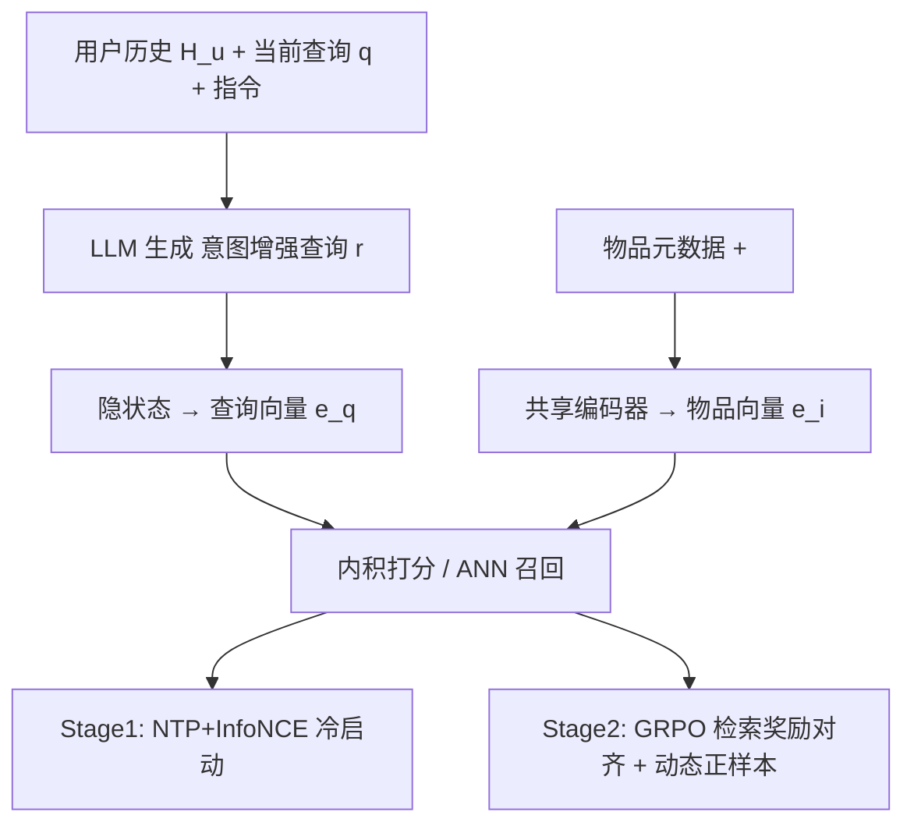
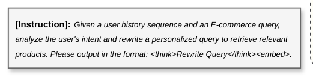

# Think-to-Personalize: Unifying Reasoning and Retrieval for User-Centric Personalized Dense Retrieval (思考即个性化：统一推理与检索的用户中心个性化稠密检索)

- **会议/期刊**: CIKM 2026
- **作者与机构**: Angqing Jiang, Gaoming Zhang, Defu Lian (USTC)；Jianchun Song, Kena Qi, Dayao Chen, Wei Lin (美团)
- **推荐链路定位**: 召回（个性化稠密召回通道）
- **研究方向**: 大语言模型推荐 / 协同过滤与双塔召回
- **论文原文**: [https://arxiv.org/abs/2608.18855v2](https://arxiv.org/abs/2608.18855v2)
- **开源代码**: [https://github.com/PhilipGAQ/ttp](https://github.com/PhilipGAQ/ttp)

## TL;DR (1分钟核心速览)

本地生活电商的查询稀疏且歧义（"Thai"、"Luck"），存在查询字面与用户潜在意图之间的 **intent gap**；现有 LLM 稠密检索仍是 query-centric，个性化方法又只做隐式 embedding 交互、缺乏显式推理，而 rewrite-then-retrieve 流水线中重写器与检索器目标错位。TTP 让 LLM 在用户历史订单上显式推理并生成 **intent-enhanced query**，与物品共享同一编码器输出统一 embedding，再用 SFT + GRPO 两阶段把推理过程与检索效用对齐。在自研四测试集与 KuaiSearch/Amazon 上全指标 SOTA，Broad 集 Recall@20 相对 Qwen-Embedding 提升 +7.47%，线上 7 天 A/B 订单量 +0.46%。

## Background & Motivation (背景与核心矛盾)

- **主流范式**: 稠密检索已从 BERT 双塔（DPR/BGE）演进到 LLM embedding（NV-Embed、Qwen3-Embedding），近期 Search-R3、LREM 开始让 LLM 先"想"再编码；个性化侧则以 UIA、MAPs 等隐式序列建模或 PBR/CoPS 式外挂重写器为主。
- **前人局限**: ① query-centric 推理只扩展查询表面语义，无法利用用户历史弥合歧义；② 隐式 embedding 交互在噪声历史下缺乏显式消歧能力；③ 解耦流水线中重写器按因果语言建模优化，与下游检索目标不对齐，生成理由与召回效果脱节。
- **核心洞察 (Key Insight)**: 在本地生活场景，宽泛/长尾查询的潜在意图**本就藏在用户历史购买序列里**（如搜"Thai"而历史全是按摩温泉），显式推理比隐式匹配更能从噪声历史中抽取信号。
- **本文切入点**: 把推理范围从 query 扩展到 (user, query) 对，并将推理生成与稠密编码放进**同一个 LLM、同一个 <embed> 表征**，端到端联合优化。

## Method (核心方法设计)

### 1. 整体框架 (Overall Architecture)

输入构造为 `[INST] ⊕ I_task ⊕ H_u ⊕ q ⊕ [/INST]`，模型先输出 `<think> r </think>` 的意图增强查询 $r$，再输出 `<embed>` 特殊 token，取其最后一层隐状态作为查询向量 $e_q$；物品侧序列化元数据后追加同一 `<embed>` token，用**共享编码器**得 $e_i$，打分 $s(q,i)=e_q^\top e_i$。训练分两阶段：Stage 1 用 NTP + InfoNCE 联合损失做冷启动 SFT；Stage 2 用 GRPO 配合检索感知奖励与动态正样本选择，把生成推理对齐到召回效用。线上则以 T+1 个性化缓存 + 305M 蒸馏双塔承接实时流量。

<figure class="paper-figure" markdown="span">
  <figcaption>图 1：Think-to-Personalize 训练框架概览。我们首先通过联合损失进行 SFT 建立冷启动能力。随后，我们采用带有检索感知奖励函数和动态正样本选择的 GRPO，使生成的推理过程与下游检索性能对齐。</figcaption>
</figure>

### 2. 关键设计拆解 (Key Designs)

1. **意图增强查询的统一编码（Intent-Enhanced Query）**：痛点是 query-centric 编码丢失历史语境、解耦重写器与检索器目标错位 $\to$ 让推理文本与查询共享同一 `<embed>` 表征，检索梯度可直接回传到生成侧 $\to$ 物理直觉是"推理即查询扩展，但扩展结果落在检索空间里"，避免重写语义漂移。

2. **检索感知的复合奖励 + 动态正样本选择**：GRPO rollout 常产出噪声重写，随机选正样本会污染对比学习 $\to$ 奖励设计为
$$R=\lambda_{fmt}R_{format}+\lambda_{len}R_{length}+\lambda_{ret}\big[\alpha\Delta S_{pos}+\beta\Delta S_{margin}\big]$$
其中 $\Delta S_{pos}=s(q',i^+)-s(q,i^+)$，$\Delta S_{margin}$ 为相对负样本均值的 margin 增益，并裁剪到 $[-1,1]$；对比学习正样本取组内 $y^*=\arg\max_{y_i}R_{retrieval}(y_i)$，若 $R_{retrieval}(y^*)\le 0$ 则回退原查询 $q$。关键在于**奖励模型冻结为 SFT 模型**，作为稳定语义锚点防止 reward hacking。

3. **训练目标、负采样与推理效率**：Stage 1 为 $\mathcal{L}_{Stage1}=\lambda_{gen}\mathcal{L}_{gen}+\mathcal{L}_{cl}$（$\lambda_{gen}=0.5$，$\tau=0.02$）；Stage 2 为 $\mathcal{L}_{Stage2}=\mathcal{L}_{GRPO}+\lambda_{cl}\mathcal{L}_{cl}$（$\lambda_{cl}=0.1$）。全部对比目标使用 **in-batch negatives**，无额外难负采样。骨干 Qwen2.5-3B-Instruct + LoRA(r=16)，embedding 维 2048，GRPO group size 8。推理侧靠 T+1 缓存（覆盖 10.59% QV）与 305M 蒸馏双塔（联合优化 $\langle q,p^+\rangle$、$\langle q_r,p^+\rangle$、$\langle q,q_r\rangle$ 三目标）压延迟。

## Experimental Setup & Evaluation Protocol (实验设置与评估协议)

- **数据集与预处理**: 自研四测试集来自真实日志，历史为过去一年购买记录，超长历史用 `bge-reranker-v2-m3` 选 top-$N$（$N=10$）后按时间重排；训练数据由 Qwen3-32B 生成 1M 样本，经 reranker 按 rewrite gain 过滤，RL 仅用增益 top-30%。

| 数据集 | #Queries | #Items | Avg.Hist | Avg.Q-Len | 场景说明 |
| :--- | :---: | :---: | :---: | :---: | :--- |
| General | 15,795 | 4,481,107 | 8.1 | 7.3 | 线上日志随机采样 |
| Broad | 14,634 | 4,481,107 | 8.1 | 6.2 | 歧义/欠指定查询 |
| LongTail | 7,746 | 4,481,107 | 7.8 | 10.1 | 尾部 10% 低频查询 |
| Relevance | 300,000 | 300,000 | - | 7.4 | 无历史相关性集，13B LLM 三级标注 |
| KuaiSearch | 8,468 | 6,634,118 | 16.5 | 10.0 | 公开，lite-recall 版 |
| Amazon | 2,174 | 35,772 | 40.1 | 36.0 | PersonalWAB 合成查询 |

- **数据划分与防穿越 (Splitting Strategy)**: 自研集按日志采样构造、以用户实际购买物品为 ground truth；公开集严格沿用原始 split 与评测协议。
- **排名评测协议 (Ranking Protocol)**: 自研集为 **Full-Ranking 全库排序**，报 Recall@{10,20,100} 与 MRR@100；Relevance 集报 Spearman 相关；公开集沿用 HR@20/nDCG@20/R@20。
- **对比基线与超参设置**: 三类基线——通用检索（BM25/BERT-base/Qwen-Embedding）、隐式历史建模（UIA/History-Aware/MAPs/CoPPS）、生成增强（HyDE/P-PRF/Decoupled-Stage，统一用 Qwen2.5-3B 生成 + Qwen-Embedding 检索）。提升在 $p<0.05$ 下显著；8×A100 训练。

## Key Experimental Results (实验关键数据)

### 1. 主实验对比 (Main Results)

| Method | General R@20 | General R@100 | Broad R@20 | LongTail R@20 | Relevance Spearman |
| :--- | :---: | :---: | :---: | :---: | :---: |
| BM25 | 42.37 | 61.96 | 42.04 | 29.15 | - |
| Qwen-Embedding | 44.20 | 64.55 | 41.27 | 29.76 | 48.51 |
| UIA | 42.19 | 62.87 | 42.25 | 32.18 | - |
| MAPs | 45.76 | 66.03 | 45.57 | 33.84 | - |
| HyDE | 36.86 | 53.81 | 31.29 | 29.76 | - |
| Decoupled-Stage | 45.89 | 65.03 | 45.08 | 35.18 | - |
| TTP (SFT Only) | 45.38 | 65.01 | 45.66 | 35.70 | 49.43 |
| **TTP (SFT+RL)** | **47.52** | **68.02** | **48.74** | **38.65** | **50.09** |
| Improv.% (vs 最强基线) | +3.55% | +3.01% | +6.96% | +9.86% | +3.26% |

公开集：Amazon HR@20 **90.17**（vs MAPs 89.87、Decoupled 87.17）；KuaiSearch HR@20 **21.94** / R@20 **16.21**（vs Decoupled 20.04/14.27）。

### 2. 消融实验 (Ablation Study)

| 变体 | General R@20 | Broad R@20 | LongTail R@20 | Avg. R@20 |
| :--- | :---: | :---: | :---: | :---: |
| Qwen-Embedding | 44.20 | 41.27 | 29.76 | 38.41 |
| TTP (SFT) | 45.38 | 45.66 | 35.70 | 42.25 |
| TTP (SFT) w/o Intent-Q | 44.48 | 43.68 | 33.66 | 40.61 |
| TTP (SFT+RL) w/o Intent-Q | 44.81 | 44.93 | 34.30 | 41.35 |
| TTP (SFT+RL) w/o Dynamic Selection | 41.39 | 41.02 | 30.71 | 37.71 |
| TTP (SFT+RL) w/ Unfrozen Reward | 32.48 | 33.74 | 22.36 | 29.53 |
| TTP (SFT+RL) w/o Positive Gain α | 45.18 | 45.75 | 35.29 | 42.07 |
| TTP (SFT+RL) w/o Margin Gain β | 46.82 | 47.16 | 37.73 | 43.90 |
| **TTP (SFT+RL)** | **47.52** | **48.74** | **38.65** | **44.97** |

### 3. 关键实验发现 (Key Findings)

1. **RL 对齐是增益主引擎，且对歧义查询放大最明显**：SFT→RL 使 Broad 集 Intent-Q 带来的额外增益从 +1.98pt 扩到 +3.81pt，LongTail 从 +0.88pt 扩到 +2.40pt，说明 GRPO 不只是提升生成质量，而是把推理真正"拧"向召回效用。
2. **动态正样本选择是稳定性的命门**：随机选正样本使 Avg. R@20 跌至 37.71%（低于 SFT 的 42.25%），而让策略模型自评奖励（unfrozen reward）更崩到 29.53%，证实自指偏差导致 reward hacking，冻结 SFT 锚点是必要设计。
3. **历史长度存在甜点、重写行为克制**：$N=10$ 时 Avg. R@20 达 44.97 峰值，$N=20$ 回落至 44.57；人工标注 200 例宽泛查询中 34.0% 保持原查询，重写案例里 Intent Disambiguation 占 52.3%、Preference Extraction 占 40.9%，过度个性化仅 2.3%，说明模型学会了"何时不改"。

## Highlights, Limitations & Rating (亮点、对比与审稿评价)

- **与代表作对比 (vs. Prior Work)**: 相比 Search-R3/LREM 的 query-centric 推理，TTP 把推理对象换成 (user, query) 对；相比 MAPs 的隐式序列交互，它用显式自然语言推理消歧；相比 Decoupled-Stage 的重写-检索分离流水线，共享编码器让检索梯度直达生成侧，General R@100 领先 +2.99pt。
- **可迁移亮点**: ① "冻结 SFT 模型作奖励锚点 + 组内按奖励选正样本"可复用到任何 LLM 生成式召回/查询扩展的 RL 对齐；② 三目标蒸馏（$\langle q,p^+\rangle$/$\langle q_r,p^+\rangle$/$\langle q,q_r\rangle$）是把 3B 推理能力压进 305M 实时双塔的实用配方。
- **审稿级局限批判**: ① 训练依赖 Qwen3-32B 教师生成 1M 数据 + GRPO rollout，离线成本高，且增益 top-30% 的筛选阈值缺乏敏感性分析；② 线上主路径实为蒸馏 305M 模型（Avg. R@20 43.10 vs 教师 44.97），真实收益部分来自缓存命中，A/B 的 +0.46% 订单量提升幅度较小、未报告置信区间与长期留存影响。
- **四维评分**: 创新性 ⭐⭐⭐⭐ | 实验扎实度 ⭐⭐⭐⭐⭐ | 方法清晰度 ⭐⭐⭐⭐ | 落地价值 ⭐⭐⭐⭐⭐

