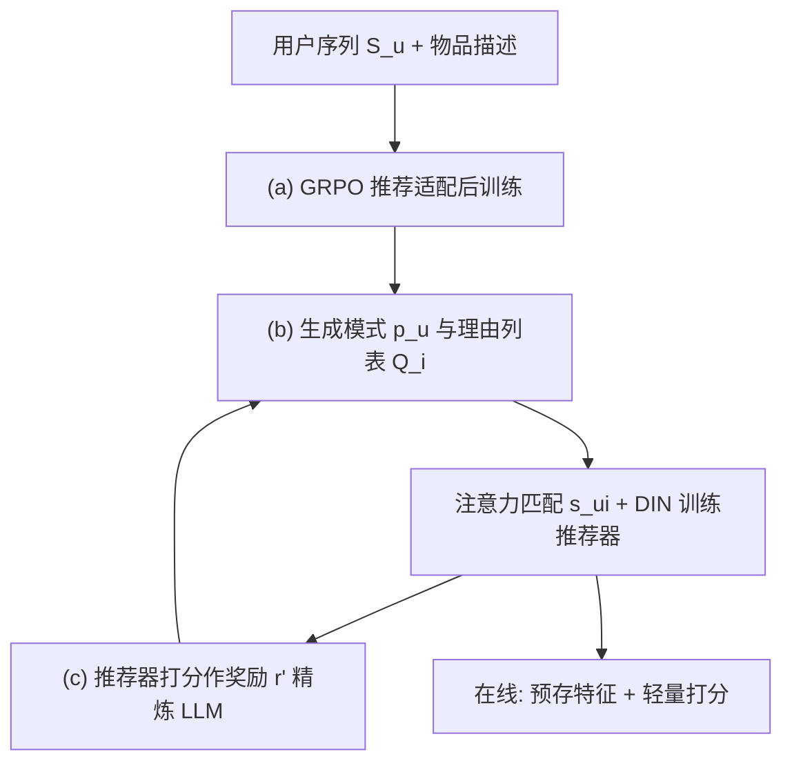
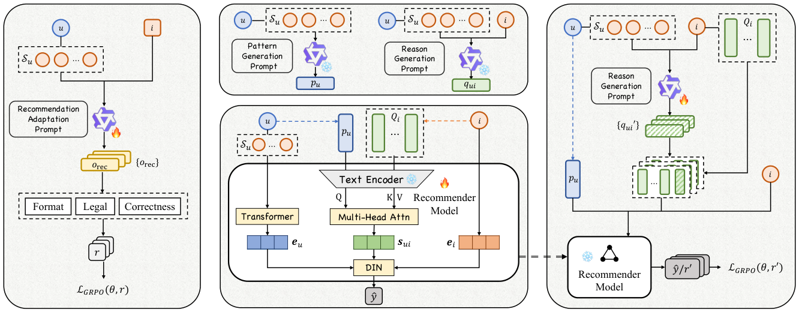

# Towards Comprehensible Recommendation with Large Language Model Fine-tuning (面向可理解推荐的大语言模型微调)

- **会议/期刊**: CIKM 2026
- **作者与机构**: Yunze Luo, Kaigui Bian (北京大学)；Yinjie Jiang, Gaode Chen (快手)；Xinghua Zhang (独立研究者)
- **推荐链路定位**: 精排（LLM 离线生成特征 + 轻量序列推荐器在线打分）
- **研究方向**: 大语言模型推荐 / 序列推荐
- **论文原文**: [https://arxiv.org/abs/2508.07595v2](https://arxiv.org/abs/2508.07595v2)
- **开源代码**: [https://github.com/Sycamoretail/CURec](https://github.com/Sycamoretail/CURec)

## TL;DR (1分钟核心速览)

传统 ID 协同过滤与内容特征方法存在「语义-协同鸿沟」：物品描述是面向所有人的，而用户喜欢同一部电影的理由却因人而异（图 1）。CURec 提出三阶段框架：先用 GRPO 做推荐对齐后训练，让 LLM 具备 CoT 推理与结构化输出能力；再用其生成用户兴趣模式 $p_u$与物品推荐理由列表$Q_i$，以注意力匹配后接入 DIN 训练推荐器；最后把推荐器打分当作奖励信号反向精炼 LLM。在 MovieLens / Video Games / Movies and TV 三个数据集上采用 Leave-One-Out + Full-Ranking 协议，Recall@5 相对最强基线平均提升 14.95% / 13.95% / 17.53%，且在线推理延迟与 SASRec 同量级。

## Background & Motivation (背景与核心矛盾)

- **主流范式**: 一路是 ID-based 序列模型（SASRec、DuoRec、MAERec），靠记忆历史交互；另一路是内容增强（UniSRec、RecFormer）与 LLM 增强（KAR、LEARN、AlphaRec），用文本或 LLM 知识补充物品表征。
- **前人局限**: 其一，内容类方法只做「物品视角」的语义描述，无法刻画「为什么这个用户会喜欢这个物品」的协同理由，语义与协同之间存在结构性错位；其二，直接用 LLM 生成理由会因训练目标与推荐目标不一致而产生幻觉、泛化、无信息量的解释。
- **核心洞察 (Key Insight)**: 同一物品在不同用户交互序列下应被赋予不同的「推荐理由」，这些理由构成物品的多视角内容表征；而理由质量好坏，恰好可以由推荐模型的预测分数来客观度量——这为用 RL 把推荐信号回灌给 LLM 提供了天然奖励。
- **本文切入点**: 不做端到端联合训练（LLM 与轻量推荐器数据需求、训练时长差距过大），而是「先训推荐器、再用推荐器当裁判精炼 LLM」的解耦式三阶段流水线。

## Method (核心方法设计)

### 1. 整体框架 (Overall Architecture)

CURec 分三阶段闭环：(a) 用推荐适配提示 $prompt_{rec}$驱动 LLM 做 CoT 推理并在候选列表$N_{ui}$中选物品，以格式/合法性/正确性三重规则奖励做 GRPO 后训练；(b) 用对齐后的 LLM 分别以$prompt_{pattern}$、$prompt_{reason}$生成用户兴趣模式$p_u$与物品理由列表$Q_i=\{q_{ui}\}$，编码后以用户模式为 Query、理由列表为 Key/Value 做多头注意力得到匹配表征$s_{ui}$，与序列用户表征、物品 ID 表征一起送入 DIN 训练推荐器；(c) 冻结推荐器，把新生成理由$q'_{ui}$追加进$Q_i$后的预测分$\hat{y}_{ui}$作为奖励$r'$，再跑一轮 GRPO 精炼 LLM。在线推理时模式与理由全部预计算存储，仅激活轻量推荐器。

<figure class="paper-figure" markdown="span">
  <figcaption>图 4：CURec 的框架，包括 (a) 面向推荐系统的 LLM 适配、(b) LLM 增强的推荐器训练，以及 (c) 推荐器引导的 LLM 精炼。</figcaption>
</figure>

### 2. 关键设计拆解 (Key Designs)

1. **推荐适配后训练（把 LLM 拉进推荐目标空间）**：痛点在于 LLM 原生目标是对话补全，直接推荐会输出泛化答案。本文构造 $prompt_{rec}$要求模型在 `<think>` 内分析长短期兴趣、在 `<answer>` 内输出候选 ID，奖励由格式奖励、合法性奖励（预测项须在$N_{ui}$ 内）、正确性奖励（命中 ground truth）三部分构成，用 GRPO 优化：
$$\mathcal{J}_{GRPO}(\theta,r)=\mathbb{E}\Big[\tfrac{1}{G}\textstyle\sum_{n=1}^{G}\big(\rho_n-\beta D_{KL}(LLM_\theta\|LLM_{ref})\big)\Big],\ \rho_n=\min[\delta_n A_n,\ \text{clip}(\delta_n,1-\epsilon,1+\epsilon)A_n]$$
其中优势 $A_n$由组内$G$ 个奖励标准化得到。直觉：组内相对比较天然适配「候选列表里选一个」的排序型任务，无需 critic 网络。

2. **协同视角理由列表 + 注意力匹配（把理由变成可解释的匹配算子）**：物品不再用一段通用描述，而是聚合所有历史交互用户生成的 $Q_i=\{q_{ui}\}_{u\in S_i}$，形成多视角内容表征。匹配表征为
$$\boldsymbol{s}_{ui}=\text{MultiHeadAttention}(\boldsymbol{e}_{p_u},\boldsymbol{E}_{Q_i},\boldsymbol{E}_{Q_i})$$
预测分 $\hat{y}_{ui}=\text{DIN}([\boldsymbol{e}_u,\boldsymbol{e}_i,\boldsymbol{s}_{ui}])$。直觉：注意力权重直接指示「哪条理由打动了该用户」，可解释性与精度同源，而非事后补解释。

3. **推荐器引导的 LLM 精炼（用协同信号纠幻觉）**：新理由 $q'_{ui}$追加进理由列表后重算预测分作为奖励$r'=\hat{y}_{ui}=f(p_u,Q_i\cup\{q'_{ui}\},S_u,i)$，冻结推荐器、只更新 LLM 参数$\theta_{new}=\theta_{old}-\alpha\nabla_\theta\mathcal{J}_{GRPO}(\theta,r')$。训练损失为负对数似然$\mathcal{L}=-\log\frac{\exp(\hat{y}_{ui})}{\sum_{i^-}\exp(\hat{y}_{ui^-})}$，负样本来自用户未交互物品（in-batch 式采样）。精炼阶段每个数据集仅耗 27.7 GPU-hours，远低于后训练的 79.6 GPU-hours。

## Experimental Setup & Evaluation Protocol (实验设置与评估协议)

- **数据集与预处理**: 评分 >3 视为正样本并删除全部负样本；保留交互数 ≥30 的用户与 ≥10 的物品。

| 数据集 | #Users | #Items | #Interactions | 密度 | 场景说明 |
| :--- | :---: | :---: | :---: | :---: | :--- |
| MovieLens | 6,041 | 3,952 | 575,292 | 2.41% | 电影评分，内容描述丰富 |
| Video Games | 15,459 | 12,540 | 227,575 | 1.17‰ | Amazon-2023 游戏评论，极稀疏 |
| Movies and TV | 12,722 | 20,551 | 405,189 | 1.55‰ | Amazon-2023 影视评论 |

- **数据划分与防穿越 (Splitting Strategy)**: `Leave-One-Out`，每个用户最后一条交互作测试；LLM 后训练用每用户序列前 80%，精炼阶段用后 20%，避免测试信息泄漏。
- **排名评测协议 (Ranking Protocol)**: 无偏 `Full-Ranking`，对全物品集排序，不做负采样评估；指标 Recall@{1,5,10,20} 与 NDCG@{5,10,20}。
- **对比基线与超参设置**: 11 个基线，覆盖传统 CF（NCF/SASRec/Bert4Rec/DuoRec/MAERec）、内容类（UniSRec/RecFormer）、LLM 增强类（LLMRec/KAR/LEARN/AlphaRec）。LLM 主干 Qwen2.5-7B，推荐器 embedding 维度 $d=64$、batch size 128、Adam 学习率 1e-3；LLM 侧 AdamW 学习率 5e-7 + cosine 调度、2 epochs。

## Key Experimental Results (实验关键数据)

### 1. 主实验对比 (Main Results)

| 数据集 | 指标 | MAERec | RecFormer | KAR | LEARN | AlphaRec | **CURec** | Improv.% |
| :--- | :--- | :---: | :---: | :---: | :---: | :---: | :---: | :---: |
| MovieLens | R@5 | 0.1166 | 0.1178 | 0.1225 | 0.1016 | 0.1215 | **0.1457** | +18.94% |
| MovieLens | N@5 | 0.0770 | 0.0761 | 0.0807 | 0.0681 | 0.0794 | **0.0952** | +17.97% |
| MovieLens | R@20 | 0.2721 | 0.2642 | 0.2787 | 0.2603 | 0.2807 | **0.3096** | +10.29% |
| Video Games | R@5 | 0.0478 | 0.0502 | 0.0484 | 0.0405 | 0.0473 | **0.0587** | +16.93% |
| Video Games | N@10 | 0.0404 | 0.0402 | 0.0420 | 0.0316 | 0.0401 | **0.0502** | +16.74% |
| Movies and TV | R@5 | 0.0454 | 0.0547 | 0.0598 | 0.0592 | 0.0626 | **0.0721** | +15.18% |
| Movies and TV | N@20 | 0.0473 | 0.0540 | 0.0604 | 0.0578 | 0.0616 | **0.0723** | +17.37% |

冷启动分桶（后 50% 低频用户/物品）上优势更明显：MovieLens 冷用户 R@1 从 AlphaRec 的 0.0348 升至 0.0410；冷物品 R@1 从 KAR 的 0.0094 升至 0.0169（近乎翻倍）。

### 2. 消融实验 (Ablation Study)

| 变体 | ML R@5 | ML N@5 | VG R@5 | VG N@5 | MTV R@5 | MTV N@5 |
| :--- | :---: | :---: | :---: | :---: | :---: | :---: |
| Text（原始描述替代理由） | 0.1203 | 0.0785 | 0.0495 | 0.0333 | 0.0625 | 0.0509 |
| w/o Refine（去掉精炼） | 0.1353 | 0.0890 | 0.0505 | 0.0346 | 0.0704 | 0.0576 |
| 理由利用: AP | 0.1368 | 0.0909 | 0.0539 | 0.0367 | 0.0670 | 0.0563 |
| 理由利用: MLP | 0.1388 | 0.0911 | 0.0528 | 0.0357 | 0.0638 | 0.0536 |
| 理由利用: SA | 0.1397 | 0.0923 | 0.0541 | 0.0363 | 0.0659 | 0.0557 |
| 融合: MLP | 0.1425 | 0.0921 | 0.0519 | 0.0355 | 0.0683 | 0.0578 |
| 融合: BI | 0.1434 | 0.0936 | 0.0562 | 0.0384 | 0.0713 | 0.0598 |
| **CURec** | **0.1457** | **0.0952** | **0.0587** | **0.0403** | **0.0721** | **0.0602** |

### 3. 关键实验发现 (Key Findings)

1. **「协同视角」而非「更细描述」才是增益来源**：把理由整体替换为原始物品文本（Text 变体）后，MovieLens R@5 从 0.1457 掉到 0.1203，甚至低于 KAR 的 0.1225——说明单纯堆砌语义描述无法跨越语义-协同鸿沟，增益来自「因人而异的理由」这一表征形式本身。
2. **推荐器引导的精炼是必要而非锦上添花**：去掉精炼（w/o Refine）在 Movies and TV 上 R@5 从 0.0721 降至 0.0704、Video Games 上 N@5 从 0.0403 降至 0.0346；GPT-4 的 GSB 评测显示精炼后仍有 46–49.5% 的理由被判为优于已适配版本，仅约 25% 变差，证明推荐分数作为奖励能有效压制幻觉与泛化表述。
3. **注意力匹配优于池化式融合，而融合器本身不敏感**：理由利用方式从 AP（0.1368）→ SA（0.1397）→ 注意力匹配（0.1457）单调提升，说明「哪条理由打动该用户」的显式对齐是关键；但下游融合从 DIN 换成 BI/MLP 仅差 0.002–0.003，表明瓶颈在特征质量而非融合网络容量。此外 LLM 规模实验显示 <3B 参数时性能显著塌陷，7B 是性价比拐点。

## Highlights & Limitations (亮点、对比与审稿批判)

- **与代表作对比 (vs. Prior Work)**: 相比 KAR/LEARN 这类「LLM 生成静态特征喂给推荐器」的单向蒸馏，CURec 增加了推荐器→LLM 的反向奖励闭环，使内容特征持续向协同目标收敛；相比 AlphaRec 用 MLP 把 LLM 表征投影到协同空间，CURec 保留自然语言理由作为可解释中间产物；相比直接用 LLM 当推荐器（Qwen2.5 API 单样本 7.4s），CURec 把推理卸载到轻量模型，延迟降至 2.94ms。
- **可迁移亮点**: (1) 「冻结下游模型、以其打分为奖励精炼上游生成器」的解耦式 RL 范式，可迁移到语义 ID 生成、查询改写、理由生成等多处；(2) 把物品表征组织成「多用户理由列表 + 注意力匹配」的结构，天然兼容可解释性需求，且理由可离线增量维护。
- **审稿级局限批判**: (1) 理由列表 $Q_i$随物品交互数线性增长，热门物品的存储与注意力计算开销未做截断或聚类讨论，工业级物品量下成本存疑；(2) 奖励信号仅为单点预测分$\hat{y}_{ui}$，未做位置/曝光去偏，且精炼阶段用后 20% 序列、与测试集时间上紧邻，存在轻度信息渗漏风险；(3) 可解释性评估仅依赖 GPT-4 的 GSB 打分与单案例定性分析，缺少人工用户研究。

## Rating (四维评分)

- **方法创新性 (Novelty)**: ⭐⭐⭐⭐ （三阶段「对齐-使用-回灌」闭环设计清晰，用推荐分数作 RL 奖励精炼 LLM 理由的思路有实用新意，但各组件单独看均为已有技术的组合）
- **评估协议与实验扎实度 (Protocol & Experiments)**: ⭐⭐⭐⭐ （三数据集 + Full-Ranking + 11 基线 + 冷启动分桶 + 效率与 GSB 评测较完整，扣分在于缺少显著性检验与人工评估）
- **写作与数学规范度 (Clarity & Rigor)**: ⭐⭐⭐⭐ （三阶段与公式对应清楚、提示词模板完整披露，但 GRPO 目标与奖励设计的推导较简，部分符号如 $f$与$W_\Theta$ 混用）
- **工业落地与复现价值 (Industrial & Practical Value)**: ⭐⭐⭐⭐ （代码已开源，在线延迟与 SASRec 同量级、特征可预存，落地路径明确；但离线 79.6+27.7 GPU-hours 的 LLM 训练成本与理由列表存储膨胀是主要工程门槛）
