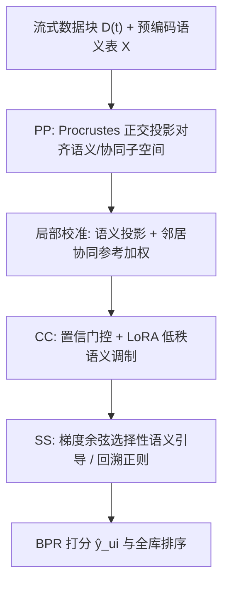
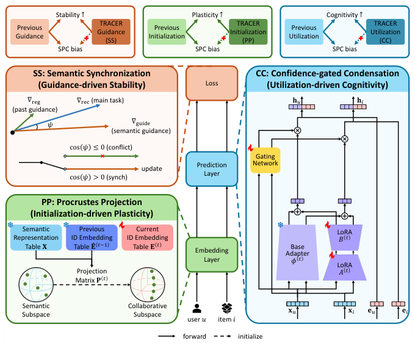

# TRACER: Balancing Stability-Plasticity-Cognitivity Trilemma for LLM Enhanced Continual Recommendation (面向 LLM 增强持续推荐的稳定性-可塑性-认知性三难困境平衡)

- **会议/期刊**: CIKM 2026 (Full Research Paper)
- **作者与机构**: WooJoo Kim, JunYoung Kim, JaeHyung Lim, HwanJo Yu (POSTECH)；HyunSik Yoo (UIUC)；SeongKu Kang (Korea University)
- **推荐链路定位**: 精排（ID 表征 + 语义表征融合打分）
- **研究方向**: 大语言模型推荐 / 序列与会话推荐
- **论文原文**: [https://arxiv.org/abs/2608.16075v2](https://arxiv.org/abs/2608.16075v2)
- **开源代码**: [https://github.com/woo-joo/TRACER_CIKM26](https://github.com/woo-joo/TRACER_CIKM26)

## TL;DR (1分钟核心速览)

持续推荐（CR）在流式数据上受稀疏性困扰，LLM 语义增强器可缓解，但朴素注入会引发新冲突：LLM 泛化语义先验（认知性 Cognitivity）与保留历史偏好（稳定性 Stability）、适应用户兴趣漂移（可塑性 Plasticity）三者互斥，作者将其形式化为 **SPC 三难困境**，并实证三种增强器（Guidance/Initialization/Utilization）分别偏向稳定/可塑/认知。TRACER 用 Procrustes 投影、置信门控凝聚、语义同步三模块协同破局，在 5 个数据集、Full-Ranking 协议下 ACC 最高提升 **14.38%**，且 BWT/TRG/SRT 三项全胜。

## Background & Motivation (背景与核心矛盾)

- **主流范式**: LLM 增强器（LLM Enhancer）范式——离线用 LLM 将用户/物品文本元数据推理为 persona/intent 画像并编码为语义表征 $\mathbf{X}$，训练与推理时只做轻量融合，避免在线调用 LLM。
- **前人局限**: ① 现有增强器仅在静态场景验证，迁移到流式 CR 后，语义先验与协同信号冲突，破坏稳定性-可塑性平衡；② 三种增强器各自只强化单一目标引理，朴素组合（如 LLM-ESR）反而放大语义支配，导致 BWT/TRG 双双为负。
- **核心洞察 (Key Insight)**: 作者用 $\gamma\in[0,1]$ 控制 LLM 干预强度做验证（图 1），发现性能偏差点几乎全部落在象限 II（稳定↓可塑↑）与 IV（稳定↑可塑↓），且 $\gamma$ 越大偏离原点越远——**认知性越强，SPC 失衡越严重**，这是结构性矛盾而非调参问题。
- **本文切入点**: 不追求"更强语义注入"，而是对三类增强器做**偏差感知的重新设计**，让每个模块保留其目标引理优势的同时抑制固有 SPC 偏差。

## Method (核心方法设计)

### 1. 整体框架 (Overall Architecture)

TRACER 沿学习工作流串联三模块：**初始化阶段**用 Procrustes 投影（PP）将语义子空间正交旋转对齐到协同子空间，为新实体提供"已对齐"的初始位置；**推理阶段**用置信门控凝聚（CC）以门控系数 $c_v$ 调节语义注入强度、以 LoRA 约束语义参数适应；**优化阶段**用语义同步（SS）按梯度余弦相似度选择性启用语义引导，冲突时改用回溯正则。三者形成良性循环：PP 降低拓扑错配 $\to$ CC 可基于置信度而非对齐误差做门控 $\to$ SS 梯度冲突减少 $\to$ 得到更优历史最优点 $\hat{E}^{(t)}$，反哺下一阶段投影 $P^{(t+1)}$。

<figure class="paper-figure" markdown="span">
  <figcaption>图 7：TRACER 示意图，其重新设计三种 LLM 增强器类型，以保留其目标引理优势，同时缓解其固有的 SPC 偏差：语义同步（SS）用于引导驱动的稳定性，Procrustes 投影（PP）用于初始化驱动的可塑性，置信门控凝聚（CC）用于利用驱动的认知性。</figcaption>
</figure>

### 2. 关键设计拆解 (Key Designs)

1. **Procrustes 投影 PP（初始化驱动可塑性）**：痛点——语义初始化注入的是"连贯但与协同子空间错位"的拓扑，拟合它需全局重对齐，反而破坏已学结构。PP 求解正交 Procrustes 问题 $\min_{P}\|\mathbf{X}_{V^{(t-1)}}P-\hat{\mathbf{E}}^{(t-1)}\|_F\ \text{s.t.}\ P^\top P=I$，闭式解 $P^{(t)}=VU^\top$（对 $(\hat{\mathbf{E}}^{(t-1)})^\top\mathbf{X}_{V^{(t-1)}}=U\Sigma V^\top$ 做 SVD）。**丢弃缩放矩阵 $\Sigma$** 是关键：只做旋转不引入协同侧的流行度缩放，保留语义几何的独立性。再做实体级局部校准 $\tilde{e}_u^{(t)}\leftarrow\beta_u e_{se,u}^{(t)}+(1-\beta_u)e_{co,u}^{(t)}$，$\beta_u$ 由语义投影与邻居协同参考的余弦相似度决定，稀疏实体自动更依赖语义。

2. **置信门控凝聚 CC（利用驱动认知性）**：痛点——语义表征直接进预测会诱发 shortcut learning，梯度集中于共享 adapter，ID 通路被架空。CC 令 $c_v^{(t)}=\text{Sigmoid}(W_{gate}^{(t)}x_v+b_{gate}^{(t)})$，$\hat{y}_{ui}=e_u\cdot e_i+c_uc_i\,\phi(x_u)\cdot\phi(x_i)$——**乘积门控**要求用户与物品两侧语义同时可靠才放大注入。adapter 侧用 LoRA $W^{(t)}=W_{base}^{(t)}+\frac{\alpha}{r}B^{(t)}A^{(t)}$ 冻结基座、跨阶段合并残差并重置 $A,B$，且 bias 固定为预训练最优值以防特征漂移。

3. **语义同步 SS（引导驱动稳定性）与训练目标**：痛点——语义锚定效应使 $\nabla_{guide}$ 与 $\nabla_{rec}$ 余弦为负，且在新实体上 $\|\nabla_{guide}\|$ 更大，压制真实兴趣漂移。SS 按实体级 $\cos(\psi_v)=\cos\_sim(\nabla_{rec,v},\nabla_{guide,v})$ 分流：$\cos>0$ 时启用 $\mathcal{L}_{guide}$ 作"语义加速器"，$\cos\le 0$ 且为老实体时改用回溯正则 $\mathcal{L}_{reg}$ 锚定 $\hat{e}_v^{(t-1)}$，冲突新实体仅用 $\mathcal{L}_{rec}$。总损失 $\mathcal{L}^{(t)}=\mathcal{L}_{rec}(\mathcal{D}^{(t)})+\lambda_{sync}\sum_v\mathcal{L}_{sync}(v)$，两项均为 **in-batch 负采样 InfoNCE**，无需额外负采样器；推理时仅需一次 MLP 前向 + 内积，开销与 No-Enhancer 同级。

## Experimental Setup & Evaluation Protocol (实验设置与评估协议)

- **数据集与预处理**: 4 个 Amazon 类目 + Yelp，`10-core` 过滤并剔除评分 <3 的交互（仅保留正反馈）：

| 数据集 | #Users (D³累计) | #Items (D³累计) | #Interactions (D⁰/D¹/D²/D³) | 稀疏度 | 场景说明 |
| :--- | :---: | :---: | :---: | :---: | :--- |
| Home | 35,513 | 17,867 | 171,457 / 38,100×3 | 99.97% | Amazon 家居评论 |
| CDs | 34,485 | 27,681 | 299,795 / 66,621×3 | 99.95% | Amazon 音乐 |
| Movies | 46,183 | 21,920 | 406,479 / 90,328×3 | 99.93% | Amazon 影视 |
| Electronics | 86,815 | 35,779 | 426,769 / 94,837×3 | 99.98% | Amazon 电子 |
| Yelp | 45,304 | 28,091 | 335,385 / 74,529×3 | 99.97% | 本地生活 |

- **数据划分与防穿越**: 按时间戳排序，前 60% 为基座块 $\mathcal{D}^{(0)}$，后 40% 均分为 $T=3$ 个持续块；块内每用户按 8:1:1 划分 train/val/test。
- **排名评测协议**: **无偏 Full-Ranking（全库未交互排序，无负采样）**，指标 NDCG@20；同时报告 ACC（当前块精度）、BWT（稳定性）、TRG（可塑性）、SRT（认知性，$k=5$ 少样本适配 + 尾部物品 + 新用户）。
- **对比基线与超参**: 2 个骨干（MF / LightGCN）× 4 种持续学习策略（FB/FT/RL2/PS）× 5 种增强器（No-Enhancer/RLMRec/LLM2X/KAR/LLM-ESR）共 20 个基线；$d=64$（利用类模型 $d=32$ 以对齐拼接维度），LightGCN 3 层，Adam $10^{-3}$，batch 4096，5 次独立运行 + 配对 t 检验 $p<0.05$。

## Key Experimental Results (实验关键数据)

### 1. 主实验对比 (Main Results)

LightGCN 骨干、FT 策略下各数据集 ACC（%）与三项引理指标（节选，完整表见原文 Table 3）：

| 数据集 | 指标 | No-Enh. | RLMRec | LLM2X | KAR | LLM-ESR | **TRACER** | Improv. |
| :--- | :--- | :---: | :---: | :---: | :---: | :---: | :---: | :---: |
| Home | ACC | 2.80 | 2.98 | 3.24 | 4.71 | 5.08 | **5.66\*** | 5.60% |
| CDs | ACC | 3.99 | 3.89 | 4.17 | 5.37 | 5.90 | **6.41\*** | 3.89% |
| Movies | ACC | 3.01 | 2.95 | 3.24 | 5.16 | 5.74 | **6.22\*** | 7.06% |
| Electronics | ACC | 2.96 | 3.13 | 3.50 | 5.86 | 6.17 | **6.47\*** | 4.35% |
| Yelp | ACC | 3.72 | 3.74 | 3.91 | 6.89 | 7.30 | **8.35\*** | **14.38%** |
| Yelp | BWT | 0.32 | 0.58 | 0.19 | −0.02 | 0.02 | **2.65\*** | 3.52% |
| Yelp | TRG | 1.23 | 1.03 | 1.54 | 0.43 | 0.37 | **2.02\*** | 29.49% |
| Yelp | SRT | 0.00 | 0.00 | 0.00 | 0.13 | 0.21 | **0.26\*** | 18.18% |

MF 骨干上 TRACER 同样全面领先（Home ACC 6.90 vs. LLM-ESR 4.20，Improv. 6.90%），说明增益不依赖图卷积结构。

### 2. 消融实验 (Ablation Study)

| 模型变体 | ACC | BWT | TRG | SRT |
| :--- | :---: | :---: | :---: | :---: |
| (1) TRACER 完整 | **0.0662** | 0.0275 | **0.0157** | **0.0034** |
| (2) w/o 回溯正则 $\mathcal{L}_{reg}$ | 0.0652 | 0.0148 | 0.0156 | 0.0032 |
| (3) w/o SS | 0.0639 | 0.0147 | 0.0144 | 0.0031 |
| (4) w/o 局部校准 $e_{co,v}$ | 0.0638 | 0.0259 | 0.0143 | 0.0027 |
| (5) w/o PP | 0.0608 | 0.0268 | 0.0107 | 0.0029 |
| (6) w/o LoRA 凝聚 | 0.0647 | 0.0224 | **0.0157** | 0.0024 |
| (7) w/o CC | 0.0476 | **0.0276** | 0.0156 | 0.0013 |

### 3. 关键实验发现 (Key Findings)

1. **语义支配是"假繁荣"**：KAR/LLM-ESR 在 ACC 与 SRT 上亮眼，但 TRG 近乎为零甚至为负（LightGCN 上 LLM-ESR 的 TRG 在 Home/Electronics 为 −1.51/−1.99），说明其收益来自语义捷径而非持续学习动力学；去掉 CC 后 ACC 从 0.0662 崩至 0.0476、SRT 从 0.0034 跌至 0.0013，证实 CC 是认知性的唯一有效入口。
2. **稳定性与可塑性可同时提升，而非零和**：去掉 SS 使 BWT 从 0.0275 腰斩至 0.0147，去掉 PP 使 TRG 从 0.0157 降至 0.0107；而完整 TRACER 同时取得最高 BWT 与最高 TRG（Yelp 上 TRG 2.02 vs. LLM2X 1.54），说明"对齐 + 选择性引导"把原本的权衡关系转成了互补关系。
3. **门控自适应地偏向稀疏实体**：CC 的置信分 $c_v$ 与实体频次呈负相关（图 9a），低频实体获得更强语义注入；把 CC 外挂到 DynLLM/LLM-CF/KAR 上均能提升其性能，证明该模块具备即插即用的通用性，且 TRACER 显存占用接近 No-Enhancer、收敛更快。

## Highlights, Limitations & Rating (亮点、对比与审稿评价)

- **与代表作对比 (vs. Prior Work)**: RLMRec 用对比对齐做刚性语义锚，稳定但压制漂移；LLM2X 用 PCA 投影做初始化，可塑但拓扑错位；KAR 用 MoE 直接注入语义，认知强但架空 ID 通路；LLM-ESR 三者叠加反而放大语义支配。TRACER 的本质差异是**把"注入多少语义"从超参变成由梯度一致性与双侧置信度动态决定的变量**。
- **可迁移亮点**: ① 用梯度余弦符号做"引导开关"可迁移到任何多任务/多目标精排的辅助损失调度；② 正交 Procrustes（丢弃 $\Sigma$）是跨表征空间对齐的干净手段，适用于多模态特征与 ID 空间的对齐。
- **审稿级局限批判**: ① 语义表征依赖 gpt-4o-mini 离线画像，画像质量与更新频率对冷启新实体的影响未被量化，且 $T=3$ 的块数偏少，长序列（$T\ge10$）下的误差累积未验证；② SS 需逐实体计算双梯度并做余弦判定，实现上需两次反传，论文只报了显存与总时长，未拆分单步开销；③ SRT 指标以 $k=5$ 少样本 + 尾部物品构造，虽巧妙但仍是代理指标，与真实冷启场景的差距缺乏线上验证。
- **四维评分**: 创新性 ⭐⭐⭐⭐ | 实验扎实度 ⭐⭐⭐⭐⭐ | 方法清晰度 ⭐⭐⭐⭐ | 落地价值 ⭐⭐⭐⭐

