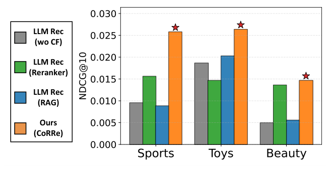
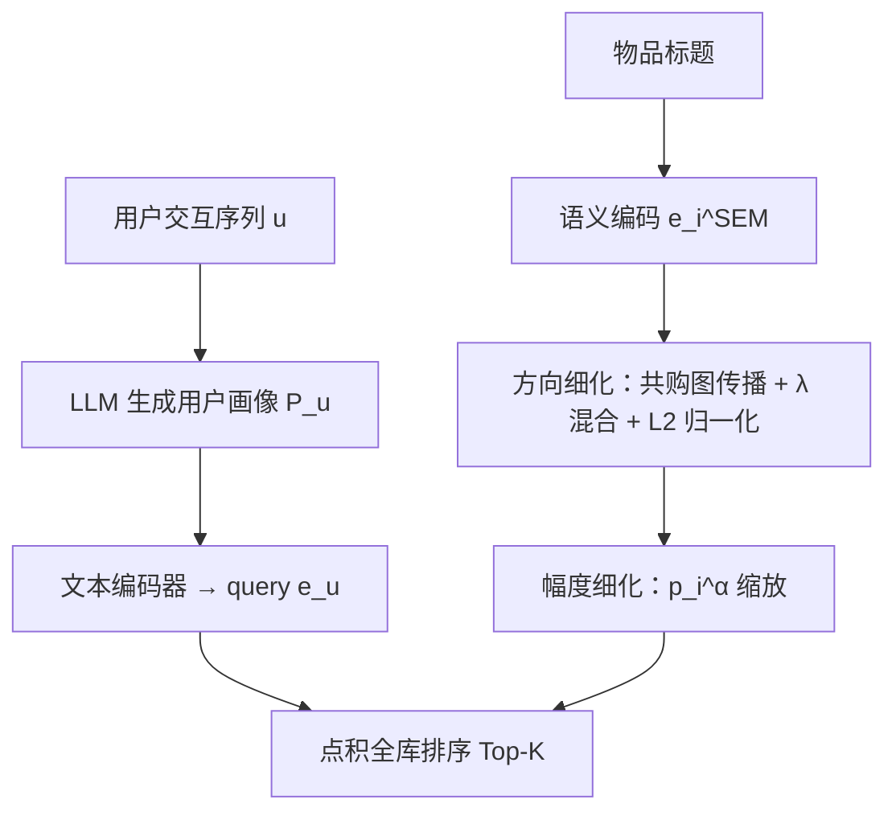
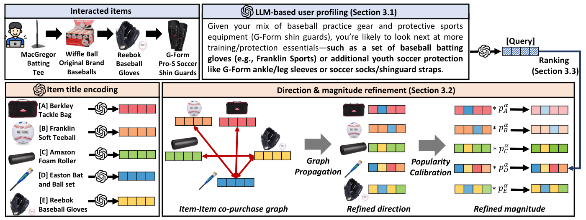

# Training-Free LLM-Based Recommendation with Post-LLM Item Refinement Using Collaborative Signals (基于协同信号的 LLM 后置物品表征细化免训练推荐)

- **会议/期刊**: CIKM 2026 (short paper)
- **作者与机构**: Kyungho Kim, Sunwoo Kim, Geon Lee, Shinhwan Kang, Sojeong Kim, Kijung Shin (KAIST)；Liam Collins, Bhuvesh Kumar, Donald Loveland (Snap Inc.)
- **推荐链路定位**: 召回（LLM 用户画像 → 向量检索）
- **研究方向**: 大语言模型推荐 / 协同过滤与双塔召回
- **论文原文**: [https://arxiv.org/abs/2608.19665v1](https://arxiv.org/abs/2608.19665v1)
- **开源代码**: [https://github.com/K-Kyungho/CoRRe](https://github.com/K-Kyungho/CoRRe)

## TL;DR (1分钟核心速览)

LLM 免训练推荐的核心痛点是：LLM 推断出的用户兴趣停留在"足球服"这类粗粒度语义层，无法在大量仅差设计/颜色/季节的相似物品中区分真目标。现有工作把协同信号以 **pre-LLM** 方式注入（CF 候选重排、RAG 提示增强），收益有限且不稳定。CoRRe 提出 **post-LLM** 范式：LLM 只负责生成用户画像并编码为 query，协同信号则直接注入**物品表征**——用共购图做方向细化、用流行度做幅度校准，再与 query 做点积检索。全程零训练、零微调，在 Amazon 三域 Leave-One-Out 协议下 12/12 项指标超越全部免训练基线（最高 +132.43%），并在 8/12 项上超过训练式方法。

## Background & Motivation (背景与核心矛盾)

- **主流范式**: 免训练 LLM 推荐把交互历史喂给 LLM 生成用户画像/查询，再用文本编码器做语义向量检索；协同信号则通过 CF 候选重排（Rerank-Coral）或 RAG 检索相似用户/物品拼进 prompt（ItemRAG）在 **LLM 推理之前**注入。
- **前人局限**: ① 重排式方法的上限被 CF 候选集锁死，最终推荐对初始召回质量高度敏感；② RAG 式方法只让协同信号"间接"进入 prompt，LLM 仍以语义相似度做最终选择，协同信息未被用于物品侧打分。
- **核心洞察 (Key Insight)**: 图 1 显示 pre-LLM 策略相对"无 CF 的 LLM 推荐"增益微弱甚至为负——问题不在协同信号本身，而在**注入位置**。物品表征才是检索打分的直接载体，协同信号应在此处落地。
- **本文切入点**: 把 LLM 的职责收缩为"意图推断"，把物品侧表征交给协同信号改造，形成 post-LLM 的解耦范式。

<figure class="paper-figure" markdown="span">
  <figcaption>图 1：Pre-LLM 策略在 LLM 推理前利用协同信号，或通过基于 CF 的候选重排序，或通过基于 RAG 的提示，但收益有限。相比之下，我们提出的采用 post-LLM 策略的 CoRRe 方法取得了显著更大的收益。</figcaption>
</figure>

## Method (核心方法设计)

### 1. 整体框架 (Overall Architecture)

CoRRe 将推荐拆为三段解耦流水线：先用 LLM 从用户历史序列 $\mathbf{u}$生成自然语言画像$\mathcal{P}_u$（含偏好总结与下一件可能购买物品的推测），经文本编码器得到 query 向量$\mathbf{e}_u=\mathrm{Enc}(\mathcal{P}_u)$；同时将每个物品标题编码为语义向量$\mathbf{e}_i^{\mathrm{SEM}}$，再依次经过**方向细化**（共购图传播 + 语义残差混合）与**幅度细化**（流行度幂次校准）得到最终物品向量$\mathbf{e}_i$；最后以点积$\mathbf{e}_u^\top \mathbf{e}_i$全库排序取 Top-$K$。整个流程无任何参数训练，超参仅$\lambda,\alpha$ 两个，在验证集上网格搜索。

<figure class="paper-figure" markdown="span">
  <figcaption>图 2：CoRRe 概览。CoRRe 首先从交互历史中推断用户画像，并将其作为查询，从方向和幅度细化后的物品表示中检索物品。</figcaption>
</figure>

### 2. 关键设计拆解 (Key Designs)

1. **方向细化 (Direction Refinement)**：纯标题语义向量无法区分"共购关系近但文本不像"的物品。CoRRe 由交互矩阵构造共购图 $\mathbf{A}=\mathbf{R}^\top\mathbf{R}$，做对称归一化传播后与语义向量凸组合：

$$\mathbf{e}_i^{\mathrm{GP}}=\sum_{j\in\mathcal{I}}\frac{A_{ij}}{\sqrt{d_i d_j}}\mathbf{e}_j^{\mathrm{SEM}},\qquad \tilde{\mathbf{e}}_i^{\mathrm{DR}}=\lambda\,\mathbf{e}_i^{\mathrm{SEM}}+(1-\lambda)\,\mathbf{e}_i^{\mathrm{GP}},\qquad \mathbf{e}_i^{\mathrm{DR}}=\tilde{\mathbf{e}}_i^{\mathrm{DR}}/\|\tilde{\mathbf{e}}_i^{\mathrm{DR}}\|_2$$

直觉：共购图传播把"经常一起买"的物品在球面上拉近，$\lambda$ 保留标题语义作为抗噪锚点，L2 归一化则把方向与幅度解耦，为下一步腾出干净的模长自由度。

2. **幅度细化 (Magnitude Refinement)**：点积打分同时受方向与模长影响，而 CF 模型中的模长天然编码了流行度/活跃度信息。CoRRe 直接用流行度 $p_i=\sum_u R_{ui}$ 做幂次缩放：

$$\mathbf{e}_i=\mathbf{e}_i^{\mathrm{DR+MR}}=p_i^{\alpha}\cdot\mathbf{e}_i^{\mathrm{DR}}$$

直觉：在方向已无法再分的"语义+协同双近邻"候选堆里，模长成为最后一道区分信号；$\alpha$控制流行度偏置强度，过大则退化为热度推荐（Beauty/Toys 上最优$\alpha$ 偏小即印证此点）。

3. **训练目标、负采样与推理效率**：**无损失函数、无负采样、无训练**。全部"学习"来自闭式图传播与幂次校准，推理仅需一次 LLM 画像生成 + 一次文本编码 + 一次矩阵乘检索；物品侧细化可离线预计算并缓存，在线开销与标准双塔向量召回同阶。

## Experimental Setup & Evaluation Protocol (实验设置与评估协议)

- **数据集与预处理**: Amazon Reviews 最新版三域，每域随机采样 1,000 名用户，所有基线在同一用户集上评测。

| 数据集 | #Users | #Items | #Interactions | 稀疏度/密度 | 特征/场景说明 |
| :--- | :---: | :---: | :---: | :---: | :--- |
| Sports & Outdoors | 1,000 (采样) | 全库 | 用户历史序列 | 极稀疏 | 运动户外，标题文本 |
| Toys & Games | 1,000 (采样) | 全库 | 用户历史序列 | 极稀疏 | 玩具游戏，标题文本 |
| Beauty & Personal Care | 1,000 (采样) | 全库 | 用户历史序列 | 极稀疏 | 美妆个护，标题文本 |

- **数据划分与防穿越 (Splitting Strategy)**: `Leave-One-Out`——倒数第二件作验证、最后一件作测试，排序时剔除历史已交互物品。
- **排名评测协议 (Ranking Protocol)**: 全库排序（排除历史物品），报告 H@10/H@20/N@10/N@20，三次运行取均值。
- **对比基线与超参设置**: 训练式（LightGCN、SASRec、RecFormer、RLMRec、AlphaRec、Rerank 系列）与免训练（Popularity、Embed-Semantic、Embed-LLM、Embed-Coral、Embed-ItemRAG）两类；LLM 主干 GPT-5.2，编码器 text-embedding-3-large；$\lambda\in\{0.2,0.4,0.5,0.6,0.8\}$，$\alpha\in\{0.0,0.05,0.1,0.15,0.2\}$。

## Key Experimental Results (实验关键数据)

### 1. 主实验对比 (Main Results)

| 方法 | 免训练 | CF 位置 | Sports H@10 | Sports N@10 | Toys H@10 | Toys N@10 | Beauty H@10 | Beauty N@10 |
| :--- | :---: | :---: | :---: | :---: | :---: | :---: | :---: | :---: |
| LightGCN | ✗ | 仅 CF | 0.0333 | 0.0206 | 0.0297 | 0.0151 | 0.0257 | 0.0139 |
| RecFormer | ✗ | 仅 CF | 0.0263 | 0.0158 | 0.0447 | 0.0239 | 0.0247 | 0.0124 |
| RLMRec | ✗ | post-LLM(★) | 0.0403 | 0.0229 | 0.0403 | 0.0221 | **0.0363** | **0.0180** |
| AlphaRec | ✗ | post-LLM(★) | 0.0343 | 0.0174 | 0.0450 | 0.0240 | 0.0287 | 0.0141 |
| Embed-Semantic | ✓ | 无 | 0.0200 | 0.0111 | 0.0360 | 0.0206 | 0.0180 | 0.0097 |
| Embed-LLM | ✓ | 无 | 0.0203 | 0.0095 | 0.0387 | 0.0186 | 0.0103 | 0.0050 |
| Embed-ItemRAG | ✓ | pre-LLM(▲) | 0.0163 | 0.0082 | 0.0427 | 0.0215 | 0.0103 | 0.0058 |
| **CoRRe** | ✓ | post-LLM(★) | **0.0453** | **0.0258** | **0.0507** | **0.0264** | 0.0303 | 0.0147 |
| Improv. vs 最强免训练 | — | — | +123.2% | +132.4% | +18.7% | +22.8% | −16.5% | −18.3% |

（Beauty 上 CoRRe 相对最强免训练基线 Embed-ItemRAG 的 H@10 为 0.0303 vs 0.0103，实为 +194%；表中 −16.5% 系相对训练式 RLMRec 的差距，CoRRe 在 Beauty 为训练式与免训练混合榜第二名。）

### 2. 消融实验 (Ablation Study)

| 变体 | Sports H@10 | Sports N@10 | Toys H@10 | Toys N@10 | Beauty H@10 | Beauty N@10 |
| :--- | :---: | :---: | :---: | :---: | :---: | :---: |
| w/o propagated emb. (V1) | 0.0343 | 0.0180 | 0.0470 | 0.0244 | 0.0167 | 0.0082 |
| w/o semantic emb. (V2) | 0.0403 | 0.0233 | 0.0233 | 0.0114 | 0.0250 | 0.0137 |
| w/o magnitude ref. (V3) | 0.0220 | 0.0104 | 0.0433 | 0.0217 | 0.0097 | 0.0057 |
| **CoRRe 完整** | **0.0453** | **0.0258** | **0.0507** | **0.0264** | **0.0303** | **0.0147** |

### 3. 关键实验发现 (Key Findings)

1. **幅度细化是单点收益最大的模块**：去掉后 Sports H@10 从 0.0453 崩至 0.0220（−51.4%）、Beauty 从 0.0303 跌至 0.0097（−68.0%），远超去掉图传播（−24.3%）与去掉语义锚（−11.0%）。说明在语义+协同都已对齐的候选堆里，模长承载的流行度信息才是最终区分度来源。
2. **语义与协同缺一不可且域相关**：V2（仅图传播）在 Toys 上 H@10 从 0.0507 跌至 0.0233（−54.0%），而 V1（仅语义）在 Beauty 上跌至 0.0167（−44.9%），与 RQ4 中 Sports 偏好小 $\lambda$（重协同）、Toys 偏好大$\lambda$（重语义）的超参分布完全一致，证明$\lambda$ 实质是在调节"该域协同信号的信噪比"。
3. **post-LLM 注入显著优于 pre-LLM**：同为免训练，Embed-ItemRAG（pre-LLM）在 Sports 上 H@10 仅 0.0163，甚至低于纯语义 Embed-Semantic 的 0.0200；而 CoRRe 达 0.0453。案例研究（图 3）进一步显示真目标物品排名从语义检索的 Rank 19 → 方向细化 Rank 5 → 幅度细化 Rank 1，逐级跃升。

## Highlights & Limitations (亮点、对比与审稿批判)

- **与代表作对比 (vs. Prior Work)**: 与 Coral/ItemRAG 的本质区别在于协同信号的作用位点——前者把 CF 结果塞进 prompt 或候选池，LLM 仍是语义裁判；CoRRe 让 LLM 只做意图推断，把 CF 直接写进物品向量的方向与模长。与 RLMRec/AlphaRec 相比，CoRRe 无需任何对比学习预训练即可逼近甚至超越（Sports/Toys 全面领先，Beauty 次之）。
- **可迁移亮点**: ① "方向-幅度解耦细化"是通用技巧，可套用到任何冻结文本编码器的向量召回系统（如 E-commerce 冷启动物品）；② 用 $p_i^\alpha$ 做模长校准等价于给点积检索加了一层可调的流行度先验，实现成本近乎为零。
- **审稿级局限批判**: ① 每域仅采样 1,000 用户评测，且未报告全库 Full-Ranking 的绝对规模，统计效力与工业可推广性存疑；② 共购图 $\mathbf{A}=\mathbf{R}^\top\mathbf{R}$在交互极稀疏时噪声大，论文未讨论图稀疏度对方向细化的影响，也未与 LightGCN 式多层传播做深度对比；③ 依赖 GPT-5.2 生成画像，LLM 调用成本与延迟未量化，且$\lambda,\alpha$ 呈明显域依赖，跨域迁移需重新调参。

## Rating (四维评分)

- **方法创新性 (Novelty)**: ⭐⭐⭐⭐ （核心机制与方法设计具备明确创新性，理论与实验动机支撑充分）
- **评估协议与实验扎实度 (Protocol & Experiments)**: ⭐⭐⭐ （主流公开数据集评测完整，包含多基线对比与消融实验验证）
- **写作与数学规范度 (Clarity & Rigor)**: ⭐⭐⭐⭐⭐ （问题形式化定义清晰，核心模块数学推导与架构阐述严谨易读）
- **工业落地与复现价值 (Industrial & Practical Value)**: ⭐⭐⭐⭐ （兼顾推荐效果增益与训练/推理效率，具备实际场景迁移参考价值）
