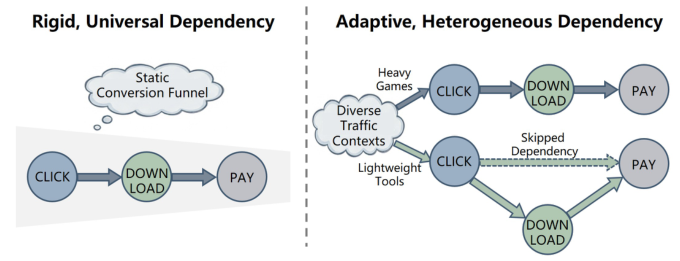
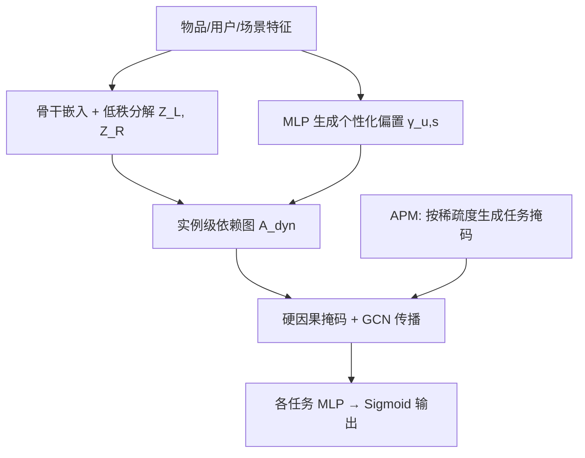
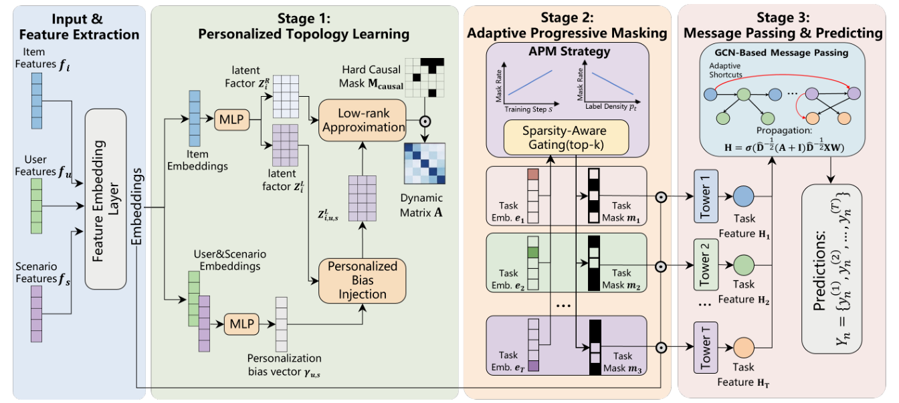

# Personalized Task Dependency Graphs for Mitigating Signal Erosion in Multi-Task Recommendation (个性化任务依赖图缓解多任务推荐中的信号侵蚀)

- **会议/期刊**: CIKM 2026 (Rome, Italy)
- **作者与机构**: Fuyuan Liu, Tiandeng Wu (共同一作, 通讯), Yaqun Fang, Wei Zhou, Zehao Zhou, Wenping Chen, Qishun Mei, Jiaxin Zhou, Heng Chang, Yi Cao, Jiandong Ding — 华为技术有限公司
- **推荐链路定位**: 精排 (多目标 CVR 预估)
- **研究方向**: 多任务学习与列表级重排 / CTR-CVR 预估与特征交叉
- **论文原文**: [https://arxiv.org/abs/2609.04862v1](https://arxiv.org/abs/2609.04862v1)
- **开源代码**: 暂未开源

## TL;DR (1分钟核心速览)

工业多目标推荐普遍采用 MMoE/PLE/AITM 等刚性漏斗结构，对所有样本施加统一的任务依赖强度，导致深层稀疏转化任务（如付费）在逐级消息传递中发生**累积信号侵蚀**。本文提出 PTDG：以低秩分解为每个物品生成实例级任务依赖图，注入用户/场景个性化偏置，再经硬因果掩码约束的 GCN 传播建立"自适应捷径"；同时用按标签稀疏度分配掩码率的 APM 策略在参数层面解耦梯度冲突。在 KuaiRand1K 与 7 任务工业数据集上，稀疏深任务 AUC 最高提升 1.45%，平均 AUC 达 0.9081/0.8878；线上两周 A/B 中 CVR +1.2%、eCPM +1.9%（p<0.05）。

## Background & Motivation (背景与核心矛盾)

- **主流范式**: 工业界以 MMoE、PLE、AITM 为代表，通过门控网络分离共享/独享专家；ESMM、ESCM2 沿固定转化链（Click→Download→Pay）做全空间建模以纠偏样本选择偏差。
- **前人局限**: ① 所有流量共享同一套依赖强度，忽视"重型游戏强因果链 vs 轻量工具跳步（Click→Pay）"这类**结构性异质**，单一拓扑限制表达力；② 固定层级链上的逐级消息传递造成**累积信号衰减**，深漏斗稀疏任务受害最重。PMTRec 只调优化权重、MIT 只学全局任务相关、CSRL 因果搜索复杂度 $O(T^2)$ 以上，均无法在工业延迟约束下做实例级结构自适应。
- **核心洞察 (Key Insight)**: 物理因果顺序（Click 先于 Pay）是**必要约束**，但节点间的**相关强度**应随物品/用户/场景变化——即"拓扑骨架固定、边权实例自适应"。
- **本文切入点**: 把任务依赖视为可学习的动态拓扑，用低秩图生成 + 硬因果掩码在保留因果合法性的前提下"重连"依赖强度，为深任务开辟信息捷径。

<figure class="paper-figure" markdown="span">
  <figcaption>图1：刚性漏斗（左）具有统一依赖关系，而我们的个性化依赖图（右）中边强度按实例自适应，二者形成对比。</figcaption>
</figure>

## Method (核心方法设计)

### 1. 整体框架 (Overall Architecture)

输入为物品/用户/场景三元组特征 $(f_i, f_u, f_s)$，经两个骨干（DeepFM 或 MLP）抽取物品嵌入；第一阶段由物品嵌入低秩分解出左右潜因子 $Z^L_i, Z^R_i$ 构造物品级邻接矩阵，再用用户-场景 MLP 生成的偏置向量 $\gamma_{u,s}$ 调制左因子得到实例级动态图；第二阶段 APM 按任务正样本率为每个任务生成 top-$k_t$ 二值掩码，结构性解耦共享参数；第三阶段对动态图施加硬因果掩码后做 GCN 传播，各任务节点特征经 MLP+Sigmoid 输出概率，总损失为 EMA 归一化加权的 BCE 之和。全流程对任务数 $T$ 保持线性复杂度，线上仅比 MMoE 增加 8ms 端到端延迟。

<figure class="paper-figure" markdown="span">
  <figcaption>图2：PTDG的整体结构。该方法可分为三个阶段：个性化拓扑学习、自适应渐进掩码以及消息传递与预测。</figcaption>
</figure>

### 2. 关键设计拆解 (Key Designs)

1. **低秩实例级依赖图 + 个性化偏置注入**：直接学 $T\times T$ 全邻接矩阵在稀疏工业交互上极易过拟合伪相关。本文令 $A_{item}=Z^L_i (Z^R_i)^\top$（$q \ll T^2$），再以 $\gamma_{u,s}\in\mathbb{R}^q$ 广播调制左因子：$A_{dyn}=Z^L_{i,u,s}(Z^R_i)^\top,\ Z^L_{i,u,s}=Z^L_i\odot(\mathbf{1}_T\otimes\gamma_{u,s}^\top)$。低秩充当结构正则，偏置注入以极轻参数量捕获上下文多样性——直觉上相当于"用 $q$ 维隐空间描述任务间相关模式，再按场景旋转该模式"。

2. **硬因果掩码 GCN 与自适应捷径**：$A=A_{dyn}\odot M_{causal}$ 先剪除 Pay→Click 这类语义回流，再做 $\hat{D}^{-1/2}(A+I)\hat{D}^{-1/2}XW$ 传播。与固定链相比，掩码后仍保留的非相邻任务边构成**信息捷径**，使深任务绕过冗余中间节点直接吸收上游信号，从结构上切断累积衰减路径。

3. **APM 稀疏感知渐进掩码与训练目标**：梯度冲突方法（PCGrad 等）在数值层面做 $O(T^2)$ 投影，代价高。APM 改为参数层面：按任务正样本率 $p_t$ 线性映射目标掩码率 $r^{target}_t=r_{min}+(r_{max}-r_{min})(1-\frac{p_t-p_{min}}{p_{max}-p_{min}})$，稀疏任务保留更多独享参数；再以 warm-up 步数 $S_{warm}$ 渐进放开 $k_{t,s}=d-d\cdot\min(r^{target}_t,\frac{s}{S_{warm}}r^{target}_t)$。总损失 $\mathcal{L}=\sum_t \beta_{t,s}\mathrm{BCE}(y_t,\hat{y}_t)$，权重 $\beta_{t,s}=1/\hat{L}_{t,s}$ 由损失的 EMA（$\alpha=0.1$）归一化，稳定多任务量级差异。掩码训练后固定，推理零开销。

## Experimental Setup & Evaluation Protocol (实验设置与评估协议)

- **数据集与预处理**:

| 数据集 | #Users | #Items | #Interactions | 稀疏度/密度 | 特征/场景说明 |
| :--- | :---: | :---: | :---: | :---: | :--- |
| KuaiRand1K | 未披露 | 未披露 | 8.4M | 正样本率 0.02%~37.9% | 6 任务（Click/Like/Follow/Comment/Forward/Hate）短视频 |
| Industrial | 未披露 | 未披露 | 13.2M | 保密 | 7 任务，主流应用分发平台 |

- **数据划分与防穿越 (Splitting Strategy)**: 原文未明确说明划分方式（仅给出样本量与任务正样本率区间），按工业惯例应为时间切分，但论文未标注，属信息缺失。
- **排名评测协议 (Ranking Protocol)**: 以 AUC 为指标，20 个随机种子重复取均值；未说明是否采用 Full-Ranking 或负采样排序，亦未披露训练负采样策略。
- **对比基线与超参设置**: 基线含 MMoE、PLE、STEM、MoCoGrad、PMTRec、MIT 六类；Adam，lr=1e-3，dropout=0.1，batch=2048，低秩维度 $q=2$，$\alpha=0.1$，$r_{max}=0.7$/$r_{min}=0.2$，$p_{min}=500$/$p_{max}=2000$，单卡 V100。

## Key Experimental Results (实验关键数据)

### 1. 主实验对比 (Main Results)

KuaiRand1K（AUC，20 种子均值）：

| Task | MMoE | PLE | STEM | MoCoGrad | PMTRec | MIT | **PTDG** | Improv. |
| :--- | :---: | :---: | :---: | :---: | :---: | :---: | :---: | :---: |
| Click | 0.8706 | 0.8637 | 0.8732 | 0.8743 | 0.8772 | 0.8766 | **0.8801** | +0.33% vs MIT |
| Like | 0.8879 | 0.8903 | 0.8998 | 0.9009 | 0.9017 | 0.9028 | **0.9085** | +0.63% vs MIT |
| Follow | 0.9033 | 0.9024 | 0.9073 | 0.9130 | 0.9124 | 0.9129 | **0.9193** | +1.77% vs MMoE |
| Comment | 0.9051 | 0.8986 | 0.9081 | 0.9072 | 0.9085 | 0.9101 | **0.9172** | +0.78% vs MIT |
| Forward | 0.8984 | 0.8933 | 0.9028 | 0.9011 | 0.9042 | 0.9038 | **0.9097** | +0.61% vs MIT |
| Hate | 0.9041 | 0.8960 | 0.9055 | 0.9066 | 0.9072 | 0.9085 | **0.9139** | +0.59% vs MIT |
| **Avg.** | 0.8949 | 0.8907 | 0.8995 | 0.9005 | 0.9019 | 0.9025 | **0.9081** | +0.62% vs MIT |

工业数据集（AUC）：

| Task | MMoE | PLE | STEM | MoCoGrad | PMTRec | MIT | **PTDG** | Improv. |
| :--- | :---: | :---: | :---: | :---: | :---: | :---: | :---: | :---: |
| Task 1 | 0.8410 | 0.8424 | 0.8494 | 0.8501 | 0.8481 | 0.8471 | **0.8527** | +0.31% vs MoCoGrad |
| Task 2 | 0.8395 | 0.8433 | 0.8457 | 0.8462 | 0.8500 | 0.8468 | **0.8511** | +0.13% vs PMTRec |
| Task 3 | 0.8601 | 0.8379 | 0.8482 | 0.8550 | 0.8745 | 0.8541 | **0.8872** | +1.45% vs PMTRec |
| Task 4 | 0.9417 | **0.9471** | 0.9457 | 0.9468 | 0.9462 | 0.9452 | 0.9464 | −0.07% vs PLE |
| Task 5 | 0.8699 | 0.8678 | 0.8613 | 0.8630 | 0.8729 | 0.8732 | **0.8751** | +0.22% vs MIT |
| Task 6 | 0.8837 | 0.8796 | 0.8557 | 0.8610 | 0.8843 | 0.8899 | **0.8993** | +1.05% vs MIT |
| Task 7 | 0.8912 | 0.8974 | 0.8915 | 0.8952 | 0.8967 | 0.8979 | **0.9028** | +0.55% vs MIT |
| **Avg.** | 0.8753 | 0.8736 | 0.8710 | 0.8739 | 0.8818 | 0.8791 | **0.8878** | +0.68% vs PMTRec |

### 2. 消融实验 (Ablation Study)

工业数据集 Avg AUC：

| 变体 | Avg AUC | Δ |
| :--- | :---: | :---: |
| PTDG (Full) | **0.8878** | — |
| w/o Personalization ($\gamma_{u,s}$) | 0.8771 | −1.07% |
| w/o GCN (改 Concat) | 0.8796 | −0.82% |
| w/o Causal Mask | 0.8814 | −0.64% |
| w/o APM (自适应掩码) | 0.8826 | −0.52% |
| w/o Progressive Warmup | 0.8841 | −0.37% |

### 3. 关键实验发现 (Key Findings)

1. **增益集中在稀疏深任务而非头部任务**：工业 Task 3 相对 PMTRec 提升 1.45%、Task 6 相对 MIT 提升 1.05%，而稠密浅任务 Task 4 反而略低于 PLE（0.9464 vs 0.9471）。这直接印证"信号侵蚀主要发生在深漏斗"的动机假设——PTDG 的收益来源是结构捷径而非更强的通用拟合能力。
2. **个性化偏置是最大单点贡献**：移除 $\gamma_{u,s}$ 掉 1.07%，超过移除 GCN（0.82%）与因果掩码（0.64%），说明"实例级边权差异"本身比"传播算子选择"更关键；而 APM 与 warm-up 合计贡献约 0.9%，证明参数级解耦与数值级梯度调和是互补而非替代关系。
3. **低秩维度存在明确甜点**：$q$ 从 1 增至 7 时性能在 $q=2$ 达峰后单调下降，经验规律 $q\approx T/3$；这与"低秩即结构正则"的设计意图一致——维度过高即退化为全邻接矩阵，重新引入稀疏数据上的伪相关过拟合。

## Highlights, Limitations & Rating (亮点、对比与审稿评价)

- **与代表作对比 (vs. Prior Work)**: 相比 AITM/HTLNet 的固定转化链，PTDG 保留因果骨架但让边权随实例变化；相比 PMTRec/MoCoGrad 在损失数值层面重加权，PTDG 在**图结构层面**开辟捷径、在**参数层面**做掩码解耦，二者正交；相比 CSRL 的 $O(T^2)$ 因果搜索与 PCGrad 的 $O(T^2)$ 投影，本文全流程对 $T$ 线性，8ms 增量满足 SLA。
- **可迁移亮点**: ① "低秩分解 + 上下文偏置广播"是构造实例级动态图的极轻量范式，可直接移植到跨域迁移或多场景建模中的场景-任务关联图；② 按标签正样本率反比分配参数掩码率，是一种无需梯度计算的通用稀疏任务保护技巧。
- **审稿级局限批判**: ① 实验披露不足——数据划分方式、是否 Full-Ranking、负采样策略均未说明，AUC 绝对值跨论文不可比；② 低秩维度 $q$ 与掩码率 $r_{min}/r_{max}$ 均需按数据集调参，且 $q\approx T/3$ 仅为经验观察、缺乏理论 scaling 分析（作者自认留待未来）；③ 任务数仅 6–7，向数十任务扩展时低秩假设与 GCN 传播的有效性未验证。
- **四维评分**: 创新性 ⭐⭐⭐⭐ | 实验扎实度 ⭐⭐⭐⭐ | 方法清晰度 ⭐⭐⭐⭐ | 落地价值 ⭐⭐⭐⭐⭐

