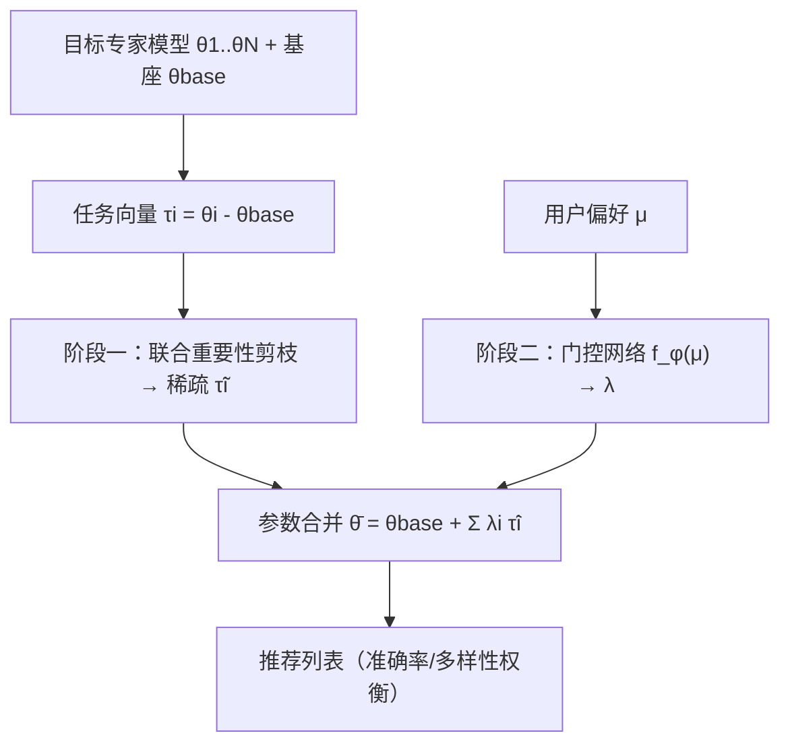
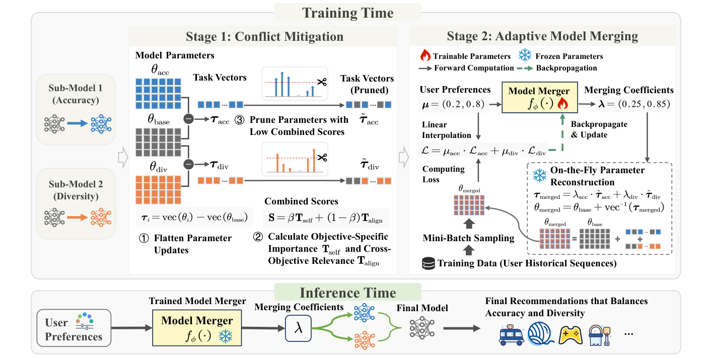

# RecSoup: Efficient Model Merging Approach for Controllable Multi-Objective Recommendation (面向可控多目标推荐的高效模型合并方法)

- **会议/期刊**: CIKM 2026
- **作者与机构**: Zidong Jia, Guofu Xie, Xiao Zhang（中国人民大学高瓴人工智能学院）
- **推荐链路定位**: 重排 / 参数级模型合并（推理时动态生成模型权重）
- **研究方向**: 多任务学习与列表级重排 / CTR 与特征交叉
- **论文原文**: [https://arxiv.org/abs/2610.21220v1](https://arxiv.org/abs/2610.21220v1)
- **开源代码**: [https://github.com/35798642/RECSOUP.git](https://github.com/35798642/RECSOUP.git)

## TL;DR (1分钟核心速览)

可控多目标推荐（CMOR）需在推理时动态调整准确率/多样性等目标的权衡，现有后处理重排受限于固定候选集，参数生成（超网络/扩散）则训练与推理开销巨大。本文提出 RecSoup：先用「目标特异性重要性 + 跨目标相关性」联合打分剪枝任务向量以消除跨目标干扰，再用轻量门控网络把用户偏好映射为合并系数，直接在参数空间合并专家模型。在 ML-1M 与 Amazon 两域、SASRec/GRU4Rec/TiSASRec 三骨干上，HV 较 Soup/TATR 最高提升 8.5%，推理延迟比超网络快 165–228 倍。

## Background & Motivation (背景与核心矛盾)

- **主流范式**: CMOR 分两派——后处理（如 MMR 重排）在固定候选集上调整列表；in-processing 参数生成（CMR 超网络、Paragon 扩散模型）学习「偏好→参数」映射。
- **前人局限**: ① 后处理受限于初始候选集，可行权衡范围窄（MMR 的 Pareto 前沿长度仅 2）；② 参数生成引入海量额外参数与迭代去噪，推理延迟高且优化不稳定（Amazon 稀疏域上 HV 骤降）。
- **核心洞察 (Key Insight)**: 工业界本就并存多个目标专用子模型，为何不直接复用？但作者用 PCA 实证：序列推荐的任务向量**不满足线性区制假设**——准确率与多样性任务向量在 PCA 空间分散于不相交区域，PC1 仅解释 25.7% 方差、前两主成分合计不足 45%，朴素线性插值必然失效；同时约 30% 参数可剪除且两目标对剪枝敏感度高度不对称。
- **本文切入点**: 两阶段解耦——先剪枝净化参数基底消除干扰，再学习非线性合并系数在复杂流形上导航。

## Method (核心方法设计)

### 1. 整体框架 (Overall Architecture)

给定基座模型 $\theta_{base}$ 与 $N$ 个目标专家 $\theta_i$，任务向量 $\tau_i = \text{vec}(\theta_i) - \text{vec}(\theta_{base})$。阶段一：对任务向量矩阵 $\mathbf{T}\in\mathbb{R}^{N\times D}$ 逐行剪枝得 $\tilde{\mathbf{T}}$，滤除冲突/冗余更新。阶段二：轻量门控 $f_\phi$ 将偏好 $\boldsymbol{\mu}\in\Delta^{N-1}$ 映射为合并系数 $\boldsymbol{\lambda}=f_\phi(\boldsymbol{\mu})$，合并模型 $\bar\theta(\boldsymbol{\mu})=\theta_{base}+\sum_i \lambda_i\tilde{\mathbf{T}}_{i,:}$ 直接产出推荐列表。训练时仅更新门控参数 $\phi$，专家与基座全冻结；推理时单次前向即得系数，无需重训或生成模块。

<figure class="paper-figure" markdown="span">
  <figcaption>图4：RecSoup 的整体架构。</figcaption>
</figure>

### 2. 关键设计拆解 (Key Designs)

1. **联合重要性剪枝（Conflict Mitigation via Pruning）**：痛点在于稠密任务向量跨目标重叠严重、直接合并会互相压制。对每个参数位置 $j$ 定义组合得分
$$S_{i,j}=\beta\frac{T_{i,j}^2}{\|\mathbf{T}_{i,:}\|_2^2}+(1-\beta)\big|T_{i,j}\cdot\bar{T}_{i,j}\big|,\quad \bar{T}_{i,j}=\tfrac{1}{N-1}\textstyle\sum_{k\neq i}T_{k,j}$$
其中第一项为目标特异性重要性，第二项为跨目标相关性。关键细节：跨目标项取**绝对值**而非符号对齐，因为准确率与多样性的更新方向天然冲突，取模长只度量耦合强度、避免因符号冲突误删对多目标都关键的参数。剪枝量由范数保留率 $\rho$ 动态决定（保留 top-$k_i$ 使自重要性累计占比 $\geq\rho$），而非固定比例。

2. **自适应合并与可学习系数（Adaptive Model Merging）**：痛点在于线性区制失效，直接用 $\boldsymbol{\mu}$ 当系数无法刻画非线性交互。RecSoup 用单层线性路由 $f_\phi$ 学习 $\boldsymbol{\lambda}=f_\phi(\boldsymbol{\mu})$，允许系数放大或抑制某目标、突破输入偏好值的线性约束。与 PWE-MoE 的本质区别在于**基底构造**：门控在剪枝后的纯净子空间上导航，只需学 Pareto 流形坐标，无需同时补偿稠密向量的噪声干扰。

3. **训练目标、负采样与推理效率**：损失为偏好加权多目标损失 $\mathcal{L}(\theta_{merged},\boldsymbol{\mu})=\sum_i \mu_i\mathcal{L}_i(\theta_{merged})$，仅在小批子集上评估以省算力；准确率专家用 BPR 损失，多样性专家用可微 $\alpha$-NDCG 代理损失。训练负采样 9 个、评估 99 个。推理复杂度：adapter 设定 $O(Nd^2)$、全参数 $O(NP)$，相较超网络的 $O(P\cdot H)$ 与扩散的 $O(T\cdot P\cdot d)$ 消除了对 $d$ 的三次依赖。

## Experimental Setup & Evaluation Protocol (实验设置与评估协议)

- **数据集与预处理**: 沿用 Paragon 的过滤与序列组织流程。

| 数据集 | #Users | #Items | 场景说明 |
| :--- | :---: | :---: | :--- |
| MovieLens-1M | ~6.0k | ~3.7k | 电影，稠密反馈 |
| Amazon (Grocery & Gourmet Food) | 稀疏 | 稀疏 | 评论序列，稀疏/噪声大 |
| Amazon (Toys and Games) | 稀疏 | 稀疏 | 评论序列，稀疏/噪声大 |

- **数据划分与防穿越**: 序列推荐标准设定，按用户历史序列组织训练/验证/测试（沿用 Paragon 流程）。
- **排名评测协议**: `Sampled Ranking`，训练 9 负样本、评估 99 负样本；指标为 HR@5、NDCG@5、$\alpha$-NDCG@5（多样性）。
- **对比基线与超参设置**: 基线含 Retrain（oracle）、MMR（后处理）、CMR/Paragon（参数生成）、Soup/TATR/TIES/DARE/CABS/LwPTV（模型合并）。Embedding 与隐状态维度 $d=64$，Adam 学习率 $10^{-3}$，$\beta=0.5$，$\rho\in[0.9,0.95]$（实际保留率 0.4–0.7）。核心指标：Hypervolume (HV)、Pareto 前沿长度 (LF)、可控性 Contro.（偏好序与指标序的 Kendall 式一致率）。

## Key Experimental Results (实验关键数据)

### 1. 主实验对比 (Main Results)

以 SASRec 骨干为例（HV↑ / Contro.↑）：

| 方法 | ML-1M HV | ML-1M Contro. | Food HV | Toys HV |
| :--- | :---: | :---: | :---: | :---: |
| MMR | 0.1153 | 0.3333 | 0.5323 | 0.5763 |
| Paragon | 0.5362 | 1.0000 | 0.6013 | 0.2479 |
| CMR | 0.5290 | 0.9818 | 0.1269 | 0.3820 |
| Soup | 0.6536 | 0.8182 | 0.5404 | 0.5467 |
| TATR | 0.6227 | 0.7636 | 0.4831 | 0.4997 |
| **RecSoup** | **0.7090** | 0.9091 | **0.6088** | **0.5755** |
| Retrain† | 0.6604 | 1.0000 | 0.7358 | 0.6120 |

RecSoup 在 ML-1M 上较 Soup 提升 **+8.5%**、较 TATR 提升 **+13.9%**；TiSASRec 上较 Soup 提升 **+7.3%**（0.6902 vs 0.6110）。GRU4Rec 上 ML-1M HV 达 0.6497，逼近 oracle 0.6569。

### 2. 消融实验 (Ablation Study)

| 配置 | ML-1M (SAS) | Food (SAS) | ML-1M (GRU) | ML-1M (TiSAS) |
| :--- | :---: | :---: | :---: | :---: |
| RecSoup 完整 | **0.7090** | **0.6088** | **0.6497** | **0.6902** |
| w/o MLP（恒等映射） | 0.6675 | 0.5995 | 0.6051 | 0.6128 |
| w/o Prune（不剪枝） | 0.7228 | 0.5437 | 0.5892 | 0.6722 |

补充：与 TIES 共享相同合并系数、仅替换剪枝准则，RecSoup 在 ML-1M 上 HV 相对提升 +4.95%(SASRec)/+2.71%(GRU4Rec)/+1.78%(TiSASRec)；跨全部骨干-数据集配置平均 HV 0.5662 vs LwPTV 0.5200、CABS 0.5044、DARE 0.4977。

### 3. 关键实验发现 (Key Findings)

1. **剪枝是「鲁棒性保险」而非普适增益**：ML-1M 上 w/o Prune 反而略高（0.7228 vs 0.7090），但在稀疏噪声大的 Food 上剪枝带来 **+12.0%** 提升（0.6088 vs 0.5437），说明剪枝价值随目标冲突强度与噪声水平上升而显现。
2. **可学习系数不可替代**：去掉 MLP 后 ML-1M(SASRec) HV 掉 5.9%、TiSASRec 掉 11.2%，证明线性区制失效下「偏好直接当系数」无法刻画非线性权衡。
3. **效率与可控性双赢**：推理参数构建延迟 0.041–0.045 ms，较超网络（7.5–9.4 ms）快 **165–228 倍**，较扩散（~87.79 s）快三个数量级；同时三目标（Acc+Div+Fair）设定下 HV 0.6148 仍为最优，验证可扩展性。

## Highlights, Limitations & Rating (亮点、对比与审稿评价)

- **与代表作对比 (vs. Prior Work)**: 相较 Paragon/CMR 的参数生成，RecSoup 不做参数合成而做参数复用，规避 Lipschitz 平滑约束（定理 5.1 证明 $L<L_0$ 时生成映射无法覆盖完整 Pareto 集）；相较 Soup/TATR 的线性/正交合并，RecSoup 用跨目标相关性剪枝 + 非线性门控突破线性区制失效；相较 TIES 仅用自重要性剪枝，额外引入跨目标耦合项。
- **可迁移亮点**: ① 跨目标相关性取绝对值的剪枝准则可迁移到任何多任务/多场景模型合并；② 「先净化基底、再学系数」的解耦思路可复用于 LoRA 多适配器融合与多场景 STAR 类模型。
- **审稿级局限批判**: ① 剪枝收益条件性明显，在任务向量本就兼容时反而掉点，缺乏自适应判断「何时该剪」的机制；② 实验仅在 64 维小模型与采样排序协议下验证，未报告全库 Full-Ranking 与工业级大模型（含大规模 item embedding）下的延迟表现，全参数合并时 $|I|\gg d^2$ 可能主导开销。
- **四维评分**: 创新性 ⭐⭐⭐⭐ | 实验扎实度 ⭐⭐⭐⭐ | 方法清晰度 ⭐⭐⭐⭐⭐ | 落地价值 ⭐⭐⭐⭐

