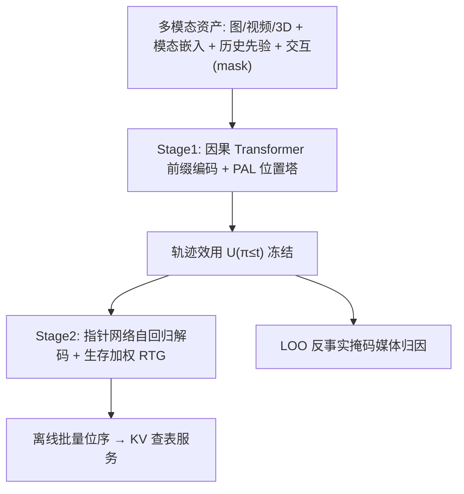
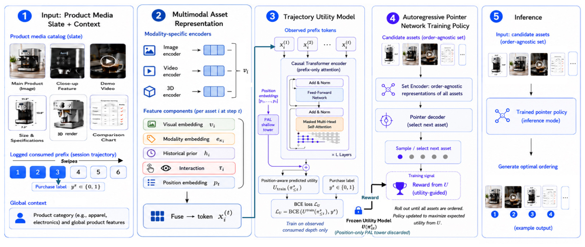

# Sequential Multimodal Evidence Optimization for Product Media Ranking in E-Commerce (电商商品媒体排序的序列多模态证据优化)

- **会议/期刊**: CIKM 2026 (35th ACM International Conference on Information and Knowledge Management)
- **作者与机构**: Prasenjit Dey, Frank McIntyre, Arnab Sinha (Amazon.com Inc.)
- **推荐链路定位**: 重排（商品详情页媒体轮播位序生成，离线批量产出 + 在线 KV 查表）
- **研究方向**: 多任务学习与列表级重排 / 多模态推荐
- **论文原文**: [https://arxiv.org/abs/2608.15662v1](https://arxiv.org/abs/2608.15662v1)
- **开源代码**: 暂未开源

## TL;DR (1分钟核心速览)

商品详情页的图片/视频/3D 素材是**同一商品的协作性证据**，而非相互竞争的候选物品；现有 CTR/停留时长代理目标与独立物品 LTR 假设均失效，且日志存在位置偏置、内生截断（用户提前滑走）与媒体级归因缺失。SMEO 用两阶段解耦破局：先以**消费前缀**训练带 PAL 去偏与生存深度重加权的轨迹效用模型 $U$，冻结后以其**生存加权 reward-to-go** 驱动自回归指针网络生成位序。在 1.5 亿真实移动会话上以 SNIPS/DR 双重稳健离线评估，DR-CVR 相对启发式基线 +5.4%，MSC（转化所需中位滑动位次）−15.3%。

## Background & Motivation (背景与核心矛盾)

- **主流范式**: 电商媒体排序依赖业务规则启发式，或优化点击/停留等**近视参与度代理**；LTR 侧则沿用 DLCM/Seq2Slate 式列表排序，把候选视为独立竞争项。
- **前人局限**: ① 吸睛图片能带来点击却未必提供决策所需的功能规格，参与度与终端转化脱钩；② 列表排序假设物品独立竞争，无法刻画"先看生活场景视频建立价值主张、再看参数图才有说服力"的**上下文调制**；③ 媒体级转化标签完全不可观测，等分归因 + 内生截断会把结果错误归给深层未曝光素材。
- **核心洞察 (Key Insight)**: 购买决策符合认知科学中的**证据累积模型**——用户逐位消费信息直至置信度足够或交互成本超过兴趣；因此真正该优化的是"前缀证据效用随深度的累积速度"，而非整列表相关性。
- **本文切入点**: 把媒体排序重构为"协作证据的序列累积优化"，用消费前缀监督效用、用到达概率加权边际增益，从而把高决策价值素材前移。

## Method (核心方法设计)

### 1. 整体框架 (Overall Architecture)

每个媒体资产经模态条件视觉编码器（CLIP ViT-L/14、VideoMAE、Uni3D，统一投影至 $d_v{=}256$）得到视觉向量，再与模态类型嵌入、历史先验向量、会话内交互向量（训练期以 0.3 概率替换为可学习 mask token，推理期恒 mask）及正弦位置编码融合为统一 token。Stage 1 用因果 Transformer 编码消费前缀，经 PAL 双塔分解位置效应后输出轨迹效用 $U$；Stage 2 冻结 $U$（剥离 PAL 塔），以指针网络自回归解码位序，用生存加权 RTG 的 REINFORCE + SCST 基线优化。推理时离线批量生成位序写入 KV 存储，在线单次查表（<5ms）。

<figure class="paper-figure" markdown="span">
  <figcaption>图 2：完整的端到端 SMEO 框架</figcaption>
</figure>

### 2. 关键设计拆解 (Key Designs)

1. **消费前缀监督 + 生存深度重加权（Variable-Depth Supervision）**：痛点是把 $y_s$ 监督到所有短前缀上会错误归因——如 `[弱图,弱图,强视频]→转化` 中前缀 1 会被误判为高转化。故仅在观测停止深度 $T^{obs}_s$ 处施加 BCE，并按到达概率重加权：
$$\hat{w}_s=\min\!\left(1/\hat{\rho}_{T^{obs}_s},\,W_{\max}\right),\quad \hat{\rho}_t=\frac{\#\{s:T^{obs}_s\ge t\}}{|\mathcal{D}|}$$
直觉：浅前缀在日志中占绝对多数，深层轨迹被系统性欠拟合，倒数权重把稀有深样本拉回同等话语权，截断 $W_{\max}{=}10$ 控方差。

2. **PAL 位置塔 + 策略期剥离（Position-Aware Learning）**：历史默认策略造成强位置偏置，若让内容编码器吸收槽位效应，策略会"学位置而非学内容"。训练期把 logit 拆为 $s_{\text{content}}{+}s_{\text{pos}}$，位置塔只看位置嵌入（10% dropout）作 nuisance 通路；**策略优化与推理期丢弃位置塔**，仅用 $U=\sigma(s_{\text{content}})$。消融显示保留位置塔反而使 MSC 恶化 +3.4%，证明偏置会诱导策略利用槽位捷径。

3. **生存加权 Reward-to-Go 与训练目标**：利用 $\mathbb{E}_T[U(\pi_{\le T})]=U(\pi_{\le 0})+\sum_t \Pr(T\ge t)\Delta_t(\pi)$ 的恒等分解，定义步奖励
$$r_t(\pi)=\hat{\rho}_t\gamma^{t-1}\Delta_t(\pi),\quad \Delta_t=U(\pi_{\le t})-U(\pi_{\le t-1})$$
边际形式消除常数基效用，避免"前缀越长奖励越高"的退化；$\hat\rho_t$ 随深度递减，使同等效用增益在浅位获得更大回报，直接优化"少滑动即转化"。策略损失为熵正则化 REINFORCE（$\lambda_H{=}5\times10^{-4}$，$\gamma{=}0.9$），SCST 贪心 rollout 作基线，指针 masked softmax 保证排列合法且每资产恰出现一次；首图按 UX 惯例固定于 slot 1，仅优化 $t\ge2$。**无需负采样**，奖励来自冻结效用模型。

## Experimental Setup & Evaluation Protocol (实验设置与评估协议)

- **数据集与预处理**: 某全球电商数周匿名移动会话日志，覆盖电子/服饰/家居/美妆；候选列表上限 $N_{\max}{=}15$。

| 数据集 | #Users | #Items | #Interactions | 稀疏度/密度 | 特征/场景说明 |
| :--- | :---: | :---: | :---: | :---: | :--- |
| 工业私有日志 | 未披露（按 session 计） | 数百万商品 / 数千万媒体资产 | ~150M sessions | 终端购买标签极稀疏（二值 $y_s$） | 图/视频/3D；含停留、点击、缩放、停止深度 |

- **数据划分与防穿越 (Splitting Strategy)**: **全局时间戳切分**（temporally held-out test set），防止未来会话泄漏。
- **排名评测协议 (Ranking Protocol)**: 非随机日志下采用**离线策略评估**而非全库排序——主指标为裁剪 SNIPS-CVR 与 **DR-CVR**（K-fold cross-fitted 直接奖励预测 + IPS 校正），辅以 MSC（转化会话中首个被互动媒体位次的中位数，越低越好，作者明确声明其为相对排序质量指标而非因果滑动估计）。行为策略由 behavior cloning 估计，Plackett–Luce 分布用于确定性排序器的 $\hat p_\pi$。
- **对比基线与超参设置**: Heuristic / CTR / CLTR-CVR（IPW 逐资产）/ Listwise-MM（自注意力列表级）/ Seq2Slate-Adapt（同架构指针网络 + 终端 REINFORCE）。所有学习型基线共享同一特征，差异纯来自建模选择；$d{=}256$、4 层编码器、2 层解码器、可训练参数约 4.5M、AdamW lr=$10^{-4}$；报告 95% 置信区间。

## Key Experimental Results (实验关键数据)

### 1. 主实验对比 (Main Results)

所有指标为相对启发式基线的变化（含 95% CI）：

| Method | ΔSNIPS-CVR↑ | ΔDR-CVR↑ | ΔMSC↓ |
| :--- | :---: | :---: | :---: |
| Heuristic (Rule-based) | – | – | – |
| Engagement (CTR) | +0.7±0.5% | +0.4±0.3% | −0.8±0.5% |
| CLTR-CVR | +1.5±0.7% | +1.1±0.5% | −3.6±0.8% |
| Listwise-MM | +3.2±0.6% | +2.7±0.4% | −8.5±1.2% |
| Seq2Slate-Adapt | +4.1±0.5% | +3.5±0.4% | −10.8±1.3% |
| **SMEO** | **+6.1±0.6%** | **+5.4±0.3%** | **−15.3±1.5%** |
| Improv. (vs Seq2Slate) | +2.0 pt | +1.9 pt | +4.5 pt |

### 2. 消融实验 (Ablation Study)

相对完整 SMEO 的变化：

| Variant | ΔSNIPS-CVR↑ | ΔDR-CVR↑ | ΔMSC↓ |
| :--- | :---: | :---: | :---: |
| SMEO full | – | – | – |
| w/o PAL | −1.2±0.4% | −1.0±0.3% | +2.1±0.7% |
| PAL tower kept in $U$ | −1.8±0.5% | −1.5±0.4% | +3.4±0.8% |
| w/o survival weighting | −2.3±0.5% | −1.9±0.3% | +4.8±0.9% |
| w/o interaction masking | −0.8±0.4% | −0.7±0.3% | +1.5±0.6% |

### 3. 关键实验发现 (Key Findings)

1. **参与度代理几乎无效，序列奖励设计才是主增益来源**：CTR 目标仅 +0.4% DR-CVR、MSC 几乎不动；而 SMEO 与同架构的 Seq2Slate-Adapt 差距（+1.9 pt DR-CVR、+4.5 pt MSC）完全来自"消费前缀效用 + 生存加权 RTG"这一奖励重构，说明自回归解码本身不够，**到达概率加权**才是前移证据的机制核心。
2. **生存加权是滑动效率的第一驱动，位置塔必须"训练用、策略弃"**：去掉生存加权造成最大 MSC 退化（+4.8%）；而保留 PAL 塔进策略优化比完全去掉 PAL 更糟（MSC +3.4% vs +2.1%），定量印证位置偏置会诱导策略利用槽位捷径而非内容排序。
3. **模型自发学到冗余抑制与品类化媒体角色**：边际增益与"与前缀最大视觉相似度"的偏 Spearman 相关为 $\rho_{\text{partial}}{=}-0.61$（$p<0.001$），近乎重复的球鞋视角使 $\Delta_t\to0$；LOO 归因显示 3D 在家具/家居贡献 0.091 vs 其他 0.028（$p<0.01$）、视频在家电/运动装 0.103 vs 0.041（$p<0.001$）、规格/成分图在电子/快消 0.078 vs 0.022（$p<0.01$），全程无媒体级标签监督。

## Highlights, Limitations & Rating (亮点、对比与审稿评价)

- **与代表作对比 (vs. Prior Work)**: 与 CLTR-CVR 的本质区别是后者把终端结果独立分配给每个曝光资产（物品级去偏），忽略资产间协作与顺序；与 Listwise-MM 的区别是后者只做整列表自注意力打分、不建模消费前缀与停止行为；与 Seq2Slate-Adapt 共享指针网络架构，但把终端 slate 级 REINFORCE 换成前缀效用 + 生存加权 RTG，是"同骨架、换奖励"的干净对照。
- **可迁移亮点**: ① "冻结奖励模型 + 自回归策略"的解耦范式可迁移到任何稀疏终端奖励的列表生成任务（如详情页模块排序、推荐理由排序）；② 训练期注入会话内交互、推理期恒 mask 的 train-serve 解耦技巧，适合在线特征不可得的批量预生成场景。
- **审稿级局限批判**: ① 评估完全离线且依赖行为策略与 PL 假设，日志非随机、仅"部分支撑"OPE，5.4% 提升缺乏在线 A/B 佐证；MSC 亦非因果滑动估计；② 策略为**商品级静态位序**，不含用户个性化与实时状态，且效用模型一旦冻结便无法随策略分布漂移而更新，存在 reward over-optimization 风险（作者仅以熵正则与 held-out 监控缓解）。
- **四维评分**: 创新性 ⭐⭐⭐⭐ | 实验扎实度 ⭐⭐⭐ | 方法清晰度 ⭐⭐⭐⭐⭐ | 落地价值 ⭐⭐⭐⭐

