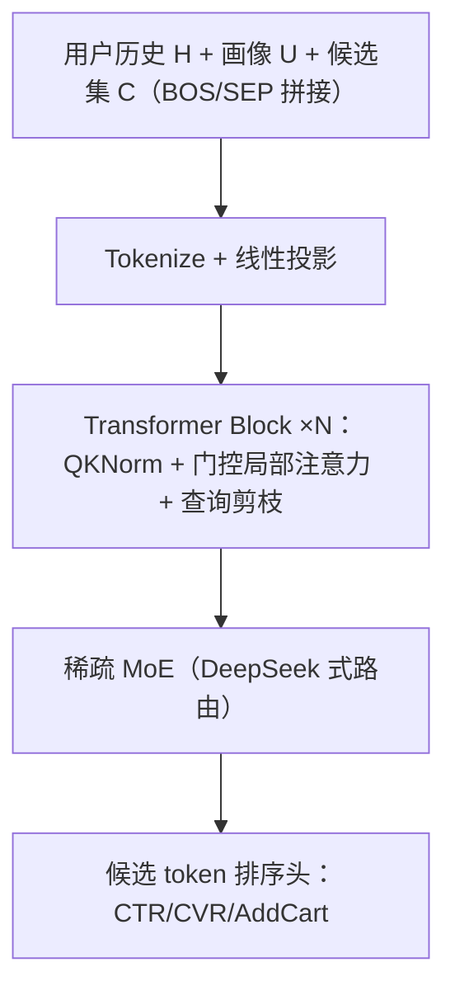
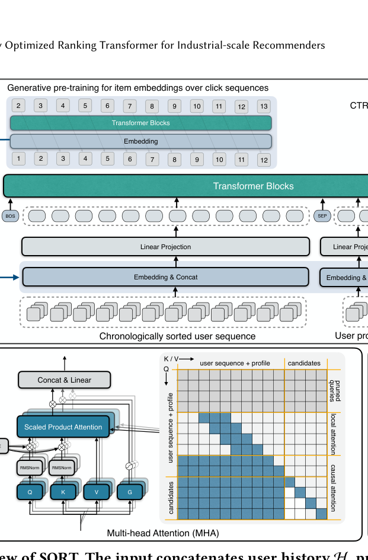

# SORT: A Systematically Optimized Ranking Transformer for Industrial-scale Recommenders (面向工业级推荐系统的系统化优化排序 Transformer)

- **会议/期刊**: CIKM 2026
- **作者与机构**: Chunqi Wang, Bingchao Wu, Taotian Pang 等，阿里巴巴国际数字商业集团（AliExpress）
- **推荐链路定位**: 精排（多目标 CTR/CVR/AddCart 预估）
- **研究方向**: 多任务学习与列表级重排 / CTR 预估与特征交叉
- **论文原文**: [https://arxiv.org/abs/2603.03988v3](https://arxiv.org/abs/2603.03988v3)
- **开源代码**: 暂未开源

## TL;DR (1分钟核心速览)

工业精排长期被 DIN/DeepFM/DCN 等专用低算力特征交叉网络主导，难以吃满现代加速器算力；而直接把 Transformer 搬进精排又会撞上「十亿级物品词表带来的高特征稀疏」与「仅目标物品有监督的低标签密度」这对核心矛盾。SORT 以请求为中心把同请求多候选打包成单样本，配合局部注意力+逐层查询剪枝、GPSD 式生成式预训练与稀疏冻结、特殊 token/QKNorm/门控注意力/DeepSeek 式 MoE 等系统化改造，在 AliExpress 离线 AUC 上 CTR +0.41pt、CVR +0.25pt、AddCart +0.31pt，线上订单 +7.47%、GMV +8.65%，同时延迟降 62%、吞吐提升 589%。

## Background & Motivation (背景与核心矛盾)

- **主流范式**: 精排主流仍是 DIN（序列建模）、DeepFM/DCN（显式特征交叉）等专用网络，靠向量级运算与低维矩阵乘捕捉特征交互，参数主要花在海量稀疏 embedding 的记忆上。
- **前人局限**: 其一，这类网络算力密度低、无法利用加速器的大规模并行能力，模型容量与可扩展性受限；其二，HSTU/OneTrans 等 Transformer 化尝试虽统一了架构，但仍受稀疏物品 ID 过拟合与单 epoch 过拟合困扰，且长历史序列带来 $O(L^2)$ 计算浪费。
- **核心洞察 (Key Insight)**: 语言模型之所以可扩展，是因为 BPE 子词把词表压到十万级（低稀疏）且每个位置都有 next-token 监督（高标签密度）；推荐则相反——词表十亿级、监督只落在候选 token 的二值标签上，形成「巨大参数空间被稀疏二值信号正则」的信息不对称。
- **本文切入点**: 用「请求为中心样本组织 + 局部注意力/查询剪枝」把算力重分配到与标签相关的交互上，用「生成式预训练 + 稀疏冻结」人为抬高标签密度，再用架构级精修稳定训练并扩容。

## Method (核心方法设计)

### 1. 整体框架 (Overall Architecture)

输入把用户历史 $\mathbf{H}$、用户画像$\mathbf{U}$与同请求候选集$\mathbf{C}$用 BOS/SEP 拼成单条序列$\mathbf{S}=[\text{BOS};\text{Tokenize}(\mathbf{H});\text{SEP};\text{Tokenize}(\mathbf{U});\text{SEP};\text{Tokenize}(\mathbf{C})]$，一次前向即完成整请求多候选打分。主干沿用 LLM 最佳实践（Pre-Norm + RMSNorm、RoPE、SwishGLU），每个 block 内先做带稀疏掩码与门控的多头注意力（QKNorm 稳定、候选间对角掩码保证独立），再经 DeepSeek 式稀疏 MoE 替代标准 FFN；查询剪枝在逐层推进中不断缩短非候选 token，最终仅对候选 token 的隐状态接排序头输出多目标 sigmoid 概率，各目标 BCE 加权求和训练。

<figure class="paper-figure" markdown="span">
  <figcaption>图 1：SORT 概览。输入将用户历史 H、用户画像 U 和候选 C 与 BOS/SEP token 拼接。每个模块使用 QKNorm 和带稀疏掩码的门控注意力，后接稀疏 MoE 层；查询剪枝在逐层过程中逐步缩短序列。排序头在候选 token 上输出多目标预测。</figcaption>
</figure>

### 2. 关键设计拆解 (Key Designs)

1. **请求为中心样本组织 + 局部注意力 + 查询剪枝（算力重分配）**：痛点是以曝光为中心每候选一样本，请求不变的用户画像与长历史被重复计算 $N$次。SORT 改为单样本打包$N$个候选，历史 token 仅保留窗口$W$的局部因果注意力（候选 token 仍全因果），复杂度由$O(L^2)$降至$O(W\cdot L)$；再逐层剪掉远离候选的 query，末层最多保留 128 个非候选 token，FLOPs 从 43G 降到 24G。意外收益是剪枝带来时间衰减的归纳偏置，性能不降反升（CTR +0.26pt）。
2. **生成式预训练 + 稀疏冻结（抬升标签密度）**：十亿级物品 embedding 仅靠二值标签无法正则。先用点击序列做 next-item 生成式预训练得到物品稀疏 embedding，再在精排训练中**冻结**之。仅 transfer 不冻结反而掉点（CTR -0.13pt），transfer+freeze 则 CTR +2.81pt、CVR +1.34pt，且支持多 epoch 训练而不严重过拟合——这是全文收益最大的单点改造。
3. **架构精修与训练目标**：BOS/SEP 特殊 token 兼作 attention sink 吸收多余注意力（CTR +0.33pt，图 4 热力图可见 BOS 吸走大量权重）；QKNorm 对 Q/K 做 RMSNorm 抑制注意力 logits 抖动；注意力后接门控；FFN 换 DeepSeek 式 MoE（免调负载均衡辅助损失，稀疏比 1/8 最优），参数 18M→85M 而 FLOPs 不增。总损失为多目标 BCE 加权和 $\mathcal{L}=\sum_{o\in\{\text{CTR,CVR,AddCart}\}}\lambda_o\,\mathcal{L}_{\text{BCE}}^{(o)}$；用户侧弃用显式 user id，改由行为序列+画像刻画，从源头削减稀疏参数。

## Experimental Setup & Evaluation Protocol (实验设置与评估协议)

- **数据集与预处理**: 取自 AliExpress 工业日志，训练集为过去数月、测试集为随后一天，无 5-core 过滤（工业全量）：

| 数据集 | #Requests | #Users | #Impressions | 稀疏度/密度 | 特征/场景说明 |
| :--- | :---: | :---: | :---: | :---: | :--- |
| Train | 0.6B | 50M | 9B | 极稀疏（十亿级物品词表） | 用户历史+画像+候选，序列长 1K |
| Test | 20M | 4M | 0.3B | 同上 | 随后一天日志 |

- **数据划分与防穿越 (Splitting Strategy)**: 全局时间戳切分（训练用历史月、测试用次日），严格防穿越。
- **排名评测协议 (Ranking Protocol)**: 采用 AUC 作为排序质量指标（工业日志全量曝光，非采样负例），多目标 CTR/CVR/AddCart 分别报告。
- **对比基线与超参设置**: 基线为同规模标准 Transformer、HSTU、OneTrans，按 small/base/large 三档对齐参数量与 FLOPs（base：depth 6、width 512、intermediate 1280；HSTU 无 FFN 故加宽对齐）。AdamW，$(\beta_1,\beta_2)=(0.9,0.99)$，weight decay 0.01，学习率 5e-4/2e-4/1e-4，batch 12K，单 epoch、序列长 1K，BF16 混合精度（排序头与 MoE 路由保 FP32），4–32 张 A100。

## Key Experimental Results (实验关键数据)

### 1. 主实验对比 (Main Results)

Base 规模（参数量不含约 20B embedding）：

| Model | CTR AUC | Imp | CVR AUC | Imp | AddCart AUC | Imp | Params | FLOPs |
| :--- | :---: | :---: | :---: | :---: | :---: | :---: | :---: | :---: |
| Transformer | 0.7456 | - | 0.9093 | - | 0.8663 | - | 18M | 43G |
| HSTU | 0.7438 | -0.18pt | 0.9070 | -0.23pt | 0.8644 | -0.19pt | 18M | 43G |
| OneTrans | 0.7476 | +0.20pt | 0.9103 | +0.10pt | 0.8677 | +0.14pt | 54M | 24G |
| **SORT (base)** | **0.7497** | **+0.41pt** | **0.9118** | **+0.25pt** | **0.8694** | **+0.31pt** | 85M | 24G |
| Transformer (large) | 0.7485 | - | 0.9122 | - | 0.8695 | - | 144M | 322G |
| **SORT (large)** | **0.7536** | **+0.51pt** | **0.9156** | **+0.34pt** | **0.8736** | **+0.41pt** | 685M | 188G |

线上 A/B（一个月、四场景，生产基线为训练一年以上的 DLRM，SORT 仅用近三月数据）：

| 场景 | Orders↑ | Buyers↑ | GMV↑ | Latency↓ | Throughput↑ |
| :--- | :---: | :---: | :---: | :---: | :---: |
| HomePage | +2.37% | +2.58% | +10.01% | -62% | +325% |
| DetailPage | +8.99% | +7.46% | +11.49% | -51% | +405% |
| ShoppingCart | +7.10% | +6.74% | +6.98% | -64% | +448% |
| AfterPayment | +11.43% | +9.91% | +6.12% | -72% | +1180% |
| **宏平均** | **+7.47%** | **+6.67%** | **+8.65%** | **-62%** | **+589%** |

### 2. 消融实验 (Ablation Study)

Base 规模逐项叠加（相对标准 Transformer）：

| 变体 | CTR Imp | CVR Imp | AddCart Imp | FLOPs |
| :--- | :---: | :---: | :---: | :---: |
| + special token (ST) | +0.33pt | +0.20pt | +0.22pt | 43G |
| + local attention (LA) | +0.10pt | +0.06pt | +0.08pt | 40G |
| + query pruning (QP) | +0.26pt | +0.19pt | +0.13pt | 24G |
| + attention gate (AG) | +0.21pt | +0.04pt | +0.09pt | 47G |
| + QKNorm (QKN) | +0.12pt | +0.11pt | +0.07pt | 43G |
| + MoE | +0.19pt | +0.06pt | +0.12pt | 43G |
| **SORT（全叠加）** | **+0.41pt** | **+0.25pt** | **+0.31pt** | **24G** |

### 3. 关键实验发现 (Key Findings)

1. **冻结比迁移更关键**：仅 sparse transfer 使 CTR 掉 0.13pt，而 transfer+freeze 反升 2.81pt，说明生成式预训练的价值不在初始化质量，而在冻结后切断稀疏 embedding 对二值标签的过拟合通道，并解锁多 epoch 训练（图 2 训练/验证 AUC 同步平滑上升）。
2. **约束即正则**：局部窗口 256 的性能甚至超过全因果注意力，查询剪枝在省近半算力的同时带来 +0.26pt CTR，验证了「时间衰减归纳偏置 + 过滤远端噪声」的假设；MoE 稀疏比 1/8 最优，DeepSeek 式路由免调辅助损失且略优于 Switch 式。
3. **数据扩展斜率最陡**：在固定算力预算下，多 epoch/多场景数据扩展的 AUC 增益斜率明显高于序列长度扩展与模型扩展，large 档 SORT 以 188G FLOPs（vs. 322G）取得 +0.51pt CTR，说明工业场景应优先投数据而非堆参数。

## Highlights & Limitations (亮点、对比与审稿批判)

- **与代表作对比 (vs. Prior Work)**: 相比 HSTU 的纯统一序列 next-token 范式，SORT 保留异构特征并显式处理稀疏 embedding 过拟合；相比 OneTrans 的独立参数规则路由（可视为规则 MoE），SORT 用数据驱动路由的稀疏 MoE，且以请求为中心打包 + 剪枝把 FLOPs 压到 24G（OneTrans 亦为 24G 但参数仅 54M）；相比 GPSD 只解决预训练问题，SORT 把数据组织、注意力稀疏化、架构精修与训练系统（MFU 13%→45%）整合为端到端工业方案。
- **可迁移亮点**: ①「生成式预训练 + 冻结稀疏 embedding」可直接迁移到任何带海量 ID 词表的精排/召回模型以缓解单 epoch 过拟合；②BOS/SEP 作 attention sink 吸收冗余注意力，是低成本稳定深层 Transformer 的通用技巧。
- **审稿级局限批判**: ①离线仅报告 AUC，缺少 GAUC/校准与多目标帕累托分析，且无公开数据集复现，工业日志不可获取削弱可比性；②收益高度依赖自研 RecIS 训练系统与定制稀疏注意力算子（SDPA/FlashAttention 不适配其掩码），MFU 45% 的可复现性存疑；③局部窗口与 MoE 稀疏比等超参在 1K 序列下调优，向 4K 长序列外推的敏感性未充分讨论。

## Rating (四维评分)

- **方法创新性 (Novelty)**: ⭐⭐⭐⭐ （单点算子多为 LLM 技巧迁移，但「请求为中心+剪枝+冻结预训练」的系统化组合与信息不对称视角具有工程理论价值）
- **评估协议与实验扎实度 (Protocol & Experiments)**: ⭐⭐⭐⭐ （离线三档规模对齐 + 逐项消融 + 四场景一个月线上 A/B 完整，但缺公开数据集与校准类指标）
- **写作与数学规范度 (Clarity & Rigor)**: ⭐⭐⭐⭐ （架构与系统优化叙述清晰、图表自洽，但核心公式偏少、复杂度与路由细节略简）
- **工业落地与复现价值 (Industrial & Practical Value)**: ⭐⭐⭐⭐⭐ （全量部署 AliExpress 全用户，GMV +8.65% 且延迟降 62%、吞吐 +589%，落地价值已被线上验证；可惜未开源）
