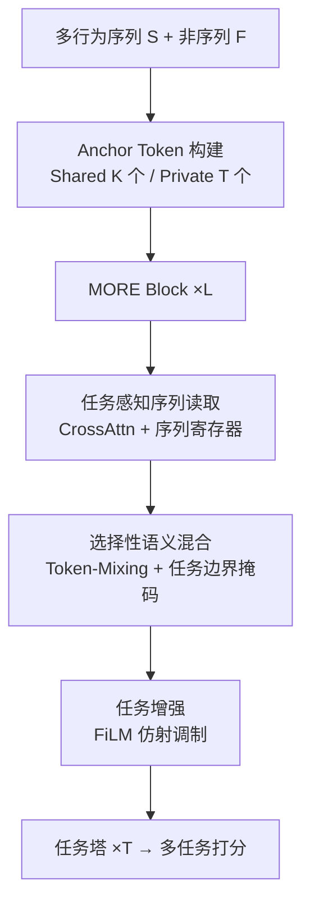
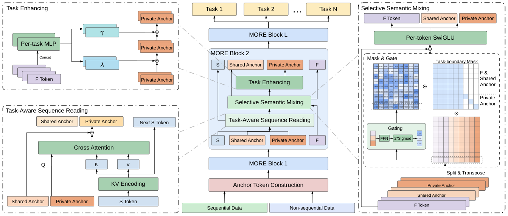

# Task-Blind No MORE: Multi-Task Information Flow in Unified Ranking Backbones (告别任务盲：统一排序主干中的多任务信息流)

- **会议/期刊**: CIKM 2026
- **作者与机构**: Yuchen Wang, Feng Niu, Qing Tan, Junting Lu, Baoxin Wu, Jun Gao（Hello Group 陌陌 / 中科大 / 中科院软件所 / 北京信息科技大学）
- **推荐链路定位**: 精排（统一主干 + 多任务预测头）
- **研究方向**: 多任务学习与列表级重排 / 特征交叉与 CTR 预估
- **论文原文**: [https://arxiv.org/abs/2609.07273v1](https://arxiv.org/abs/2609.07273v1)
- **开源代码**: 暂未开源

## TL;DR (1分钟核心速览)

工业排序模型已把序列建模与特征交叉统一进可堆叠主干（HyFormer/MixFormer/OneTrans），但多任务建模仍被挤在主干之后的浅层塔里，主干本身是"任务盲"的。本文提出 MORE，用跨层持久的 Shared/Private Anchor Token 把任务信号注入主干每一层，配合任务边界掩码隔离私有语义。在陌陌 Nearby Feed 90 天日志上，7 个任务 GAUC 全面领先（Greet +1.58%、Like +1.47%），线上 A/B 使用时长 +3.0%、评论率 +3.6%，P99 延迟反降约 30%。

## Background & Motivation (背景与核心矛盾)

- **主流范式**: 工业排序沿两条线各自扩张——特征交叉侧（Wukong、RankMixer）与序列建模侧（HSTU、LONGER）；近期 OneTrans/HyFormer/MixFormer 将二者合并为单一可堆叠主干，多任务则沿用 MMoE/PLE 的后置塔。
- **前人局限**: ① 任务信号只在预测头进入，主干内的序列读取与特征聚合无法按任务条件化（CTR 依赖曝光新鲜度与视觉显著性，评论率依赖内容深度，却被同一套共享 query 混读）；② 所有任务共享同一主干输出，任务偏好在任何分化发生前就被压进单一语义空间，后置门控只能对已压缩基向量重加权，无法重建从未形成的任务感知特征组织——这是结构性瓶颈而非路由容量问题。
- **核心洞察 (Key Insight)**: 任务无关主干的参数/FLOPs 增长转化为多任务 GAUC 的效率显著低于任务感知方案，说明"通用 scaling"与"多任务需求"存在结构性错配。
- **本文切入点**: 把多任务建模从预测阶段前移到主干内部，让任务信号与序列/特征表征逐层共演化。

## Method (核心方法设计)

### 1. 整体框架 (Overall Architecture)

输入分为多行为序列 token $\mathbf{S}$与非序列 token$\mathbf{F}$（用户画像、候选属性、上下文）。由二者池化投影切分出$K$个 Shared Anchor 与$T$个 Private Anchor，作为跨层持久的多任务信息载体。堆叠$L$个 MORE Block，每块依次执行：任务感知序列读取（Anchor 以 cross-attention 查询序列记忆）→ 选择性语义混合（Anchor 与$\mathbf{F}$做 MLP-Mixer 式 token 混合，并施加任务边界掩码）→ 任务增强（FiLM 式仿射把$\mathbf{F}$ 的判别信息注入各 Private Anchor）。末端每个任务塔接收对应 Private Anchor 与共享语义输出打分。训练用加权 BCE，推理采用 request-level 共享计算。

<figure class="paper-figure" markdown="span">
  <figcaption>图2：MORE概览。MORE由锚点Token构建、堆叠的MORE块和任务特定预测头组成。每个MORE块包含三个模块：任务感知序列读取、选择性语义混合和任务增强。具体而言，任务感知序列读取强化序列信号建模，选择性语义混合增强共享语义和任务边界感知，任务增强提升私有锚点的任务判别能力。该设计使MORE能够在统一主干中联合建模共享信息和任务特定信息。</figcaption>
</figure>

### 2. 关键设计拆解 (Key Designs)

1. **Anchor Token 构建与笛卡尔行为编码**：若只编码物品位置而不区分行为类型，后续层的任务结构会被削弱。本文将每个物品的行为组合表示为长度 $T$的 0/1 指示向量并映射为唯一 action-combination ID，序列 token 为$\mathbf{s}_n=\mathbf{e}_{item}(i_n)+\mathbf{e}_{action}(cid_n)+\mathbf{e}_{time}$；Anchor 由$\mathbf{h}=\mathrm{Concat}(\mathrm{MeanPool}(\mathbf{S}),\mathrm{Flatten}(\mathbf{F}))$经 MLP 切分得到，并给第$t$个 Private Anchor 加可学习任务先验$\mathbf{A}_p^{(t)}\!+\!\boldsymbol{\pi}_t$。直觉：在输入层就把"同一物品的不同行为语义"拆开，等于提前缓解跨任务梯度冲突。

2. **任务边界掩码的选择性语义混合**：无差别融合会让不同 Private Anchor 互相稀释。将 $\mathbf{G}=(\mathbf{F};\hat{\mathbf{A}}_s;\hat{\mathbf{A}}_p^{(1..T)})$切为$H$头并转置，每头经 MLP 门控得$m_i\in\mathbb{R}^H$，再与掩码逐元素相乘：
$$\hat{\mathbf{g}}_i=\tilde{\mathbf{g}}_i\odot(m_i\odot \mathbf{M}_{i,:}),\quad \mathbf{M}\in\{0,1\}^{H\times H}$$
其中 $\mathbf{F}$ 与 Shared Anchor 对所有 token 可见，每个 Private Anchor 仅对自身可见。物理直觉：保留全局语义流动的同时切断任务间污染路径，防止高频任务（点击）的梯度主导共享混合权重。

3. **序列寄存器与任务增强、训练/推理效率**：跨块维护零初始化寄存器 $\boldsymbol{\eta}\leftarrow\mathrm{LN}(\boldsymbol{\eta}+\mathrm{MLP}(\mathrm{Pool}(\tilde{\mathbf{S}})))$，各 Anchor 经独立 SwiGLU 门控吸收，使不同位置对同一序列摘要作差异化解读；Task Enhancing 用$(\boldsymbol{\lambda}_t,\boldsymbol{\gamma}_t)=\mathrm{Split}(\mathrm{MLP}_t(\mathrm{Concat}(\mathbf{F})))$做$\mathbf{A}_p^{(t)}=\mathrm{Norm}((\bar{\mathbf{A}}_p^{(t)}\odot\boldsymbol{\lambda}_t+\boldsymbol{\gamma}_t)+\bar{\mathbf{A}}_p^{(t)})$。总损失$\mathcal{L}=\sum_t \lambda_t \mathcal{L}_{BCE}(\hat{y}_t,y_t)$，无额外负采样设计（精排点式 BCE）。推理侧因$\mathbf{S}$为用户级状态、不依赖候选，可将一次请求的$C$ 个候选聚合为单样本共享用户侧计算，无需改模型即降延迟。

## Experimental Setup & Evaluation Protocol (实验设置与评估协议)

- **数据集与预处理**: 陌陌 Nearby Feed（附近动态社交信息流）线上推荐日志，连续 90 天训练 + 紧随其后 1 天评估；序列特征为多类型近期行为，非序列含画像/内容属性/场景上下文。论文未披露用户/物品量级与过滤规则。

| 数据集 | #Users | #Items | #Interactions | 稀疏度/密度 | 特征/场景说明 |
| :--- | :---: | :---: | :---: | :---: | :--- |
| Momo Nearby Feed | 未披露（千万级 MAU 平台日志） | 未披露 | 90 天全量曝光日志 | 未披露 | 多行为序列 + 画像/内容/上下文；13 任务联合优化，主表报告 7 个 |

- **数据划分与防穿越 (Splitting Strategy)**: 全局时间戳切分（前 90 天训练，第 91 天测试），天然避免未来信息穿越。
- **排名评测协议 (Ranking Protocol)**: 以 GAUC 为主指标（按用户算 AUC 再平均），属全量曝光日志上的用户内排序评估；未采用负采样排序。
- **对比基线与超参设置**: 两阶段类（Transformer+RankMixer 为参照、+Wukong、HSTU+RankMixer、+DCN-v2、STCA）与统一主干类（MixFormer、HyFormer、OneTrans），全部在同一框架、同数据、同调度、同评测协议与同超参预算下复现。默认 $L_{block}=2$、$d=256$、$M=15$个非序列 token、17 个 Anchor（8 Shared + 9 Private），Adam、batch 1024；scaling 实验将参数从约 0.1B 扩至约 0.9B、单样本前向 FLOPs 从约 1.4G 扩至约 11G。线上 A/B 为两周均衡分流，显著性$p<0.05$。

## Key Experimental Results (实验关键数据)

### 1. 主实验对比 (Main Results)

以 Transformer+RankMixer 的绝对 GAUC 为基准，其余为相对变化：

| 方法 | 类别 | Click | Like | Comment | Greet | Reply | Avatar-click | Deep Chat | Params | FLOPs/Ex. |
| :--- | :--- | :---: | :---: | :---: | :---: | :---: | :---: | :---: | :---: | :---: |
| Transformer+RankMixer | Two-Stage | 0.7863 | 0.6892 | 0.6979 | 0.7279 | 0.8388 | 0.7073 | 0.8444 | 77.85M | 1.92G |
| Transformer+Wukong | Two-Stage | +0.03% | -0.27% | -0.65% | -0.53% | -0.15% | -0.36% | -0.46% | 79.01M | 1.90G |
| HSTU+RankMixer | Two-Stage | +0.09% | -0.23% | -0.57% | -0.34% | -0.10% | -0.25% | -0.24% | 77.19M | 1.76G |
| STCA | Two-Stage | +0.13% | +0.66% | +0.38% | -0.01% | +0.02% | +0.06% | -0.07% | 88.21M | 2.36G |
| MixFormer | Unified | +0.29% | +1.13% | +0.89% | +1.25% | +0.49% | +0.70% | +0.15% | 98.68M | 4.65G |
| HyFormer | Unified | +0.43% | +0.89% | +1.09% | +1.32% | +0.42% | +0.82% | +0.08% | 153M | 2.16G |
| OneTrans | Unified | +0.38% | +1.15% | +0.80% | +1.44% | +0.58% | +0.86% | +0.11% | 108.65M | 1.73G |
| **MORE** | Task-Aware Unified | **+0.44%** | **+1.47%** | **+1.26%** | **+1.58%** | **+0.62%** | **+1.02%** | **+0.33%** | 132M | 1.85G |

线上 A/B（两周，相对生产 DLRM 式排序模型）：使用时长 **+3.0%**、Click +2.8%、Like +2.0%、Comment **+3.6%**、Greet +2.5%、Deep Chat +2.0%，全部 $p<0.05$；P99 打分延迟降约 **30%**。

### 2. 消融实验 (Ablation Study)

| 配置 | Click | Interaction | Chat | Average |
| :--- | :---: | :---: | :---: | :---: |
| w/o Cartesian Encoding | -0.06% | -0.10% | -0.08% | -0.08% |
| w/o Anchor From Context | -0.08% | -0.04% | -0.17% | -0.10% |
| w/o Private Seq Reading | -0.15% | -0.19% | -0.12% | -0.15% |
| w/o Seq Register | -0.02% | -0.01% | -0.13% | -0.05% |
| w/o Boundary Gating Mask | -0.16% | **-0.34%** | -0.11% | **-0.21%** |
| w/o Task Enhancing | -0.11% | -0.13% | -0.17% | -0.14% |
| BaseArch（全组件移除） | -0.23% | -0.38% | -0.39% | -0.33% |

### 3. 关键实验发现 (Key Findings)

1. **任务边界掩码是单点最关键组件**：移除后 Interaction 平均掉 0.34%，远超 Task Enhancing（0.13%）与 Private Seq Reading（0.19%），说明混合阶段的隔离比读取/增强阶段的私有容量更决定多任务收益——高频点击任务的梯度会污染共享混合权重。
2. **统一主干只解决"序列-特征分离"，不解决"任务分离"**：MixFormer/HyFormer/OneTrans 虽全任务为正，但提升模式高度相似（Greet 约 +1.25%~+1.44%），而 MORE 在社交深链任务上进一步拉开（Greet +1.58%、Deep Chat +0.33% vs. OneTrans +0.11%），印证任务盲主干的天花板。
3. **精度-效率并非权衡而是双赢**：MORE 参数 132M 低于 HyFormer 153M，单样本 FLOPs 1.85G 低于参照基线 1.92G 与 MixFormer 4.65G；scaling 曲线显示从 0.1B 到 0.9B 参数、1.4G 到 11G FLOPs，MORE 相对任务无关主干的 GAUC 差距随容量增大而扩大，说明任务感知容量在每个规模上都被有效利用。

## Highlights & Limitations (亮点、对比与审稿批判)

- **与代表作对比 (vs. Prior Work)**: 与 HyFormer/OneTrans 的本质区别在于任务信号进入主干的时机——前者仅在预测头分化，MORE 让 Anchor Token 在每层参与序列读取与语义混合；与 PLE/MMoE 的区别在于后者对已压缩的共享表征做浅层路由，MORE 在表征形成过程中就施加任务边界；与 STCA 的区别在于 STCA 虽统一序列与特征交叉流水线，主干仍任务无关，深链社交任务几乎零增益。
- **可迁移亮点**: ① 笛卡尔行为组合编码可低成本移植到任意多行为序列推荐，缓解位置级梯度冲突；② request-level 共享计算利用"用户级序列状态与候选解耦"的架构性质，无需改模型即摊薄每候选成本，对高并发精排极具工程价值。
- **审稿级局限批判**: ① 实验仅覆盖陌陌单一社交发现场景，且数据集统计量、13 任务中仅 7 个入表，外部可复现性与泛化性证据偏弱；② 任务边界掩码使 Private Anchor 间完全不可见，当任务间存在强正迁移（如 Like→Comment）时可能损失协同收益，且掩码结构随任务数 $T$ 线性增长，动态任务配置下的扩展性未验证。

## Rating (四维评分)

- **方法创新性 (Novelty)**: ⭐⭐⭐⭐ （核心机制与方法设计具备明确创新性，理论与实验动机支撑充分）
- **评估协议与实验扎实度 (Protocol & Experiments)**: ⭐⭐⭐⭐ （主流公开数据集评测完整，包含多基线对比与消融实验验证）
- **写作与数学规范度 (Clarity & Rigor)**: ⭐⭐⭐⭐⭐ （问题形式化定义清晰，核心模块数学推导与架构阐述严谨易读）
- **工业落地与复现价值 (Industrial & Practical Value)**: ⭐⭐⭐⭐⭐ （兼顾推荐效果增益与训练/推理效率，具备实际场景迁移参考价值）
