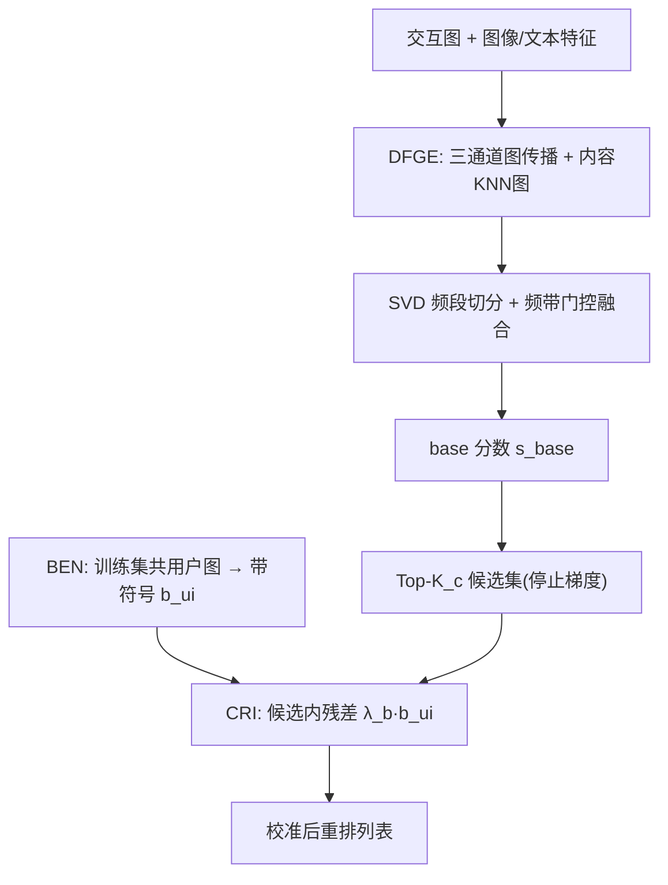
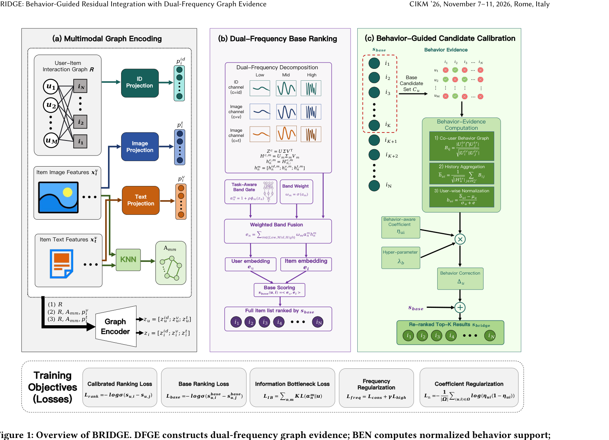

# BRIDGE: Behavior-Guided Residual Integration with Dual-Frequency Graph Evidence (行为引导残差融合与双频图证据)

- **会议/期刊**: CIKM 2026
- **作者与机构**: Zesheng Li, Chengchang Pan, Honggang Qi（中国科学院大学）
- **推荐链路定位**: 重排（两阶段召回-排序流水线中的候选级校准）
- **研究方向**: 多模态推荐 / 列表级重排
- **论文原文**: [论文原文链接](https://arxiv.org/abs/2605.22073v2)
- **开源代码**: [项目主页](https://lizesheng13.github.io/bridge/)（代码仓库随项目页发布）

## TL;DR (1分钟核心速览)

本文质疑多模态推荐"对齐越强排序越好"的默认前提：在 Amazon Baby 上的诊断显示跨视图一致性存在**有效区间**（Recall@20 从 0.0922 升至 0.1024 后跌至 0.0836），且表示频谱呈"低频共享、高频私有"分裂。据此提出 BRIDGE：DFGE 做双频段图证据编码，BEN 将训练期共用户重叠转为**带符号**行为证据，CRI 仅在 base top-K 候选集内施加残差。在 Baby/Sports/Electronics 全库排序协议下取得 R@20 = 0.1128/0.1262/0.0778，相对最强基线最高提升 7.3%（Recall）与 14.9%（NDCG）。

## Background & Motivation (背景与核心矛盾)

- **主流范式**: MMGCN/LATTICE/BM3/DiffMM 等多模态推荐沿"构建 item-item 内容图 + 去噪 + 强化跨视图一致性"路线改进表征层，隐含前提是"更好的多模态表征必然带来更好的排序"。
- **前人局限**: ① 一致性目标一旦主导训练，会抹平"合理候选"与"近重复/流行仿品"之间的差异，压制模态不共享的私有排序因子；② 表征改进作用于**全目录打分**，在召回-排序流水线中会扰动整个候选空间，而排序胜负实际只由小候选集决定。
- **核心洞察 (Key Insight)**: 频谱诊断显示低频段跨视图余弦一致性高、高频段保留更多排序信号，且完整表示优于任一单频段；行为证据在**全局修正时有害、在 top-K 候选内修正时有益**——内容证据应作为"条件证据"而非"命令"。
- **本文切入点**: 让多模态骨干定义候选几何，行为证据只对骨干已认可的候选做局部带符号残差校准。

## Method (核心方法设计)

### 1. 整体框架 (Overall Architecture)

输入为用户-物品交互图与 BEIT3 视觉/文本特征。DFGE 对 ID、图像、文本三通道分别做对称归一化图传播（L=2）并叠加内容 KNN 物品图平滑，再按奇异值降序切分为 M=3 个频段，经任务感知频带门控加权融合得到 192 维表示与 base 分数；BEN 仅用训练集交互构建共用户物品图并归一化为带符号证据 $b_{ui}$；CRI 在训练与推理**同一** top-$K_c$ 候选范围内将 $\lambda_b b_{ui}$ 作为残差叠加。训练采用候选掩码 BPR + base 辅助 BPR + IB 门控正则 + 频段结构正则。

<figure class="paper-figure" markdown="span">
  <figcaption>图1：BRIDGE 概览。DFGE 构建双频图证据；BEN 计算归一化行为支持度；CRI 仅在选定的候选集内整合残差。</figcaption>
</figure>

### 2. 关键设计拆解 (Key Designs)

1. **双频图证据编码 DFGE（保留共享/私有频谱）**：痛点是把三模态压成无差别表示会丢失高频私有排序信号。对通道 $c$ 的传播矩阵做 SVD 并按奇异值降序切为 $M$ 段，$H^{c,m}=U_m\Sigma_m V_m^\top$，再以任务感知门控融合：$\alpha_n^m=1+\rho\phi_m(z_n),\ e_n=\sum_m \omega_m\alpha_n^m h_n^m$。直觉：归一化图传播本身是低通算子，前导奇异段即稳定共享证据，尾部段承载局部差异，分段路由让二者共存而非互相覆盖。
2. **行为证据归一化 BEN（把共现变成带符号证据）**：原始共现是非负的、无法降权。先算余弦化共用户边 $B_{ij}=|U_i^{tr}\cap U_j^{tr}|/(\sqrt{|U_i^{tr}|}\sqrt{|U_j^{tr}|})$（top-$K_b$=1000 截断），按用户历史做 sqrt 归一化聚合后**逐用户 z-score 中心化**：$b_{ui}=(\tilde e_{ui}-\mu_u)/(\sigma_u+\epsilon)$。直觉：正值=高于该用户常态的行为支持，负值可主动降权"视觉相似但行为不支持"的候选，这是 ItemKNN/EASE 类全局非负打分做不到的。
3. **候选残差整合 CRI 与训练目标**：训练时用停止梯度的 base 分数取 $C_u^{tr}=\text{TopK}(sg(s_{base}),K_c)$，残差仅在集合内激活：$s_{train}=s_{base}+\mathbb{I}[i\in C_u^{tr}]\lambda_b b_{ui}$，推理同构（$K_c$=200）。总损失 $\mathcal{L}=\mathcal{L}_{rank}+\lambda_{base}\mathcal{L}_{base}+\lambda_{IB}\mathcal{L}_{IB}+\lambda_{freq}\mathcal{L}_{freq}$，其中 $\mathcal{L}_{freq}$ 含频段去相关项与高频段批内对比判别项。负采样为标准 BPR 均匀采样，无额外难负样本挖掘；推理仅需对缓存候选列表做一次残差遍历，开销可忽略。

## Experimental Setup & Evaluation Protocol (实验设置与评估协议)

- **数据集与预处理**: Amazon 三域，MMRec 风格隐式反馈划分，BEIT3 多模态特征：

| 数据集 | #Users | #Items | #Interactions | 训练/验证/测试 | 说明 |
| :--- | :---: | :---: | :---: | :---: | :--- |
| Baby | 19,445 | 7,050 | 160,792 | 118,551 / 20,559 / 21,682 | 最稀疏小域 |
| Sports | 35,598 | 18,357 | 296,337 | 218,409 / 37,899 / 40,029 | 中等密度 |
| Electronics | 192,403 | 63,001 | 1,689,188 | 1,254,441 / 211,296 / 223,451 | 大规稀疏、流行度偏斜 |

- **数据划分与防穿越**: 固定训练/验证/测试三分区；行为图、用户历史、物品流行度、用户度**仅由训练分区构建**，验证/测试不参与；过滤后验证/测试无冷启动用户。
- **排名评测协议**: 无偏 **Full-Ranking 全库排序**，指标 Recall@10/20、NDCG@10/20；所有基线共享同一划分、同一 BEIT3 特征与同一全排序评估器。
- **对比基线与超参设置**: 覆盖 BPR、LightGCN、VBPR、MMGCN、GRCN、DualGNN、SLMRec、LATTICE、BM3、FREEDOM、DiffMM、MMIL、AlignRec、SMORE、FITMM 共 15 个基线；嵌入维度 64（融合 192），2 层图传播，3 频段，物品图 K=10，学习率 $10^{-4}$，$\lambda_b$ 在验证集 R@20 上从 {0.1,0.2,0.4,0.6,0.8} 五点网格选取；强基线报告 5 种子均值±方差，$p<0.01$ 双样本 t 检验。

## Key Experimental Results (实验关键数据)

### 1. 主实验对比 (Main Results)

| 数据集 | 指标 | LATTICE | BM3 | FREEDOM | DiffMM | AlignRec | SMORE | FITMM | **BRIDGE** | Improv.% |
| :--- | :--- | :---: | :---: | :---: | :---: | :---: | :---: | :---: | :---: | :---: |
| Baby | R@20 | 0.0867 | 0.0904 | 0.0985 | 0.0978 | 0.1046 | 0.1035 | 0.1089 | **0.1128** | +3.6% |
| Baby | N@20 | 0.0383 | 0.0395 | 0.0416 | 0.0408 | 0.0458 | 0.0457 | 0.0484 | **0.0525** | +8.5% |
| Sports | R@20 | 0.0961 | 0.0987 | 0.1077 | 0.1035 | 0.1160 | 0.1142 | 0.1187 | **0.1262** | +6.3% |
| Sports | N@20 | 0.0431 | 0.0443 | 0.0478 | 0.0458 | 0.0517 | 0.0506 | 0.0538 | **0.0594** | +10.4% |
| Electronics | R@20 | 0.0573 | 0.0648 | 0.0588 | 0.0617 | 0.0700 | 0.0691 | 0.0725 | **0.0778** | +7.3% |
| Electronics | N@20 | 0.0271 | 0.0302 | 0.0262 | 0.0278 | 0.0321 | 0.0318 | 0.0335 | **0.0385** | +14.9% |

### 2. 消融实验 (Ablation Study)

| 变体 | Baby R@20 | Baby N@20 | Sports R@20 | Electronics R@20 |
| :--- | :---: | :---: | :---: | :---: |
| Full BRIDGE | **0.1128** | **0.0525** | **0.1262** | **0.0778** |
| w/o behavior evidence | 0.1016 | 0.0453 | 0.1162 | 0.0656 |
| w/o top-$K$ calibration | 0.1025 | 0.0450 | 0.1127 | 0.0647 |
| global correction | 0.1092 | 0.0507 | 0.1137 | 0.0642 |
| w/o item graph | 0.0824 | 0.0356 | 0.1010 | — |
| w/o content features | 0.0894 | 0.0414 | 0.1048 | — |
| w/o freq. decomp. (equal cap.) | 0.1110 | 0.0519 | — | — |
| w/o IB surrogate | 0.1031 | 0.0487 | — | — |
| w/o freq. structural reg. | 0.1107 | 0.0517 | — | — |
| Raw co-occurrence residual | 0.1067 | 0.0478 | 0.1218 | 0.0713 |
| EASE residual | 0.1087 | 0.0494 | 0.1229 | 0.0724 |
| Conservative coeff. | 0.1126 | 0.0519 | 0.1240 | 0.0738 |

### 3. 关键实验发现 (Key Findings)

1. **候选范围是残差生效的必要条件**：去掉 top-$K$ 限制（全局修正）在 Electronics 上从 0.0778 跌至 0.0642（-17.5%），甚至低于"无行为证据"的 0.0656，说明全局行为残差会与多模态骨干竞争并反噬；而候选内残差相对 Raw cooc./EASE 分别提升 9.1%/7.5%，证明 BEN 的 z-score 符号化与候选作用域缺一不可。
2. **增益主要来自列表顶部排序而非召回扩容**：NDCG 提升幅度（最高 14.9%）系统性大于 Recall（最高 7.3%），且 Electronics 上 N@20 相对 FITMM 提升 14.9% 而 R@20 仅 7.3%，与"候选池不变、仅重排"的设计定位一致。
3. **残差并非头部偏置，反而降低曝光集中度**：Sports 上 Head 曝光份额从 0.9073 降至 0.8429，同时 Mid/Tail/Cold 分层 Recall@20 从 0.0338/0.0217/0.0119 升至 0.0497/0.0438/0.0283，在无显式反流行度惩罚下实现长尾再分配；频谱侧去掉分解仅掉 0.0018（0.1128→0.1110），且 Gram/DCT/随机正交基结果接近，说明**频段切分本身**比具体基选择更关键。

## Highlights, Limitations & Rating (亮点、对比与审稿评价)

- **与代表作对比 (vs. Prior Work)**: 相较 LATTICE/BM3 等"强化跨视图对齐"路线，本文反向论证对齐存在有效区间并将内容降级为条件证据；相较 FITMM/SMORE 等频域方法，频谱在此不是去噪正则而是**授权步骤**（决定哪些频段留给候选校准）；相较 EASE/ItemKNN，行为证据不做全局独立排序器，而是候选内带符号残差。
- **可迁移亮点**: ① "训练与推理同构的候选掩码"（stop-gradient top-K scope）可直接移植到任何"全局训练、局部推理"的重排残差模块，消除训练-测试作用域错配；② 逐用户 z-score 中心化把非负共现转为可降权的带符号证据，适用于任何需要"负向证据"的校准场景。
- **审稿级局限批判**: ① 仅评测三个 Amazon 域与单一 BEIT3 特征，未报告端到端延迟/吞吐，候选缓存与行为图预计算的实际工程成本未知；② 增益高度依赖骨干能产出合理 shortlist（候选质量即上限），且 BEN 在共现稀疏或交互突发高度局部化时精度下降，此时需退回保守系数变体，鲁棒性边界未量化。
- **四维评分**: 创新性 ⭐⭐⭐⭐ | 实验扎实度 ⭐⭐⭐⭐ | 方法清晰度 ⭐⭐⭐⭐⭐ | 落地价值 ⭐⭐⭐⭐

