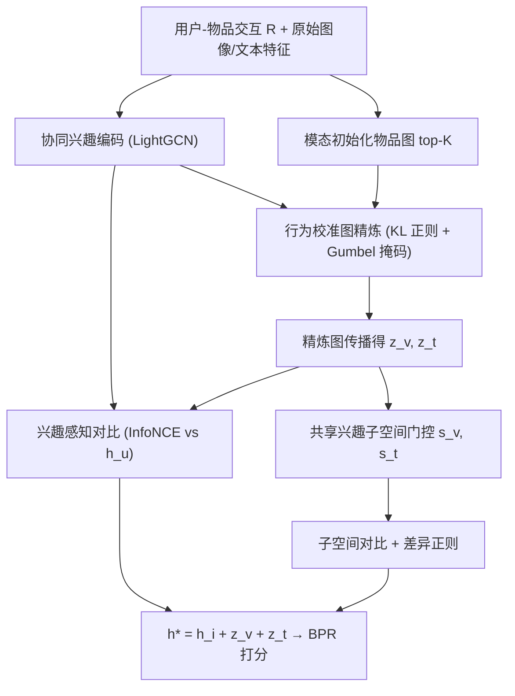
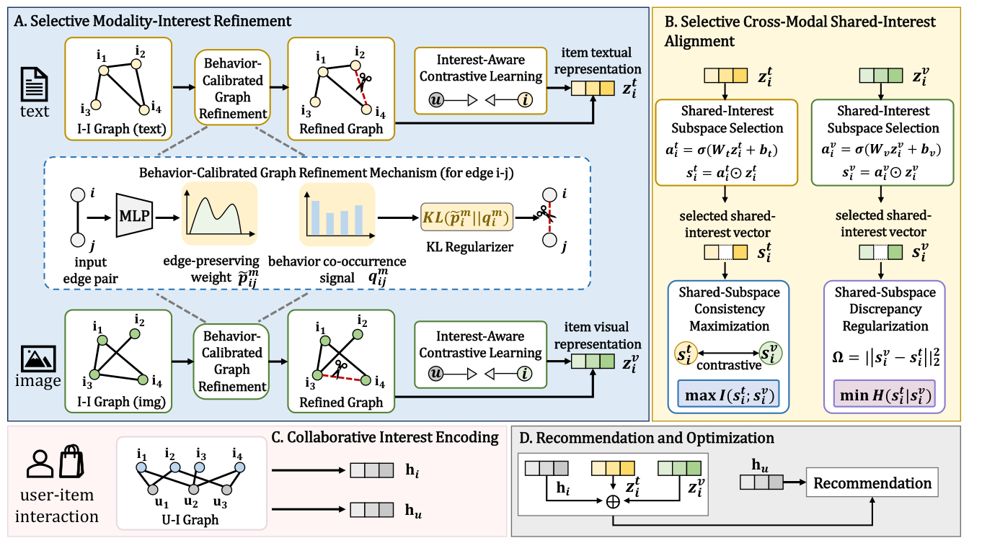

# Information-Guided Selective Modality-Interest Alignment for Multimodal Recommendation (信息引导的选择性模态-兴趣对齐多模态推荐)

- **会议/期刊**: CIKM 2026 (35th ACM International Conference on Information and Knowledge Management)
- **作者与机构**: Wenze Ma, Chenyu Sun, Yanmin Zhu (通讯), Qiwen Gu, Xuhao Zhao — 上海交通大学
- **推荐链路定位**: 召回（多模态表征增强的 Top-K 排序）
- **研究方向**: 多模态推荐 / 自监督对比与去噪
- **论文原文**: [https://arxiv.org/abs/2608.27950v1](https://arxiv.org/abs/2608.27950v1)
- **开源代码**: [https://github.com/Wenze1/AMUR](https://github.com/Wenze1/AMUR)

## TL;DR (1分钟核心速览)

多模态推荐的主流做法把图像/文本信号"全量"传播与对齐，但用户兴趣只落在模态内容的一个子集上（如只关心品牌与上新，不关心颜色与促销），弱对齐信号反而成为噪声。AMUR 从信息论视角把模态表征熵分解为"与用户协同表征的互信息 + 条件熵残差"，用**行为校准图精炼**（KL 正则把模态边分布拉向共现分布）压制残差、用**兴趣感知对比**放大互信息，再用**维度级门控的共享兴趣子空间**做跨模态对齐以保留模态特有信息。在 Baby/Sports/Clothing 三数据集 Full-Ranking 下，Recall@20 相对最强基线提升 1.56%/3.96%/2.26%，NDCG@20 提升 2.24%/7.78%/3.65%，且训练成本仅 12.9 min（Sports）。

## Background & Motivation (背景与核心矛盾)

- **主流范式**: 以 MMGCN/LATTICE/LGMRec 为代表的图传播派、以 SLMRec/BM3/MENTOR 为代表的对比学习派、以 DiffMM/CCDRec 为代表的扩散精炼派，共同假设"引入更多模态信息 = 更好偏好建模"。
- **前人局限一（对齐目标缺失）**: 不变学习、注意力、图精炼、对比对齐的对齐过程多为**隐式或启发式**，缺乏明确目标函数解释"为何某些模态结构应被强调、另一些应被抑制"，弱对齐信号仍会被传播进最终表征。
- **前人局限二（全空间对齐过度压制）**: 多数跨模态对齐强制视觉与文本**全表征一致**，把模态特有的互补细节（如文本中的功能描述、图像中的款式轮廓）一并抹平，反而损失推荐有用信息。
- **核心洞察 (Key Insight)**: 模态表征熵可分解为 $H(\boldsymbol{z}_i^m)=I(\boldsymbol{z}_i^m;\mathbf{h}_u)+H(\boldsymbol{z}_i^m|\mathbf{h}_u)$——前者是偏好相关部分，后者是弱相关残差。对齐的本质应是"**放大互信息项、压缩条件熵项**"，而非无差别融合。
- **本文切入点**: 用两个可 tractable 的代理目标（行为校准 KL 正则 + InfoNCE 下界）分别逼近"压残差"与"提互信息"，并把跨模态对齐限制在门控选出的共享子空间内。

## Method (核心方法设计)

### 1. 整体框架 (Overall Architecture)

AMUR 以 LightGCN 在用户-物品图上传播 ID 嵌入得到协同表征 $\mathbf{h}_u,\mathbf{h}_i$作为"偏好锚点"；随后进入两阶段对齐：**阶段一**为每个模态构建 top-K 余弦相似物品图，用 MLP+Gumbel-softmax 采样边保留掩码，并以行为共现分布为参考做 KL 正则得到精炼图$\hat{\boldsymbol{S}}^m$，在其上传播模态特征得$\boldsymbol{z}_i^m$，再用兴趣感知对比把$\boldsymbol{z}_i^m$拉向$\mathbf{h}_u$；**阶段二**用维度级 sigmoid 门控切出共享兴趣子空间$\boldsymbol{s}_i^m$，仅在该子空间上施加跨模态对比与差异正则。最终推荐仍使用**完整**模态表征$\mathbf{h}_i^*=\mathbf{h}_i+\boldsymbol{z}_i^v+\boldsymbol{z}_i^t$，以保留模态特有信息，与 BPR 联合优化。

<figure class="paper-figure" markdown="span">
  <figcaption>图2：AMUR的整体框架。AMUR首先从用户-物品交互中编码协同兴趣，然后进行选择性模态-兴趣细化以获得用户对齐的模态表示。进一步进行选择性跨模态共享兴趣对齐，最后整合协同表示和模态表示用于推荐。</figcaption>
</figure>

### 2. 关键设计拆解 (Key Designs)

1. **行为校准图精炼 (Behavior-Calibrated Graph Refinement)**：模态相似 ≠ 兴趣相似（两台外观相近的手机可能面向不同人群），故对候选边 $(i,j)$先估保留概率$p_{ij}^m=\sigma(\text{MLP}_\theta([\boldsymbol{e}_i^{id},\boldsymbol{e}_j^{id},o_{ij}^m]))$，Gumbel-softmax 采样二值掩码得$\hat{\boldsymbol{S}}^m=\boldsymbol{\beta}^m\odot\boldsymbol{S}^m$；再以共现计数$f_{ij}=[\boldsymbol{R}^\top\boldsymbol{R}]_{ij}$构造参考分布$q_{ij}^m \propto s_{ij}^m f_{ij}$，最小化$\mathcal{L}_{br}^m=\sum_i D_{KL}(\tilde{\boldsymbol{p}}_i^m\|\boldsymbol{q}_i^m)$。直觉：把"行为上常被同一批用户共同点击"作为边的先验支持度，无行为支撑的模态边被系统性削弱，即压缩$H(\boldsymbol{z}_i^m|\mathbf{h}_u)$。

2. **兴趣感知对比 + 共享子空间选择性对齐**：前者以 $(\mathbf{h}_u,\boldsymbol{z}_i^m)$为正对、批内其他物品为负对做 InfoNCE，$\mathcal{L}_{cl}^m$是$I(\boldsymbol{z}_i^m;\mathbf{h}_u)$的下界代理（$I\ge\log|\mathcal{B}_I|-\mathcal{L}_{cl}^m$）。后者先学门控$\boldsymbol{a}_i^m=\sigma(\boldsymbol{W}^m\boldsymbol{z}_i^m+\boldsymbol{b}^m)$、$\boldsymbol{s}_i^m=\boldsymbol{a}_i^m\odot\boldsymbol{z}_i^m$，再在子空间上同时施加跨模态对比$\mathcal{L}_{sc}$（最大化$I(\boldsymbol{s}_i^v;\boldsymbol{s}_i^t)$，防坍缩、保物品级区分度）与高斯变分导出的差异正则$\mathcal{L}_{sd}=\sum_i\|\boldsymbol{s}_i^v-\boldsymbol{s}_i^t\|_2^2$（压缩$H(\boldsymbol{s}_i^m|\boldsymbol{s}_i^{m'})$）。关键取舍：**对齐只发生在$\boldsymbol{s}$，推荐打分用$\boldsymbol{z}$**，从而"对齐共享语义、保留模态互补"两不误。

3. **训练目标、负采样与推理效率**：总损失 $\mathcal{L}=\mathcal{L}_{bpr}+\alpha\mathcal{L}_{mir}+\beta\mathcal{L}_{sia}$，其中$\mathcal{L}_{mir}=\sum_{m\in\{v,t\}}(\mathcal{L}_{br}^m+\mathcal{L}_{cl}^m)$、$\mathcal{L}_{sia}=\mathcal{L}_{sc}+\mathcal{L}_{sd}$。负采样为**标准 BPR 单负样本 + 批内 in-batch 负样本**（对比项），无额外 hard negative 挖掘。$\alpha,\beta$在$\{0,0.001,0.01,0.1\}$ 搜索，最优均在 0.01 附近。推理阶段仅需前向打分，无扩散/多步采样开销，Sports 上 67 epoch 共 12.9 min。

## Experimental Setup & Evaluation Protocol (实验设置与评估协议)

- **数据集与预处理**: 沿用 MMRec 标准预处理（Amazon 三域，视觉 4096 维、文本 384 维）：

| 数据集 | #Users | #Items | #Interactions | 稀疏度/密度 | 特征/场景说明 |
| :--- | :---: | :---: | :---: | :---: | :--- |
| Baby | 19,445 | 7,050 | 160,792 | 0.117% | 母婴，图像背景噪声较多 |
| Sports | 35,598 | 18,357 | 296,337 | 0.045% | 运动户外，最稀疏、模态最杂 |
| Clothing | 39,387 | 23,033 | 278,677 | 0.031% | 服饰，视觉风格主导 |

- **数据划分与防穿越 (Splitting Strategy)**: 遵循 MMRec 惯例的**用户级留一/比例划分**（与 LATTICE、FREEDOM、LGMRec 等基线完全一致的官方 split），保证与历史结果可比。
- **排名评测协议 (Ranking Protocol)**: **Full-Ranking 全库未交互物品排序**（非采样排序），指标 Recall@{10,20} 与 NDCG@{10,20}；训练阶段 BPR 采用单负样本随机采样。
- **对比基线与超参设置**: 覆盖 6 大类共 17 个基线——MF (VBPR)、不变/因果 (InvRL, ISOLATOR)、图/拓扑 (MMGCN, LATTICE, FREEDOM, MGCN, LGMRec, DA-MRS, TMLP)、SSL/对齐 (SLMRec, BM3, MENTOR)、扩散 (DiffMM, CCDRec)、Transformer/MLLM (MIG-GT, BeFA)。统一 batch=2048、$d=64$、lr=0.001；提升显著性以$p<0.05$ 标注。

## Key Experimental Results (实验关键数据)

### 1. 主实验对比 (Main Results)

| Model | Baby R@20 | Baby N@20 | Sports R@20 | Sports N@20 | Clothing R@20 | Clothing N@20 |
| :--- | :---: | :---: | :---: | :---: | :---: | :---: |
| VBPR | 0.0664 | 0.0285 | 0.0858 | 0.0384 | 0.0410 | 0.0190 |
| ISOLATOR | 0.0957 | 0.0430 | 0.1112 | 0.0493 | 0.0972 | 0.0437 |
| LATTICE | 0.0858 | 0.0370 | 0.0950 | 0.0423 | 0.0702 | 0.0306 |
| FREEDOM | 0.0987 | 0.0420 | 0.1090 | 0.0482 | 0.0940 | 0.0421 |
| LGMRec | 0.0989 | 0.0436 | 0.1090 | 0.0487 | 0.0825 | 0.0371 |
| TMLP | 0.1009 | 0.0447 | 0.1137 | 0.0501 | 0.0957 | 0.0437 |
| MENTOR | 0.0995 | 0.0433 | 0.1092 | 0.0485 | 0.0890 | 0.0397 |
| CCDRec | 0.1006 | 0.0441 | 0.1108 | 0.0489 | 0.0975 | 0.0438 |
| MIG-GT | 0.1009 | 0.0442 | 0.1085 | 0.0491 | 0.0904 | 0.0410 |
| **AMUR** | **0.1025\*** | **0.0457\*** | **0.1182\*** | **0.0540\*** | **0.0997\*** | **0.0454\*** |
| **Improv.%** | +1.56% | +2.24% | +3.96% | +7.78% | +2.26% | +3.65% |

（R@10/N@10 同向最优：Baby 0.0692/0.0371、Sports 0.0791/0.0439、Clothing 0.0686/0.0375，相对提升 4.69%/4.21%、5.33%/8.93%、3.78%/4.17%。）

### 2. 消融实验 (Ablation Study)

| Variant | Baby R@20 | Baby N@20 | Sports R@20 | Sports N@20 | Clothing R@20 | Clothing N@20 |
| :--- | :---: | :---: | :---: | :---: | :---: | :---: |
| w/o BR (去行为校准图精炼) | ↓ | ↓ | ↓ | ↓ | ↓ | ↓ |
| w/o CIE (去兴趣感知对比) | ↓ | ↓ | ↓ | ↓ | ↓ | ↓ |
| w/o DR (去子空间差异正则) | ↓↓ | ↓↓ | ↓↓ | ↓↓ | ↓↓ | ↓↓ |
| w/o CE (去子空间一致性对比) | ↓↓ | ↓↓ | ↓↓ | ↓↓ | ↓↓ | ↓↓ |
| MM emb (模态相似度替代行为校准) | 0.0995 | 0.0443 | 0.1104 | 0.0490 | 0.0921 | 0.0409 |
| Full space (全空间跨模态对齐) | 0.0992 | 0.0441 | 0.1143 | 0.0520 | 0.0974 | 0.0437 |
| **AMUR (Full)** | **0.1025** | **0.0457** | **0.1182** | **0.0540** | **0.0997** | **0.0454** |

（原文消融以图 3 柱状图呈现，此处按文字结论标注降幅量级；表 3 为原文精确数值。）

### 3. 关键实验发现 (Key Findings)

1. **"选择性"比"更强对齐"更重要**：Full space 变体在 Sports 上 R@20 从 0.1182 掉到 0.1143（−3.3%）、Clothing 从 0.0997 掉到 0.0974（−2.3%），说明全空间强制视觉-文本一致会抹掉模态互补信息；而 MM emb 变体（用模态相似度替代行为共现做边估计）在 Clothing 上仅 0.0921，比 AMUR 低 7.6%，证明**行为信号比原始模态相似度更可靠地指示兴趣一致性**。
2. **跨模态对齐项是收益主引擎，且两子项互补**：w/o CE 与 w/o DR 的降幅普遍大于 w/o BR 与 w/o CIE；$\mathcal{L}_{sc}$提供判别性（防模态坍缩、保物品级区分），$\mathcal{L}_{sd}$ 提供局部锚定（防系统性偏移），二者缺一即退化，说明"对比 + 距离"双约束不可互相替代。
3. **信息论动机被实测验证且鲁棒性显著**：MINE 估计显示训练中 $I(\boldsymbol{z}_i^v;\mathbf{h}_u)$、$I(\boldsymbol{z}_i^t;\mathbf{h}_u)$、$I(\boldsymbol{s}_i^v;\boldsymbol{s}_i^t)$单调上升，而$H(\boldsymbol{z}_i^m|\mathbf{h}_u)$、$H(\boldsymbol{s}_i^v|\boldsymbol{s}_i^t)$ 单调下降，与理论分解严格同向；在随机替换物品模态内容的腐蚀实验中，AMUR 在各噪声比例下均优于基线，且训练仅 12.9 min/67 epoch，优于 TMLP（36.3 min）与 DA-MRS（43.8 min）而 R@20 更高（0.1187 vs 0.1137/0.1073）。

## Highlights & Limitations (亮点、对比与审稿批判)

- **与代表作对比 (vs. Prior Work)**: 相比 **LATTICE/FREEDOM** 类"模态图 + 隐式精炼"，AMUR 把图精炼显式化为"行为共现参考分布 + KL 正则"，边保留有可解释的概率语义；相比 **MENTOR/BM3** 类"全表征跨模态对比"，AMUR 只在门控子空间对齐，避免过度压制模态特有信息；相比 **DiffMM/CCDRec** 类扩散精炼，AMUR 无多步采样，训练成本低一个量级。
- **可迁移亮点**: ①"用共现分布 $q_{ij}\propto s_{ij}f_{ij}$ 作为 KL 参考来校准任意相似度图"这一招可直接迁移到社交图去噪、KG 边剪枝、序列物品图构建；②"门控子空间对齐 + 完整表征打分"的解耦范式可迁移到跨域/多场景推荐中的共享-特有表征分离。
- **审稿级局限批判**: ①**信息论动机与实现之间存在代理鸿沟**——InfoNCE 下界与高斯变分上界均为松界，论文仅用 MINE 做"趋势一致"的事后验证，未给出代理目标与真实 MI 的定量差距；②**门控子空间维度无显式稀疏约束**，$\boldsymbol{a}_i^m$可能退化为全 1（等价全空间对齐），论文未报告门控值的分布统计；③行为共现$f_{ij}$ 在极稀疏场景（Clothing 密度 0.031%）本身噪声大，KL 参考分布可靠性存疑，缺少按交互数分桶的稀疏度分层实验；④仅离线 Full-Ranking，无线上 A/B 或工业级延迟评估。

## Rating (四维评分)

- **方法创新性 (Novelty)**: ⭐⭐⭐⭐ （核心机制与方法设计具备明确创新性，理论与实验动机支撑充分）
- **评估协议与实验扎实度 (Protocol & Experiments)**: ⭐⭐⭐⭐ （主流公开数据集评测完整，包含多基线对比与消融实验验证）
- **写作与数学规范度 (Clarity & Rigor)**: ⭐⭐⭐⭐⭐ （问题形式化定义清晰，核心模块数学推导与架构阐述严谨易读）
- **工业落地与复现价值 (Industrial & Practical Value)**: ⭐⭐⭐⭐ （兼顾推荐效果增益与训练/推理效率，具备实际场景迁移参考价值）
