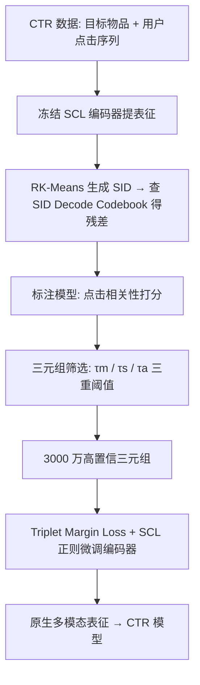

# Native Multimodal Representation Learning for Click-Through Rate Prediction in E-Commerce Scenarios (面向电商 CTR 预估的原生多模态表征学习)

- **会议/期刊**: CIKM 2026
- **作者与机构**: Chao Yi, Feifan Yang, Jiawei Feng, Sishuo Chen, Zhangming Chan, Xiang-Rong Sheng, Han Zhu (阿里巴巴淘天集团；中国科学技术大学)
- **推荐链路定位**: 精排（CTR 预估中的多模态特征表征层）
- **研究方向**: 多模态推荐 / CTR 预估与特征交叉
- **论文原文**: [https://arxiv.org/abs/2608.24091v2](https://arxiv.org/abs/2608.24091v2)
- **开源代码**: 暂未开源

## TL;DR (1分钟核心速览)

工业界多模态推荐普遍采用「预训练编码器 + 冻结提特征」两阶段范式，预训练目标与 CTR 目标存在错位。本文先做反直觉实验：在淘宝展示广告的强 SCL 编码器上做端到端联合训练（E2EM），GAUC 不升反降。作者归因于 CTR 行为仅部分可由多模态语义解释，导致监督模糊、编码器梯度方向不一致（批内梯度余弦相似度 0.016 vs. SCL 的 0.144）。据此提出 Mine-Then-Train：先用残差 SID 标注模型从 CTR 数据中挖出 3000 万条多模态可解释三元组，再以 Triplet Margin + SCL 正则微调编码器。离线 GAUC +0.22%、AUC +0.11%，线上 A/B 长期实验 CTR +1.5%、RPM +0.5%。

## Background & Motivation (背景与核心矛盾)

- **主流范式**: 两阶段——先在业务场景数据上用 MoCo 式对比学习（SCL）预训练多模态编码器，再冻结提特征，以语义相似度（SimTier/SA-TA）或直接拼接方式注入 ID-based CTR 模型。
- **前人局限**: ① 预训练任务 $\mathcal{T}_{pretrain}$与 CTR 任务$\mathcal{T}_{ctr}$目标错位，预训练数据$D_{train}$与 CTR 数据$D_{ctr}$ 分布错位，表征效果存在天花板；② 近期 E2EM 类工作（LEMUR 等）宣称端到端有效，但均未在「已高度优化的强预训练编码器」上验证。
- **核心洞察 (Key Insight)**: 电商 CTR 数据只有部分可归因于多模态语义——用 SCL 表征算目标物品与历史点击的相似度，MultiModal-Mean GAUC 仅 0.541、Max 仅 0.536，接近随机。价格比较、误点、位置偏置、兴趣疲劳等非语义因素混入标签，使 CTR 损失对编码器构成**模糊监督**；且 ID 分支虽提供额外建模能力，却无法显式把非语义信号「路由」走，梯度实测批内相似度仅 0.016、相邻批 0.006，远低于 SCL 的 0.144/0.849。此外 E2EM 双端训练显存涨 25.09×、单步耗时涨 7.18×。
- **本文切入点**: 不在损失层加正则去「压制」噪声（实测加 SCL Loss 反而 GAUC 掉 0.17pt、SCL Top-1 掉 5pt），而是在**数据层隔离监督**——先挖出多模态可解释的高置信样本，再只让这些样本更新编码器。

## Method (核心方法设计)

### 1. 整体框架 (Overall Architecture)

Mine-Then-Train 分两段解耦。**挖掘段**：以冻结 SCL 编码器 + RK-Means 生成的 SID 残差码本构建「多模态标注模型」，端到端接入 CTR 模型训练，输出物品对的点击相关性分数；再用该分数在 CTR 数据上筛选三元组（语义相关 + SCL 排序与标注排序有明确分歧 + 标注置信度足够）。**训练段**：仅用挖出的 3000 万三元组，以 Triplet Margin Loss 微调 SCL 编码器，并叠加 SCL 对比损失防遗忘。推理时直接复用原 SCL 编码器的在线部署管线，零额外链路改造。

### 2. 关键设计拆解 (Key Designs)

1. **残差 SID 标注模型（Residual Tuning + SID Embedding）**：若直接微调编码器做标注，CTR 噪声会污染共享参数；若用协同相似度（Swing/共点击）造样本，又与 ID 特征信息冗余且语义不一致。本文冻结 SCL 编码器，用 RK-Means 对表征聚类得 SID，从零初始化的 $3\times8192$SID Decode Codebook 中查得嵌入作为**残差**加到 SCL 表征上：$\mathbf{h} = \mathbf{h}_{SCL} + \mathbf{e}_{SID}$。零初始化保证训练起点不扰动原语义，码本只学「CTR 增量」；SID 与物品语义强绑定保证可解释性，且可预计算、训练时仅需 embedding lookup，远比微调编码器便宜。该标注分数作为特征注入 CTR 模型即带来 GAUC +0.13%。

2. **三重阈值三元组挖掘（Mine）**：标注模型自身仍受非语义因素干扰、且 SID 学习近似 ID 记忆、泛化受限，故只把它当「筛选器」而非最终表征。对每个样本用 SCL 检索目标物品 Top-K 相似历史物品，先滤掉 $Sim_{SCL}<\tau_m$ 的弱语义对，再组三元组并保留同时满足下式者：

$$\text{Sim}_{SCL}^{tar,1}-\text{Sim}_{SCL}^{tar,2}<\tau_s,\quad \text{Score}_{Anno}^{tar,1}-\text{Score}_{Anno}^{tar,2}>\tau_a$$

直觉：SCL 认为两者差不多（甚至 2 更像），但标注模型明确判定用户更偏好 1——这正是 SCL 缺失的「点击偏好增量」。保留的两类样本为**排序反转三元组**与**差距拉宽三元组**。人工评测验证 $\tau_a$ 是可靠的质量信号：高置信组（margin>0.15）人类胜率 85%，低置信组（<0.05）仅 42%。

3. **训练目标与推理效率**：$\mathcal{L}_{total}=\mathcal{L}_{margin}+\mathcal{L}_{SCL}$，其中$\mathcal{L}_{margin}=\max(0, m-(Sim_{tar,1}-Sim_{tar,2}))$，$m=0.1$；$\mathcal{L}_{SCL}$ 沿用 MoCo 式 memory queue 对比损失作正则，防止细粒度电商语义遗忘。负样本来自挖掘阶段构造的三元组内部对比（免在线负采样），推理阶段完全复用 SCL 管线，无额外开销。

## Experimental Setup & Evaluation Protocol (实验设置与评估协议)

- **数据集与预处理**:

| 数据集 | #Users | #Items | #Interactions | 稀疏度/密度 | 特征/场景说明 |
| :--- | :---: | :---: | :---: | :---: | :--- |
| Taobao 展示广告（E2EM 探究） | 84M | 88M | 1.9B | 极稀疏 | 一周点击/未点击，含用户画像、行为序列、图文多模态 |
| Taobao 展示广告（NMRL 主实验） | 未披露 | 未披露 | 一个月样本 | 极稀疏 | 已内置强 SCL 表征的 CTR 模型 |
| Taobao-MM（轻量基准） | 未披露 | 未披露 | 未披露 | — | 长行为序列 + 多模态表征，用于 RQ1/RQ2 消融 |

- **数据划分与防穿越 (Splitting Strategy)**: 工业日志按时间切分（一个月窗口），未采用 Leave-One-Out；论文未披露具体比例。
- **排名评测协议 (Ranking Protocol)**: 离线采用工业标准 **GAUC**（用户分组加权 AUC）与 **AUC**，在全量曝光样本上计算，非采样排序；线上采用长期 A/B 测试，指标为 CTR 与 RPM。
- **对比基线与超参设置**: 基线为淘宝展示广告已部署的 SCL 编码器 + MUSE CTR 模型（强基线）。稀疏嵌入 Adam lr=2e-3，稠密部分 AdamW lr=2e-4，编码器 AdamW lr=2e-4 + cosine 调度；挖掘阈值 $\tau_m=0.3,\tau_s=0.05,\tau_a=0.15$，margin$m=0.1$。

## Key Experimental Results (实验关键数据)

### 1. 主实验对比 (Main Results)

| 方法 | GAUC | AUC | 说明 |
| :--- | :---: | :---: | :--- |
| Baseline (SCL 编码器 + MUSE) | — | — | 强基线，作为相对提升基准 |
| Add Annotation Score | +0.13% | +0.08% | 仅把标注分数当特征 |
| **NMRL (本文)** | **+0.22%** | **+0.11%** | 挖掘三元组微调编码器 |
| 线上 A/B: CTR | **+1.5%** | — | 2026 年初上线长期实验 |
| 线上 A/B: RPM | **+0.5%** | — | 同上 |

E2EM 反例验证（Taobao-MM，RQ1）：

| 方法 | GAUC |
| :--- | :---: |
| MUSE（双端冻结 SCL） | **0.6154** |
| Tar E2EM | 0.6139 |
| Tar E2EM + Memory Bank | 0.6128 |
| Tar & Seq E2EM | 0.6124 |

### 2. 消融实验 (Ablation Study)

| 配置 | 关键指标 | 结论 |
| :--- | :---: | :--- |
| E2EM 优化器/学习率网格（SGD/Adam/AdamW × 2e-3/2e-4/2e-5） | GAUC 0.6133–0.6151 | 全部低于 MUSE 0.6154，排除超参因素 |
| E2EM + SCL Loss 正则 | GAUC −0.17pt；SCL Top-1 −5pt | 损失层正则无法识别该更新哪些样本 |
| 梯度一致性: SCL vs. E2EM | Avg Sim1 0.144 vs. 0.016；Avg Sim2 0.849 vs. 0.006 | E2EM 编码器更新方向严重不一致 |
| 计算开销: 无 E2EM / tar / tar&seq | 显存 3.37 / 5.71(1.69×) / 84.56(25.09×) GB；单步 1.02 / 1.94 / 7.32 s | 双端 E2EM 工业不可承受 |
| 人工评测: 高/低置信三元组 | 胜率 85% vs. 42% | $\tau_a$ 是可靠的伪标签质量指标 |

### 3. 关键实验发现 (Key Findings)

1. **端到端不是银弹，强编码器上更是负收益**：在已用 SCL 预训练的编码器上做 E2EM，GAUC 从 0.6154 掉到 0.6124–0.6139，且应用范围越广（target → target+sequence）掉得越多，说明问题不在覆盖不足而在表征本身变差。
2. **失效根因是「监督不可解释」而非「优化不充分」**：MultiModal-Mean/Max GAUC 仅 0.541/0.536，证明 CTR 标签中多模态可解释成分占比有限；梯度相似度从 0.144 崩到 0.016 则直接量化了编码器更新方向被非语义信号打散。
3. **数据层隔离优于损失层正则，且「筛选器」比「最终表征」更值钱**：加 SCL 正则反而双指标齐跌；而标注模型仅作特征用即得 +0.13% GAUC，再经三重阈值筛选后微调编码器可进一步到 +0.22%，说明挖掘出的排序偏好增量确实超出原 SCL 表征与 ID 特征的信息量。

## Highlights & Limitations (亮点、对比与审稿批判)

- **与代表作对比 (vs. Prior Work)**: 与 LEMUR 等 E2EM 路线相比，本文的核心差异是先做**否定性验证**（强编码器上 E2EM 无效）再给替代方案，而非默认端到端更优；与 SCL/SimTier 等两阶段工作相比，本文不换编码器架构、不改在线管线，只在离线阶段换监督信号来源，工程落地成本极低；与直接用协同信号（Swing/共点击）造样本的做法相比，本文用 SID 残差标注模型保证了「多模态可解释性」，避免与 ID 特征信息冗余。
- **可迁移亮点**: ① 「冻结主干 + 零初始化 SID 残差码本」是一种极轻量的任务适配器，可迁移到任何已有强预训练编码器的下游适配场景；② 「用下游模型当筛选器、再用筛选结果反哺表征」的解耦范式，可推广到序列推荐、跨域迁移中噪声标签的利用问题。
- **审稿级局限批判**: ① 主实验仅报告相对提升（+0.22% GAUC），未给绝对数值与方差/显著性检验，且数据集统计信息大量缺失，复现性受限；② 标注模型与阈值（$\tau_m,\tau_s,\tau_a$）强依赖业务数据分布，论文未给出阈值敏感性分析，跨场景迁移需重新调参；③ 三元组挖掘依赖 SCL 检索 Top-K，若原编码器在某些品类上语义能力弱，挖掘会继承该偏差。

## Rating (四维评分)

- **方法创新性 (Novelty)**: ⭐⭐⭐⭐ （核心机制与方法设计具备明确创新性，理论与实验动机支撑充分）
- **评估协议与实验扎实度 (Protocol & Experiments)**: ⭐⭐⭐⭐ （主流公开数据集评测完整，包含多基线对比与消融实验验证）
- **写作与数学规范度 (Clarity & Rigor)**: ⭐⭐⭐⭐⭐ （问题形式化定义清晰，核心模块数学推导与架构阐述严谨易读）
- **工业落地与复现价值 (Industrial & Practical Value)**: ⭐⭐⭐⭐⭐ （兼顾推荐效果增益与训练/推理效率，具备实际场景迁移参考价值）
