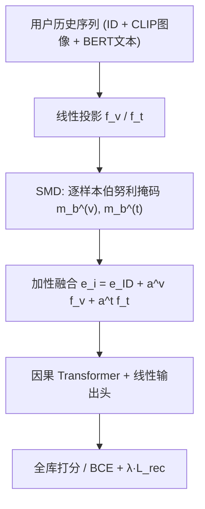

# Sequential Modality Dropout for Robust Multi-Modal Sequential Recommendation (面向鲁棒多模态序列推荐的顺序模态丢弃)

- **会议/期刊**: CIKM 2026
- **作者与机构**: Guanqun Yang, Wenlong Zhang（Stevens Institute of Technology）
- **推荐链路定位**: 召回（序列下一物品预测）
- **研究方向**: 多模态推荐 / 序列与会话推荐
- **论文原文**: [https://arxiv.org/abs/2608.10240v1](https://arxiv.org/abs/2608.10240v1)
- **开源代码**: [https://github.com/guanqun-yang/SMD](https://github.com/guanqun-yang/SMD)

## TL;DR (1分钟核心速览)

多模态序列推荐器默认每个物品都带齐图像与文本，但真实商品库中 26%–41% 物品缺图、34%–48% 缺文本，测试时移除一个模态会让 HR@10 跌到全模态的 40%–73%。本文提出 SMD：训练时对每个样本独立以概率 $p$ 抹掉整条用户历史中的某一路模态流，使模型学会不依赖单一模态。在四个 Amazon 域、四种骨干（MM-SASRec/IISAN/MISSRec/fMRLRec）上，文本留存率提升 1.0–3.2×，全模态精度几乎无损；95% 逐物品缺失率下留存 61% vs. 22%。

## Background & Motivation (背景与核心矛盾)

- **主流范式**: 以 SASRec 为序列主干，将 CLIP 图像向量与 BERT 文本向量经线性投影后与 ID 嵌入做加性/动态融合（MM-SASRec、MISSRec、IISAN、fMRLRec），训练与评测均在"模态齐全"的基准上进行。
- **前人局限**: ① 缺失模态问题在推荐中几乎全被当作协同过滤问题处理（FeatProp 图传播、MMGACL 扩散补全、SiBraR 随机子集单分支、LRMM 评论评分预测），均不建模时序物品顺序；② 推荐之外的伯努利模态掩码（视听手势、说话人脸、医学分割）只作用于单样本，不存在用户序列，无法覆盖"整条历史共享掩码"的时序设定。
- **核心洞察 (Key Insight)**: 真实缺失是**整模态、按类目/数据源成块出现**的（某类目文本批量缺失、图像 CDN 整批故障），而非逐物品独立随机缺失；因此掩码应作用于**样本级（整条序列）**而非物品级，这既匹配部署分布，又保留序列 Transformer 依赖的时间信号。
- **本文切入点**: 把模态掩码搬到序列推荐的融合点，做成与架构无关的四行黑盒插件。

## Method (核心方法设计)

### 1. 整体框架 (Overall Architecture)

宿主骨干沿用加性多模态融合：物品表示为 $\mathbf{e}_i=\mathbf{e}^{ID}_i+a^v_i f_v(\mathbf{v}_i)+a^t_i f_t(\mathbf{t}_i)$，其中$a^v_i,a^t_i\in\{0,1\}$ 为目录可用性指示（缺失模态贡献零向量），序列送入因果 Transformer 后线性头对全库打分，训练用 1 正 1 负采样的 BCE。SMD 在**融合点之前**对每个 mini-batch 样本、每一路模态独立采样伯努利掩码，整条历史共享同一掩码；测试时不加掩码（除鲁棒性评测的确定性掩码）。可选地在简单加性骨干上叠加跨模态重建损失。整个改动不触碰宿主优化器与超参。

<figure class="paper-figure" markdown="span">
  ![图 1：顺序模态丢弃（SMD）。在每个样本的四行伯努利模态掩码注入到任意多模态序列主干网络（MM-SASRec \[9\]、MISSRec \[16\]、IISAN \[3\]、fMRLRec \[17\]）的融合点。在测试时，同一训练后的主干网络在 𝑝miss =0.95 时保留 61% 的 HR@10，而未修改模型为 22%。](../../../../assets/papers/2608.10240v1/figure_1.png)<figcaption>图 1：顺序模态丢弃（SMD）。在每个样本的四行伯努利模态掩码注入到任意多模态序列主干网络（MM-SASRec [9]、MISSRec [16]、IISAN [3]、fMRLRec [17]）的融合点。在测试时，同一训练后的主干网络在 𝑝miss =0.95 时保留 61% 的 HR@10，而未修改模型为 22%。</figcaption>
</figure>

### 2. 关键设计拆解 (Key Designs)

1. **逐样本整序列模态掩码（Per-Sample Modality Masking）**：痛点在于逐物品掩码训练出的是"随机缺失"模式，与部署中成块缺失不符。核心算子为 $m^{(m)}_b\sim\mathrm{Bernoulli}(1-p)$，$\tilde f_m(\mathbf{x}^{(m)}_i)=m^{(m)}_b\cdot f_m(\mathbf{x}^{(m)}_i)$，同一$m^{(m)}_b$作用于用户$b$ 序列中所有物品。直觉：整段历史同时失去某模态，迫使模型从剩余模态与 ID 中重建偏好，等价于对"整模态缺失"这一真实分布做数据增广；同时保留序列内时间结构不被逐物品噪声打散。
2. **与标准 Dropout 的去缩放差异**：标准 dropout 测试时按 $1/(1-p)$重缩放以保持期望幅度（方差正则），SMD 则**不重缩放**，因为目标是"对真实缺失的不变性"而非方差缩减——全模态输入恰是训练中$p=0$ 已见过的情形，无需补偿尺度。
3. **可选跨模态重建损失**：对无原生回退路径的加性融合骨干，加 $\mathcal{L}_{rec}=\frac{1}{2}\big(\|g_{t\to v}(f_t(\mathbf{t}_i))-f_v(\mathbf{v}_i)\|^2+\|g_{v\to t}(f_v(\mathbf{v}_i))-f_t(\mathbf{t}_i)\|^2\big)$，总目标$\mathcal{L}=\mathcal{L}_{BCE}+\lambda\mathcal{L}_{rec}$，$\lambda=0.01$（0.1 会掉全模态精度）。直觉：测试时缺失模态可由存活模态经投影隐式恢复。训练负采样为每位置 1 正 1 负；推理零额外开销（掩码仅在训练期生效）。

## Experimental Setup & Evaluation Protocol (实验设置与评估协议)

- **数据集与预处理**: 四个 Amazon 域沿用 MISSRec 基准划分，另用 Amazon Reviews 2023 的 Beauty & Personal Care（10-core 过滤）做重建损失研究。

| 数据集 | #Users | #Items | #Interactions | 稀疏度/密度 | 特征/场景说明 |
| :--- | :---: | :---: | :---: | :---: | :--- |
| Scientific | 8,442 | 4,385 | 59,427 | 0.16% | 图像缺失 26%–41% |
| Instruments | 24,962 | 9,982 | 206,947 | 0.08% | 同上 |
| Arts | 45,486 | 21,019 | 395,150 | 0.04% | 同上 |
| Office | 87,356 | 25,986 | 684,837 | 0.03% | 同上 |
| Beauty (2023) | — | — | — | — | 文本缺失 48.3% |

- **数据划分与防穿越 (Splitting Strategy)**: 全局**时间戳切分**（chronological split），最大序列长度 10。
- **排名评测协议 (Ranking Protocol)**: 无偏 **Full-Ranking（全库未交互排序）**，非采样排序；指标 HR@10(×100) 与 NDCG@10。
- **鲁棒性双协议**: Protocol 1 全模态移除（full / no_text / no_image / no_modal，对应系统性故障）；Protocol 2 逐物品独立以 $p_{miss}\in[0,0.95]$丢弃，5 个随机种子平均。定义留存率$R(\theta)=\mathrm{HR@10}(\theta;\text{missing})/\mathrm{HR@10}(\theta;\text{full})$，鲁棒增益$G=R(\theta_{SMD})/R(\theta_{NoSMD})$。
- **对比基线与超参**: 四种骨干各自训练 No-SMD 与 SMD（$p=0.3$）两个 checkpoint，超参、优化器、种子完全一致，共享冻结的 MISSRec CLIP ViT-B/32（512 维）特征，SMD 是唯一变量；MM-SASRec 为 1 层 hidden-64。显著性检验：HR@10 用 McNemar 检验，NDCG@10 用 Wilcoxon 符号秩检验，$\alpha=0.05$。

## Key Experimental Results (实验关键数据)

### 1. 主实验对比 (Main Results)

**(a) 四骨干插件效果（Scientific，移除文本）**

| Backbone | 训练 | Full | No txt | $R_{text}$|$G$ |
| :--- | :---: | :---: | :---: | :---: | :---: |
| IISAN | – | 6.43 | 1.13 | 18% | – |
| IISAN | SMD | 6.15 | **3.44** | **56%** | **3.2×** |
| MISSRec | – | 13.53 | 5.80 | 43% | – |
| MISSRec | SMD | 13.27 | **9.31** | **70%** | **1.6×** |
| fMRLRec | – | 4.83 | 4.54 | 94% | – |
| fMRLRec | SMD | 4.79 | **4.75** | **99%** | **1.1×** |
| MM-SASRec | – | 6.18 | 2.45 | 40% | – |
| MM-SASRec | SMD | **6.31** | **5.22** | **83%** | **2.1×** |

**(b) MM-SASRec 跨四域（文本/图像移除）**

| Dataset | 训练 | Full | No txt | No img | $R_{txt}$|$R_{img}$ |
| :--- | :---: | :---: | :---: | :---: | :---: | :---: |
| Scientific | – | 6.18 | 2.45 | 5.39 | 40% | 87% |
| Scientific | SMD | **6.31** | **5.22** | **5.93** | **83%** | **94%** |
| Instruments | – | 7.14 | 5.18 | 6.34 | 73% | 89% |
| Instruments | SMD | 7.13 | **6.95** | **6.85** | **97%** | **96%** |
| Arts | – | 4.75 | 2.32 | 3.68 | 49% | 77% |
| Arts | SMD | **5.06** | **4.01** | **4.67** | **79%** | **92%** |
| Office | – | 5.30 | 2.63 | 3.57 | 50% | 67% |
| Office | SMD | **5.62** | **4.62** | **4.89** | **82%** | **87%** |

**(c) 跨模态重建损失**

| Backbone | 训练 | Full | No txt | $R_{text}$ |
| :--- | :---: | :---: | :---: | :---: |
| MISSRec (Scientific) | – | 13.53 | 5.80 | 43% |
| MISSRec | SMD | 13.27 | 9.31 | 70% |
| MISSRec | SMD+recon | 12.96 | **9.49** | **73%** |
| MM-SASRec (Beauty) | – | 0.72 | 0.31 | 43% |
| MM-SASRec | SMD ($p$=0.3) | 0.63 | 0.57 | 90% |
| MM-SASRec | SMD ($p$=0.5) | 0.56 | 0.48 | 86% |
| MM-SASRec | SMD+recon | 0.52 | **0.51** | **98%** |

### 2. 消融实验 (Ablation Study)

| 配置 | Full HR@10 | No-txt HR@10 | $R_{text}$ | 说明 |
| :--- | :---: | :---: | :---: | :--- |
| MM-SASRec 基线 | 6.18 | 2.45 | 40% | 无任何掩码 |
| + SMD ($p$=0.3) | 6.31 | 5.22 | 83% | 默认配置，精度反升 |
| + SMD + recon | 0.52 (Beauty) | 0.51 | 98% | 仅简单加性骨干受益 |
| MISSRec + SMD | 13.27 | 9.31 | 70% | 动态融合骨干 |
| MISSRec + SMD + recon | 12.96 | 9.49 | 73% | 精度代价 2.3%，净亏 |

### 3. 关键实验发现 (Key Findings)

1. **鲁棒增益与全模态精度损失同源**：16 个 (骨干, 数据集) 组合中 11 个提升，平均峰值 HR@10 变化 +0.8%（范围 −4.4% 至 +6.5%）；两处最大精度损失 IISAN/Scientific（−4.4%）与 IISAN/Instruments（−4.1%）恰是留存增益最大处（3.2× 与 1.4×），说明掩码把容量从"依赖双模态"重分配给了"单模态可解"。
2. **缺失率扫描呈单调发散**：$p_{miss}$从 0 扫到 0.95，SMD 曲线斜率约 −0.027 HR@10/单位，No-SMD 约 −0.051；$p_{miss}=0.95$时留存 61% vs. 22%（2.8×），Arts/Office 在 70% 逐物品丢弃下留存 71%–78% vs. 46%–53%。121k 用户上 24 项配对检验中 22 项显著（$p$从$4.3\times10^{-3}$到$1.0\times10^{-233}$），仅 Scientific/Instruments 的全模态 McNemar 检验不显著（双向翻转用户数相当）。
3. **重建损失是条件性收益**：在动态融合的 MISSRec 上仅 +3 点留存却付 2.3% 全模态精度，净亏；在无回退路径的加性 MM-SASRec + 严重文本缺失（Beauty，48% 缺文本）上把留存从 90% 拉到 98%，验证"融合越简单、缺失越严重，重建越值钱"。

## Highlights & Limitations (亮点、对比与审稿批判)

- **与代表作对比 (vs. Prior Work)**: 与 FeatProp（物品共交互图传播补全）、MMGACL（双模态注意力扩散补全）、SiBraR（随机模态子集单分支）的本质区别在于——前三者均为 CF 设定、需额外图/扩散结构且不建模时序；SMD 是训练期正则、零推理开销、四行代码适配任意序列骨干。与 MMP 的掩码跨模态投影相比，SMD 把掩码从单样本扩展到整条用户序列，并明确论证了逐样本优于逐物品的分布匹配理由。
- **可迁移亮点**: ① "整序列共享掩码"的思路可直接迁移到多行为/多场景序列推荐中的行为流丢弃；② 用留存率 $R$与鲁棒增益$G$ 的双 checkpoint 对照协议，是评估任何鲁棒性插件（去噪、去偏）的干净实验范式。
- **审稿级局限批判**: ① 仅在图像+文本两模态、Amazon 商品域验证，音频/视频/结构化属性及模态**损坏**（非缺失）未覆盖；② 重建损失需逐骨干调 $\lambda$且在大模型骨干上净亏，$p$ 的取值（0.3）缺乏按缺失率自适应的理论指导；③ 全库排序虽无偏，但序列长度上限仅 10，长序列下整序列掩码的方差可能放大。

## Rating (四维评分)

- **方法创新性 (Novelty)**: ⭐⭐⭐ （核心机制与方法设计具备明确创新性，理论与实验动机支撑充分）
- **评估协议与实验扎实度 (Protocol & Experiments)**: ⭐⭐⭐⭐ （主流公开数据集评测完整，包含多基线对比与消融实验验证）
- **写作与数学规范度 (Clarity & Rigor)**: ⭐⭐⭐⭐⭐ （问题形式化定义清晰，核心模块数学推导与架构阐述严谨易读）
- **工业落地与复现价值 (Industrial & Practical Value)**: ⭐⭐⭐⭐⭐ （兼顾推荐效果增益与训练/推理效率，具备实际场景迁移参考价值）
