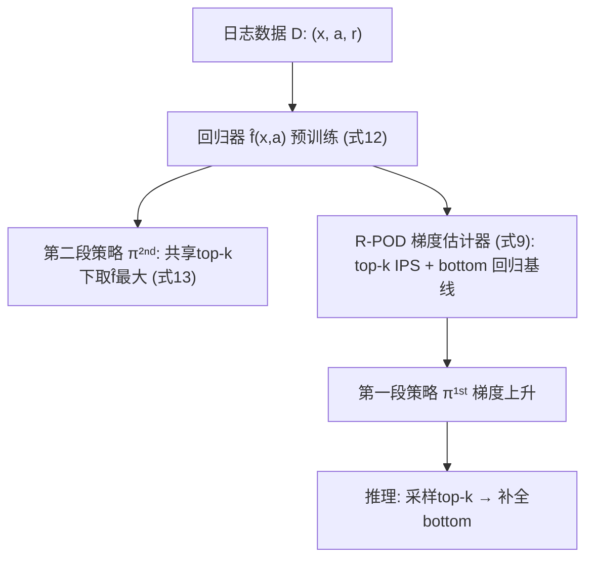
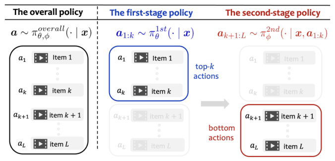
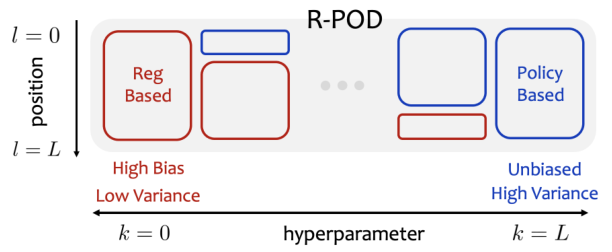

# Efficient Offline Learning of Ranking Policies via Top-$k$ Policy Decomposition (基于 Top-$k$ 策略分解的高效排序策略离线学习)

- **会议/期刊**: CIKM 2026
- **作者与机构**: Ren Kishimoto (Institute of Science Tokyo)、Koichi Tanaka (Keio University)、Haruka Kiyohara (Cornell)、Yusuke Narita (Yale)、Yasuo Yamamoto / Nobuyuki Shimizu (LY Corporation)、Yuta Saito (Hanjuku-kaso)
- **推荐链路定位**: 重排（排序策略离线学习）
- **研究方向**: 强化学习与动态探索推荐 / 多任务学习与列表级重排
- **论文原文**: [https://arxiv.org/abs/2609.36740v1](https://arxiv.org/abs/2609.36740v1)
- **开源代码**: 暂未开源

## TL;DR (1分钟核心速览)

排序策略的离线学习（OPL）面临动作空间为 $L$-排列（$|\Pi_L(\mathcal{A})|>10^9$）的困境：策略梯度类方法（IPS/DR）因排序级重要性权重方差爆炸而失效，回归类方法则因需精确拟合每个唯一排序的期望奖励而偏差巨大。本文提出 R-POD，将排序策略分解为「top-$k$ 选择」与「bottom 补全」两段：前者用仅作用于 top-$k$ 动作空间的新策略梯度估计器学习，后者用回归模型学习。理论上证明该估计器在「条件成对正确性 (CPC)」这一弱条件下无偏，且方差显著低于 IPS/DR。在合成数据与 Yahoo! LETOR / MSLR-WEB10K 上，R-POD 在 DCG@3/@5 上稳定超越 5 个主流基线，小样本与大规模动作空间下优势尤为明显。

## Background & Motivation (背景与核心矛盾)

- **主流范式**: 排序 OPL 分两派——策略梯度派（IPS、DR、RIPS、IIPS）用重要性加权估计策略梯度；回归派（Reg-based）拟合奖励函数后取 argmax 排序。
- **前人局限**: ① 策略梯度派需满足全支撑条件，排序级权重 $w(\bm{x},\bm{a})=\pi_\theta(\bm{a}|\bm{x})/\pi_0(\bm{a}|\bm{x})$ 在排列空间下方差爆炸（式 5 显示方差正比于 $w^2$）；RIPS/IIPS 靠 cascade/independence 假设降方差，但假设被违反时（排序内交互存在）偏差剧增。② 回归派需对 $\forall \bm{a}\in\Pi_L(\mathcal{A})$ 精确回归期望奖励，而日志数据仅含部分反馈，偏差难以控制。
- **核心洞察 (Key Insight)**: 排序中高位物品主导期望奖励，而低位物品的效应可被回归模型吸收；因此只需对 top-$k$ 动作做重要性加权（空间从 $|\Pi_L|$ 降至 $|\Pi_k|$），bottom 部分交给回归，即可同时压制方差与偏差。
- **本文切入点**: 用排序列表的**内在位置结构**（而非 POTEC 的外部聚类）做策略分解，把 $k$ 作为偏差-方差混合旋钮。

## Method (核心方法设计)

### 1. 整体框架 (Overall Architecture)

R-POD 将整体策略分解为 $\pi^{\text{overall}}_{\theta,\phi}(\bm{a}|\bm{x})=\pi^{1st}_\theta(\bm{a}_{1:k}|\bm{x})\cdot\pi^{2nd}_\phi(\bm{a}_{k+1:L}|\bm{x},\bm{a}_{1:k})$。训练流程：先用式 (12) 的平方损失预训练奖励回归器 $\hat{f}_\phi(\bm{x},\bm{a})$；再据此按式 (13) 定义第二段策略（在共享 top-$k$ 的候选中取 $\hat{f}$ 最大者）；最后固定 $\hat{f}$，用 R-POD 梯度估计器（式 9）迭代更新第一段策略 $\pi^{1st}_\theta$。推理时先采样 top-$k$，再由第二段策略补全 bottom，等价于从联合分布采样一个完整排序。

<figure class="paper-figure" markdown="span">
  <figcaption>图 1：R-POD 利用式 (6) 中 top-𝑘 策略分解的概念，离线学习更优的排序策略。</figcaption>
</figure>

### 2. 关键设计拆解 (Key Designs)

1. **R-POD 梯度估计器（top-$k$ IPS + 回归控制变量）**：痛点在于排序级 IPS 权重方差爆炸。本文只对 top-$k$ 动作施加重要性权重，bottom 部分用回归器 $\hat{f}$ 作为控制变量吸收：
$$\nabla_\theta\hat{V}_{\text{RPOD}}=\frac{1}{n}\sum_i\Big\{w(\bm{x}^{(i)},\bm{a}^{(i)}_{1:k})\big(\textstyle\sum_l\alpha_l r_l^{(i)}-\hat{f}(\bm{x}^{(i)},\bm{a}^{(i)})\big)s_\theta(\bm{x}^{(i)},\bm{a}^{(i)}_{1:k})+\mathbb{E}_{\pi^{1st}_\theta}\big[\hat{f}^{\pi^{2nd}_\phi}(\bm{x}^{(i)},\bm{a}_{1:k})s_\theta(\bm{x}^{(i)},\bm{a}_{1:k})\big]\Big\}$$
其中 $w(\bm{x},\bm{a}_{1:k})=\pi^{1st}_\theta(\bm{a}_{1:k}|\bm{x})/\pi^{1st}_0(\bm{a}_{1:k}|\bm{x})$ 仅定义在 top-$k$ 空间。直觉：top-$k$ 价值被无偏估计，回归器只需修正 bottom 的相对贡献，故权重方差从 $O(w_{\text{full}}^2)$ 降至 $O(w_{\text{top-}k}^2)$。

2. **条件成对正确性 (CPC) 与无偏性**：定理 3.1 给出偏差正比于 $\Delta q(\bm{x},\bm{a},\bm{b})-\Delta\hat{f}(\bm{x},\bm{a},\bm{b})$，即回归器只需**保持共享同一 top-$k$ 的排序对之间的相对价值差**即可（条件 3.2），远比回归派要求的全局奖励精确拟合宽松。推论 3.1 表明在「全 top-$k$ 支撑 + CPC」下估计器无偏。这解释了为何 bottom 段策略可直接复用同一 $\hat{f}$ 且仍最优。

3. **训练目标、负采样与推理效率**：回归器用 $\ell_f=\big(\sum_l\alpha_l r_l-\hat{f}_\phi(\bm{x},\bm{a})\big)^2$ 训练（式 12），无需负采样；第一段策略用式 (9) 梯度上升。$k$ 是核心超参：$k=L$ 退化为纯策略梯度，$k=0$ 退化为纯回归（图 2），实践中用留出集上的 IPS/DR 估计值网格搜索 $k\in[0,L]$。推理开销为一次 top-$k$ 采样 + 一次 bottom 排序，与常规两段式重排相当。

<figure class="paper-figure" markdown="span">
  <figcaption>图 2：R-POD 算法通过其超参数 𝑘 混合基于策略和基于回归的方法。当 𝑘= 𝐿 时，R-POD 退化为基于策略的方法；当 𝑘= 0 时，退化为基于回归的方法。</figcaption>
</figure>

## Experimental Setup & Evaluation Protocol (实验设置与评估协议)

- **数据集与预处理**: 合成数据（5 维标准正态 context，$|\mathcal{A}|\le 8$，$L=3$，含交互项 $F(\bm{x},\bm{a})$ 故意违反 cascade/independence 假设）；真实数据为 MSLR-WEB10K（每 query 采样 100 文档，$L=5$）与 Yahoo! LETOR（每 query 采样 10 文档，$L=3$），5 级相关性分数 $rel\in\{0,\dots,4\}$ 经 $\tilde{q}_l=rel/4+\eta$ 转为奖励。

| 数据集 | #Queries | #Items/Query | $L$ | 指标 | 场景说明 |
| :--- | :---: | :---: | :---: | :---: | :--- |
| Synthetic | 1000 (默认) | 4–8 | 3 | 策略值 | 含排序交互项，可控 $\lambda$ |
| Yahoo! LETOR | — | 10 | 3 | DCG@3 | 真实相关性标签 |
| MSLR-WEB10K | — | 100 | 5 | DCG@5 | 大规模排序空间 |

- **数据划分与防穿越 (Splitting Strategy)**: 日志由 Plackett-Luce 日志策略 $\pi_0$（式 15）生成，温度 $\tau$ 控制确定性；真实数据中 $f_0$ 取常数（uniform）或随机森林回归（用 10% 训练数据拟合）。$k$ 的调参在留出集上完成，与训练数据隔离。
- **排名评测协议 (Ranking Protocol)**: 采用**全排序策略值评估**（对完整 $L$-排列空间计算期望 DCG），非采样排序；合成实验 100 次随机种子取均值，真实实验 5 个种子报告均值±标准差。
- **对比基线与超参设置**: 基线为 IPS-PG、DR-PG、RIPS-PG、IIPS-PG、Reg-based；R-POD 报告 (tuning)（IPS 留出估计调 $k$）与 (best)（oracle $k$）两版；真实实验额外注入 $\pm V/20$（小误差）与 $\pm V/10$（大误差）的调参噪声以检验鲁棒性。

## Key Experimental Results (实验关键数据)

### 1. 主实验对比 (Main Results)

真实数据 DCG 对比（均值，括号内为标准差；加粗为同列最优）：

| OPL 方法 | Yahoo! (uniform) | Yahoo! (RF) | MSLR (uniform) | MSLR (RF) |
| :--- | :---: | :---: | :---: | :---: |
| Reg-based | 1.660 (0.154) | 1.613 (0.100) | **2.318** (0.237) | 2.256 (0.269) |
| IPS-PG | 1.568 (0.090) | 1.648 (0.071) | 1.885 (0.060) | 2.016 (0.066) |
| RIPS-PG | 1.576 (0.092) | 1.625 (0.074) | 2.043 (0.041) | 2.078 (0.065) |
| IIPS-PG | 1.602 (0.047) | 1.571 (0.081) | 2.240 (0.077) | 2.227 (0.155) |
| DR-PG | 1.599 (0.103) | 1.672 (0.033) | 1.893 (0.078) | 2.227 (0.100) |
| R-POD (tuning, large err.) | 1.651 (0.068) | 1.651 (0.041) | 2.274 (0.159) | 2.229 (0.175) |
| R-POD (tuning, small err.) | **1.679** (0.093) | **1.682** (0.055) | 2.317 (0.214) | **2.280** (0.088) |
| R-POD (best) | **1.694** (0.091) | **1.693** (0.046) | **2.335** (0.213) | **2.337** (0.122) |

相对最强策略梯度基线（DR-PG / IIPS-PG）提升：Yahoo! uniform 上 +5.0%（1.679 vs 1.599），MSLR uniform 上 +3.4%（2.317 vs 2.240）。

### 2. 消融实验 (Ablation Study)

$k$ 的取值即消融（图 4 统计 100 次模拟中 $k$ 的选择分布）：

| 配置 | 等价方法 | 合成数据表现 | 说明 |
| :--- | :--- | :---: | :--- |
| $k=0$ | 纯 Reg-based | 大方差、依赖回归精度 | 大数据量时被选中 |
| $k=L$ | 纯 Policy-based | 高方差、小样本差 | 大数据量时被选中 |
| $k\in\{1,2\}$ | R-POD 混合 | **小样本最优** | 数据量小时被选中 |
| R-POD (tuning) vs (best) | — | 大数据量下接近 oracle | 调参策略有效 |

### 3. 关键实验发现 (Key Findings)

1. **小样本优势最大**：图 3a 中训练数据 $n$ 从 250 增至 2000，R-POD (tuning) 全程领先，且 $n$ 越小领先幅度越大——直接印证 top-$k$ 重要性加权带来的方差压缩使 OPL 更数据高效。
2. **对假设违反鲁棒**：图 3d 中交互强度 $\lambda$ 增大时，RIPS-PG 与 IIPS-PG 因 cascade/independence 假设被违反而性能下滑，R-POD 几乎不降——因其 top-$k$ 部分无假设无偏、bottom 交互由回归器吸收。
3. **回归精度决定 Reg-based 成败，R-POD 更稳**：MSLR（回归器较准）上 Reg-based 与 R-POD 接近（2.318 vs 2.317），但 Yahoo!（回归不准）上 Reg-based 被 R-POD 反超（1.660 vs 1.679）；且 R-POD 在大误差调参下仍显著优于 RIPS/IIPS，验证 CPC 弱条件的实用价值。

## Highlights, Limitations & Rating (亮点、对比与审稿评价)

- **与代表作对比 (vs. Prior Work)**: 相比 IPS/DR，R-POD 把重要性加权从 $L$-排列空间收缩到 top-$k$ 空间，方差降数个量级且不引入行为假设；相比 RIPS/IIPS，不依赖 cascade/independence，假设违反时无额外偏差；相比 POTEC 的「聚类 + 两段」，R-POD 用排序位置这一**内生结构**做分解，免去聚类学习与调参，只留一个可解释的 $k$。
- **可迁移亮点**: ① 「高位精确、低位回归」的分段偏差-方差分配思路可迁移到列表级重排与生成式推荐的 rerank 阶段；② CPC 条件提示：回归器只需保序（pairwise 相对价值），可用 pairwise ranking loss 替代 pointwise MSE 以进一步降偏。
- **审稿级局限批判**: ① 实验规模受限（$|\mathcal{A}|\le 100$、$L\le 5$），未验证 $|\mathcal{A}|$ 上千时的可扩展性，作者亦承认依赖 $\mathcal{A}$ 结构的扩展是未来工作；② $k$ 依赖留出集 OPE 估计调参，真实场景中 OPE 本身有偏，图 4 显示 tuning 与 best 仍有差距；③ 第二段策略取 argmax 是确定性的，探索性不足，长期留存场景下可能过早收敛。
- **四维评分**: 创新性 ⭐⭐⭐⭐ | 实验扎实度 ⭐⭐⭐⭐ | 方法清晰度 ⭐⭐⭐⭐⭐ | 落地价值 ⭐⭐⭐⭐

