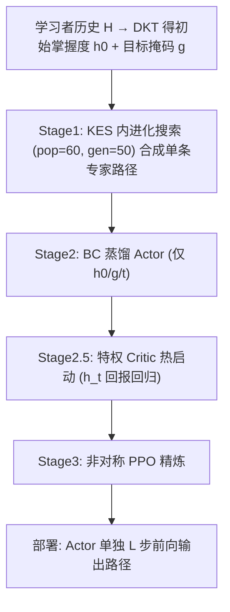
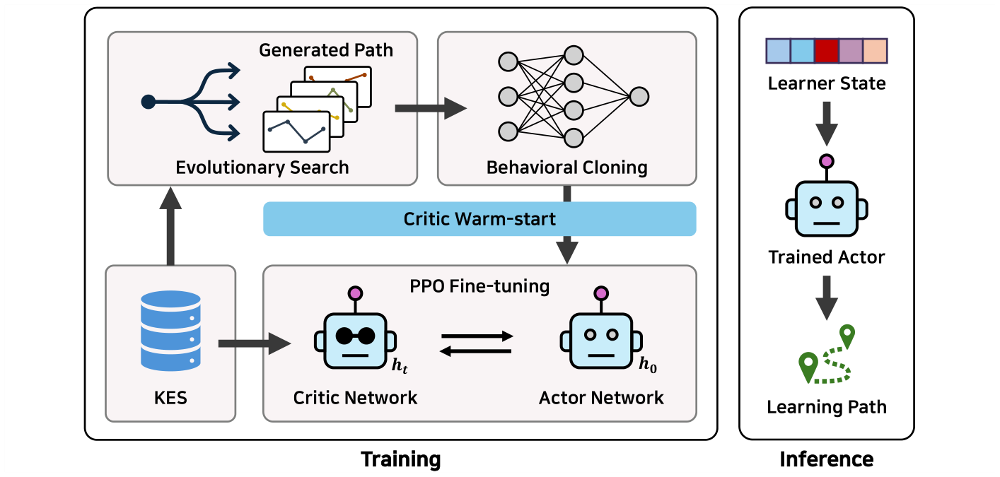

# EVOL: Simulator-Guided Evolutionary Expert Synthesis for Deployment-Free Learning Path Recommendation (模拟器引导的进化专家合成用于免部署学习路径推荐)

- **会议/期刊**: CIKM 2026
- **作者与机构**: Geonwoo Bang, Dongho Kim, Moohong Min (Sungkyunkwan University)
- **推荐链路定位**: 端到端生成式（一次性输出 L 步路径）
- **研究方向**: 强化学习与动态探索推荐 / 序列推荐
- **论文原文**: [https://arxiv.org/abs/2610.03273v1](https://arxiv.org/abs/2610.03273v1)
- **开源代码**: [https://github.com/g7199/EvoLearning](https://github.com/g7199/EvoLearning)

## TL;DR (1分钟核心速览)

学习路径推荐 (LPR) 的 RL 范式面临双重困境：策略必须"盲规划"整条 L 步路径（搜索空间达 $1.2\times10^{45}$）且仅在终点获得稀疏奖励；而教育数据只记录学生"做了什么"而非"应该做什么"，天然缺失专家示范。EVOL 借用机器人 sim-to-real 配方：在知识追踪模拟器 (KES) 内用进化搜索为每个学习者合成专家路径，再蒸馏为仅以初始掌握度$h_0$为条件的前馈 Actor，配合特权 Critic 的非对称 PPO 精炼。在 ASSIST15/Junyi/EdNet 三数据集、$L\in\{5,10,20\}$的$h_0$-only 部署协议下全面超越 8 个基线，ASSIST15$L{=}10$ 上 EP 达 +0.614（vs. PPO-vanilla +0.543）。

## Background & Motivation (背景与核心矛盾)

- **主流范式**: CSEAL/GEHRL/DLELP/KnowLP 将 LPR 建模为 KES（DKT 模拟器）内的 RL 问题，训练 Actor-Critic 逐步选择概念。
- **前人局限一（推理越界）**: 上述方法在**推理时逐步查询 KES**，把模拟出的中间作答追加进历史再更新掌握度——这在真实部署中不可得，等价于"已知考卷答案再排学习计划"，是反事实 oracle 而非可服务系统。
- **前人局限二（示范缺失）**: 稀疏终点奖励下 RL 样本效率极低，而教育日志只记录历史行为，不存在人类导师给出的逐学习者最优路径。
- **核心洞察 (Key Insight)**: KES 与机器人物理引擎结构同构——学习者即"机器人"、路径即"轨迹"。KES 无梯度、可廉价并行查询，因此可用进化算法在模拟器内**合成**人类无法提供的专家示范。
- **本文切入点**: 训练期用模拟器合成专家 + 部署期彻底剥离模拟器，把组合搜索问题转化为"模仿引导的策略学习"。

## Method (核心方法设计)

### 1. 整体框架 (Overall Architecture)

EVOL 分三阶段闭环：Stage 1 在 KES 内对每个训练学习者跑进化搜索，产出单条最优专家路径；Stage 2 以行为克隆把专家蒸馏进仅吃 $[h_0\|g\|t/L]$的 Actor；Stage 2.5 用专家回报对特权 Critic 热启动；Stage 3 用非对称 PPO 在线精炼。部署时仅 Actor 存活，$L$ 次前向即输出完整路径，零 KES 查询。

<figure class="paper-figure" markdown="span">
  <figcaption>图1：EVOL 概览。仅在训练时查询 KES。阶段1在 KES 内运行进化搜索，为每个学习者合成专家路径；阶段2将其蒸馏为仅以初始掌握度 h0 为条件的前馈 actor；阶段2.5在特权 h𝑡 上对 critic 进行热启动；阶段3使用非对称 PPO 精炼 actor。部署时，actor 单独输出完整的 𝐿 步路径，无需查询 KES。</figcaption>
</figure>

### 2. 关键设计拆解 (Key Designs)

1. **进化专家合成（Stage 1）**：痛点是无梯度稀疏奖励下 RL 无法探索 $10^{45}$ 级空间。候选集限定为目标概念、其前置/相似邻居与 ZPD 概念（掌握度近 0.5）：
$$\mathcal{C}=\mathcal{G}\cup\bigcup_{g\in\mathcal{G}}\big(\text{prereq}(g)\cup\text{sim}_K(g)\big)\cup\text{ZPD}$$
以 $f(p)=\text{EP}(H,p,\mathcal{G})$为适应度，经锦标赛选择、有序交叉、点变异迭代 50 代。关键取舍：**每学习者仅保留$K{=}1$条最优路径**——$K>1$ 会让同一状态对应冲突动作，BC 准确率被标签噪声封顶在 ~70%。直觉：进化端到端评估完整轨迹，绕过了稀疏奖励的信用分配难题。

2. **非对称 Actor-Critic（Stage 2/3）**：痛点是若 Actor 也看 $h_t$则推理需模拟器。Actor 状态固定为$s^{actor}_t=[h_0\|g\|t/L]$，靠步索引与已用概念掩码区分步骤；Critic 则吃特权$s^{critic}_t=[h_t\|g\|t/L]$ 以给出低方差优势估计：
$$\hat{A}_t=R_t+\gamma V(s^{critic}_{t+1})-V(s^{critic}_t),\quad R_t=\text{EP}\ \text{仅当}\ t=L{-}1$$
直觉：训练期"偷看"模拟器状态提升价值估计质量，部署期 Actor 仍严格盲规划，二者解耦。

3. **训练目标与开销**：总损失 $\mathcal{L}=\mathcal{L}_{PPO}+c_v\mathcal{L}_{value}-c_e H[\pi_\theta]$，$\epsilon{=}0.15$、熵系数 0.03；BC 阶段 2000 epoch，PPO 30000 episode。**免负采样**（动作空间由候选掩码约束）。进化搜索墙钟成本：Junyi 8.4 min / ASSIST15 31 min / EdNet 41 min（单卡 3090），仅一次性离线开销；推理为$L$ 次 MLP 前向。

## Experimental Setup & Evaluation Protocol (实验设置与评估协议)

- **数据集与预处理**（按 CSEAL 协议，50/50 切为 $D_{Sim}$训 DKT 与$D_{Off}$ 训评测 LPR，后者再 80/10/10）：

| 数据集 | #Users | #Items (KCs) | #Interactions | 过滤/采样说明 |
| :--- | :---: | :---: | :---: | :--- |
| ASSIST15 | 14,567 | 100 | 682K | 保留 ≥10 交互学习者 |
| Junyi | 20,000 | 39 | 4.9M | 种子控制采样 |
| EdNet-KT1 | 50,000 | 189 | 7.5M | 官方 EdNet-Contents 标签 |

- **数据划分与防穿越**: 比例划分（80/10/10），三随机种子 {42,123,7} 诱导不同学生群体；DKT 仅在 $D_{Sim}$ 上训练，避免信息泄漏。
- **排名评测协议**: 非传统 Top-K 排序，而是**路径级 EP 指标**（目标概念掌握度归一化提升，按 $1-E^{start}_g$加权降权近天花板目标）；所有方法统一在 **$h_0$-only 部署约束**下评测（推理禁用 KES），响应模型为确定性阈值$r=\mathbb{1}[h_c>0.5]$。
- **对比基线与超参**: 8 基线覆盖启发式 (Target)、序列 (GRU4Rec/SASRec，共享同一专家监督)、RL (PPO-vanilla，同架构无预训练)、图增强 RL (CSEAL/GEHRL/DLELP)、LLM 增强 (KnowLP)；Actor/Critic 为两层 MLP，隐宽 512（ASSIST15/EdNet）/256（Junyi）。

## Key Experimental Results (实验关键数据)

### 1. 主实验对比 (Main Results)

Test EP（3 种子均值，节选核心列）：

| 数据集-L | SASRec | PPO-vanilla | CSEAL | DLELP | KnowLP | **EVOL-BC** | **EVOL-DAPG** | Improv.(vs 最强基线) |
| :--- | :---: | :---: | :---: | :---: | :---: | :---: | :---: | :---: |
| Junyi L=5 | +0.256 | +0.247 | +0.054 | +0.110 | +0.089 | **+0.286** | +0.285 | +11.7% |
| Junyi L=20 | +0.299 | +0.380 | +0.207 | +0.337 | +0.337 | **+0.426** | +0.428 | +12.1% |
| ASSIST15 L=10 | +0.466 | +0.543 | +0.215 | +0.454 | +0.388 | **+0.614** | +0.613 | +13.1% |
| ASSIST15 L=20 | +0.473 | +0.511 | +0.292 | +0.230 | +0.293 | +0.621 | **+0.624** | +22.1% |
| EdNet L=10 | +0.260 | +0.367 | +0.187 | +0.264 | +0.227 | +0.383 | **+0.384** | +4.6% |
| EdNet L=20 | +0.275 | +0.457 | +0.229 | +0.352 | +0.321 | **+0.475** | +0.474 | +3.9% |

### 2. 消融实验 (Ablation Study)

ASSIST15 $L{=}10$，3 种子：

| 变体 | Test EP | 说明 |
| :--- | :---: | :--- |
| Greedy 1-step lookahead | +0.155 | 无学习，仅贪心局部 |
| Random-path experts → BC | +0.354 | 有示范但质量差，反而不如 PPO |
| PPO-vanilla（无专家无预训练） | +0.543 | 同架构对照 |
| EVOL-BC w/o critic warm-start | +0.591 | 去掉 Stage 2.5 |
| **EVOL-BC (full)** | **+0.614** | 完整三阶段 |
| EVOL-AWR / EVOL-DAPG | +0.604 / +0.613 | 模仿目标可互换 |

### 3. 关键实验发现 (Key Findings)

1. **专家质量而非模仿目标是增益来源**：BC/AWR/DAPG 在全部 9 个 ⟨数据集,L⟩ 单元内 EP 差异 <0.01；而把进化专家换成随机路径后 BC 仅 +0.354（低于 PPO-vanilla +0.543），证明"任何示范都行"不成立，坏示范会主动带偏策略。
2. **增益主要来自顺序而非选概念**：ASSIST15 $L{=}10$ 上对路径均匀打乱后，EVOL-BC 与 PPO-vanilla 的 EP 几乎无差（+0.330 vs +0.333），但原序路径 EVOL 领先 +0.066；SeqDrop 指标 EVOL-BC 达 +0.297，说明蒸馏传递的是**顺序敏感**的规划策略。
3. **鲁棒性来自进化合成而非特定 DKT 实例**：在 4 个不同种子 DKT 实例上，EVOL-BC 跨实例均值 +0.341，比 PPO-vanilla 高 +0.091；在 Bernoulli/Slip-Guess 随机响应下 EVOL 仍领先 +0.043，而图条件基线 (CSEAL/GEHRL) 在随机响应下 EP 转负（约 −0.11），暴露固定概念图候选结构的脆弱性。

## Highlights & Limitations (亮点、对比与审稿批判)

- **与代表作对比 (vs. Prior Work)**: 与 CSEAL/GEHRL/DLELP/KnowLP 的本质区别在于**推理期是否依赖模拟器**——本文首次把 LPR 明确为"训练期可用模拟器、部署期不可用"的 sim-to-real 问题；与机器人 DAPG/AWR 的区别在于示范不是脚本控制器采集，而是**模拟器内进化合成**，且进化在实例级（每学习者一次搜索）而梯度学习在群体级（一个策略泛化所有学习者）。
- **可迁移亮点**: (1) "训练期特权信息 + 部署期盲推理"的非对称 AC 可直接迁移到任何需要一次性提交多步序列、但训练有模拟器的场景（治疗方案排序、内容版面规划）；(2) 用无梯度进化搜索为稀疏终点奖励任务合成示范，再蒸馏，是绕过信用分配难题的通用配方。
- **审稿级局限批判**: (1) 专家在 DKT 模拟器内优化 EP，示范继承 DKT 的表征缺陷（同历史不同资质的学习者被赋予相同动力学），缺乏真实学习者前瞻验证；(2) 基线被统一改造为 $h_0$-only 推理，报告的差距刻画的是"免部署性能"而非原方法在其自身假设下的上限，公平性需读者自行折算；(3) 进化搜索每数据集需 8–41 分钟离线成本，且$K{=}1$ 的取舍使示范多样性受限。

## Rating (四维评分)

- **方法创新性 (Novelty)**: ⭐⭐⭐⭐ （核心机制与方法设计具备明确创新性，理论与实验动机支撑充分）
- **评估协议与实验扎实度 (Protocol & Experiments)**: ⭐⭐⭐⭐⭐ （主流公开数据集评测完整，包含多基线对比与消融实验验证）
- **写作与数学规范度 (Clarity & Rigor)**: ⭐⭐⭐⭐⭐ （问题形式化定义清晰，核心模块数学推导与架构阐述严谨易读）
- **工业落地与复现价值 (Industrial & Practical Value)**: ⭐⭐⭐⭐ （兼顾推荐效果增益与训练/推理效率，具备实际场景迁移参考价值）
