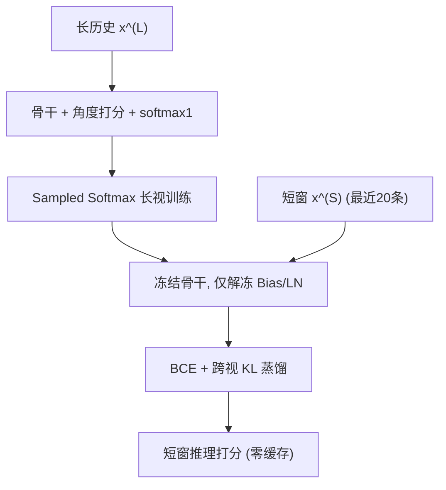
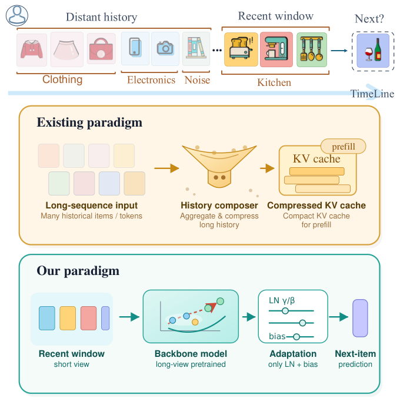

# Closing the Long-Short View Gap in Sequential Recommendation without Cached History (无需缓存历史即可弥合序列推荐的长短视差距)

- **会议/期刊**: CIKM 2026
- **作者与机构**: Lingfeng Shi, James Caverlee (Texas A&M University); Chengkai Huang, Lina Yao (UNSW)
- **推荐链路定位**: 精排（Next-Item 打分）
- **研究方向**: 序列与会话推荐 / CTR 特征交叉（打分几何与损失设计）
- **论文原文**: [https://arxiv.org/abs/2609.06219v1](https://arxiv.org/abs/2609.06219v1)
- **开源代码**: [https://github.com/lingfengs111/long-short-view-rec](https://github.com/lingfengs111/long-short-view-rec)

## TL;DR (1分钟核心速览)

工业序列推荐常用长历史训练，但线上受延迟约束只能喂最近 20 条，导致显著掉点；现有解法（PersRec/LONGER 等）把历史压缩成 per-user KV/token 缓存，带来存储与冷启动开销。本文实证定位两个结构性缺陷——点积的**范数偏置**（稀疏长序列下退化为流行度捷径）与 **prefix 注意力沉降**（截断即破坏），提出两阶段框架：长视训练阶段用**角度相似度打分 + softmax1** 修正几何，短视适配阶段**仅微调 Bias/LayerNorm** 并加跨视蒸馏。在 SASRec/HSTU × 三数据集上，短窗推理即超越原全序列基线，适配后逼近甚至超过缓存类方法且零 per-user 存储。

## Background & Motivation (背景与核心矛盾)

- **主流范式**: ID-based 序列推荐（SASRec/HSTU）在长历史 $\mathbf{x}^{(L)}$ 上训练收敛，线上却只能用最近窗口 $\mathbf{x}^{(S)}$ 推理；为搬运远距离信号，PersRec、Kwai Summary Attention、LONGER 等把历史压缩为可学习 token / KV cache / recurrent state，离线预计算、线上检索。
- **前人局限**: ① 缓存范式要求 per-user 状态被物化、存储、刷新，把计算成本换成基础设施成本；② 新用户或长期沉默用户无状态可用，冷启动场景完全失效。
- **核心洞察 (Key Insight)**: 作者用 SASRec/HSTU 在 Taobao 上做冻结模型的截断实验（图 2）：仅 5 个 recent token 时 NDCG@10 已达 ≈0.48/0.44，说明推荐主要由近期行为驱动；但恢复曲线直到 $L=200$ 才触顶，说明存在持续 gap。更关键的是，把 **prefix 段**拼回 recent 段会带来一次**陡峭跳升**（>5 个 prefix token 后转为平缓线性增长）——这正是 softmax 强制概率和为 1 导致的 "sinking token" 现象：模型把残差注意力倾倒到最早几个位置作结构性垃圾桶，截断即破坏已学注意力模式。
- **第二重矛盾**: 表 1 显示 Taobao/XLong 中 freq≤5 的物品占 73%/85%，且物品频率与嵌入范数的 Pearson 相关系数达 0.54/0.80。由 $z_t(i)=\|h_t\|_2\|e_i\|_2\cos\theta_{t,i}$ 可知，点积让模长压过方向对齐，在稀疏长上下文下放大为流行度捷径。
- **本文切入点**: 与其把长历史搬到服务端，不如**在训练侧改造骨干**，使其在纯短窗推理下依然有效——先修几何（角度打分 + softmax1），再修分布（Bias/LN 适配）。

## Method (核心方法设计)

### 1. 整体框架 (Overall Architecture)

两阶段、骨干无关。**阶段一（长视骨干学习）**：在完整 $\mathbf{x}^{(L)}$ 上训练，把打分从点积换成温度缩放余弦相似度以解耦模长，把 softmax 换成 softmax1 以允许注意力总质量趋零、缓解 prefix 沉降，用 sampled softmax 做正负竞争。**阶段二（短视适配）**：冻结骨干，仅解冻原生 bias 与 LayerNorm 仿射参数 $(\gamma,\beta)$，在短窗 $\mathbf{x}^{(S)}$ 上以 BCE 点式对齐 + 长视教师对短视学生的候选池 KL 蒸馏联合优化。推理时只输入最近 20 条，无任何 per-user 缓存或 prefill。

<figure class="paper-figure" markdown="span">
  <figcaption>图1：序列推荐推理两种范式的比较。现有方法将长用户历史压缩为KV缓存或token记忆用于预填充；我们的方法则在长视图数据上预训练主干，仅用较短的近期窗口进行服务，仅自适应调整LayerNorm和偏置参数。</figcaption>
</figure>

### 2. 关键设计拆解 (Key Designs)

1. **角度相似度打分（Angular Similarity Scoring）**：痛点是由式 (5) 展开可见模长项可主导排序，稀疏数据下退化为流行度捷径。改为对用户态与物品嵌入双向 $\ell_2$ 归一化后除以温度：
$$s_t(i)=\frac{\bar{h}_t^\top \bar{e}_i}{\tau},\quad \bar{h}_t=\frac{h_t}{\|h_t\|_2},\ \bar{e}_i=\frac{e_i}{\|e_i\|_2}$$
直觉：排序完全由 $\cos\theta$ 决定，迫使偏好表达落在方向上；且这套归一化几何正是短视学生要继承的结构知识。

2. **有界注意力聚合（softmax1）**：痛点是标准 softmax 强制 $\sum\alpha=1$，模型学会把残差权重倒给最早 prefix token 作 "dump" 位，截断即崩。改为在分母加常数 1：
$$\alpha^{\text{softmax1}}_{t,j}=\frac{\exp(a_{t,j})}{1+\sum_{m\le t}\exp(a_{t,m})}$$
直觉：允许模型在无信息 token 时分配近零总注意力，而非被迫摊派单位概率预算——契合长上下文稀疏、预测可能只依赖极少数 token 的事实。作者未采用加全局 token 或用户画像的方案，而是直接改聚合算子本身。

3. **架构感知的 Bias/LayerNorm 适配 + 双监督**：痛点是长度剧变导致 LayerNorm 统计量漂移，与范数偏置同属"归一化边界失准"。借鉴 BitFit，令 $\theta=\theta_{\text{frozen}}\cup\theta_{\text{adapt}}$，$\theta_{\text{adapt}}\subseteq\mathcal{B}\cup\{\gamma_{\text{LN}},\beta_{\text{LN}}\}$，不引入任何新参数。该规则自动适配架构：SASRec 侧重 LN 的 $\gamma,\beta$，HSTU（block norm 无参数）则自动转向投影与位置偏置。总损失：
$$\mathcal{L}_{\text{FT}}=\mathcal{L}_{\text{BCE}}+\lambda_{\text{KD}}\,\mathrm{KL}\big(\text{softmax}(s^{(L)}/T_d)\,\|\,\text{softmax}(s^{(S)}/T_d)\big)$$
其中 KL 在"正样本 + 随机负样本"的共享局部候选池上计算。训练负采样：阶段一 sampled softmax 用 128 个采样负例；阶段二 BCE 用 1 个均匀负例（作者实证发现适配阶段复用 sampled softmax 收益可忽略）。推理开销：仅编码 20 条序列，无缓存检索。

## Experimental Setup & Evaluation Protocol (实验设置与评估协议)

- **数据集与预处理**: 沿用 LONGER/PersRec 的长序列筛选——ML-10M 与 Taobao 保留训练长度 >200（取 202），XLong 保留 >400（取 402）。

| 数据集 | #Users | #Items | Context len | Avg freq | Density |
| :--- | :---: | :---: | :---: | :---: | :---: |
| ML-10M | 10,870 | 9,841 | 202 | 223.1 | 2.05×10⁻² |
| Taobao | 94,489 | 2.06M | 202 | 9.25 | 9.79×10⁻⁵ |
| XLong | 20,000 | 1.81M | 402 | 4.45 | 2.23×10⁻⁴ |

- **数据划分与防穿越**: `Leave-One-Out`（最后一条测试、倒数第二条验证）；滚动评估实验额外留出最后 10 条作未来块，训练长度降为 190/390。
- **排名评测协议**: `Sampled Ranking`，每个目标物品配 **1000 个均匀采样负例**；指标 Hit@5/10、NDCG@5/10。
- **对比基线与超参**: 骨干 SASRec（2 层、1 头、$d=128$、dropout 0.1）与 HSTU（4 层、4 头、$d=128$、per-head 32、dropout 0.2）；基线含 Original Full/Short/+prefix、LONGER†（仅 SASRec，ID-only 重训）、PersRec（8 个可学习 token、全参数微调）。长视训练温度 $\tau=0.07$、峰值学习率 $10^{-3}$、200 epochs；适配学习率 $10^{-4}$、SASRec 200 / HSTU 120 epochs。

## Key Experimental Results (实验关键数据)

### 1. 主实验对比 (Main Results)

下表摘取 NDCG@10（Δ 为相对同数据集 Original Full 的绝对变化），完整四指标见原文表 3：

| 数据集 | 设置 | SASRec NDCG@10 | Δ | HSTU NDCG@10 | Δ |
| :--- | :--- | :---: | :---: | :---: | :---: |
| ML-10M | Original Full | 0.2329 | ref | 0.2559 | ref |
| ML-10M | Original Short | 0.2157 | −1.7% | 0.2217 | −3.4% |
| ML-10M | **Ours Adapted** | **0.2633** | +3.0% | **0.2768** | +2.1% |
| ML-10M | PersRec | 0.2313 | +0.1% | 0.2674 | +1.3% |
| Taobao | Original Full | 0.5175 | ref | 0.5231 | ref |
| Taobao | Original Short | 0.4831 | −3.4% | 0.4446 | −7.9% |
| Taobao | **Ours Adapted** | **0.5522** | +3.5% | **0.5467** | +2.4% |
| Taobao | PersRec | 0.5543 | +3.7% | 0.5703 | +4.7% |
| XLong | Original Full | 0.2709 | ref | 0.3441 | ref |
| XLong | Original Short | 0.2380 | −3.3% | 0.2932 | −5.1% |
| XLong | **Ours Adapted** | **0.3539** | +8.3% | **0.3461** | +0.2% |
| XLong | PersRec | 0.3287 | +5.8% | 0.3292 | −1.5% |

效率对比（Taobao/HSTU，表 4）：本文仅更新 **2,764** 参数、训练 1.07h、零长期内存与 prefill；PersRec 全参微调 302M 参数（×109,600）、8.34h、16KB/user（共 1.44GiB）、190 token/user prefill。本文以 95.9% 的 PersRec NDCG@10 换取全部 per-user 基础设施的消除。

### 2. 消融实验 (Ablation Study)

| 维度 | 配置 | NDCG@10 | Hit@10 |
| :--- | :--- | :---: | :---: |
| SASRec 骨干配方 | Original (dot+BCE) | 0.5175 | 0.6479 |
| | + 余弦 + sampled softmax | 0.5435 | 0.6613 |
| | **Final (+softmax1)** | **0.5500** | **0.6677** |
| HSTU 骨干配方 | Base (softmax+SSM) | 0.5229 | 0.6652 |
| | + softmax1 | 0.5361 | 0.6718 |
| | + rel_bias | 0.5615 | 0.6814 |
| | **Final (+both)** | **0.5764** | **0.6992** |
| SASRec 适配参数 | Direct short | 0.5406 | 0.6511 |
| | + bias only | 0.5492 | 0.6770 |
| | + LN only | 0.5501 | 0.6767 |
| | **+ Both** | **0.5520** | **0.6805** |
| HSTU 适配参数 | Direct short | 0.5396 | 0.6631 |
| | **+ bias only** | **0.5472** | **0.6748** |
| | + LN only | 0.5375 | 0.6623 |
| | + Both | 0.5458 | 0.6733 |
| 损失（HSTU/Taobao） | BCE only | 0.5467 | 0.6742 |
| | KD only | 0.5462 | 0.6722 |
| 损失（SASRec/XLong） | BCE only | 0.3539 | 0.5034 |
| | **KD only** | **0.3682** | **0.5169** |

### 3. 关键实验发现 (Key Findings)

1. **几何修正本身就能"零样本"反超全序列基线**：Ours Short（不做任何适配）在 Taobao/SASRec 上 NDCG@10 达 0.5407，已高于 Original Full 的 0.5175；XLong/SASRec 上 0.3391 vs 0.2709（+6.8%）。说明长视训练配方把短视鲁棒性内化进了表征空间，而非靠推理期补丁。
2. **适配参数族必须架构感知，选错会反噬**：HSTU 上 LN-only 适配（0.5375）甚至低于 Direct short（0.5396），因其 block norm 无参数、可训练量集中在投影/位置偏置；而 SASRec 上 LN-only（0.5501）优于 bias-only（0.5492）。联合两类参数是唯一对两骨干都稳健的选择。
3. **蒸馏的收益与截断 gap 大小正相关**：Taobao/HSTU 的短视 gap 仅 −7.9%，BCE-only 已最优、加 KD 无增益；XLong/SASRec 的 gap 更大，KD-only（0.3682）显著优于 BCE-only（0.3539），说明教师候选序结构在困难截断场景才提供互补信号，$\lambda_{\text{KD}}$ 是 regime-sensitive 开关。
4. **滚动评估下增益时间稳定**：Taobao/SASRec 九个未来位置上 Ours-Adapted 平均 NDCG@10 为 0.5607，恢复 PersRec（0.5652）的 97.4% 且差距不随目标后移扩大；XLong/HSTU 上 Ours-Adapted（0.3780）在全部九个位置领先 PersRec（0.3571）。

## Highlights, Limitations & Rating (亮点、对比与审稿评价)

- **与代表作对比 (vs. Prior Work)**: 与 **PersRec** 的本质区别是"改模型 vs. 存状态"——PersRec 用 8 个可学习 token 缓存历史并全参微调，本文零缓存、仅调 2,764 参数；与 **LONGER** 的区别是后者靠全局 anchor token + token-merge 压缩长历史且需推理期可见，本文则彻底放弃推理期长历史；与 **TWIN** 等工业长序列方案相比，本文不依赖任何行为检索或聚类。
- **可迁移亮点**: ① "softmax1 + 角度打分"组合可作为长上下文序列骨干的通用训练配方，直接提升全视上限（Taobao/SASRec +3.3%，XLong/SASRec +9.5%）；② "仅解冻 Bias/LN" 的架构感知适配规则可迁移到任何需要跨输入长度分布迁移的推荐场景（如跨场景序列迁移、变长会话）。
- **审稿级局限批判**: ① 评测全部采用 1000 负例的 Sampled Ranking，未报告 Full-Ranking，负例采样偏差可能高估绝对水平；② 数据集经 >200/>400 长度筛选，用户规模大幅缩水（Taobao 仅 9.4 万用户），且未在真实线上流量做 A/B，工业结论需谨慎；③ 短窗固定为 20，未系统扫描窗口长度与适配收益的敏感曲线；④ 蒸馏收益高度依赖 regime，$\lambda_{\text{KD}}$ 缺乏自适应设定方法。
- **四维评分**: 创新性 ⭐⭐⭐⭐ | 实验扎实度 ⭐⭐⭐⭐ | 方法清晰度 ⭐⭐⭐⭐⭐ | 落地价值 ⭐⭐⭐⭐⭐

