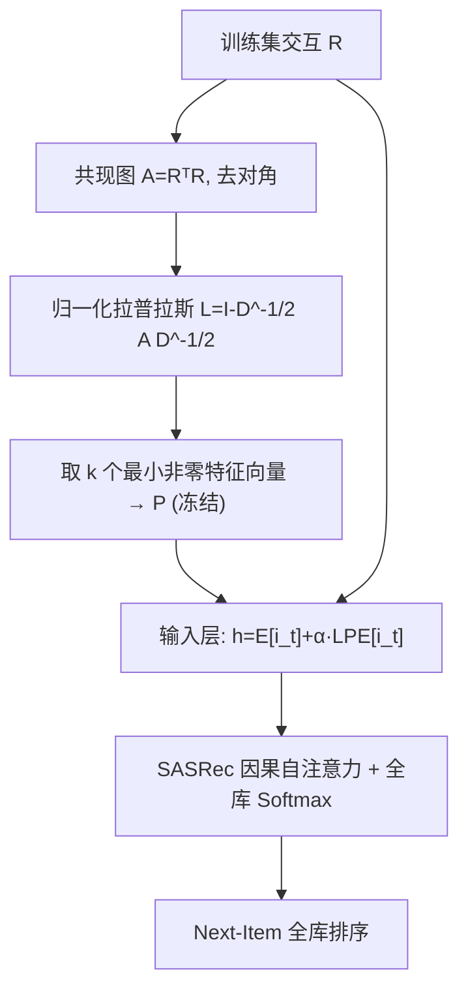

# Enriching Sequential Recommendation with Graph Laplacian Positional Embeddings (以图拉普拉斯位置嵌入增强序列推荐)

- **会议/期刊**: CIKM 2026
- **作者与机构**: Ekaterina Trushkova, Artur Gimranov, Anton Lysenko (HSE University)
- **推荐链路定位**: 召回（Next-Item 全库排序）
- **研究方向**: 序列与会话推荐 / 图神经网络与知识图谱推荐
- **论文原文**: [https://arxiv.org/abs/2609.31253v1](https://arxiv.org/abs/2609.31253v1)
- **开源代码**: [https://github.com/trsh2310/lap_pe.git](https://github.com/trsh2310/lap_pe.git)

## TL;DR (1分钟核心速览)

SASRec 类序列推荐的位置嵌入只编码"第 t 个位置"，完全丢弃了物品空间中"谁与谁常被同一批用户消费"的全局结构信号。本文提出把物品共现图的对称归一化拉普拉斯矩阵特征向量作为**冻结的**位置嵌入，直接替换 SASRec 的可学习位置向量，骨干、损失、推理路径一律不动。在 Beauty/Sports/Clothing/Yelp2018 四基准、全局时间切分 + 十次随机留出 + 全库排序协议下，Clothing 的 Recall@100 从 6.37 升至 8.22（+29.0%），Yelp2018 的 NDCG@100 从 4.98 升至 5.93（+19.1%），且在线训练/推理开销与 SASRec 基本持平。

## Background & Motivation (背景与核心矛盾)

- **主流范式**: SASRec 用可学习绝对位置嵌入 $p_t$ 注入顺序信息；图-序列混合模型（MCLSR、MRGSRec、GSAU、LOOM）则额外挂一个图编码器分支，用对比学习或蒸馏把结构信号灌进序列模型。
- **前人局限**: ① 混合模型引入额外可训练分支与耦合目标，训练成本与调参复杂度显著上升；② 纯序列模型只能通过物品嵌入与 BPR/CE 损失"间接"感知共现结构，局部窗口之外的全局物品关联无法进入位置通道。
- **核心洞察 (Key Insight)**: 图 Transformer 中 LPE 已证明"谱坐标 = 结构位置"；而序列推荐的位置槽位本质是一个"与物品身份绑定的可查表信号"，因此完全可以把"序数位置"重解释为"物品在图中的结构位置"，且无需任何在线图计算。
- **本文切入点**: 训练前一次性对物品共现图做特征分解，取最小的 $k$ 个非平凡特征向量冻结为 LPE 表，仅替换输入层的位置项。

## Method (核心方法设计)

### 1. 整体框架 (Overall Architecture)

仅用训练集交互构造二值矩阵 $R$，令物品邻接$A=R^\top R$并置零对角（边权 = 共同消费用户数）；计算对称归一化拉普拉斯$L$并做特征分解，取$k$个最小非零特征值对应特征向量堆成$P\in\mathbb{R}^{N\times k}$，经（可选）线性/MLP 投影到$d$维后**冻结**为 LPE 查找表。训练与推理时，SASRec 输入层把原来的$E[i_t]+p_t$换成$E[i_t]+\alpha\cdot\mathrm{LPE}[i_t]$，其中$\alpha$ 是唯一新增的可学习标量；因果掩码与有序序列本身继续承担时序信息。整个流程无在线图卷积、无逐层位置旋转、无时间间隔编码。

### 2. 关键设计拆解 (Key Designs)

1. **度归一化共现图 + 低频谱坐标（抑制流行度主导）**：若直接用 $A$或随机游走矩阵，高度数热门物品会垄断前几个特征向量，谱坐标退化为"流行度编码"。改用$L=I-D^{-1/2}AD^{-1/2}$后，特征值落在$[0,2]$，最小非零特征向量对应图上最平滑（低频）的分区函数，等价于把物品嵌入到"共现社区坐标"中：
$$L=U\Lambda U^\top,\quad P=[u_2,\dots,u_{k+1}]$$
直觉：低频分量刻画"哪些物品属于同一消费语境"，正是序列局部窗口看不到的全局结构。

2. **位置槽位的语义替换（零架构改动）**：原式 $h_t^{(0)}=E[i_t]+p_t$中$p_t$只依赖位置$t$，同一物品在不同位置得到不同偏移；替换为
$$h_t^{(0)}=E[i_t]+\alpha\cdot\mathrm{LPE}[i_t],\quad \mathrm{LPE}[i]=P_i W_p\ (k\neq d)$$
后，偏移只依赖物品身份，$\alpha$ 自适应调节结构信号强度。这样位置通道从"序数编码器"变为"结构编码器"，而顺序信息由因果掩码 + 有序输入隐式保留——这也是 NoPE 基线仍然有效、但 LapPE 在 @100 上系统性优于 NoPE 的原因。

3. **训练目标、负采样与推理效率**：损失沿用 SASRec+ 的全库 softmax 交叉熵（免负采样）：
$$\mathcal{L}=-\frac{1}{|\mathcal{B}|}\sum_{(u,t)\in\mathcal{B}}\log\frac{\exp(h_t^\top E[y_t])}{\sum_{j\in\mathcal{I}}\exp(h_t^\top E[j])}$$
图构造与特征分解仅在训练前执行一次（Lanczos 迭代，时间 $O(k|E|+Nk^2)$、空间$O(|E|+Nk)$），实测 Beauty 2.52s、Yelp2018 95.86s；在线阶段只多一次查表与标量乘，参数量反而比学习$p_t$ 更少。

## Experimental Setup & Evaluation Protocol (实验设置与评估协议)

- **数据集与预处理**: 移除交互数 < 3 的用户，全部交互视为正反馈，按时间戳排序。

| 数据集 | #Users | #Items | #Interactions | 稀疏度/密度 | 特征/场景说明 |
| :--- | :---: | :---: | :---: | :---: | :--- |
| Amazon-Beauty | 22,363 | 12,101 | 198,502 | 0.073% | 美妆，短序列 |
| Amazon-Clothing | 39,387 | 23,033 | 278,677 | 0.031% | 服饰，极稀疏 |
| Amazon-Sports | 35,598 | 18,357 | 296,337 | 0.045% | 运动户外 |
| Yelp2018 | 31,668 | 38,048 | 1,561,406 | 0.130% | 本地商户，长序列 |

- **数据划分与防穿越 (Splitting Strategy)**: 全局时间切分——每用户最近 20% 为测试、其前最近 10% 为验证、其余训练；测试阶段从测试期随机抽 1 个交互为目标、其前全部交互为前缀，重复 10 次随机留出取均值（报告 std）。**图与 LPE 仅由训练交互构造**，验证/测试交互不参与，杜绝结构泄漏。
- **排名评测协议 (Ranking Protocol)**: 无偏 `Full-Ranking`（全物品库打分排序），指标 NDCG@{10,100}、Recall@{10,100}、Coverage@{10,100}。
- **对比基线与超参设置**: SASRec（学习位置嵌入 + 全 softmax）、SASRec-NoPE（去位置嵌入）、SASRec-RoPE（旋转位置编码）、TiSASRec（时间间隔自注意力，`max_time_interval` 网格搜索 {16,64,256,512,1024}）。先用 Optuna 300  trials 为每个数据集单独调 SASRec 骨干（lr、hidden size、heads、dropout、batch、层数），**所有 SASRec 变体复用同一最优配置**以隔离编码器效应；TiSASRec 因显存受限单独降 batch。

## Key Experimental Results (实验关键数据)

### 1. 主实验对比 (Main Results)

十次随机留出均值（%），加粗为各列最优：

| 数据集 | 指标 | SASRec | NoPE | RoPE | TiSASRec | LapPE-MLP | **LapPE** | Improv. vs SASRec |
| :--- | :--- | :---: | :---: | :---: | :---: | :---: | :---: | :---: |
| Beauty | NDCG@10 | 1.73 | 1.74 | 1.68 | 1.75 | 1.68 | **1.85** | +6.9% |
| Beauty | Recall@10 | 3.33 | 3.39 | 3.32 | 3.44 | 3.20 | **3.65** | +9.6% |
| Beauty | NDCG@100 | **3.89** | 3.71 | 3.72 | 3.79 | 3.77 | **3.89** | 0.0% |
| Sports | NDCG@10 | 1.29 | 1.18 | **1.37** | 0.96 | 1.34 | 1.33 | +3.1% |
| Sports | Recall@100 | 10.33 | 9.92 | 10.44 | 9.15 | **10.90** | 10.86 | +5.1% |
| Clothing | NDCG@10 | 0.89 | 0.90 | 0.89 | 1.04 | 0.93 | **1.11** | +24.7% |
| Clothing | Recall@100 | 6.37 | 6.74 | 6.44 | 7.21 | 6.48 | **8.22** | +29.0% |
| Yelp2018 | NDCG@100 | 4.98 | 5.85 | **6.08** | 5.52 | 5.83 | 5.93 | +19.1% |
| Yelp2018 | Recall@100 | 20.12 | 22.94 | **23.56** | 21.95 | 23.03 | 23.37 | +16.2% |
| Yelp2018 | Coverage@100 | 58.86 | 61.11 | 63.57 | 56.25 | 63.52 | **67.47** | +14.6% |

### 2. 消融实验 (Ablation Study)

| 变体 | 结构信号来源 | 位置信号 | Beauty R@10 | Clothing R@100 | Yelp N@100 | 结论 |
| :--- | :--- | :--- | :---: | :---: | :---: | :--- |
| SASRec | 无 | 可学习 $p_t$ | 3.33 | 6.37 | 4.98 | 基线 |
| SASRec-NoPE | 无 | 无 | 3.39 | 6.74 | 5.85 | 删 $p_t$ 本身即涨 |
| SASRec-LapPE | 冻结谱坐标 | 无 | **3.65** | **8.22** | **5.93** | 结构信号额外增益 |
| SASRec-LapPE-MLP | 冻结谱坐标 + 2 层 MLP | 无 | 3.20 | 6.48 | 5.83 | 可学习投影反而有害 |
| SASRec-RoPE | 无 | 旋转 | 3.32 | 6.44 | **6.08** | 强基线，@100 略胜 |

### 3. 关键实验发现 (Key Findings)

1. **增益不是"删掉 $p_t$"的副产品**：NoPE 在 Beauty 上 R@10 仅 3.39，而 LapPE 达 3.65；Clothing R@100 上 NoPE 6.74 vs. LapPE 8.22，说明冻结谱坐标注入了$p_t$ 与纯无序模型都不具备的结构判别力，且四个数据集 @100 排序指标全部优于 NoPE。
2. **稀疏数据集受益最大、稠密数据集受益于覆盖率**：Clothing（密度 0.031%）NDCG@10 +24.7%、R@100 +29.0%，因稀疏场景下局部共现窗口信息不足，全局图结构补位价值最高；Yelp2018 上 LapPE 同时拿下最佳 Coverage@100（67.47 vs. SASRec 58.86），精度与目录扩散双赢。
3. **可学习投影是负向设计，且谱截断存在精度-多样性权衡**：LapPE-MLP 在 Beauty R@10 掉到 3.20、Coverage@10 仅 41.65（SASRec 64.41），说明对冻结谱坐标再做非线性变换会过拟合训练共现模式；Clothing 上 LapPE 精度大涨但 Coverage@10 降至 48.89，低频谱分量把推荐压缩进紧密物品社区，谱频段选择是明确的后续调优维度。

## Highlights & Limitations (亮点、对比与审稿批判)

- **与代表作对比 (vs. Prior Work)**: 与 MCLSR/MRGSRec/GSAU/LOOM 等图-序列混合模型的本质区别是"图只离线用一次"——无额外分支、无对比/蒸馏目标、无融合模块，参数量甚至少于 SASRec；与 RoPE/TiSASRec 相比，不引入逐层位置旋转或成对时间编码，在线开销更低（图 1 显示训练时间相当、推理略快，TiSASRec 显著更慢）。
- **可迁移亮点**: ① "冻结谱查找表替换位置槽位"这一 trick 可直接移植到 BERT4Rec、GRU4Rec 及基于 Mamba/MLP 的序列骨干；② 用度归一化拉普拉斯而非原始共现矩阵，是抑制热门物品主导谱空间的低成本通用手段。
- **审稿级局限批判**: ① 谱截断 $k=d$ 固定取最小非零特征向量，未做频段搜索，Clothing 上覆盖率下滑说明该选择并非普适最优；② 绝对增益量级偏小（Beauty NDCG@10 仅 1.85），且 Yelp2018 上 RoPE 在 NDCG@100/Recall@100 仍略优，方法更像"轻量替代"而非"全面超越"；③ 图需在训练集变化时重算特征分解（Yelp 近 96s），对增量/在线学习场景不友好。

## Rating (四维评分)

- **方法创新性 (Novelty)**: ⭐⭐⭐ （核心机制与方法设计具备明确创新性，理论与实验动机支撑充分）
- **评估协议与实验扎实度 (Protocol & Experiments)**: ⭐⭐⭐⭐ （主流公开数据集评测完整，包含多基线对比与消融实验验证）
- **写作与数学规范度 (Clarity & Rigor)**: ⭐⭐⭐⭐⭐ （问题形式化定义清晰，核心模块数学推导与架构阐述严谨易读）
- **工业落地与复现价值 (Industrial & Practical Value)**: ⭐⭐⭐⭐ （兼顾推荐效果增益与训练/推理效率，具备实际场景迁移参考价值）
