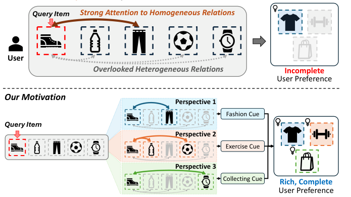
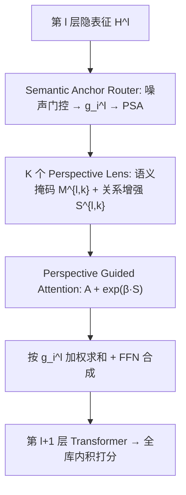
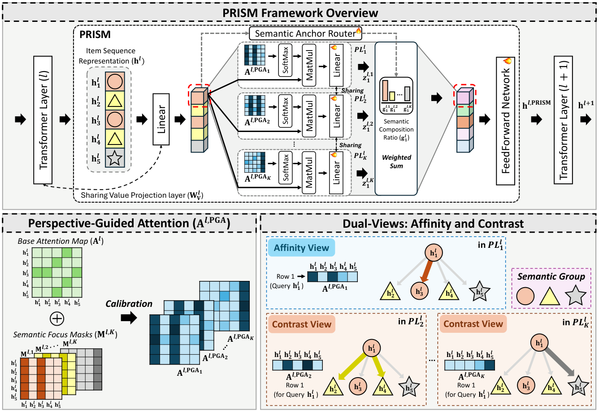

# From Overlooked to Explored: Recovering Item Relations via Mixture of Perspectives for Sequential Recommendation (从被忽略到被挖掘：以混合视角恢复物品关系用于序列推荐)

- **会议/期刊**: CIKM 2026 (Full Research Paper)
- **作者与机构**: Junyoung Kim, Wonbin Kweon, Woojoo Kim, Jaehyung Lim, Dongha Kim, Hwanjo Yu (POSTECH / Sungkyunkwan University)
- **推荐链路定位**: 精排（序列编码器内部模块，可插拔于 Transformer 层间）
- **研究方向**: 序列与会话推荐 / 自监督对比学习与交互去噪
- **论文原文**: [https://arxiv.org/abs/2608.11846v2](https://arxiv.org/abs/2608.11846v2)
- **开源代码**: [https://github.com/327aem/PRISM](https://github.com/327aem/PRISM)

## TL;DR (1分钟核心速览)

本文指出 Transformer 序列推荐中的点积自注意力存在**相似性偏置 (similarity bias)**：注意力分数天然偏向与 query 相似的物品，系统性压制了携带有效偏好信号的异构关系。作者提出 PRISM 模块，用 K 个"视角透镜"从不同语义分组校准注意力——亲和视图 (Affinity View) 精炼同质关系、对比视图 (Contrast View) 挖掘被压制的异质关系，并辅以序列级对比损失与跨透镜一致性损失。在 7 个真实数据集、Leave-One-Out + Full-Ranking 协议下，N@20 相对最强基线提升 4.08%–11.17%。

## Background & Motivation (背景与核心矛盾)

- **主流范式**: 以 SASRec/BERT4Rec 为代表的 Transformer 序列推荐依靠自注意力计算全序列两两点积交互来建模物品转移关系，是当前绝对主流。
- **前人局限**: ① 点积注意力分数由向量相似度决定，query 表征被相似物品主导，语义相异但因果重要的物品（如"跑鞋"序列中的"水壶"）被压制；② 现有补救方案均未触及"注意力如何选物品"这一根本机制——AC-SASRec 用可学习矩阵盲校准注意力分数，反而在 Beauty 上使 $\rho(A,I)$ 更差；FAME 在注意力头内做 MoE，但每个头仍是点积注意力，Align@1 甚至低于 SASRec；ICLRec/ICSRec 的序列级意图原型同样继承该偏置。
- **核心洞察 (Key Insight)**: 作者用**因果重要性** $I_j = P(y|S_u) - P(y|\text{mask}(S_u,j))$度量每个位置对目标预测的真实贡献，发现注意力与因果重要性的 Spearman 相关$\rho(A,I)$ 在 SASRec 上为**负值**；反事实干预实验进一步显示，提升被忽略位置（C3 盲提底部 20%）的注意力即可提升目标置信度，且"被忽略但因果重要"的位置（C4）收益最大——说明被忽略的关系不仅有用，而且**分散在多个异构语义面向**上。
- **本文切入点**: 既然有用信号分布在多个异构面向，就用多个语义视角并行重审物品关系，而非在单一注意力图上做修补。

<figure class="paper-figure" markdown="span">
  <figcaption>图1：PRISM的动机。（上）标准自注意力偏向同质关系，仅能捕捉部分偏好。（下）从多个视角审视序列，每个视角揭示不同线索（如时尚、锻炼、收藏），可将它们组合成更丰富的偏好。</figcaption>
</figure>

## Method (核心方法设计)

### 1. 整体框架 (Overall Architecture)

PRISM 是一个插在相邻 Transformer 层之间的模块（$L$层 Transformer 配$L-1$个 PRISM）。输入第$l$层隐表征$H^l$后，先由 **Semantic Anchor Router** 为每个物品计算 K 个语义组的软归属比例$g_i^l$并确定主语义锚 (PSA)；随后 K 个 **Perspective Lenses** 各自以"仅保留第 k 组 key 列"的语义掩码重算注意力，得到 K 份视角化表征；最后按$g_i^l$加权求和并经 FFN 合成统一表征送入下一层。训练时叠加序列级偏好对比损失$\mathcal{L}_{SPCL}$与跨透镜一致性损失$\mathcal{L}_{CCL}$，推理时直接取末层序列表征与物品嵌入做全库内积打分。

<figure class="paper-figure" markdown="span">
  <figcaption>图4：PRISM框架：PRISM逐项进行多视角分析，随后进行关系洞察合成。所有可学习参数在各透镜间共享以提高效率，输出仅因关系视角不同而不同。</figcaption>
</figure>

### 2. 关键设计拆解 (Key Designs)

1. **语义锚路由与双视图的自然涌现 (Semantic Anchor Router + Dual-View)**：痛点在于"异构关系"无法被显式定义。作者用带高斯噪声的门控 $r_i^l = h_i^l W_g^l + \eta_i^l \odot \text{Softplus}(h_i^l W_{noise}^l)$经 Softmax 得到语义组成比例$g_i^l$，取$\text{PSA}_i^l = \arg\max_k g_i^{l,k}$。关键机制在于：每个透镜$PL_k$的语义掩码$M_{ij}^{l,k} = \mathbb{I}(\text{PSA}_j^l = k)$ **只由 key 位置决定、对所有 query 共享**。于是当 query 自身属于第 k 组时该透镜退化为**亲和视图**（精炼组内同质关系），否则为**对比视图**（强制关注跨组异质关系）。每个物品恰好被 1 个亲和视图 + K−1 个对比视图审视，双视图无需额外设计即自动覆盖组内与组间关系。

2. **视角引导注意力校准 (Perspective Guided Attention)**：痛点在于直接替换注意力会丢失原层已捕获的有效信号。作者先计算组特异的关系增强信号 $S_{ij}^{l,k} = \left(\frac{1}{T}\sum_{j'} A_{ij'}^l M_{ij'}^{l,k}\right) M_{ij}^{l,k}$（即 query i 对第 k 组 key 的平均注意力），再以可学习标量$\beta^l$融合：$A_k^{l,PGA} = A^l + \exp(\beta^l \cdot S^{l,k})$。$\exp(\cdot)$保证增强项恒非负，即只做"加法补偿"而不削弱原有关系；所有透镜共享$\beta^l$、值投影$W_V^l$与输出 Linear 层，使不同透镜输出的差异**纯粹来自视角掩码**而非参数差异，参数量仅随 K 线性增加$2d$。

3. **训练目标、负采样与推理效率**：总损失 $\mathcal{L} = \mathcal{L}_{rec} + \lambda(\mathcal{L}_{SPCL} + \mathcal{L}_{CCL})$。$\mathcal{L}_{SPCL}$采用**同目标增强**（检索目标物品相同的另一条序列作正样本）+ **随机视角掩码 SPM**（以概率$\rho$屏蔽非主视角的路由 logit，$\tilde{r}_i^l = r_i^l + \log(m_i^l + \epsilon)$），防止对比学习把不同用户的关系模式过度对齐；$\mathcal{L}_{CCL}$用对称 KL 散度对齐各透镜在采样物品空间上的相似度分布，权重$w_i^{l,k,k'} = \frac{g_i^{l,k} g_i^{l,k'}}{g_i^{l,k}+g_i^{l,k'}+\epsilon}$使弱激活透镜不参与对齐。训练采用标准交叉熵 + in-batch 负样本（$\mathcal{L}_{CCL}$的$E_{sample}$ 复用 in-batch 目标物品），**无额外负采样开销**；推理时仅增加一次前向，K=4 时推理延迟 4.13s 接近 SASRec 的 3.43s。

## Experimental Setup & Evaluation Protocol (实验设置与评估协议)

- **数据集与预处理**: 全部采用迭代式 `5-core` 过滤（Beauty♠ 冷启动实验版本仅单次 5-core）：

| 数据集 | #Users | #Items | #Interactions | 稀疏度/密度 | 特征/场景说明 |
| :--- | :---: | :---: | :---: | :---: | :--- |
| Toys | 19,412 | 11,924 | 167,597 | 99.93% | Amazon 中等规模 |
| Beauty | 22,363 | 12,101 | 198,502 | 99.93% | Amazon 中等规模 |
| Games | 24,303 | 10,672 | 231,780 | 99.91% | Amazon 中等规模 |
| Sports | 35,598 | 18,357 | 296,337 | 99.95% | Amazon 中等规模 |
| ML-1M | 6,040 | 3,416 | 999,610 | 95.16% | 长序列 (平均 165.5) |
| Yelp | 29,915 | 21,572 | 345,186 | 99.95% | 2020 年后点评交互 |
| Electronics | 192,403 | 63,001 | 1,689,188 | 99.99% | 工业级大规模 |

- **数据划分与防穿越**: `Leave-One-Out`——每用户最后一项测试、倒数第二项验证、其余训练。
- **排名评测协议**: 无偏 `Full-Ranking`（全库未交互物品排序，**不做负采样**），指标 H@{5,10,20} 与 N@{5,10,20}，5 个随机种子取均值。
- **对比基线与超参设置**: 覆盖 5 类共 13 个基线（通用 SASRec/BERT4Rec/GRU4Rec、注意力校准 AC-SASRec、对比学习 CL4SRec/DuoRec、意图建模 ICLRec/IOCRec/ICSRec/ELCRec、MoE 类 FAME/FamouSRec/STAR-Rec）。$d=64$、$L=2$、2 头、最大序列长 50、batch 256、lr 0.001；搜索$K \in \{2,4,6,8\}$、$\lambda \in \{0.01,...,0.5\}$、$\tau \in \{0.05,...,2.0\}$，$\rho=0.25$；显著性用配对 t 检验$p<0.05$。

## Key Experimental Results (实验关键数据)

### 1. 主实验对比 (Main Results)

下表摘取 7 个代表性基线在 N@20 上的结果（完整表含 H@5/10/20 与 N@5/10）：

| Dataset | SASRec | AC-SASRec | CL4SRec | ICLRec | ICSRec | FAME | FamouSRec | STAR-Rec | **PRISM** | Improv. |
| :--- | :---: | :---: | :---: | :---: | :---: | :---: | :---: | :---: | :---: | :---: |
| Toys | 0.0653 | 0.0674 | 0.0691 | 0.0696 | 0.0700 | 0.0705 | 0.0721 | 0.0717 | **0.0751*** | +4.16% |
| Beauty | 0.0574 | 0.0613 | 0.0630 | 0.0629 | 0.0632 | 0.0637 | 0.0647 | 0.0640 | **0.0696*** | +7.57% |
| Games | 0.0803 | 0.0834 | 0.0874 | 0.0887 | 0.0897 | 0.0916 | 0.0899 | 0.0925 | **0.0982*** | +6.16% |
| Sports | 0.0324 | 0.0339 | 0.0365 | 0.0367 | 0.0366 | 0.0371 | 0.0377 | 0.0379 | **0.0406*** | +7.12% |
| ML-1M | 0.1530 | 0.1572 | 0.1662 | 0.1670 | 0.1675 | 0.1754 | 0.1767 | 0.1772 | **0.1913*** | +7.96% |
| Yelp | 0.0301 | 0.0312 | 0.0336 | 0.0330 | 0.0360 | 0.0361 | 0.0372 | 0.0376 | **0.0418*** | +11.17% |
| Elec. | 0.0324 | 0.0340 | 0.0345 | 0.0343 | 0.0347 | 0.0360 | 0.0368 | 0.0367 | **0.0383*** | +4.08% |

### 2. 消融实验 (Ablation Study)

| 变体 | Toys H@20 | Toys N@20 | ML-1M H@20 | ML-1M N@20 |
| :--- | :---: | :---: | :---: | :---: |
| **PRISM (full)** | **0.1410** | **0.0751** | **0.3942** | **0.1913** |
| w/o $\mathcal{L}_{SPCL}$ | 0.1362 | 0.0732 | 0.3776 | 0.1804 |
| w/ $\mathcal{L}_{SPCL}$ 但 w/o Same-Target | 0.1401 | 0.0746 | 0.3829 | 0.1833 |
| w/ $\mathcal{L}_{SPCL}$ 但 w/o SPM | 0.1395 | 0.0740 | 0.3844 | 0.1852 |
| w/o $\mathcal{L}_{CCL}$ | 0.1403 | 0.0744 | 0.3887 | 0.1878 |
| Only Affinity（仅主视角） | 0.1367 | 0.0726 | 0.3830 | 0.1841 |
| Only Contrast（仅非主视角） | 0.1352 | 0.0719 | 0.3795 | 0.1820 |
| w/o PGA（保留参数量、去掉增强信号） | 0.1341 | 0.0712 | 0.3762 | 0.1801 |

### 3. 关键实验发现 (Key Findings)

1. **增益来自"校准机制"而非"参数容量"**：`w/o PGA` 在参数量与完整 PRISM 完全一致的前提下，N@20 反而低于两个单视图变体（Toys 0.0712 vs 0.0726/0.0719），说明性能提升源于视角引导的注意力重分配，而非 MoE 式的容量扩张；佐证是 PRISM (K=4) 仅 909K 参数、训练 20.99s/epoch，却优于 965K 参数、训练 103.55s/epoch 的 FamouSRec（5× 训练加速）。
2. **双视图互补且缺一不可**：Only Affinity 与 Only Contrast 均超 SASRec 但机制不同（前者精炼同质、后者挖掘异质），二者合并取得最优；同时移除 $\mathcal{L}_{SPCL}$ 造成最大跌幅（ML-1M N@20 从 0.1913 降至 0.1804，−5.7%），其中 SPM 的缺失（0.1852）比 Same-Target 缺失（0.1833）影响更小但同样显著，验证了"防过度对齐"的必要性。
3. **对"非显式偏好"目标与稀疏证据最鲁棒**：在 ML-1M 按序列-目标相似度切分的 Novel Set（底部 20%）上，ICSRec 从 0.1675 暴跌至 0.0484（−71.1%），甚至低于 SASRec，而 PRISM 仅降至 0.0797（−58.3%）且仍为最优；在 Beauty♠ 极短序列（T<5）冷启动区间，PRISM 相对 ICSRec 提升 12.44%，长序列（T≥300）区间 ICSRec 跌幅 −50.02% 而 PRISM 仅 −42.99%。

## Highlights & Limitations (亮点、对比与审稿批判)

- **与代表作对比 (vs. Prior Work)**: 与 **AC-SASRec** 的本质区别在于后者用无关系引导的可学习矩阵盲校准注意力分数（治标），PRISM 用语义分组掩码显式指定"从哪个视角看哪些 key"（治本）；与 **FAME** 的区别在于后者在注意力头内做 MoE 但每个头仍是点积注意力、相似性偏置在每个 facet 内依然存在，PRISM 的对比视图直接绕过点积相似度选择 key；与 **ICLRec/ICSRec** 的区别在于后者把整条序列压缩为单一全局意图原型，反而主动压制非主导信号（Novel Set 上 ICSRec 崩盘即为证据），PRISM 在物品级关系上操作，与序列级建模互补。
- **可迁移亮点**: ① "语义掩码只由 key 决定、对所有 query 共享"这一设计，用极低成本（每透镜仅增 $2d$ 参数）实现了 query 自适应的双视图切换，可迁移到任何需要"同质/异质关系兼顾"的图注意力或跨域注意力场景；② 用**因果重要性 + 反事实注意力干预**（mask 单点测置信度下降、boost 底部位置测置信度上升）作为诊断注意力机制的工具，比单纯可视化注意力图更有说服力，可直接复用于诊断其他注意力类推荐模型。
- **审稿级局限批判**: ① 语义分组完全由无监督噪声门控学习得到，PSA 的语义可解释性仅靠 t-SNE 聚类佐证，缺乏与真实类目/属性的定量对齐验证，K 的选择也依赖网格搜索而非原则性方法；② 实验全部为离线 Full-Ranking，未报告线上 A/B 或延迟敏感场景的端到端收益，且 PRISM 层使训练时间较 SASRec 翻倍（20.99s vs 10.20s/epoch）、K=8 时显存达 5.2GB，在超长序列工业场景下的可扩展性仍待验证。

## Rating (四维评分)

- **方法创新性 (Novelty)**: ⭐⭐⭐⭐ （核心机制与方法设计具备明确创新性，理论与实验动机支撑充分）
- **评估协议与实验扎实度 (Protocol & Experiments)**: ⭐⭐⭐⭐⭐ （主流公开数据集评测完整，包含多基线对比与消融实验验证）
- **写作与数学规范度 (Clarity & Rigor)**: ⭐⭐⭐⭐ （问题形式化定义清晰，核心模块数学推导与架构阐述严谨易读）
- **工业落地与复现价值 (Industrial & Practical Value)**: ⭐⭐⭐⭐ （兼顾推荐效果增益与训练/推理效率，具备实际场景迁移参考价值）
