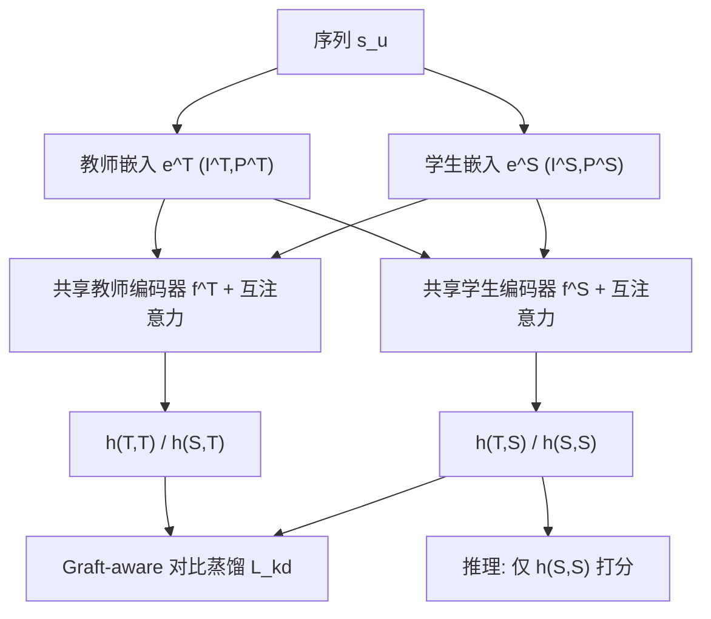
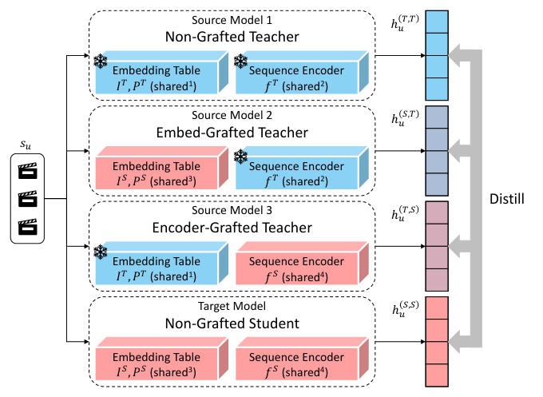

# GOD: Enhancing Generalization via Deep Grafting for Sequential Recommendation (面向序列推荐的深度嫁接泛化增强)

- **会议/期刊**: CIKM 2026 (Full Research Paper)
- **作者与机构**: WooJoo Kim, JunYoung Kim, JaeHyung Lim, HwanJo Yu (POSTECH)
- **推荐链路定位**: 精排（Next-Item 序列打分）/ 训练期蒸馏增强
- **研究方向**: 序列与会话推荐 / 自监督对比与去噪
- **论文原文**: [https://arxiv.org/abs/2608.16073v2](https://arxiv.org/abs/2608.16073v2)
- **开源代码**: 暂未开源

## TL;DR (1分钟核心速览)

序列推荐在稀疏、噪声历史上易过拟合，而现有知识蒸馏让教师与学生**各自独立前向**再对齐输出/表征，导致「嵌入不可靠」与「编码器过拟合」的误差纠缠，无法定位泛化短板。本文提出 GOD：把学生嵌入表或学生编码器**嫁接**进冻结教师，构造两个混合源模型，使学生在教师侧计算路径中被单独评估，得到组件级监督；配合 Grafted Encoding 互注意力与 Graft-aware 对比蒸馏。在 Amazon Beauty / Yelp / MovieLens 1M 上采用 Leave-One-Out + Full-Ranking 协议，跨 GRU4Rec/FMLPRec/SASRec 三种骨干全面最优，相对最强基线最高提升 13.92%（Yelp-SASRec NDCG@10）。

## Background & Motivation (背景与核心矛盾)

- **主流范式**: 序列推荐以「嵌入表 + 序列编码器」两段式结构为主（SASRec 类 Transformer 编码器占主导）；KD 通过大教师向小学生的稠密监督缓解稀疏性，监督形式涵盖排序输出 (RD/RRD/CD)、隐表征 (DE/HTD)、兴趣漂移 (MSKDIK) 与双向蒸馏 (BD)。
- **前人局限**: ①教师与学生走**两条独立推理路径**，学生整体路径被联合监督，嵌入误差与编码器误差相互纠缠，无法判断泛化弱是源于嵌入不可靠还是编码过拟合；②中间层表征蒸馏虽暴露教师内部状态，但目标仍由独立教师前向产生，学生倾向「模仿输出」而非「对齐编码过程」。
- **核心洞察 (Key Insight)**: 作者用 CKA 度量发现——DE/RRD 提升了训练集师生对齐却使测试集对齐下降、NDCG 泛化间隙扩大；而嫁接模型（Graft-Embed / Graft-Encoder）在训练/测试上均保持高 CKA 且泛化间隙显著更小。逐层 CKA 热力图进一步显示：常规 KD 所有学生层都最对齐教师**最后一层**（输出模仿），嫁接模型则呈现清晰**对角线**（层间过程对齐），且这一对齐无需显式中间层蒸馏即自发涌现。
- **本文切入点**: 用「嫁接」把可训练学生组件塞进冻结教师的条件路径，让每个学生组件在教师侧计算中被单独检验，从而提供组件级而非路径级的蒸馏反馈。

## Method (核心方法设计)

### 1. 整体框架 (Overall Architecture)

GOD 以「非嫁接学生」为目标模型，构造三个共享参数的源模型：**Non-Grafted Teacher**（原始教师，稳定知识锚点）、**Embed-Grafted Teacher**（学生嵌入表 + 教师编码器）、**Encoder-Grafted Teacher**（教师嵌入表 + 学生编码器）。四路表征经 Grafted Encoding 的师生互注意力生成后，用 Graft-aware 对比学习把三个源表征蒸馏进学生；推理时仅保留非嫁接学生，零额外开销。

<figure class="paper-figure" markdown="span">
  <figcaption>图 4：GOD 示意图。GOD 将三个源模型——未嫁接教师、嵌入嫁接教师和编码器嫁接教师——的表示蒸馏到未嫁接学生中。相同的“共享”索引表示参数共享。</figcaption>
</figure>

### 2. 关键设计拆解 (Key Designs)

1. **组件级嫁接源模型 (Grafting Sources)**：痛点是不知误差来自嵌入还是编码器 $\to$ 用共享投影 $W_{up}\in\mathbb{R}^{d_S\times d_T}$、$W_{down}\in\mathbb{R}^{d_T\times d_S}$ 对齐维度，生成四路表征
   $$h^{(T,T)}=f^T(e^T)W_{down},\ h^{(S,T)}=f^T(e^S W_{up})W_{down},\ h^{(T,S)}=f^S(e^T W_{down}),\ h^{(S,S)}=f^S(e^S)$$
   由于嫁接组件与学生共享参数，KD 正则反向精炼源模型，形成**自适应监督闭环**（类似双向 KD 但教师始终冻结）。直觉：学生嵌入在教师编码器下被检验，学生编码器在教师嵌入下被检验，误差不再纠缠。

2. **Grafted Encoding (GE) 师生互注意力**：训练早期学生组件未优化，混合源表征不稳定 $\to$ 将两侧嵌入拼接为长度 $2N$ 序列送入共享编码器，并用全 1 块掩码
   $$A_{GE}=\begin{bmatrix}A_{causal} & A_{causal}\\ A_{causal} & A_{causal}\end{bmatrix}\in\{0,1\}^{2N\times 2N}$$
   使教师侧 token 早期为学生侧提供稳定上下文，学生侧后期反向精炼教师条件表征。代价是注意力计算约翻倍（$O(4N^2d_T+4N^2d_S)$），但仅训练期存在。

3. **Graft-aware 对比学习 (GCL) 与训练目标**：点式匹配丢失序列间关系结构 $\to$ 对 4 路表征的全部 6 个配对做 InfoNCE，并按批内平均相似度自适应降权高相似（冗余）配对：
   $$w(a,b)=\frac{\exp(\mathrm{sg}(-\tfrac{1}{|B|}\sum_{s_u}h^a_u\cdot h^b_u))}{\sum_{\{a',b'\}\subset\mathcal{A}}\exp(\mathrm{sg}(-\tfrac{1}{|B|}\sum_{s_u}h^{a'}_u\cdot h^{b'}_u))},\quad \mathcal{L}=\sum_u\big(\mathcal{L}_{rec}(u)+\lambda\mathcal{L}_{kd}(u)\big)$$
   含源-源配对是因为混合源含可训练学生组件，可反向正则学生；stop-gradient 保证权重是自适应系数而非被直接优化。**负采样**：对比损失用 in-batch 负样本（批大小 256），推荐主损失用全库 softmax 免负采样；推理仅 $h^{(S,S)}$，无额外成本。

## Experimental Setup & Evaluation Protocol (实验设置与评估协议)

- **数据集与预处理**（隐式反馈，过滤交互数 < 5 的用户与物品，即 `5-core`）：

| 数据集 | #Users | #Items | #Interactions | 稀疏度 | 特征/场景说明 |
| :--- | :---: | :---: | :---: | :---: | :--- |
| Amazon Beauty | 22,363 | 12,101 | 198,502 | 99.93% | 极稀疏电商评论 |
| Yelp | 29,915 | 21,572 | 345,186 | 99.95% | 本地生活 POI 签到 |
| MovieLens 1M | 6,040 | 3,416 | 999,611 | 95.16% | 稠密电影评分，平均序列长 165.5 |

- **数据划分与防穿越**: `Leave-One-Out`——每序列最后一项测试、倒数第二项验证、其余训练。
- **排名评测协议**: 无偏 `Full-Ranking`（全库未交互物品排序，不做负采样），指标 HR@{10,20}、NDCG@{10,20}。
- **对比基线与超参**: 骨干为 GRU4Rec / FMLPRec / SASRec（GE 仅用于 SASRec）；基线含通用 KD（RD、CD、DE、RRD、HTD、BD）与序列定制 KD（AdaRec、MSKDIK、EMKD），自蒸馏场景另比 CL4SRec/MCLRec/CT4Rec/DuoRec/RCL。默认 $d_S=16$、$d_T=64$、2 层编码器、dropout 0.5、$N=50$、SASRec 2 头；$\lambda\in\{10^{-4},\dots,10^0\}$、$\tau\in\{1,5,10,20\}$；Adam lr=0.001、batch=256、patience=30，5 次独立运行 + 配对 $t$ 检验 $p<0.05$。

## Key Experimental Results (实验关键数据)

### 1. 主实验对比 (Main Results)

以最具代表性的 SASRec 骨干为例（完整表覆盖 3 数据集 × 3 骨干 × 4 指标，GOD 全部最优）：

| 数据集 | 指标 | Teacher | Student | BD | AdaRec | MSKDIK | EMKD | **GOD** | Improv.(vs S) | Improv.(vs Best) |
| :--- | :--- | :---: | :---: | :---: | :---: | :---: | :---: | :---: | :---: | :---: |
| Beauty | HR@10 | 0.0727 | 0.0605 | 0.0675 | 0.0666 | 0.0668 | 0.0683 | **0.0725\*** | 19.83% | 6.15% |
| Beauty | NDCG@20 | 0.0472 | 0.0390 | 0.0444 | 0.0437 | 0.0439 | 0.0447 | **0.0474\*** | 21.54% | 6.04% |
| Yelp | HR@10 | 0.0568 | 0.0454 | 0.0503 | 0.0497 | 0.0500 | 0.0507 | **0.0567\*** | 24.89% | 11.83% |
| Yelp | NDCG@10 | 0.0303 | 0.0241 | 0.0271 | 0.0269 | 0.0270 | 0.0273 | **0.0311\*** | 29.05% | **13.92%** |
| Yelp | NDCG@20 | 0.0390 | 0.0316 | 0.0370 | 0.0364 | 0.0367 | 0.0373 | **0.0405\*** | 28.16% | 8.58% |
| ML-1M | HR@10 | 0.2330 | 0.1640 | 0.1715 | 0.1723 | 0.1731 | 0.1739 | **0.1856\*** | 13.17% | 6.73% |
| ML-1M | NDCG@20 | 0.1417 | 0.1052 | 0.1094 | 0.1096 | 0.1097 | 0.1098 | **0.1218\*** | 15.78% | 10.93% |

**自蒸馏（$d_S=d_T=64$，SASRec）**：GOD 亦全面最优，Beauty NDCG@10 0.0559（vs 最强 RCL 0.0517，+8.12%）、Yelp NDCG@20 0.0427（+5.69%）、ML-1M NDCG@20 0.1561（+4.07%），显著优于 CL4SRec/DuoRec 等自监督对比方法。

### 2. 消融实验 (Ablation Study)

| 消融维度 | 变体 | Beauty | Yelp | ML-1M |
| :--- | :--- | :---: | :---: | :---: |
| 源模型 (NDCG@20) | 完整 GOD (T,T)+(S,T)+(T,S) | **0.0474** | **0.0405** | **0.1218** |
| | 去 (T,S) | 0.0451 | 0.0375 | 0.1141 |
| | 去 (S,T) | 0.0448 | 0.0376 | 0.1135 |
| | 仅 (T,T) | 0.0410 | 0.0342 | 0.1084 |
| | 仅 (S,T) | 0.0421 | 0.0349 | 0.1111 |
| Grafted Encoding | 完整 GE | **0.0474** | **0.0405** | **0.1218** |
| | T→S only | 0.0466 | 0.0394 | 0.1184 |
| | S→T only | 0.0459 | 0.0386 | 0.1166 |
| | GE (half length) | 0.0462 | 0.0396 | 0.1152 |
| | w/o GE | 0.0452 | 0.0379 | 0.1126 |
| GCL | 完整 GCL | **0.0474** | **0.0405** | **0.1218** |
| | Source-Target only | 0.0460 | 0.0386 | 0.1111 |
| | Unweighted | 0.0455 | 0.0379 | 0.1090 |
| | Learnable weight | 0.0427 | 0.0359 | 0.1074 |

### 3. 关键实验发现 (Key Findings)

1. **稀疏度决定增益幅度**：Beauty/Yelp（稀疏度 99.9%+）上 GOD 相对学生提升 19.8%–29.1%，而稠密 ML-1M 仅 13.2%–19.9%；按序列长度分桶后，短序列组增益最大、长序列组收窄，直接印证「嫁接在证据稀缺时最有效」的动机。
2. **两个嫁接源互补且不可替代**：去掉任一嫁接源（0.0474→0.0451/0.0448）均下降，但仅保留非嫁接教师 (T,T) 时跌幅最大（0.0474→0.0410，−13.5%），说明稳定锚点与组件级视图缺一不可；GCL 中「可学习配对权重」反而最差（0.0427），证明相似度驱动的自适应预算分配比自由学习更可靠。
3. **效率与鲁棒性双赢**：GOD 每 epoch 10.06s / 0.9GB，低于 BD（12.98s / 1.0GB）与 EMKD（15.57s / 1.1GB），且因监督更直接，达到最佳验证点仅需 15.26 分钟（学生自身需 24.03 分钟）；在 25%–100% 教师质量、$d_S\in\{8,16,32\}$、$d_T\in\{64,128\}$ 及最高噪声注入比例下均保持最优，学生越小增益越大。

## Highlights, Limitations & Rating (亮点、对比与审稿评价)

- **与代表作对比 (vs. Prior Work)**: 与 DE/RRD/HTD 等「独立路径 + 表征/输出对齐」不同，GOD 让学生在教师条件路径内被评估，把监督粒度从路径级细化到组件级；与 BD 的双向蒸馏相比，GOD 教师始终冻结却取得更优结果，且无需显式更新教师；与 NetGraft/GrafT 等视觉/少样本嫁接不同，GOD 首次将嫁接用于序列推荐的嵌入表与编码器替换。
- **可迁移亮点**: ①「冻结大模型 + 嫁接小模型组件」的组件级诊断范式可迁移到双塔召回、跨域迁移中的模块归因；②用 CKA 对角线模式作为「过程对齐 vs 输出模仿」的量化诊断工具，成本低、解释性强。
- **审稿级局限批判**: ①GE 使训练期注意力计算约翻倍，且需教师/学生共享同构编码器，异构师生架构（作者自述未来工作）暂不支持；②仅在 3 个 ID-based 公开数据集离线验证，无线上 A/B；稠密数据上 $\lambda$ 过大易过正则（ML-1M 出现退化），超参仍需按数据集调。
- **四维评分**: 创新性 ⭐⭐⭐⭐ | 实验扎实度 ⭐⭐⭐⭐ | 方法清晰度 ⭐⭐⭐⭐⭐ | 落地价值 ⭐⭐⭐⭐

