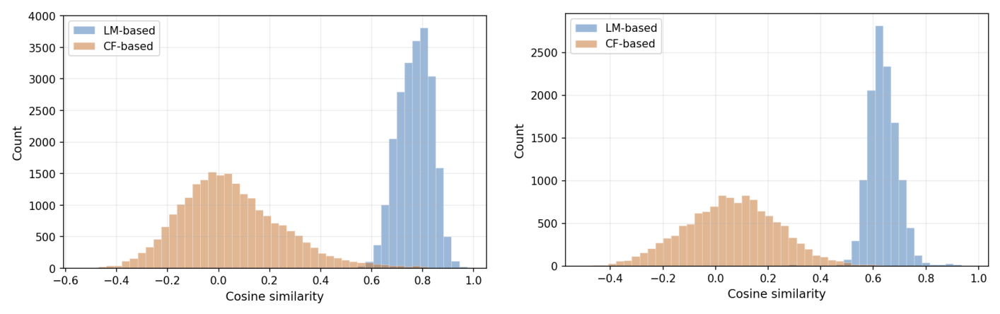
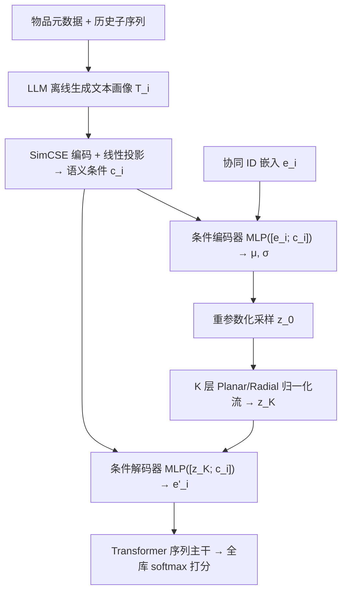
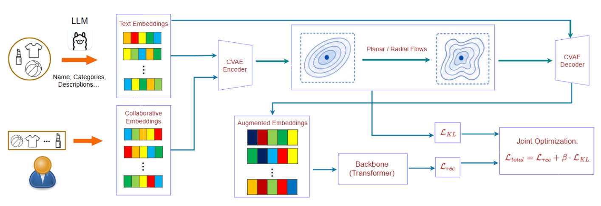

# LSF-SR: Latent Semantic Fusion for Sequential Recommendation via Flow-based Conditional Variational Autoencoders (基于流式条件变分自编码器的序列推荐隐语义融合)

- **会议/期刊**: CIKM 2026
- **作者与机构**: Shih-Hong Chen, Vincent S. Tseng (阳明交通大学)；Josh Jia-Ching Ying (中兴大学)
- **推荐链路定位**: 召回（序列 Next-Item 预测）
- **研究方向**: 序列与会话推荐 / 大语言模型推荐
- **论文原文**: [https://arxiv.org/abs/2609.29815v1](https://arxiv.org/abs/2609.29815v1)
- **开源代码**: 暂未开源

## TL;DR (1分钟核心速览)

现有 LLM 增强序列推荐把文本语义与协同 ID 嵌入做确定性拼接或晚期融合，但两者分布严重错位（LLM 嵌入高度聚集、协同嵌入近似零均值高斯），导致语义信号无法真正对齐。LSF-SR 将融合重构为**概率推断**：以 LLM 语义为条件，用 CVAE 把协同嵌入映射到共享隐空间，并叠加 Planar/Radial 归一化流把对角高斯后验重塑为非高斯流形，配合循环 KL 退火防后验坍缩。在 5 个 Amazon/Yelp 数据集、Leave-One-Out + Full-Ranking 协议下，Recall@20 最高提升 12.98%、NDCG@20 最高提升 14.13%。

## Background & Motivation (背景与核心矛盾)

- **主流范式**: 以 SASRec 为代表的自注意力序列主干仅依赖离散 ID 嵌入，语义完全来自共现统计；LLM 增强路线则离线生成物品文本画像并抽取语义向量，再以拼接/门控/互信息最大化等方式并入协同模型（RLMRec、LRD、LLM-ESR、SRA-CL）。
- **前人局限**: ① **分布错位**——LLM 语义嵌入因自然语言共享词表而高度聚集（高余弦相似度），协同嵌入近似零均值高斯，二者 top-K 邻居结构几乎不重合，确定性投影与晚期融合无法弥合（图 1 实证）；② **推理开销**——用户级 LLM profiling 需在每次推理时动态更新，成本随活跃用户数与请求频率线性增长，难以满足实时性。
- **核心洞察 (Key Insight)**: 两种异构表征的对齐本质上是**带不确定性的随机映射**，而非确定函数；且物品级语义可完全离线预计算，实时开销为零。
- **本文切入点**: 把融合建模为以语义为条件的变分推断问题，并用归一化流赋予后验非高斯表达能力。

<figure class="paper-figure" markdown="span">
  <figcaption>图1：在Amazon Beauty数据集上，协同语义嵌入与LLM语义嵌入之间分布不匹配的实证分析。我们随机选取一个用户（左）和一个物品（右），分别计算其与所有其余用户和物品的余弦相似度分布，揭示其表示存在严重错位。</figcaption>
</figure>

## Method (核心方法设计)

### 1. 整体框架 (Overall Architecture)

离线阶段用 LLaMA 3.1-8B-Instruct 依据「属性 + 历史交互子序列」的结构化 Prompt 为每个物品合成描述性文本 $T_i$，再由冻结的 SimCSE (RoBERTa-large, $d_s{=}1024$) 编码并经线性投影得到语义条件 $\hat{\mathbf{c}}_i \in \mathbb{R}^d$。在线阶段，物品 ID 嵌入 $\mathbf{e}_i$ 与 $\hat{\mathbf{c}}_i$ 拼接送入条件编码器得到后验参数，重参数化采样后经 $K$ 层归一化流变换为 $\mathbf{z}_K$，条件解码器输出增强嵌入 $\mathbf{e}'_i$；该嵌入加位置编码后进入 Transformer 序列主干，与融合模块在统一目标下端到端联合优化。

<figure class="paper-figure" markdown="span">
  <figcaption>图2：所提出的LSF-SR框架概览。该架构利用LLM离线合成描述性物品文本，并从文本中提取语义信号。基于这些信号，融合归一化流以重塑潜在后验的条件语义融合模块与基于Transformer的序列主干在统一目标下进行端到端联合优化。</figcaption>
</figure>

### 2. 关键设计拆解 (Key Designs)

1. **条件语义融合的概率化重构（Probabilistic Fusion）**：痛点是用确定性算子强行对齐两个异构空间会丢失不确定性。本文将语义条件同时注入编码器与解码器，学习近似后验 $q_\phi(\mathbf{z}\mid \mathbf{e}_i,\hat{\mathbf{c}}_i)$，解码器**不重建** $\mathbf{e}_i$ 而是直接生成面向下一项预测的 $\mathbf{e}'_i$：
$$\mathbf{e}'_i=\mathrm{MLP}_{dec}([\mathbf{z}_K;\hat{\mathbf{c}}_i])$$
直觉：语义条件在编码/解码两端双重锚定，使协同嵌入被"拉"到语义流形上，相似语义物品在隐空间中自然聚类。

2. **归一化流增强后验（Flow-Augmented Posterior）**：对角高斯后验无法刻画协同-语义联合分布的非高斯几何。对基分布采样 $\mathbf{z}_0$ 施加 $K$ 个可逆变换，按变量替换公式得
$$\ln q_K(\mathbf{z}_K)=\ln q_0(\mathbf{z}_0)-\sum_{k=1}^{K}\ln\left|\det\frac{\partial f_k}{\partial \mathbf{z}_{k-1}}\right|$$
其中 Planar flow $f(\mathbf{z})=\mathbf{z}+\mathbf{u}\tanh(\mathbf{w}^\top\mathbf{z}+b)$ 沿超平面方向扭曲以刻画簇间非线性边界，Radial flow 以参考点 $\mathbf{z}_{ref}$ 为中心做局部径向伸缩以建模语义簇。直觉：可逆变换在保持概率归一化的前提下"掰弯"高斯，使后验贴合真实流形。

3. **训练目标、KL 退火与推理效率**：总损失
$$\mathcal{L}_{total}=\mathcal{L}_{rec}+\beta\cdot\mathcal{L}_{KL},\quad \mathcal{L}_{KL}=\mathbb{E}_{q_0}\Big[\ln q_0(\mathbf{z}_0)-\sum_k \ln|\det J_k|-\ln p(\mathbf{z}_K)\Big]$$
$\mathcal{L}_{rec}$ 为全库 softmax 的负对数似然；训练时 KL 走随机采样路径，而全库 logits 走确定性路径（$\mathbf{z}_K=\mathrm{flow}(\boldsymbol{\mu}_i)$，不采样）以稳定打分。$\beta$ 采用**循环退火**（锯齿波，30 epoch 一周期，从 0.01 升至 $\beta_{end}$），周期性放松/收紧 KL 约束以逃离局部最优并防止后验坍缩。负采样策略为**免负采样**（全库 softmax）；LLM 调用完全离线，在线仅多一次 MLP + $K$ 层流变换，开销可忽略。

## Experimental Setup & Evaluation Protocol (实验设置与评估协议)

- **数据集与预处理**: 四个 Amazon 类目 + Yelp（Yelp 截断至 2019 年），统一 `5-core` 过滤：

| 数据集 | #Users | #Items | #Interactions | 稀疏度 | 场景说明 |
| :--- | :---: | :---: | :---: | :---: | :--- |
| Beauty | 22,363 | 12,101 | 198,502 | 99.93% | 美妆电商，元数据丰富 |
| Office | 4,905 | 2,420 | 53,258 | 99.55% | 办公用品，用户最少 |
| Sports | 35,598 | 18,357 | 296,337 | 99.95% | 运动户外，规模最大 |
| Toys | 19,412 | 11,924 | 167,597 | 99.93% | 玩具，长尾显著 |
| Yelp | 19,936 | 14,587 | 207,952 | 99.93% | 本地生活，元数据贫乏 |

- **数据划分与防穿越**: `Leave-One-Out`——最后一项为测试、倒数第二项为验证、其余为训练。
- **排名评测协议**: 无偏 `Full-Ranking`（对全物品库排序），指标 Recall@{10,20}、NDCG@{10,20}；5 个随机种子取均值，双尾配对 $t$ 检验 $p<0.05$。
- **对比基线与超参**: 行为侧 10 个基线（SASRec、ICLRec、DuoRec、MCLRec、ICSRec、FENRec、FMLP-Rec、FEARec、BSARec、DIFF）+ LLM 侧 3 个（LRD、LLM-ESR、SRA-CL）。嵌入维度 $d{=}64$，2 层 2 头注意力，dropout 0.3，序列长度 20，学习率 1e-3（Yelp 1e-4），隐空间 $d_z{=}32$；流深 $K{=}2$（Beauty/Sports）、$K{=}3$（Toys/Yelp 用 Planar，Office 用 Radial）；$\beta_{end}\in[0.1,0.2]$。所有 LLM 基线统一使用 LLaMA 3.1-8B-Instruct + SimCSE 文本管线以保证公平。

## Key Experimental Results (实验关键数据)

### 1. 主实验对比 (Main Results)

下表摘取各数据集 Recall@20 / NDCG@20（完整 4 指标见原文表 2），加粗为最优：

| 数据集 | 指标 | SASRec | FENRec | DIFF | LRD | LLM-ESR | SRA-CL | **LSF-SR** | Improv. |
| :--- | :--- | :---: | :---: | :---: | :---: | :---: | :---: | :---: | :---: |
| Beauty | R@20 | 0.1140 | 0.1286 | 0.1209 | 0.1149 | 0.1019 | 0.1323 | **0.1406** | +6.26% |
| Beauty | N@20 | 0.0490 | 0.0564 | 0.0572 | 0.0462 | 0.0394 | 0.0568 | **0.0629** | +10.00% |
| Office | R@20 | 0.1487 | 0.1689 | 0.1767 | 0.1751 | 0.1439 | 0.1689 | **0.1925** | +8.97% |
| Office | N@20 | 0.0615 | 0.0724 | 0.0745 | 0.0654 | 0.0561 | 0.0719 | **0.0830** | +11.30% |
| Sports | R@20 | 0.0692 | 0.0812 | 0.0762 | 0.0648 | 0.0575 | 0.0801 | **0.0917** | +12.98% |
| Sports | N@20 | 0.0291 | 0.0351 | 0.0335 | 0.0245 | 0.0225 | 0.0341 | **0.0401** | +14.13% |
| Toys | R@20 | 0.1148 | 0.1380 | 0.1300 | 0.1233 | 0.1078 | 0.1356 | **0.1545** | +11.95% |
| Toys | N@20 | 0.0492 | 0.0604 | 0.0581 | 0.0470 | 0.0428 | 0.0588 | **0.0686** | +12.32% |
| Yelp | R@20 | 0.1099 | 0.1283 | 0.1250 | 0.1119 | 0.0936 | 0.1247 | **0.1363** | +6.24% |
| Yelp | N@20 | 0.0477 | 0.0537 | 0.0525 | 0.0432 | 0.0393 | 0.0522 | **0.0566** | +5.40% |

### 2. 消融实验 (Ablation Study)

| 数据集 | 指标 | w/o LLM | w/o Flows | w/o KL loss | Fixed β | Linear | Sigmoid | **Cyclical (默认)** |
| :--- | :--- | :---: | :---: | :---: | :---: | :---: | :---: | :---: |
| Beauty | R@20 | 0.1362 | 0.1384 | 0.1234 | 0.1315 | 0.1387 | 0.1373 | **0.1406** |
| Beauty | N@20 | 0.0606 | 0.0622 | 0.0563 | 0.0597 | 0.0619 | 0.0615 | **0.0629** |
| Office | R@20 | 0.1806 | 0.1896 | 0.1750 | 0.1854 | 0.1855 | 0.1857 | **0.1925** |
| Sports | R@20 | 0.0877 | 0.0911 | 0.0813 | 0.0880 | 0.0887 | 0.0892 | **0.0917** |
| Toys | R@20 | 0.1450 | 0.1514 | 0.1288 | 0.1474 | 0.1549 | 0.1546 | 0.1545 |
| Yelp | R@20 | 0.1349 | 0.1359 | 0.1239 | 0.1303 | 0.1356 | 0.1342 | **0.1363** |

### 3. 关键实验发现 (Key Findings)

1. **KL 正则是最关键组件，而非流本身**：去掉 KL（$\beta{=}0$）造成最大跌幅——Beauty R@20 从 0.1406 掉至 0.1234（−12.2%）、Toys 从 0.1545 掉至 0.1288（−16.6%），说明无约束后验会过拟合特异融合模式；而 w/o Flows 跌幅温和（Beauty −1.6%），且在 Sports/Yelp 上几乎无损，印证稀疏域协同几何本身接近高斯、流带来的额外几何自由度收益有限。
2. **LLM 语义合成的价值依赖元数据丰富度**：w/o LLM（直接用原始元数据文本嵌入）在 Beauty/Toys 上分别掉 3.1%/6.1% R@20，但在 Yelp 上仅掉 1.0%——Yelp 原始元数据缺乏长描述文本，LLM 合成增益天然受限，说明本方法优势与输入上下文丰富度强绑定。
3. **循环退火优于固定与单调退火**：Cyclical 在 5 个数据集 NDCG@20 上全部最优或并列最优，Beauty N@20 较 Fixed 提升 5.4%（0.0629 vs 0.0597）；周期性放松 KL 使优化多次跳出局部极小，是稳定收敛的关键。
4. **冷启动与长尾优势显著**：短序列（长度 ≤5）用户组上 LSF-SR 全面领先；尾部物品（频次 ≤9）上 NDCG@20 较最强 LLM 基线 SRA-CL 分别提升 **22.88%（Beauty）与 18.50%（Yelp）**，证明语义条件使尾部物品按语义相关性而非流行度定位。

## Highlights, Limitations & Rating (亮点、对比与审稿评价)

- **与代表作对比 (vs. Prior Work)**: 与 **LLM-ESR**（冻结语义嵌入 + 双视图自蒸馏）和 **SRA-CL**（语义检索构造对比正样本）的本质区别在于：二者仍在确定性/对比框架内做"对齐"，而 LSF-SR 把对齐建模为带不确定性的变分推断，并用可逆流显式重塑后验几何；与 **LRD**（DVAE 发现离散隐关系）相比，本文保留连续隐空间并引入条件解码，直接产出面向预测的增强嵌入而非重建。
- **可迁移亮点**: ① "LLM 离线物品级 profiling + 在线零额外开销"的工程范式，可直接套用到任何需要语义增强的召回/粗排模型；② 循环 KL 退火 + 确定性/随机双路径打分（训练采样、推理取均值）的组合，是 CVAE 类推荐模型防坍缩的通用配方。
- **审稿级局限批判**: ① 流深 $K$ 与 $\beta_{end}$ 需逐数据集网格搜索（$K\in\{2,3\}$、$\beta_{end}\in[0.1,0.2]$），且消融显示稀疏域收益有限，自适应流架构尚未解决；② 全库 softmax 训练在 18K 物品规模可行，但未讨论十万级以上物品库的采样近似与延迟；③ 仅报告离线 Full-Ranking，缺少线上 A/B 与推理时延实测。
- **四维评分**: 创新性 ⭐⭐⭐⭐ | 实验扎实度 ⭐⭐⭐⭐ | 方法清晰度 ⭐⭐⭐⭐ | 落地价值 ⭐⭐⭐⭐

