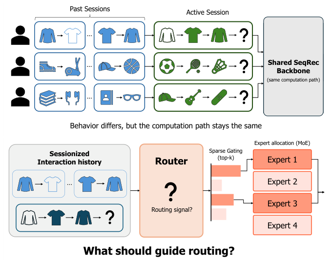
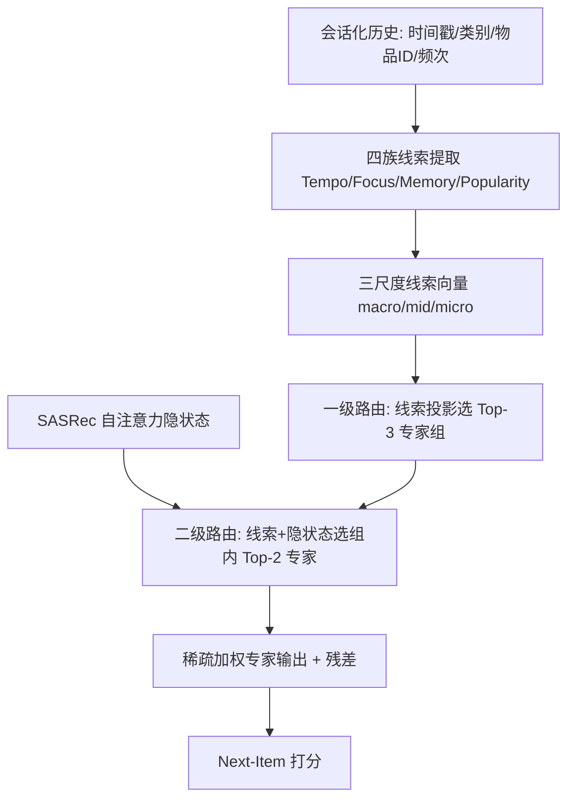
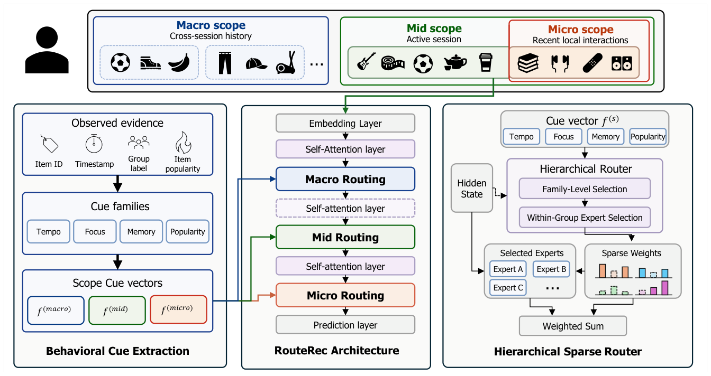

# RouteRec: Behavior-Guided Sparse Routing for Sequential Recommendation (行为引导的稀疏路由序列推荐)

- **会议/期刊**: CIKM 2026
- **作者与机构**: Junyeong Song (KAIST), Jaemin Yoo (Seoul National University)
- **推荐链路定位**: 精排（Next-Item 预测）
- **研究方向**: 序列与会话推荐 / 特征交叉与条件计算
- **论文原文**: [https://arxiv.org/abs/2609.39007v1](https://arxiv.org/abs/2609.39007v1)
- **开源代码**: [https://github.com/jy1559/RouteRec](https://github.com/jy1559/RouteRec)

## TL;DR (1分钟核心速览)

现有序列推荐对所有会话套用同一套参数块，无视会话间行为模式差异；MoE 虽能条件计算，但"用什么信号路由"在会话感知推荐中无标签可依。RouteRec 从会话化历史中抽取 Tempo/Focus/Memory/Popularity 四族行为线索，在 macro/mid/micro 三个时间尺度上做"线索选专家组 + 隐状态选组内专家"的分层稀疏路由。在 6 个公开数据集、18 个 dataset-metric 单元上，RouteRec 12 次第一、3 次第二，平均排名 1.61（次优 FDSA 为 4.11），LastFM 上 NDCG@10 相对 SASRec 提升 6.0%。

## Background & Motivation (背景与核心矛盾)

- **主流范式**: 会话感知推荐以 SASRec 类自注意力主干为核心，辅以对比学习（DuoRec）、频域增强（FEARec/BSARec）或属性融合（FDSA/DIF-SR）来丰富序列表征。
- **前人局限**: ① 所有会话共享同一前馈参数块，快速切换型会话与重复消费型会话被迫走同一条计算路径（图 1 上）；② 已有 MoE 推荐（FAME、M3SRec、FamouSRec）的路由信号要么依赖任务/模态标签，要么依赖频域分量，会话感知场景下**没有预定义标签**可作路由依据。
- **核心洞察 (Key Insight)**: 会话行为本身在预测前即可观测，且在同一用户不同会话间、不同数据集间均呈现显著异质性（图 2：交互节奏与跨会话类别切换率分布高度分散），天然适合作为路由准则。
- **本文切入点**: 把"观测到的会话行为"显式编码为线索向量，作为专家分配的第一级信号，隐状态仅用于组内精调。

<figure class="paper-figure" markdown="span">
  <figcaption>图1：在标准序列推荐中，具有不同行为模式的会话共享同一条计算路径（上），这促使我们通过MoE路由进行行为引导的专家分配（下）。</figcaption>
</figure>

## Method (核心方法设计)

### 1. 整体框架 (Overall Architecture)

以 SASRec 为骨干，保留自注意力层，将 macro/mid/micro 三个尺度上的前馈层替换为路由专家块。输入侧，交互历史按三个观测窗口聚合为线索向量 $\mathbf{f}^{(s)}_{i,t}=\mathcal{A}(\mathcal{R}^{(s)}_{i,t})$：macro 取最近$H=5$个历史会话，mid 取当前会话已观测前缀，micro 取最近$w=5$个交互。路由侧采用两级层次结构：线索投影先选出$k_G=3$个专家组，组内再由"线索 + 当前隐状态"联合选出$k_E=2$ 个专家，最终以稀疏权重加权求和并残差归一化。三个尺度与自注意力块由粗到细交错排列，使细尺度路由在粗尺度表征基础上精调。

<figure class="paper-figure" markdown="span">
  <figcaption>图3：RouteRec概览。左：交互历史在宏观、中观和微观范围上转化为行为线索向量。中：SASRec主干在这些范围上应用路由专家块。右：族特定线索选择专家组；相应线索和当前隐藏状态在所选组内选择专家。隐藏状态仅在此组内阶段使用。</figcaption>
</figure>

### 2. 关键设计拆解 (Key Designs)

1. **四族行为线索库（Cue Bank）**：痛点在于会话行为缺乏结构化表征。本文从原始日志构造 16 个标量/尺度（每族 4 个摘要），Tempo 刻画间隔均值/方差与节奏趋势，Focus 刻画主题熵与类别切换率，Memory 刻画会话内重复率与跨会话延续性，Popularity 刻画训练集频次水平与漂移。所有线索仅用预测目标之前的信息与训练集统计量，缺失元数据时零填充。直觉：这四族恰好对应时间动态、会话意图、重复消费、流行度偏置四条既有研究脉络，是把"隐性行为机制"变成"显式路由特征"。

2. **分层稀疏路由（Hierarchical Sparse Router）**：痛点在于纯隐状态路由缺乏可解释的行为依据、纯线索路由又丢失位置级细节。设 $\mathbf{q}^{(s,g)}_{i,t}$为族$g$的投影线索，$\mathbf{u}^{(s,g)}_{i,t}=[\tilde{\mathbf{h}}^{(\ell)}_{i,t};\mathbf{q}^{(s,g)}_{i,t}]$，则

$$\mathbf{p}^{(s)}_{i,t}=\mathrm{TopKSoftmax}_{k_G}\big(\{\phi^{(s)}_g(\mathbf{q}^{(s,g)}_{i,t})\}_g\big),\quad \mathbf{r}^{(s)}_{i,t,g}=\mathrm{TopKSoftmax}_{k_E}\big(\psi^{(s)}_g(\mathbf{u}^{(s,g)}_{i,t})\big)$$

联合权重 $\pi^{(s)}_{i,t,g,k}=p^{(s)}_{i,t,g}\,r^{(s)}_{i,t,g,k}$。关键点：组选择只由线索决定（保证行为语义主导），组内选择引入隐状态（保证位置级适配），两级都做 top-k 掩码并重归一化。这样"行为族 → 专家组"的对应关系被硬性绑定，路由剖面因此可解释（图 4 对角线偏移 3.8–5.5 个百分点）。

3. **训练目标与正则**：总损失 $\mathcal{L}=\mathcal{L}_{\mathrm{CE}}+\lambda_{\mathrm{cons}}\mathcal{L}_{\mathrm{cons}}+\lambda_z\mathcal{L}_{z}$。$\mathcal{L}_{\mathrm{cons}}$在 batch 内取余弦最相似的$k_B=\min(4,B-1)$个邻居，对三个尺度的平均路由分布施加 Jensen–Shannon 散度惩罚，使行为相近会话路由平滑；$\mathcal{L}_{z}$ 对联合 pre-softmax logits 施加 z-loss 平方惩罚，防止 top-k 稀疏下权重过度集中。**刻意不用 load balancing**——均匀使用与行为依赖分配相冲突（消融证实加平衡反而掉点）。负采样：全库 softmax 交叉熵（无负采样），推理为全库排序。

## Experimental Setup & Evaluation Protocol (实验设置与评估协议)

- **数据集与预处理**: 会话短于 5 次交互、物品出现少于 3 次者剔除；KuaiRec/LastFM 用 30 分钟不活跃阈值切会话，其余沿用源会话 ID。

| 数据集 | #Users/会话 | #Items | #Interactions | 平均长度 | 场景说明 |
| :--- | :---: | :---: | :---: | :---: | :--- |
| KuaiRec | 183.3K 会话 | 6.5K | 3.44M | 18.8 | 短视频 |
| LastFM | 658.6K 会话 | 426.2K | 14.23M | 21.6 | 音乐长收听 |
| Retail Rocket | 41.8K 会话 | 26.6K | 0.37M | 8.7 | 电商浏览 |
| ML-1M | 14.2K 会话 | 3.1K | 0.57M | 40.4 | 电影评分 |
| Foursquare | 4.6K 会话 | 3.6K | 0.05M | 9.9 | POI 签到 |
| Beauty | 2.5K 会话 | 1.9K | 0.02M | 7.5 | 电商评论 |

- **数据划分与防穿越**: 会话按时间 **70/15/15** 比例切分，超 50 交互的会话在各自分区内分块、块不跨分区；训练词表拟合后剔除验证/测试中训练未见目标，保证所有方法共享同一闭集候选目录。
- **排名评测协议**: **Full-Ranking 全库排序**（闭集候选），报告 HR@10 / NDCG@10 / MRR@10，种子 42–44 取均值±样本标准差；超参与 checkpoint 按验证集三指标均值选择，测试集仅评估一次。
- **对比基线与超参**: 9 个基线分三组——常规（GRU4Rec、SASRec、TiSASRec）、表征增强（DuoRec、FEARec、BSARec）、侧信息/MoE（FDSA、DIF-SR、FAME）。路由布局跨数据集固定，$G=4$组、$K\in\{3,4,5,6\}$ 按数据集调，每尺度 16 维线索。

## Key Experimental Results (实验关键数据)

### 1. 主实验对比 (Main Results)

| 数据集 | 指标 | SASRec | DuoRec | FEARec | FDSA | FAME | **RouteRec** | Improv. |
| :--- | :--- | :---: | :---: | :---: | :---: | :---: | :---: | :---: |
| KuaiRec | NDCG@10 | .4319 | .4555 | .3101 | .4377 | .4617 | **.4656** | +0.8% vs FAME |
| LastFM | NDCG@10 | .2703 | .2577 | .2260 | .2639 | .1846 | **.2866** | +6.0% vs SASRec |
| LastFM | HR@10 | .3439 | .3447 | .2978 | .3321 | .2465 | **.3569** | +3.5% vs DuoRec |
| Retail Rocket | NDCG@10 | .3730 | .3597 | .3776 | .3622 | .3521 | **.3805** | +0.8% vs FEARec |
| ML-1M | NDCG@10 | .0781 | .0756 | .0682 | .0840 | .0818 | **.0846** | +0.7% vs FDSA |
| Foursquare | HR@10 | .6207 | .6456 | .6054 | .6514 | .4914 | **.6533** | +0.3% vs FDSA |
| Beauty | NDCG@10 | .1113 | .1248 | .1395 | .1163 | .1057 | .1325 | 次优（FEARec 最优） |
| **Avg. Rank↓** | 18 单元 | 4.78 | 5.22 | 5.78 | 4.11 | 6.89 | **1.61** | — |

### 2. 消融实验 (Ablation Study)

| 变体 | KuaiRec MRR@10 | LastFM MRR@10 | 说明 |
| :--- | :---: | :---: | :--- |
| Full RouteRec | **.460** | **.265** | 完整模型 |
| w/o micro scope | .434 | .253 | 单尺度移除，KuaiRec 掉点最大 |
| w/o macro scope | .451 | .254 | 跨会话线索贡献次之 |
| w/o mid scope | .458 | .256 | 活跃会话前缀贡献最小 |
| Dense FFN 基线 | .398 | .247 | 仅加宽共享前馈，远逊路由 |
| 1 scope / 2 scopes | 递减 | 递减 | 尺度数单调有益 |
| Flat sparse / H-dense | 均低于 H-sparse | 同 | 层次结构本身有贡献 |
| w/o 两个正则 | .435 | .257 | 掉点最大 |
| 加 load balancing | .445 | .260 | 均匀使用与行为分配冲突 |
| Train shuffle 线索 | .360 | .245 | 线索–会话错位重创 KuaiRec |
| Train zero 线索 | .413 | .253 | 退化为近 SASRec 水平 |

### 3. 关键实验发现 (Key Findings)

1. **增益来自路由质量而非容量**：参数匹配（0.4% 内）的 SASRec-wide 仅从 .464 微升至 .472 MRR@10，而 Hidden MoE 与 RouteRec 分别达 .472/.480 量级；在 DuoRec 上 Hidden MoE 甚至不涨点，而行为路由两指标双升，说明"用什么路由"比"有没有专家"更关键。
2. **线索语义被真实使用且错位比缺失更致命**：推理期 role swap 使 KuaiRec MRR@10 相对下降约 35%，高于 zero cues 的 28%——结构合理但行为错配的线索比无线索更糟；训练期 Train shuffle 掉至 .360，证明线索–会话对齐是训练必需条件。
3. **时间分辨率需求随数据分布变化**：KuaiRec 移除 micro 尺度掉点最大（.460→.434），LastFM 则 no-mid 与 no-micro 几乎持平（.256 vs .253），说明短视频场景依赖即时局部状态、长收听历史更依赖跨会话节奏；同时 LastFM 去掉 Tempo 线索掉点最明显，而 KuaiRec 仅用序列线索仍接近全模型，体现线索可用性的数据集依赖。

## Highlights & Limitations (亮点、对比与审稿批判)

- **与代表作对比 (vs. Prior Work)**: 相比 FAME（注意力头内专家、隐状态路由）与 FamouSRec（频域分量路由异构编码器），RouteRec 首次把**多尺度会话行为线索**作为一级路由信号并与隐状态二级精调解耦；相比 FDSA/DIF-SR 的属性融合，它不把侧信息灌入表征，而是用于**选择计算路径**，因而在 18 个单元的平均排名上以 1.61 对 4.11 大幅领先。
- **可迁移亮点**: ① "线索选组 + 隐状态选组内"的两级解耦路由可直接移植到多场景/多任务 MoE 精排；② 用 JSD 邻居一致性正则稳定"特征→路由"映射，可复用于任何条件计算模块；③ 推理期线索扰动（role swap / shuffle）是一套低成本的路由归因诊断协议。
- **审稿级局限批判**: ① **稀疏未落地为效率**——专家为稠密执行，相比 SASRec-wide 全排序延迟达 4.30–6.06 倍、训练吞吐仅剩 55–61%，论文自承"贡献在路由质量而非稀疏加速"；② 线索依赖时间戳与类别/艺人等元数据，缺失时零填充，Beauty/Foursquare 等短稀疏集上波动大且未全面领先（Foursquare NDCG@10 仅第四），跨数据集泛化证据偏描述性、未做因果隔离。

## Rating (四维评分)

- **方法创新性 (Novelty)**: ⭐⭐⭐⭐ （核心机制与方法设计具备明确创新性，理论与实验动机支撑充分）
- **评估协议与实验扎实度 (Protocol & Experiments)**: ⭐⭐⭐⭐⭐ （主流公开数据集评测完整，包含多基线对比与消融实验验证）
- **写作与数学规范度 (Clarity & Rigor)**: ⭐⭐⭐⭐ （问题形式化定义清晰，核心模块数学推导与架构阐述严谨易读）
- **工业落地与复现价值 (Industrial & Practical Value)**: ⭐⭐⭐ （兼顾推荐效果增益与训练/推理效率，具备实际场景迁移参考价值）
