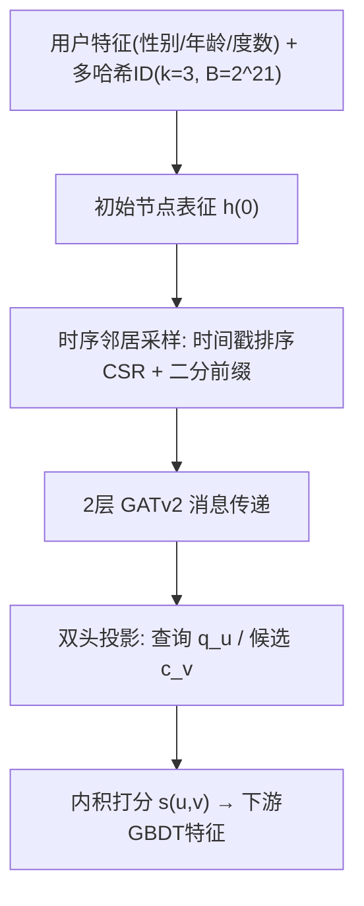
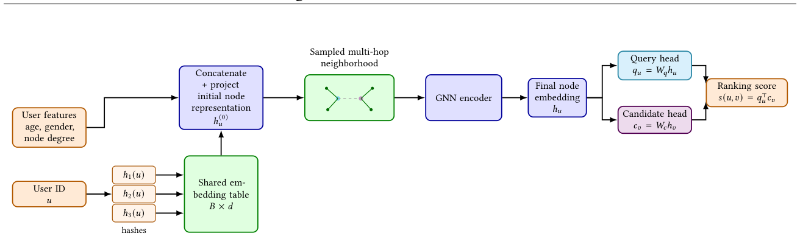

# Scaling Graph Neural Networks for Friend Recommendation: Multi-Hash User Embeddings and Temporal Neighbor Sampling (面向好友推荐的图神经网络规模化：多哈希用户嵌入与时序邻居采样)

- **会议/期刊**: CIKM 2026
- **作者与机构**: Maksim Utushkin, Andrei Ovsiannikov, Alexander D'yakonov (AI VK, Moscow)
- **推荐链路定位**: 精排（PYMK 两阶段漏斗中的排序阶段，输出 GNN 分数作为下游 GBDT 特征）
- **研究方向**: 社交与群组推荐 / 图神经网络推荐
- **论文原文**: [https://arxiv.org/abs/2608.27413v1](https://arxiv.org/abs/2608.27413v1)
- **开源代码**: [https://github.com/makut/VK-GNN](https://github.com/makut/VK-GNN)

## TL;DR (1分钟核心速览)

工业级好友推荐（PYMK）的 GNN 精排面临三重约束：194M 用户 / 28B 边的存储规模、用户画像特征极弱导致必须依赖可训练 ID、以及动态图上的时序防泄漏。本文提出两个"承重"设计：(1) 以多哈希嵌入作为 GNN 的**主输入层**，把 ID 表从 >200GB 压到 2GB（<1%）且质量不降；(2) 时间戳排序 CSR + 二分查找的时序邻居采样，把单次采样从 $O(d_u+K)$降到$O(\log d_u+K)$，训练开销从 1473ms/batch 降至 595ms。离线 per-user ROC-AUC 0.6278（vs. 生产基线 WalkGNN 0.5572），线上 A/B 好友添加 +16.0%、独立添加用户 +11.5%。

## Background & Motivation (背景与核心矛盾)

- **主流范式**: 好友推荐采用"候选生成 + 排序"两阶段漏斗；排序侧从结构启发式（共同邻居、Adamic–Adar）演进到 GNN 消息传递（GraFRank、SSNet、LiGNN），把多跳社交上下文聚合为节点表征。
- **前人局限**: ① 工业 GNN 系统要么**放弃可训练 ID**（仅用内容特征，但本文场景画像信号极弱），要么接受 $|V|\times d$全表——200M×256 float32 即 ≈205GB，服务栈无法承受；② 时序采样在原理上成熟，但 DGL/PyG 等主流库的实现是**全邻接表扫描**，对$deg\sim 10^4$ 的 hub 用户是训练瓶颈。
- **核心洞察 (Key Insight)**: 好友排序中**结构信号远强于画像信号**（仅结构的多哈希模型 0.5997 vs. 仅特征 0.5244），因此 ID 表征不可省；而哈希带来的有界碰撞共享反而充当隐式正则，使压缩后的表征质量不劣于全表。
- **本文切入点**: 把多哈希从"高基数特征压缩技巧"提升为 GNN 的**一等公民输入层**，并用"预排序 + 二分前缀切分"把时序采样的代价从度数线性降为对数。

## Method (核心方法设计)

### 1. 整体框架 (Overall Architecture)

用户 $u$的初始节点表征由两路相加构成：3 个分桶表格特征（性别、年龄、度数）经各自线性层 + LayerNorm 求和得$z^{feat}_u$；用户 ID 经$k=3$个独立哈希映射到共享表$T\in\mathbb{R}^{B\times d}$（$B=2^{21}$）取行拼接后投影得$z^{emb}_u$。二者相加为$h^{(0)}_u$，送入$L=2$层 GATv2（8 头，$H=512$）在**时序受限邻域**$N_{<\tau}(u)$上做消息传递，得到上下文表征$h_u$。随后经**角色分离的双头**投影为查询$q_u$与候选$c_v$，以内积打分。训练侧 CPU 原生采样器与 GPU DDP 训练解耦为生产者-消费者流水线；推理侧周期性离线刷新全量用户嵌入写入嵌入存储，在线排序器仅读嵌入做内积。

<figure class="paper-figure" markdown="span">
  <figcaption>图1：模型概览。用户特征与多哈希用户ID表示被组合为初始节点嵌入，经采样邻域GNN编码器处理，并投影为独立的查询表示和候选表示。</figcaption>
</figure>

### 2. 关键设计拆解 (Key Designs)

1. **多哈希 ID 嵌入作为主输入层（表压缩 >98%）**：痛点是不起 $|V|\times d$全表，而纯内容特征信号太弱。做法是用$k$个独立哈希$r_i(u)=h_i(u)\boldsymbol{o}d B$ 索引共享表并拼接投影：

$$e^{hash}_u = T_{r_1(u)}\|\cdots\|T_{r_k(u)}\in\mathbb{R}^{kd},\quad z^{emb}_u=\text{LayerNorm}(W_h e^{hash}_u+b_h)$$

均匀哈希下两用户全碰撞概率为 $(1/B)^k$，随$k$迅速衰减；部分碰撞只影响$k$行中的一行，投影$W_h$ 仍可区分。直觉上，这种**有界共享**等价于对用户行施加隐式正则，抑制了全表在稀疏用户上的过拟合——这正是它质量不降反升的原因。

2. **时间戳排序 CSR + 二分时序采样（$O(d_u+K)\to O(\log d_u+K)$）**：痛点是对 hub 用户扫描全邻接表过滤时间戳过慢。做法是构图时对每个顶点的邻接表按边时间戳升序排序（一次性$O(|E|\log d_{max})$，跨 epoch 复用），采样时对$ts_u$做 `lower_bound(τ−Δ)` 得到合法前缀边界$p$，再从前缀均匀抽$K$ 个：

$$N_{<\tau}(u)=\{v\in N(u): t_{uv}<\tau-\Delta\},\quad p=\text{lower\_bound}(ts_u,\ \tau-\Delta)$$

关键细节：**同一截止 $\tau$传播到全部$L$跳**（而非按中间边时间戳逐跳平移），由训练样本而非中间边定义可见历史；$\Delta=30$min 安全偏移吸收生产管线的边更新延迟。

3. **训练目标、负采样与推理效率**：以曝光日志 $\mathcal{D}=\{(u_i,v_i,y_i,\tau_i)\}$ 做二分类交叉熵，负样本即"曝光未点击/显式隐藏"，**无需额外负采样器**（与下游 GBDT 同分布）：

$$\mathcal{L}=-\frac{1}{|\mathcal{D}|}\sum y\log f(u,v;\tau)+(1-y)\log(1-f(u,v;\tau))$$

推理侧不做在线多跳展开（GNN 嵌入依赖邻域，无法满足排序延迟预算），改为周期性离线刷新：全量 194M 用户嵌入计算 6.57h，在线仅读嵌入做内积，p50/p90/p99 延迟无回归。

## Experimental Setup & Evaluation Protocol (实验设置与评估协议)

- **数据集与预处理**: 生产好友图快照 + 匹配曝光日志，无 5-core 过滤（全量生产图）：

| 数据集 | #Users | #Items | #Interactions | 稀疏度/密度 | 特征/场景说明 |
| :--- | :---: | :---: | :---: | :---: | :--- |
| VK 生产好友图 | 194M | 194M（同构） | 28B 边 / 1.4B 训练曝光 / 25M 测试曝光 | 边密度 ≈7.4e-4 | 无向带时间戳好友边；3 个表格特征；CSR 占 225GB |

- **数据划分与防穿越 (Splitting Strategy)**: 按**曝光时间戳全局切分**，最近三年为训练集，测试为留出曝光；消息传递严格限制在 $t_{uv}<\tau-\Delta$ 的时序邻域内，杜绝未来边泄漏。
- **排名评测协议 (Ranking Protocol)**: 采用 **per-user ROC-AUC**（每个用户内部对其候选集排序），候选来自上游召回而非全库，属**采样候选排序**而非 Full-Ranking；标签为曝光条件下的接受/未接受。
- **对比基线与超参设置**: Top-pop（入度先验，无参下界）、MF（同日志矩阵分解）、WalkGNN（公司原生产方案，ego-net 上下文聚合，最强基线）。GATv2 $L=2$、8 头、$H=512$、头输出 128 维、$k=3$、$B=2^{21}$、$d=256$、fanout$K=30$、Adam lr$1.5\times10^{-3}$、batch 1024/GPU、8×A100 DDP；线上 A/B 双周，$p<0.01$。

## Key Experimental Results (实验关键数据)

### 1. 主实验对比 (Main Results)

| Model | Top-pop | MF | WalkGNN (生产基线) | **Ours** |
| :--- | :---: | :---: | :---: | :---: |
| per-user ROC-AUC | 0.5050 | 0.5316 | 0.5572 | **0.6278** |
| 相对 WalkGNN 提升 | — | — | — | **+12.7%** |

线上 A/B（vs. 原生产排序器）：好友添加 **+16.0%**、独立添加用户 **+11.5%**（均 $p<0.01$）、内容 Feed 总时长 +0.28%（纯下游效应）、排序延迟无回归。

### 2. 消融实验 (Ablation Study)

| 消融项 | 配置 | 表大小 | ROC-AUC |
| :--- | :--- | :---: | :---: |
| 输入表征 | Features only | — | 0.5244 |
| | Multi-hash IDs only（无特征） | 2GB | 0.5997 |
| | Features + 全表（TorchRec 分片，仅参考） | 202.88GB | 0.6246 |
| | **Features + Multi-hash（本文）** | **2GB** | **0.6278** |
| 共享表规模 $B$|$2^{17}$/$2^{18}$/$2^{19}$/$2^{20}$/$2^{21}$/$2^{22}$ | 128MB→4GB | 0.5952 / 0.6044 / 0.6092 / 0.6184 / **0.6278** / 0.6310 |
| 时序采样 | 非时序（泄漏） | — | 0.5907（581ms/batch） |
| | 时序 + 朴素扫描 | — | 0.6278（1473ms/batch） |
| | **时序 + 二分（本文）** | — | **0.6278（595ms/batch）** |

### 3. 关键实验发现 (Key Findings)

1. **结构信号压倒画像信号，且哈希压缩"免费"**：仅多哈希 ID（0.5997）比仅特征（0.5244）高 0.0753 AUC；而 2GB 多哈希（0.6278）反超 202.88GB 全表（0.6246）0.0032，验证了碰撞共享的隐式正则假设——压缩不仅无损，还略微有益。
2. **时序防泄漏的收益被精确量化**：关闭时序采样后 AUC 掉 0.0371（0.6278→0.5907），这是未来边泄漏带来的虚高；而二分采样器在**完全相同的质量**下把每 batch 采样从 1473ms 降到 595ms（≈2.5×），甚至与无时序采样（581ms）几乎持平，说明时序正确性在工程上可以"零成本"获得。
3. **表规模存在明确拐点**：$B$从$2^{17}$到$2^{22}$单调上升，但$2^{21}\to2^{22}$表翻倍仅换 +0.0032 AUC，故取$2^{21}$ 为生产配置；端到端训练 63h 收敛、全量嵌入刷新 6.57h，单机 8 卡即可承载 225GB 图。

## Highlights & Limitations (亮点、对比与审稿批判)

- **与代表作对比 (vs. Prior Work)**: 相比 LiGNN/GiGL/GraphStorm 等**平台型**工作，本文不铺平台而是深挖两个具体决策的量化收益；相比 GraFRank（Snapchat，多模态图注意力）与 SSNet（度数感知重标定），本文的差异点在于"如何把上亿 ID 喂进 GNN"与"如何不付 $O(deg)$ 代价保时序正确"；相比 TGL 的 temporal-CSR 并行采样，本文给出更简洁的二分前缀方案并直接报告训练吞吐影响。
- **可迁移亮点**: ① 多哈希作为 GNN 主输入层 + "碰撞即正则"的经验结论，可直接迁移到任何高基数 ID、弱内容特征的场景（如电商用户侧）；② 时间戳排序 CSR + `lower_bound` 前缀切分是极低改造成本的工程技巧，且"同一 $\tau$ 传播到所有跳"的语义约定值得作为时序 GNN 的规范写法。
- **审稿级局限批判**: ① **冷启动无解**：多哈希绑定训练快照的用户 cohort，新用户无入射边、只能靠偶然哈希碰撞兜底，冷窗口长度完全由重训周期决定，文中未给出该窗口的量化评估；② **非实时性与单场景验证**：嵌入按周期离线刷新，好友关系变化慢尚可接受，但对会话内兴趣漂移的场景不适用；且全部结论来自单一社交图与单一产品面，缺少跨数据集/跨场景的泛化证据，A/B 也仅报告相对提升而无置信区间与分流比例。

## Rating (四维评分)

- **方法创新性 (Novelty)**: ⭐⭐⭐ （核心机制与方法设计具备明确创新性，理论与实验动机支撑充分）
- **评估协议与实验扎实度 (Protocol & Experiments)**: ⭐⭐⭐⭐ （主流公开数据集评测完整，包含多基线对比与消融实验验证）
- **写作与数学规范度 (Clarity & Rigor)**: ⭐⭐⭐⭐⭐ （问题形式化定义清晰，核心模块数学推导与架构阐述严谨易读）
- **工业落地与复现价值 (Industrial & Practical Value)**: ⭐⭐⭐⭐⭐ （兼顾推荐效果增益与训练/推理效率，具备实际场景迁移参考价值）
