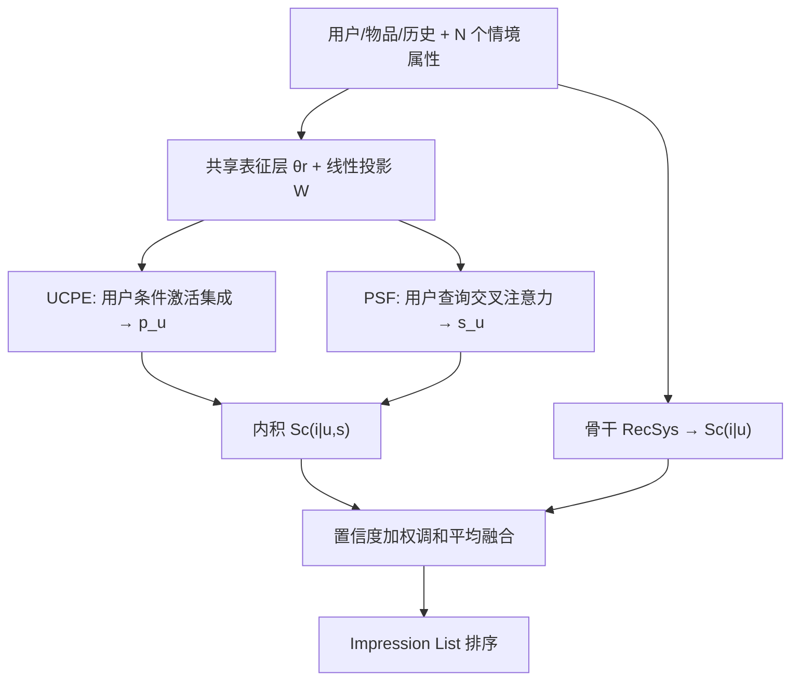
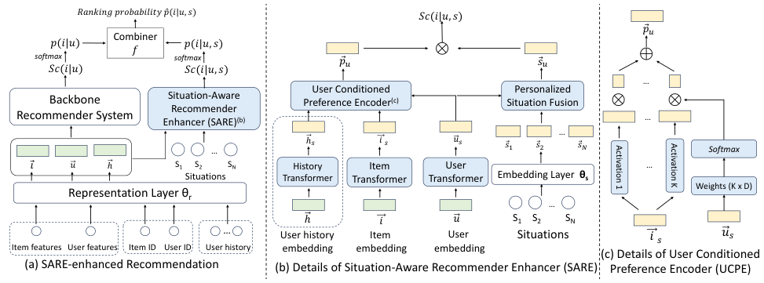

# A Situation-aware Enhancer for Personalized Recommendation (情境感知的个性化推荐增强器)

- **会议/期刊**: DASFAA 2024
- **作者与机构**: Jiayu Li, Peijie Sun, Chumeng Jiang, Weizhi Ma, Qingyao Ai, Min Zhang（清华大学 Quan Cheng Lab / 清华 AIR）
- **推荐链路定位**: 精排（Impression List Ranking）
- **研究方向**: 协同过滤与双塔召回 / CTR 预估与特征交叉
- **论文原文**: [论文原文链接](https://arxiv.org/abs/2403.18317v1)
- **开源代码**: [开源代码仓库链接](https://github.com/JiayuLi-997/SARE_DASFFA2024)

## TL;DR (1分钟核心速览)

现有推荐系统把情境（时间、地点、环境）与用户/物品放在同一层级做拼接或特征交叉，只能建模"情境—用户""情境—物品"的二元关系，无法刻画情境对"用户—物品关联"本身的动态调制。本文提出把情境视为交互的**前置条件 (precondition)**，设计可插拔双塔增强器 SARE：用 UCPE 以用户为条件调制物品表征、用 PSF 以用户为查询做情境注意力融合，再以置信度加权调和平均与骨干融合。在 MIND 与 KuaiRand-1K 的 Impression-List 全排序协议下，SARE 挂载 5 个情境感知骨干与 2 个 ID 骨干均稳定提升，xDeepFM+SARE 在 KuaiRand 上 NDCG@3 由 0.6226 升至 0.6405（+2.87%）。

## Background & Motivation (背景与核心矛盾)

- **主流范式**: 情境感知推荐（FM/AFM/xDeepFM/DIN/CAN 及 DIF-SR、CARCA、MEANTIME、Mojito 等时间感知模型）将情境属性与用户、物品特征**平级拼接**，通过特征交叉或序列注意力学习"情境—用户""情境—物品"的关联。
- **前人局限**: 其一，平级建模只能学到情境与单侧实体的关系，无法表达"同一用户在不同情境下对同一物品偏好翻转"这一**关系级调制**；其二，情境的**感知个性化**（同一客观情境对不同用户语义不同）与**影响个性化**（同一情境对不同用户偏好改变幅度不同）被固定 embedding 抹平。
- **核心洞察 (Key Insight)**: 情境是交互发生的"背景/前提"，其作用层级高于用户与物品的固有属性；把情境从用户/物品表征中**分离**出来，才能显式建模它对 user-item 关联的动态、个性化影响，同时保留"有/无情境"两路预测以便在情境不可靠时降权。
- **本文切入点**: 不改动骨干，另建一条以情境为条件的轻量双塔旁路，与骨干输出做置信度自适应融合。

## Method (核心方法设计)

### 1. 整体框架 (Overall Architecture)

给定用户 $u$、候选列表$\{i_1,\dots,i_M\}$与$N$个情境属性$s=\{s_1,\dots,s_N\}$，SARE 与骨干**共享**表征层$\theta_r$得到$\vec{u},\vec{i},\vec{h}$（历史可选），再经线性变换$W_u,W_i,W_h$投影到情境感知空间得$\vec{u}_s,\vec{i}_s,\vec{h}_s$，情境属性经$\theta_s$嵌入为$\{\vec{s}_n\}$。随后 UCPE 以$\vec{u}_s$为条件编码$\vec{i}_s$（及$\vec{h}_s$）得个性化偏好$\vec{p}_u$，PSF 以$\vec{u}_s$为 query 对$\{\vec{s}_n\}$做交叉注意力得个性化情境$\vec{s}_u$，二者内积给出$Sc(i|u,s)$。骨干给出$Sc(i|u)$，两路经 softmax 转概率后用置信度加权调和平均融合为$\hat{p}(i|u,s)$ 并排序。训练端到端，骨干与 SARE 使用独立学习率。

<figure class="paper-figure" markdown="span">
  <figcaption>图 2. 我们提出的情境导向优化器（SARE）概览。(a) SARE 可通过多种（可选）输入类型增强骨干推荐系统。(b) SARE 的详细结构，其中用户历史为可选输入。(c) 用户条件偏好编码器的细节，该编码器是 SARE 的两个关键组件之一。</figcaption>
</figure>

### 2. 关键设计拆解 (Key Designs)

1. **User-Conditioned Preference Encoder (UCPE，以用户为条件调制物品表征)**：痛点是把情境与物品一起拼接后，物品表征对所有用户共享，无法体现"情境影响因人而异"。UCPE 借鉴条件序列建模，用用户向量生成 $K$ 个激活函数的组合权重，再对物品表征的激活输出加权求和：
$$\hat{\vec{u}}=\mathrm{softmax}(W_c\vec{u}_s+\vec{b}_c),\quad \vec{p}_u=\sum_{j=1}^{K}\hat{u}_j\cdot A_j(\vec{i}_s)$$
其中 $W_c\in\mathbb{R}^{K\times D}$。直觉是：不同激活函数提供互补的非线性基，用户条件决定"用哪组基去读这个物品"，等价于为每个用户定制一个轻量非线性编码器，从而在几乎零额外参数下注入个性化。历史向量$\vec{h}_s$走同构 UCPE（共享$\{A_j\}$、独立权重），两路输出相加。

2. **Personalized Situation Fusion (PSF，个性化情境感知)**：痛点是同一客观情境（如 23 点）对早睡者与夜猫子语义不同，固定情境 embedding 无法区分。PSF 用用户向量作 query 对情境属性做交叉注意力，自适应聚合多属性情境：
$$\vec{s}_u=\mathrm{Attention}(W_s\vec{u}_s,S,S)=\mathrm{softmax}\!\left(\frac{(W_s\vec{u}_s)S^{\top}}{\sqrt{D}}\right)S$$
直觉是注意力权重即"该用户此刻更关注哪个情境维度"，把客观情境翻译成用户主观感知的情境，同时自动处理小时/时段、星期/是否周末等**依赖属性**间的冗余。

3. **置信度感知融合、损失与推理开销**：情境描述常不完整，故不直接用 $Sc(i|u,s)$，而以加权调和平均融合两路概率：
$$\hat{p}(i|u,s)=\frac{c_u+c_{u,s}}{c_u/p(i|u)+c_{u,s}/p(i|u,s)},\quad c_u=1-\frac{1}{\max_j p(i_j|u)+1}$$
置信度由列表内概率分布的尖锐度（不确定性）反推。损失为 $\mathcal{L}=\mathcal{L}_{rb}+\lambda_s\mathcal{L}_{sb}+\lambda_p\mathcal{L}_p$：前两项分别是骨干与 SARE 打分的 **session-level pairwise BPR**（列表内正负样本 softmax 加权），$\mathcal{L}_p$为最终概率的交叉熵对齐项。负样本来自 Impression 列表内未点击项（**免额外负采样**）。额外参数至多$4D^2+2KD+2K$，远小于嵌入矩阵$D(|\mathcal{U}|+|\mathcal{I}|)$，推理仅多一次双塔内积。

## Experimental Setup & Evaluation Protocol (实验设置与评估协议)

- **数据集与预处理**: 过滤正交互少于 3 的用户与物品；MIND 随机采样 4 万用户；KuaiRand-1K 以 30 分钟间隔切分 Impression List。

| 数据集 | #Users | #Items | #Interactions | Click/Imp. | 特征/场景说明 |
| :--- | :---: | :---: | :---: | :---: | :--- |
| MIND | 40,000 | 25,545 | 332,756 | 1.076 | 新闻，1 用户属性/3 物品属性/4 情境属性，列表均长 46.9 |
| KuaiRand-1K | 1,000 | 487,974 | 2,763,334 | 12.430 | 短视频，25 用户属性/7 物品属性/4 情境属性，列表均长 29.6 |

- **数据划分与防穿越 (Splitting Strategy)**: **随机 8:1:1 比例划分**（作者明确弃用时间线切分，以保证训练/测试情境同分布、比较公平）。
- **排名评测协议 (Ranking Protocol)**: **Impression-List 全排序**——列表内所有点击项须排在所有未点击项之前，指标 HR@3 / MAP@3 / NDCG@3，5 个随机种子取均值。
- **对比基线与超参设置**: 情境感知骨干 FM/AFM/xDeepFM/DIN/CAN；SOTA 情境（时间）感知基线 DIF-SR/CARCA/MEANTIME/Mojito；ID 骨干 LightGCN/SASRec（fix+SARE 与 train+SARE 两种设定）。嵌入维度 $D=64$（CAN 因 induction 特征需更大），UCPE 用 11 个激活函数，配对 t 检验$p<0.05/0.01$。

## Key Experimental Results (实验关键数据)

### 1. 主实验对比 (Main Results)

| 骨干 (情境用法) | MIND HR@3 | MIND NDCG@3 | KuaiRand HR@3 | KuaiRand NDCG@3 |
| :--- | :---: | :---: | :---: | :---: |
| FM (Concat) | 0.4774 | 0.3407 | 0.8717 | 0.6221 |
| FM + SARE | 0.4819* | 0.3444** | 0.8771** | 0.6308** |
| AFM (Concat) | 0.4780 | 0.3398 | 0.8758 | 0.6266 |
| AFM + SARE | 0.4797 | 0.3417* | 0.8789* | 0.6301* |
| xDeepFM (Concat) | 0.4825 | 0.3453 | 0.8733 | 0.6226 |
| **xDeepFM + SARE** | **0.4857*** | **0.3504*** | **0.8832**** | **0.6405**** |
| DIN (Concat) | 0.4834 | 0.3441 | 0.8700 | 0.6174 |
| DIN + SARE | 0.4821 | 0.3470 | 0.8761* | 0.6203 |
| CAN (Concat) | 0.4850 | 0.3459 | 0.8749 | 0.6218 |
| CAN + SARE | 0.4881 | 0.3493* | 0.8762 | 0.6310** |
| LightGCN (w/o 情境) | 0.4471 | 0.3125 | 0.8589 | 0.6043 |
| LightGCN (train+SARE) | 0.4599** | 0.3184** | 0.8661** | 0.6137** |
| SASRec (w/o 情境) | 0.4670 | 0.3301 | 0.8594 | 0.6023 |
| SASRec (train+SARE) | 0.4757** | 0.3385** | 0.8643* | 0.6052* |

xDeepFM+SARE 相对最强情境感知基线（MIND 上 CARCA、KuaiRand 上 MEANTIME/Mojito）在 HR@3 与 NDCG@3 上均全面领先（图 3）。

### 2. 消融实验 (Ablation Study)

| 变体 (xDeepFM / CAN) | MIND NDCG@3 | KuaiRand NDCG@3 | 说明 |
| :--- | :---: | :---: | :--- |
| 骨干（虚线基准） | 0.3453 / 0.3459 | 0.6226 / 0.6218 | 情境仅拼接 |
| -cb（仅用 SARE 输出） | 显著下降（降幅最大） | 显著下降 | 失去骨干直接监督 |
| -ucfe（全局权重替代） | 下降 | 下降 | 去掉偏好个性化 |
| -psf（全局权重替代） | 下降 | 下降 | 去掉情境感知个性化 |
| -conf（无权调和平均） | 小幅下降 | 小幅下降 | 去掉置信度自适应 |
| **SARE 完整** | **0.3504 / 0.3493** | **0.6405 / 0.6310** | — |

### 3. 关键实验发现 (Key Findings)

1. **"分离情境"胜过"复杂交叉"**：仅给最简单的 FM 挂上 SARE，在 KuaiRand 上 NDCG@3 即从 0.6221 升至 0.6308（+1.40%），超过所有平级建模的复杂骨干，说明瓶颈在建模视角而非网络容量。
2. **融合方式比单侧增强更关键**：消融中去掉骨干输出（-cb）造成最大跌幅，因为骨干失去直接监督、SARE 的情境噪声也无从校正；而置信度加权（-conf → SARE）仍带来稳定增益，验证"情境不可靠时自动降权"的设计有效。
3. **非序列骨干受益更大、ID 骨干亦可白嫖**：SARE 在 FM/AFM/xDeepFM 上的提升普遍大于 DIN/CAN（后者历史建模已部分吸收情境信号）；LightGCN 在完全无情境输入下 train+SARE 仍将 MIND NDCG@3 从 0.3125 提至 0.3184（+1.89%），证明其作为通用插件的灵活性。

## Highlights & Limitations (亮点、对比与审稿批判)

- **与代表作对比 (vs. Prior Work)**: 相较 xDeepFM/AFM 等把情境当普通特征做交叉，SARE 把情境提升为"条件"作用于 user-item 关联；相较 DIF-SR（直接预测情境）与 MEANTIME/Mojito（语义时间嵌入），SARE 不限定情境类型、不依赖序列结构，且以用户为条件实现双重个性化；相较 DSAIN 的多行为交互层，SARE 是模型无关的旁路插件而非专用网络。
- **可迁移亮点**: ① UCPE 的"用户条件激活集成"是极低成本的条件化技巧（仅 $K\times D$ 参数），可迁移到跨域/多场景的条件表征；② 置信度加权调和平均可作为任意双路召回/精排融合的通用算子。
- **审稿级局限批判**: ① 情境属性受数据集限制仅用 4 个时间语义特征，位置/天气/情绪等未验证，泛化性证据不足；② 序列骨干增益偏弱（DIN 在 MIND HR@3 甚至微降），作者自承未针对历史序列做专门设计；③ 随机划分而非时间切分虽保证分布一致，但高估了真实线上对情境漂移的鲁棒性。

## Rating (四维评分)

- **方法创新性 (Novelty)**: ⭐⭐⭐⭐ （"情境作为前置条件"的视角转换清晰有力，UCPE+PSF 双重个性化设计自洽，但组件本身均为已有技术的巧妙重组）
- **评估协议与实验扎实度 (Protocol & Experiments)**: ⭐⭐⭐⭐ （7 个骨干 × 2 数据集 × 3 指标 + 5 种子 + 显著性检验 + 完整消融，Impression-List 全排序协议规范；情境类型单一为短板）
- **写作与数学规范度 (Clarity & Rigor)**: ⭐⭐⭐⭐ （公式简洁、参数复杂度分析到位、任务定义严谨；个别符号如 $Sc$ 与 softmax 维度说明略简）
- **工业落地与复现价值 (Industrial & Practical Value)**: ⭐⭐⭐⭐⭐ （模型无关插件、额外参数可忽略、推理仅增一次内积，代码已开源，工程接入成本极低）

