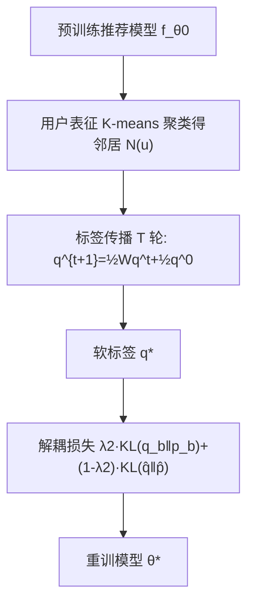
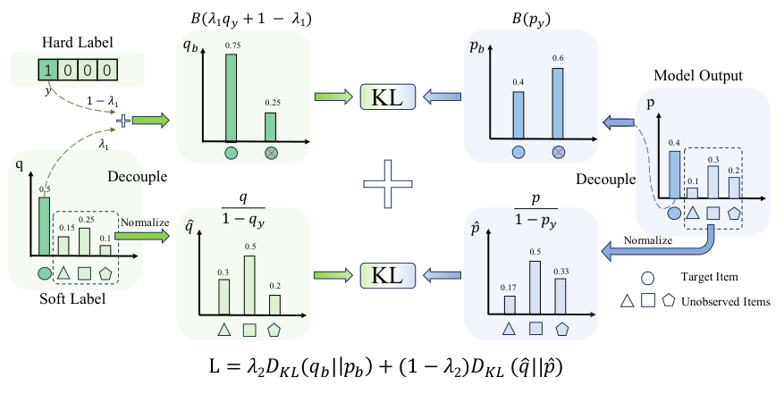

# Learning Recommender Systems with Soft Target: A Decoupled Perspective (从解耦视角用软标签学习推荐系统)

- **会议/期刊**: DASFAA 2024
- **作者与机构**: Hao Zhang, Mingyue Cheng, Qi Liu, Yucong Luo, Rui Li, Enhong Chen（中国科学技术大学认知智能全国重点实验室）
- **推荐链路定位**: 精排（多分类 Softmax 训练目标层面，模型无关）
- **研究方向**: 协同过滤与双塔召回 / 自监督与去噪
- **论文原文**: [https://arxiv.org/abs/2410.06536v1](https://arxiv.org/abs/2410.06536v1)
- **开源代码**: [https://github.com/zh-ustc/desorec](https://github.com/zh-ustc/desorec)

## TL;DR (1分钟核心速览)

隐式反馈下用户正反馈仅占物品池极小比例，标准 Softmax 把全部未交互项一律当负类，无法区分"潜在正反馈"与"真负反馈"。本文从理论上把传统软标签损失 $\lambda_1 D_{KL}(q\|p)+(1-\lambda_1)H(d,p)$拆解为「目标项二项置信度」与「非目标项$|I|-1$维兴趣分布」两部分，指出原框架中后者的权重被$q_y$与$\lambda_1$耦合锁死，遂提出解耦损失$\mathcal{L}_{Deso}=\lambda_2 D_{KL}(q_b\|p_b)+(1-\lambda_2)D_{KL}(\hat{q}\|\hat{p})$，并用 K-means 邻居上的标签传播生成软标签。在 DeepFM/YoutubeDNN/GRU4Rec/SASRec 四个骨干、三个公开数据集上，Full-Ranking 下 N@10 相对最优基线最高提升约 3.2%。

## Background & Motivation (背景与核心矛盾)

- **主流范式**: 推荐被建模为多分类问题，目标物品 one-hot 作监督信号，用 Softmax 交叉熵训练；软标签路线（Label Smoothing、SoftRec 的 POP+/CSN）用先验分布替换 one-hot 以缓解过置信。
- **前人局限**: 其一，one-hot 与均匀平滑都把海量未交互项视作同质负类，抹杀了"潜在正反馈 vs 真负反馈"的差异；其二，SoftRec 类方法直接优化目标项与未观测项的**联合分布**，两部分权重被耦合，无法独立调节。
- **核心洞察 (Key Insight)**: 对传统软标签损失做代数恒等变形可得 $\mathcal{L}=D_{KL}(q_b\|p_b)+\lambda_1(1-q_y)D_{KL}(\hat{q}\|\hat{p})+F(q)$，其中第二项权重$\lambda_1(1-q_y)$被$q_y$（通常$>0.5$）与$\lambda_1$双重约束，而$\lambda_1$同时还在控制目标置信度——两个目标共用同一旋钮，搜索空间退化为一条曲线$\lambda_2=\frac{1}{1+\lambda_1(1-q_y)}$。
- **本文切入点**: 用独立参数 $\lambda_2$ 重新加权两项 KL，把"目标置信度"与"非目标兴趣分布"彻底解耦，使二者可各自最优。

## Method (核心方法设计)

### 1. 整体框架 (Overall Architecture)

先用硬标签预训练推荐模型获得用户/物品表征，对用户表征做 K-means 聚类得到邻居集合；在每个簇内以 one-hot 为初值执行 $T$轮带温度归一化相似度的标签传播，得到软标签$q^*$；最后用解耦损失$\mathcal{L}_{Deso}$ 重训模型。整个流程与骨干模型解耦，可插拔于任意 Softmax 类推荐器。

<figure class="paper-figure" markdown="span">
  <figcaption>图1. 所提出的解耦软标签优化框架。</figcaption>
</figure>

### 2. 关键设计拆解 (Key Designs)

1. **解耦软标签损失（Decoupled Loss）**：痛点在于原框架两项权重耦合。将 Eq.3 的恒等拆解重写为
$\mathcal{L}_{Deso}=\lambda_2 D_{KL}(q_b\|p_b)+(1-\lambda_2)D_{KL}(\hat{q}\|\hat{p})$，
其中 $q_b=\mathrm{Bernoulli}(\lambda_1 q_y+1-\lambda_1)$、$p_b=\mathrm{Bernoulli}(p_y)$刻画目标项的二项置信度，$\hat{q}_i=q_i/(1-q_y)$、$\hat{p}_i=p_i/(1-p_y)$为剔除目标项后的$|I|-1$维条件分布。直觉：第一项只负责"目标该有多确信"，第二项专职"在剩余全库上分配兴趣质量"，$\lambda_2$ 独立调节二者，突破了原框架只能沿红线搜索的盲区。
2. **邻居标签传播生成软标签（Label Propagation）**：无社交网络时用 K-means 簇内 $l_2$距离定义邻居，传播权重$w_{uv}=\frac{\exp(\mathrm{sim}(u,v)/\tau)}{\sum_{j\in N(u)}\exp(\mathrm{sim}(u,j)/\tau)}$，迭代$q^{t+1}_u=\sum_{v\in N(u)}p(v|u)q^t_v$。为防目标概率被稀释，保留一半原始 one-hot：$q^{t+1}=\tfrac12 Wq^t+\tfrac12 q^0$。直觉：相似用户共享潜在正反馈，等价于在未观测项上做一次"兴趣扩散"，把潜在正例的质量从邻居处借过来。
3. **训练目标与开销**：总损失即 $\mathcal{L}_{Deso}$，无需额外负采样（全库 Softmax 天然覆盖）；软标签生成是一次性离线预处理（聚类 +$T$ 轮稀疏矩阵乘），在线推理与骨干模型完全一致，零额外延迟。

## Experimental Setup & Evaluation Protocol (实验设置与评估协议)

- **数据集与预处理**: 三个域（电商/电影/音乐），统一 `5-core` 过滤，行为序列截断至 20：

| 数据集 | #Users | #Items | #Interactions | 密度 | 场景说明 |
| :--- | :---: | :---: | :---: | :---: | :--- |
| Diginetica | 62,502 | 43,229 | 467,631 | 0.017% | 电商会话 |
| MovieLens | 1,460,900 | 23,716 | 27,525,126 | 0.079% | 电影评分 |
| Last.FM | 534,982 | 199,013 | 10,699,640 | 0.010% | 音乐收听 |

- **数据划分与防穿越**: `Leave-One-Out`（最后一步测试、倒数第二步验证），遵循 [20] 的序列推荐标准协议。
- **排名评测协议**: 无偏 `Full-Ranking`（对全物品池未交互项排序），指标 Recall@{10,20} 与 NDCG@{10,20}。
- **对比基线与超参**: Base（标准 Softmax）、LS（标签平滑）、POP+（流行度软标签）、CSN（用户相似度软标签）；骨干为 DeepFM、YoutubeDNN、GRU4Rec、SASRec；Embedding 维度 $d=128$，Adam lr=$1e^{-3}$，batch=256；$\tau\in\{0.25,0.5,1,2\}$、簇数$k\in\{16,64,256,1024\}$、$\lambda_1,\lambda_2\in\{0.1,\dots,0.9\}$ 网格搜索。

## Key Experimental Results (实验关键数据)

### 1. 主实验对比 (Main Results)

以最具代表性的 SASRec 与 YoutubeDNN 骨干为例（R@20 / N@20）：

| 骨干 | 方法 | Diginetica R@20 | Diginetica N@20 | MovieLens R@20 | MovieLens N@20 | Last.FM R@20 | Last.FM N@20 |
| :--- | :--- | :---: | :---: | :---: | :---: | :---: | :---: |
| SASRec | Base | 0.1766 | 0.1075 | 0.2612 | 0.1298 | 0.3248 | 0.2608 |
| SASRec | LS | 0.1818 | 0.1088 | 0.2696 | 0.1343 | 0.3287 | 0.2626 |
| SASRec | POP+ | 0.1750 | 0.1067 | 0.2700 | 0.1340 | 0.3156 | 0.2676 |
| SASRec | CSN | 0.1843 | 0.1073 | 0.2651 | 0.1319 | 0.3241 | 0.2684 |
| SASRec | **Ours** | **0.1895** | **0.1093** | **0.2733** | **0.1351** | **0.3360** | **0.2735** |
| YoutubeDNN | Base | 0.1350 | 0.0753 | 0.2427 | 0.1125 | 0.2028 | 0.1590 |
| YoutubeDNN | CSN | 0.1521 | 0.0846 | 0.2519 | 0.1177 | 0.2465 | 0.1947 |
| YoutubeDNN | **Ours** | **0.1597** | **0.0870** | **0.2578** | **0.1204** | **0.2669** | **0.2085** |

相对最强基线：SASRec 上 Diginetica R@20 提升 2.8%、Last.FM R@20 提升 2.2%；YoutubeDNN 上 Diginetica R@20 较 CSN 提升 5.0%、Last.FM R@20 提升 8.3%。GRU4Rec 上增益最大（Diginetica R@20 0.1197→0.1289，+7.7%），说明序列稀疏骨干受益最明显。

### 2. 消融实验 (Ablation Study)

| 配置 | Diginetica R@10 | Diginetica N@10 | Last.FM R@10 | Last.FM N@10 |
| :--- | :---: | :---: | :---: | :---: |
| Base | 0.1077 | 0.0684 | 0.1850 | 0.1545 |
| 仅目标置信度项 | 0.1145 | 0.0716 | 0.1932 | 0.1603 |
| 仅非目标分布项 | 0.0753 | 0.0432 | 0.1138 | 0.0736 |
| **DeSoRec（完整）** | **0.1247** | **0.0782** | **0.2442** | **0.2024** |

解耦框架的通用性（DeepFM，NDCG@10，w/o De → w/ De）：LS 0.0663→0.0680（+2.56%）、POP+ 0.0636→0.0655（+2.99%）、CSN 0.0655→0.0671（+2.44%）、DeSoRec 0.0666→0.0686（+3.00%）。

### 3. 关键实验发现 (Key Findings)

1. **两项缺一不可但不对称**：仅优化非目标分布项时性能崩塌（Diginetica R@10 从 0.1077 跌至 0.0753），因为失去目标正反馈锚点后模型无法定位用户兴趣中心；仅优化目标置信度项已优于 Base（+6.3%），说明把 one-hot 换成软二项分布本身就能抑制过置信。
2. **解耦带来的是"搜索空间"红利而非单纯正则**：图 2 显示最优 $(\lambda_1,\lambda_2)$组合落在传统框架红线$\lambda_2=\frac{1}{1+\lambda_1(1-q_y)}$之外的盲区，最优$\lambda_2$ 稳定在 0.5–0.7，而传统框架在该区间根本无法取到——这解释了为何解耦版对 LS/POP+/CSN 等已有软标签也能再涨 1.5%–3.2%。
3. **稀疏骨干收益更大**：GRU4Rec 与 YoutubeDNN 上的相对增益（5%–8%）显著高于 SASRec（2%–3%），因为表达能力弱的模型更依赖标签质量来弥补未观测项信息的缺失，标签传播的"邻居兴趣扩散"在数据稀疏时边际价值最高。

## Highlights & Limitations (亮点、对比与审稿批判)

- **与代表作对比 (vs. Prior Work)**: 相比 Label Smoothing 的均匀先验与 SoftRec 的 POP+/CSN 先验，本文不改软标签来源而改**优化几何**——把联合分布拆成二项 + 条件分布两个独立可调项；相比 BPR/BCE 等 pairwise/pointwise 目标，本文保留全库 Softmax 的信息量但修正了其负类同质假设。
- **可迁移亮点**: ①"解耦 KL"这一恒等变形可直接套用到任何带辅助软标签的蒸馏/对比学习损失中，实现主目标与辅助目标的独立调权；②无社交图时用 K-means 簇内 $l_2$ 相似度构造伪邻居做标签传播，是低成本获取"潜在正例"的通用 trick。
- **审稿级局限批判**: ①软标签质量强依赖预训练表征与聚类数 $k$、温度$\tau$，论文仅在$\{16,\dots,1024\}$上网格搜索，缺少对聚类不稳定性的敏感性分析；②标签传播需$O(T\cdot|N(u)|)$ 的簇内全对相似度计算，用户量级达百万时（MovieLens 146 万用户）离线开销与内存未做复杂度报告；③实验仅覆盖 top-N 排序，未验证在 CTR 预估等 pointwise 场景或冷启动用户分桶上的表现。

## Rating (四维评分)

- **方法创新性 (Novelty)**: ⭐⭐⭐⭐ （从损失代数恒等变形出发揭示耦合约束，解耦视角简洁且有理论支撑，但本质仍是软标签重加权）
- **评估协议与实验扎实度 (Protocol & Experiments)**: ⭐⭐⭐⭐ （四骨干三数据集 + Full-Ranking + 通用性/消融/参数分析齐全，缺显著性检验与冷启动分桶）
- **写作与数学规范度 (Clarity & Rigor)**: ⭐⭐⭐⭐ （Eq.3 的逐步拆解推导清晰，$q_b/\hat{q}$符号定义完整，个别记号如$F(q)$ 常数项说明略简）
- **工业落地与复现价值 (Industrial & Practical Value)**: ⭐⭐⭐⭐ （模型无关、零在线延迟、代码已开源，但离线标签传播在亿级用户上的工程成本需评估）

