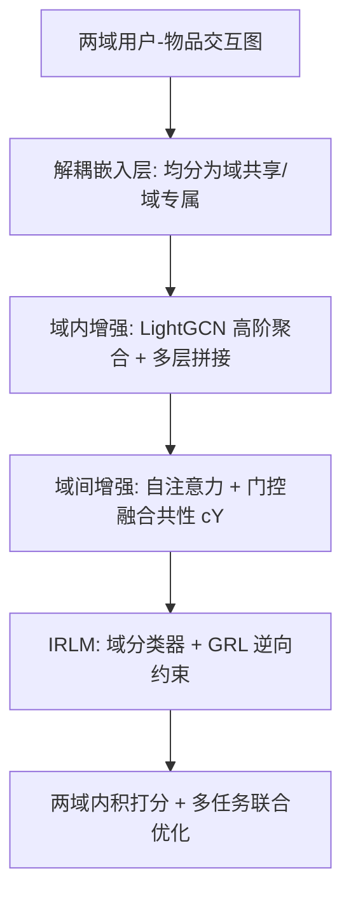
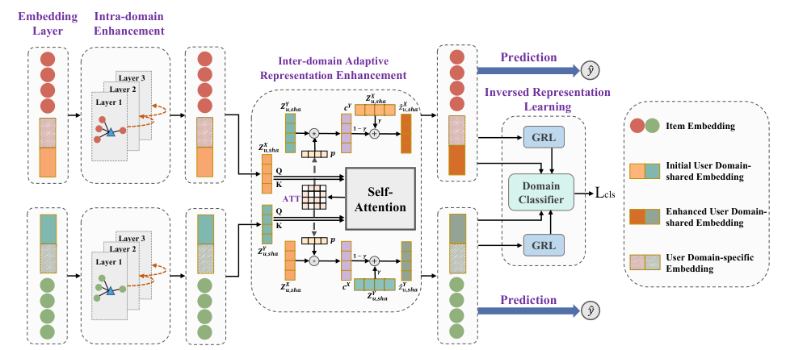

# A Unified Framework for Adaptive Representation Enhancement and Inversed Learning in Cross-Domain Recommendation (跨域推荐中自适应表征增强与逆向学习的统一框架)

- **会议/期刊**: DASFAA 2024
- **作者与机构**: Luankang Zhang, Hao Wang, Suojuan Zhang, Mingjia Yin, Yongqiang Han, Jiaqing Zhang, Defu Lian, Enhong Chen（中国科学技术大学认知智能全国重点实验室；陆军工程大学）
- **推荐链路定位**: 召回（双目标跨域 Top-K 推荐）
- **研究方向**: 跨域与多场景推荐 / 图神经网络推荐
- **论文原文**: [https://arxiv.org/abs/2404.00268v1](https://arxiv.org/abs/2404.00268v1)
- **开源代码**: 暂未开源

## TL;DR (1分钟核心速览)

现有解耦式跨域推荐把同一用户的域共享表征视为跨域完全一致，且仅靠 VAE/对比学习做互斥约束，无法保证共享/专属因子各归其位，导致负迁移。AREIL 将用户表征均分为域共享与域专属两段，用 LightGCN 聚合域内高阶协同信号、用自注意力门控自适应注入跨域共性，再用域分类器 + 梯度反转层（GRL）实现"共享表征骗过分类器、专属表征被分类器识别"的逆向约束。在 Elec&Phone、Sport&Phone、Elec&Cloth 三个 Amazon 场景、全库 Full-Ranking 协议下，Recall@20 相对最强基线最高提升 8.31%，NDCG@20 最高提升 9.68%。

## Background & Motivation (背景与核心矛盾)

- **主流范式**: 跨域推荐（CDR）从早期"用户跨域兴趣一致"假设下的 MF/GNN 直接迁移（CoNet、BiTGCF），演进到解耦式方法（DisenCDR 用 VAE + 互信息正则、DR-MTCDR 用图对比学习），只迁移域共享分量以缓解负迁移。
- **前人局限**: 其一，解耦类方法默认同一用户的域共享表征跨域完全一致，忽视了数据倾斜造成的表征质量差异与同一偏好在两域的不同表现，无法区分哪些共享特征"重要且可泛化"；其二，VAE/对比学习的互斥约束只是软性排斥，不能保证域共享分量真的编码域不变信息、域专属分量真的编码域相关信息。
- **核心洞察 (Key Insight)**: 图 4(b) 的可视化显示，同一用户的域共享表征在跨域空间中有的高度重合、有的相距甚远——说明共享特征的重要性与泛化性在域间存在显著差异，简单整体迁移必然引入噪声；同时理想解耦应满足"逆向"性质：共享分量应让域判别器失效，专属分量应让域判别器轻易分辨。
- **本文切入点**: 把"自适应增强"与"逆向学习"放进同一端到端框架：前者解决"迁移什么"，后者解决"解耦得对不对"。

## Method (核心方法设计)

### 1. 整体框架 (Overall Architecture)

输入两域用户-物品交互二部图，先将用户初始表征 $\mathbf{Z}^X_u\in\mathbb{R}^{|U|\times d}$沿维度均分为域共享$\mathbf{Z}^X_{u,sha}$与域专属$\mathbf{Z}^X_{u,spe}$（各$d/2$维）。AREM 模块分两步增强：域内用 LightGCN 在用户-物品二部图上做$K$层线性传播并拼接各层输出以捕获高阶协同信号；域间用自注意力计算两域共享表征的相关性矩阵，经门控得到"共性"分量$c^Y$，再以权重$\gamma_s$ 与本地共享表征加权融合。IRLM 模块将增强后的共享/专属表征送入域分类器，共享分支前置 GRL 反转梯度。最后两域分别做内积打分，以交叉熵推荐损失 + 分类损失 + L2 正则多任务联合优化。

<figure class="paper-figure" markdown="span">
  <figcaption>图 1：用于自适应表示增强和逆向表示学习的 AREIL 框架。</figcaption>
</figure>

### 2. 关键设计拆解 (Key Designs)

1. **域间自适应增强（Inter-domain AREM）**：痛点是把对方域的共享表征整体搬过来会引入数据倾斜噪声。做法是把两域共享表征拼成序列 $\mathbf{Z}_u=\mathbf{Z}^X_{u,sha}\|\mathbf{Z}^Y_{u,sha}$，经可学习$W^X_Q,W^X_K$得$\mathrm{ATT}_X=(\mathbf{Q}^X)^\top\mathbf{K}^X$，沿 query 维求和得特征重要性分布$p$，再门控提取共性并融合：

$$c^Y=\mathbf{Z}^Y_{u,sha}\odot\mathrm{Norm}(p),\qquad \hat{\mathbf{Z}}^X_{u,sha}=\gamma_s\mathbf{Z}^X_{u,sha}+(1-\gamma_s)c^Y$$

直觉是 $p$越大说明该维特征在两域都强相关，越值得注入；$\gamma_s$ 控制"信自己"还是"信对方"，避免单侧主导。

2. **逆向表征学习（IRLM）**：痛点是软性互斥约束无法保证因子归位。做法是让域专属表征最小化域分类交叉熵 $\mathcal{L}^{spe}_{cls}$（分类器应能认出它来自哪个域），而共享表征经 GRL 后同样最小化分类损失，但 GRL 在前向恒等、反向将梯度乘以$-\lambda$：

$$\mathrm{GRL}(x)=x,\qquad \frac{\mathrm{d}\,\mathrm{GRL}}{\mathrm{d}x}=-\lambda\mathbf{I}$$

于是共享分支实际上在**最大化**域分类误差，被迫编码域不变信息，与专属分支形成方向相反的对抗目标，在同一框架内统一优化。

3. **训练目标、负采样与推理效率**：总损失为

$$\mathcal{L}=\mathcal{L}_{rec}+\lambda_1\mathcal{L}_{cls}+\lambda_2\|\Theta\|_2^2,\qquad \mathcal{L}_{cls}=\mathcal{L}^{sha}_{cls}+\mathcal{L}^{spe}_{cls}$$

其中 $\mathcal{L}_{rec}$ 为两域逐交互的二元交叉熵（隐式反馈 0/1），未显式设计负采样器，依赖全库候选评估；推理时仅需前向传播与内积，无额外候选生成开销，但 GRL 与自注意力带来少量训练期开销。

## Experimental Setup & Evaluation Protocol (实验设置与评估协议)

- **数据集与预处理**: 三个 Amazon 场景，仅保留两域共同出现的用户（完全重叠用户、物品不重叠），评分二值化为隐式反馈：

| 数据集 | #Users | #Items | #Interactions | 稀疏度/密度 | 特征/场景说明 |
| :--- | :---: | :---: | :---: | :---: | :--- |
| Elec&Phone (Elec) | 3,325 | 17,709 | 52,966 | 0.089% | 电子产品→手机 |
| Elec&Phone (Phone) | 3,325 | 38,706 | 118,114 | 0.091% | 手机域较稠密 |
| Sport&Phone (Sport) | 4,998 | 20,845 | 54,256 | 0.052% | 运动户外→手机 |
| Sport&Phone (Phone) | 4,998 | 13,655 | 46,445 | 0.068% | 手机域较稀疏 |
| Elec&Cloth (Elec) | 15,761 | 51,447 | 224,689 | 0.027% | 大规模稀疏场景 |
| Elec&Cloth (Cloth) | 15,761 | 48,781 | 133,609 | 0.017% | 最稀疏域 |

- **数据划分与防穿越 (Splitting Strategy)**: 随机比例划分 80%/10%/10%（训练/验证/测试），非时间戳切分，存在轻度未来信息泄漏风险。
- **排名评测协议 (Ranking Protocol)**: 无偏 `Full-Ranking`，以全物品集为候选，指标为 Recall@20 与 NDCG@20，显著性 $p<0.05$。
- **对比基线与超参设置**: 单域基线 BPR、NGCF、LightGCN、DGCF、MultVAE；常规跨域 CoNet、BiTGCF；解耦跨域 DRMTCDR、DisenCDR。嵌入维度 $d=64$，GNN 层数搜索$\{2,3,4\}$，$\lambda_1,\lambda_2\in\{10^{-4},\dots,1.0\}$，$\gamma_s,\gamma_t\in\{0.8,\dots,0.95\}$，Adam 优化，基于 NDCG@20 早停。

## Key Experimental Results (实验关键数据)

### 1. 主实验对比 (Main Results)

| 模型 | Elec R@20 | Elec N@20 | Phone(E&P) R@20 | Phone(E&P) N@20 | Sport R@20 | Sport N@20 | Phone(S&P) R@20 | Phone(S&P) N@20 | Elec(E&C) R@20 | Elec(E&C) N@20 | Cloth R@20 | Cloth N@20 |
| :--- | :---: | :---: | :---: | :---: | :---: | :---: | :---: | :---: | :---: | :---: | :---: | :---: |
| BPR | 5.75 | 2.86 | 3.44 | 1.83 | 4.05 | 1.87 | 5.52 | 2.72 | 3.48 | 1.58 | 0.94 | 0.39 |
| LightGCN | 7.98 | 3.69 | 4.09 | 2.34 | 5.15 | 2.54 | 7.45 | 3.48 | 3.84 | 1.82 | 1.85 | 0.84 |
| MultVAE | 6.69 | 3.24 | 3.86 | 2.28 | 4.30 | 2.02 | 6.80 | 3.10 | 3.97 | 1.79 | 1.48 | 0.61 |
| CoNet | 3.76 | 1.45 | 2.96 | 1.62 | 2.37 | 1.11 | 5.66 | 2.27 | 3.26 | 1.38 | 1.34 | 0.54 |
| BiTGCF | 7.32 | 3.46 | 4.86 | 2.79 | 5.38 | 2.39 | 7.83 | 3.55 | 3.82 | 1.71 | 1.69 | 0.76 |
| DRMTCDR | 5.90 | 2.51 | 4.08 | 2.38 | 3.67 | 1.71 | 5.37 | 2.39 | 3.73 | 1.60 | 1.27 | 0.53 |
| DisenCDR | 5.27 | 2.12 | 3.85 | 2.18 | 3.60 | 1.59 | 6.41 | 2.67 | 3.35 | 1.42 | 1.39 | 0.55 |
| **AREIL** | **8.29** | **3.92** | **5.12** | **3.06** | **5.72** | **2.73** | **8.07** | **3.69** | **4.30** | **1.97** | **1.94** | **0.88** |
| Improv.% | +3.88 | +6.23 | +5.35 | +9.68 | +6.32 | +7.48 | +3.07 | +3.94 | +8.31 | +8.24 | +4.86 | +4.76 |

### 2. 消融实验 (Ablation Study)

| 变体 | Sport R@20 | Sport N@20 | Phone(S&P) R@20 | Phone(S&P) N@20 | Elec(E&C) R@20 | Elec(E&C) N@20 | Cloth R@20 | Cloth N@20 |
| :--- | :---: | :---: | :---: | :---: | :---: | :---: | :---: | :---: |
| w/o graph | 3.91 | 1.87 | 5.42 | 2.70 | 3.52 | 1.51 | 1.34 | 0.60 |
| w/o AREM | 5.17 | 2.27 | 7.95 | 3.63 | 4.11 | 1.92 | 1.91 | 0.86 |
| w/o IRLM | 5.27 | 2.31 | 7.87 | 3.61 | 4.01 | 1.88 | 1.76 | 0.80 |
| **AREIL** | **5.72** | **2.73** | **8.07** | **3.69** | **4.30** | **1.97** | **1.94** | **0.88** |

### 3. 关键实验发现 (Key Findings)

- **域内高阶信号是性能地基**：去掉 LightGCN 改用矩阵分解后，Sport 域 NDCG@20 从 2.73 暴跌至 1.87（降幅约 31.5%），Elec&Cloth 的 Cloth 域 Recall@20 从 1.94 跌至 1.34，说明在极稀疏场景下域内协同聚合比跨域迁移更不可替代。
- **跨域自适应增强与逆向约束缺一不可且量级相当**：w/o AREM 在 Sport 域 NDCG@20 下降 16.85%，w/o IRLM 下降 15.38%，两者降幅接近，证明"迁移什么"与"解耦得对不对"是两个独立且同等关键的增益来源；而 DisenCDR、DRMTCDR 等解耦基线在多个域甚至不如单域 LightGCN，反证其解耦约束不够严格。
- **稀疏域受益更大**：Elec&Cloth 中更稀疏的 Cloth 域（密度 0.017%）Recall@20 提升 4.86%，而较稠密的 Elec 域提升 8.31% 但绝对增益来自更强基线；Sport&Phone 中较稀疏的 Phone 域 NDCG@20 提升 3.94%，说明跨域迁移对稀疏侧确有补益，但增益并非无条件随稀疏度单调放大。

## Highlights & Limitations (亮点、对比与审稿批判)

- **与代表作对比 (vs. Prior Work)**: 相比 BiTGCF 仅靠重叠用户做高阶特征传播、不区分共享/专属，AREIL 显式解耦并只迁移共享分量；相比 DisenCDR 用 VAE + 互信息正则做软互斥，AREIL 用 GRL 构造方向相反的对抗目标，使共享分量主动"欺骗"域分类器，约束更硬；相比 DR-MTCDR 的图对比自监督，AREIL 额外引入自注意力门控来区分共享特征的重要性与泛化性，直接回应数据倾斜。
- **可迁移亮点**: (1) 用"分类器 + GRL"把解耦约束转成对抗式逆向目标，可迁移到多场景/多业务联合建模中的场景不变表征学习；(2) 以自注意力沿 query 维求和得到特征重要性分布 $p$ 再做门控融合，是一种轻量的跨源特征选择技巧，可复用到多模态或多行为序列融合。
- **审稿级局限批判**: (1) 实验仅覆盖完全重叠用户、物品不重叠的 Amazon 场景，未验证非重叠用户或部分重叠设定，泛化性存疑；(2) 随机 80/10/10 划分而非全局时间戳切分，存在未来交互泄漏，且未报告训练/推理时延与 GRL 的 $\lambda$ 调度细节，工业落地成本不明；(3) 解耦采用"维度均分"这一硬切分，缺乏对共享/专属维度比例的自适应学习。

## Rating (四维评分)

- **方法创新性 (Novelty)**: ⭐⭐⭐⭐ （将 GRL 逆向约束与自注意力自适应融合统一进解耦式 CDR，思路清晰但各组件均为已有技术的组合创新）
- **评估协议与实验扎实度 (Protocol & Experiments)**: ⭐⭐⭐⭐ （三组跨域场景 + Full-Ranking 无偏评估 + 显著性检验 + 完整消融与 t-SNE 可视化，但划分方式非时间切分、缺效率分析）
- **写作与数学规范度 (Clarity & Rigor)**: ⭐⭐⭐⭐ （公式与模块职责定义清楚，但部分符号如 $\gamma_t$、$\lambda$ 调度仅一笔带过，缺少复杂度分析）
- **工业落地与复现价值 (Industrial & Practical Value)**: ⭐⭐⭐ （基于 RecBole-CDR 实现、结构轻量易部署，但暂未开源且 GRL 训练稳定性与超参敏感性需额外调优）

