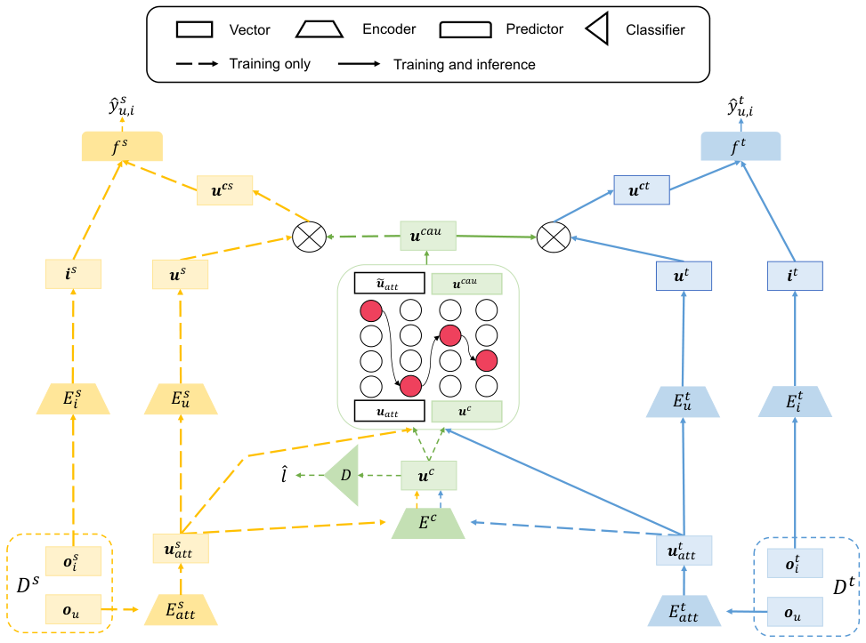
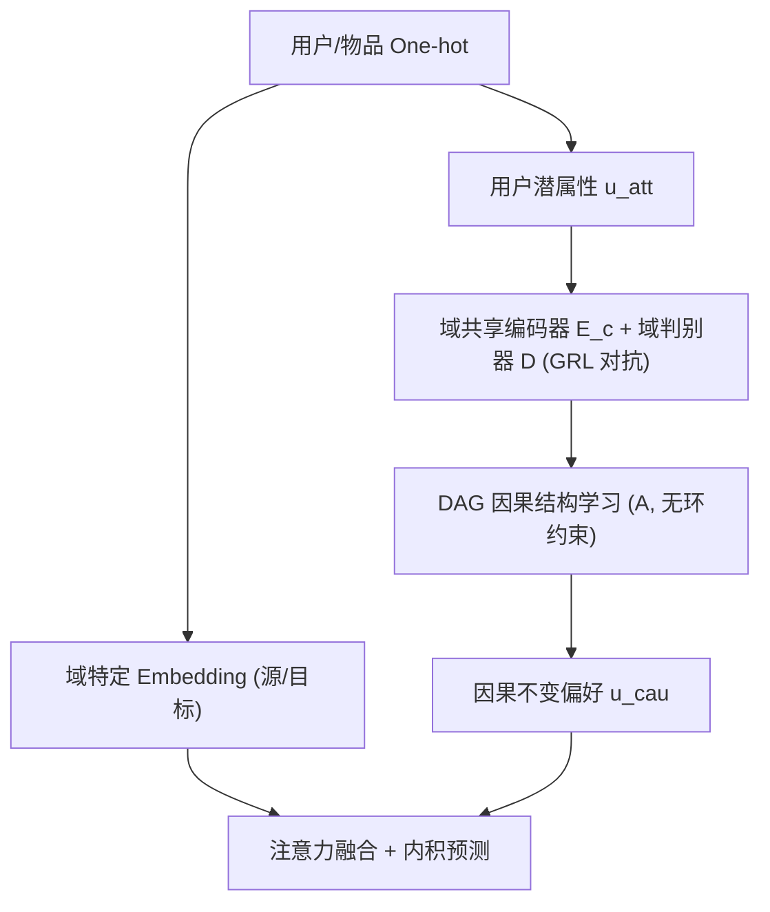

# Cross-Domain Causal Preference Learning for Out-of-Distribution Recommendation (跨域因果偏好学习用于分布外推荐)

- **会议/期刊**: DASFAA 2025
- **作者与机构**: Zhuhang Li, Ning Yang（四川大学计算机学院）
- **推荐链路定位**: 召回（单目标跨域 Top-N 排序）
- **研究方向**: 跨域与多场景推荐 / 去偏与因果推荐
- **论文原文**: [https://arxiv.org/abs/2404.14856v1](https://arxiv.org/abs/2404.14856v1)
- **开源代码**: [https://github.com/Rexhaha/CDCOR](https://github.com/Rexhaha/CDCOR)

## TL;DR (1分钟核心速览)

针对用户属性漂移（收入、性别构成变化）导致的训练/测试分布不一致，本文提出 CDCOR：用域对抗网络从用户潜属性中抽取**域共享偏好**，再用 DAG 学习器在潜属性与偏好之间学习**因果不变结构**，从而把数据丰富源域的因果知识迁移到稀疏目标域。在 Douban 与 Tenrec 的 Leave-One-Out + 99 负采样协议下，OOD#1 场景 HR@10 相对最强基线 DCCL 提升约 1.6%（Douban）与 6.5%（Tenrec），且 OOD 性能衰减幅度最小（-5.5% vs. 基线 -8.7%）。

## Background & Motivation (背景与核心矛盾)

- **主流范式**: 现有 OOD 推荐分两派——解耦派（DICE 拆兴趣/从众、DCCL 用流行度加权 InfoNCE）与因果派（COR 人工指定因果图、CausPref 用 DAG 约束从数据学因果结构）。
- **前人局限**: ① 解耦派只针对特定偏置（流行度/曝光），无法覆盖"用户属性随时间演化"这类更普遍的分布漂移；② 因果派依赖**显式用户属性**（隐私受限常拿不到）且需**稠密数据**才能学对因果图，在目标域稀疏时因果与相关混淆、严重过拟合。
- **核心洞察 (Key Insight)**: 因果结构（属性→偏好 的生成过程）在分布漂移下保持不变，因此学到它即可获得 OOD 泛化；而源域与目标域共享用户，源域稠密交互恰好能补足目标域学因果所需的数据量。
- **本文切入点**: 把因果结构学习从"显式属性"下沉到"潜属性"，并用跨域对抗对齐保证所学因果是**域共享**的。

<figure class="paper-figure" markdown="span">
  <figcaption>图 2. CDCOR 的架构。源域为黄色，目标域为蓝色，域共享模块与因果结构学习模块为绿色。</figcaption>
</figure>

## Method (核心方法设计)

### 1. 整体框架 (Overall Architecture)

模型为端到端前馈网络，含三模块：**域特定模块**（各域独立 embedding 用户/物品并做最终预测）、**域共享模块**（用户潜属性经共享编码器 $E_c$得域共享偏好$u_c$，经域判别器$D$做对抗对齐）、**因果结构学习模块**（把潜属性$u_{att}$与域共享偏好$u_c$拼接为$H$，用加权邻接矩阵$A$建模因果图，输出因果不变偏好$u_{cau}$）。预测时融合域特定偏好与$u_{cau}$经注意力融合层后与物品内积。训练用 GRL 实现 min-max 对抗，推理阶段仅需输入$u_{att}$（$u_c$置零），由$A$ 直接推断偏好。

### 2. 关键设计拆解 (Key Designs)

1. **域共享偏好对抗抽取**：痛点是"共同偏好相似但不相同"（如用户看小说重情节、看电影重特效），直接共享会丢域特性。做法是让 $E_c$与判别器$D$玩 min-max：$\mathcal{L}_c=-\sum_n l_n\log\hat{l}_n+(1-l_n)\log(1-\hat{l}_n)$，判别器分不出 embedding 来自哪个域即视为域共享。直觉：GRL 反向传播翻转梯度，迫使编码器抹去域标识信息，只保留跨域共性。

2. **潜属性上的 DAG 因果学习**：痛点是用显式属性受隐私限制、用 user ID 又受陈旧交互污染。做法是把 $u_{att}\|u_c\in\mathbb{R}^{2k}$作为 SCM 节点，最小化$\mathcal{L}_{rec}=\frac{1}{N}\sum_i\|H_i-A^{\top}H_i\|_2^2$，并以$\mathrm{Tr}(e^{A\odot A})-k=0$保证无环。额外加两条推荐域约束：边只能从属性节点指向偏好节点（$\mathcal{L}_{a2p}$）、偏好节点不能是根节点（$\mathcal{L}_{pnr}$）。直觉：$A$ 刻画"属性如何生成偏好"，该生成机制跨分布不变，故可 OOD 外推。

3. **训练目标与推理效率**：总损失 $\mathcal{L}=\mathcal{L}_t+\lambda_1\mathcal{L}_s+\lambda_2\mathcal{L}_c+\lambda_3\mathcal{L}_{cau}+\lambda_4\|\theta\|_2$，其中$\mathcal{L}_{cau}=\mathcal{L}_{rec}+\gamma_1\mathcal{L}_{dag}+\gamma_2\mathcal{L}_{a2p}+\gamma_3\mathcal{L}_{pnr}+\gamma_4\|A\|_1$。负采样沿用 Leave-One-Out 的 1 正 99 负评估采样；推理时因果模块只需前向一次$2k\times 2k$ 稀疏矩阵乘，开销与普通 MLP 同量级。

## Experimental Setup & Evaluation Protocol (实验设置与评估协议)

- **数据集与预处理**: 评分 ≥4 视为正样本转为隐式反馈；Douban 取 movie→book，Tenrec 取 video→article。

| 数据集 | 源域 #Users/#Items/#Inter. | 目标域 #Users/#Items/#Inter. | 特征/场景说明 |
| :--- | :---: | :---: | :--- |
| Douban | 2106 / 9555 / 969937 | 2106 / 6777 / 95974 | 电影→图书，含评分 |
| Tenrec | 2151 / 37041 / 247942 | 2151 / 2869 / 37641 | 视频→文章，含性别属性 |

- **数据划分与防穿越**: 训练/验证/测试 = 8:1:1；IID 为随机采样；OOD#1（用户度数偏置）训练按原始分布采样、测试偏向高度数用户；OOD#2（用户属性偏置）按性别划分，训练 8:2、测试 2:8。
- **排名评测协议**: `Leave-One-Out` + 每正样本采样 99 负样本的 `Sampled Ranking`，指标 HR@{5,10}、NDCG@{5,10}，报告 5 次随机均值与标准差。
- **对比基线与超参**: 8 个基线覆盖传统（GMF、IPS）、跨域（DARec、HMRec、PTUPCDR）、解耦 OOD（DICE、DCCL）、因果 OOD（CausPref）；embedding 维度 $d=16$，学习率 0.01，$\lambda_1..\lambda_4=1,0.5,1,10^{-5}$。

## Key Experimental Results (实验关键数据)

### 1. 主实验对比 (Main Results)

Douban（IID 与 OOD#1，括号为相对 IID 的衰减）：

| 模型 | IID H@10 | IID N@10 | OOD#1 H@10 | OOD#1 N@10 |
| :--- | :---: | :---: | :---: | :---: |
| GMF | 0.3209 | 0.1791 | 0.2793(-12.99%) | 0.1491(-16.77%) |
| DICE | 0.3667 | 0.2073 | 0.3127(-14.71%) | 0.1724(-16.82%) |
| DCCL | 0.3850 | 0.2186 | 0.3516(-8.68%) | 0.1863(-14.76%) |
| PTUPCDR | 0.3444 | 0.1963 | 0.3096(-10.10%) | 0.1708(-13.00%) |
| CausPref | 0.3282 | 0.1878 | 0.2894(-11.80%) | 0.1589(-15.41%) |
| **CDCOR** | **0.3782** | **0.2166** | **0.3574(-5.50%)** | **0.1973(-8.90%)** |

Tenrec（OOD#1 / OOD#2，HR@10）：

| 模型 | IID H@10 | OOD#1 H@10 | OOD#2 H@10 |
| :--- | :---: | :---: | :---: |
| GMF | 0.6238 | 0.5444(-12.72%) | 0.5888(-5.61%) |
| DICE | 0.6993 | 0.6066(-13.26%) | 0.6601(-5.60%) |
| DCCL | 0.6536 | 0.5927(-9.32%) | 0.6452(-1.28%) |
| DARec | 0.6615 | 0.5644(-14.68%) | 0.6289(-4.93%) |
| CausPref | 0.6260 | 0.4984(-20.39%) | 0.5600(-10.55%) |
| **CDCOR** | **0.6878** | **0.6310(-8.25%)** | **0.6841(-0.54%)** |

### 2. 消融实验 (Ablation Study)

| 变体 | Douban OOD#1 H@10 | Tenrec OOD#1 H@10 | Tenrec OOD#2 H@10 |
| :--- | :---: | :---: | :---: |
| CDCOR 完整 | **0.3574** | **0.6310** | **0.6841** |
| w/o causal | 0.3388 | 0.5793 | 0.6476 |
| w/o source | 0.3375 | 0.6026 | 0.6637 |

### 3. 关键实验发现 (Key Findings)

1. **因果模块是 OOD 泛化的主引擎**：去掉因果学习后 Tenrec OOD#1 HR@10 从 0.6310 掉到 0.5793（-8.2%），衰减率从 -8.25% 恶化到 -13.13%，说明因果不变结构确实承担了分布漂移下的稳定性。
2. **源域知识对稀疏目标域不可或缺**：w/o source 在 Douban OOD#1 掉 5.6%（0.3574→0.3375），且数据密度降到 40% 时 CDCOR 相对优势进一步扩大，验证"源域补数据量→学对因果图"的假设。
3. **漂移越强优势越大**：在 Douban OOD#1 比例从 4:6 拉到 7:3 时，CDCOR 的 HR@10 曲线下降最平缓；Tenrec OOD#2 中 CDCOR 仅衰减 0.54%，而 CausPref 衰减 10.55%，说明纯因果派在无跨域支撑时对属性漂移极脆弱。

## Highlights & Limitations (亮点、对比与审稿批判)

- **与代表作对比 (vs. Prior Work)**: 相比 CausPref（单域 DAG、依赖显式属性、稀疏即崩），CDCOR 用跨域对抗把因果学习搬到潜属性并借源域稠密数据稳住结构学习；相比 DICE/DCCL（只解耦特定偏置因子），CDCOR 面向更一般的属性漂移；相比 DARec（仅做域对齐、无因果），CDCOR 多了不变性约束，OOD 衰减显著更小。
- **可迁移亮点**: ① "潜属性 + DAG + 域对抗"三件套可迁移到任何缺显式画像的冷启动/跨场景任务；② 推理时把共享偏好置零、仅用 $A$ 从属性推偏好，是一种低成本去域偏的部署技巧。
- **审稿级局限批判**: ① 假设源/目标域**完全共享用户**，非重叠用户场景未验证；② OOD 构造仅用度数偏置与性别比例两种人工切分，与真实时间演化漂移仍有差距；③ 因果图 $A$为$2k\times 2k$稠密学习，$k$增大时$\mathrm{Tr}(e^{A\odot A})$的矩阵指数开销与超参$\gamma_{1..4}$ 敏感度未做复杂度/敏感性分析。

## Rating (四维评分)

- **方法创新性 (Novelty)**: ⭐⭐⭐⭐ （首次把跨域知识引入 OOD 因果推荐，并将因果结构学习从显式属性推广到潜属性，思路清晰但组件均为已有模块的组合）
- **评估协议与实验扎实度 (Protocol & Experiments)**: ⭐⭐⭐ （双数据集 + IID/两种 OOD + 鲁棒性 + 稀疏性四组实验较完整，但仅 99 负采样排序、缺 Full-Ranking 与显著性检验）
- **写作与数学规范度 (Clarity & Rigor)**: ⭐⭐⭐⭐ （SCM、无环约束与两条领域约束公式定义完整，符号统一；部分超参选择缺少理论解释）
- **工业落地与复现价值 (Industrial & Practical Value)**: ⭐⭐⭐⭐ （代码开源、推理仅需一次稀疏矩阵乘，跨域共享用户假设在集团多业务场景中常见，落地门槛低）

