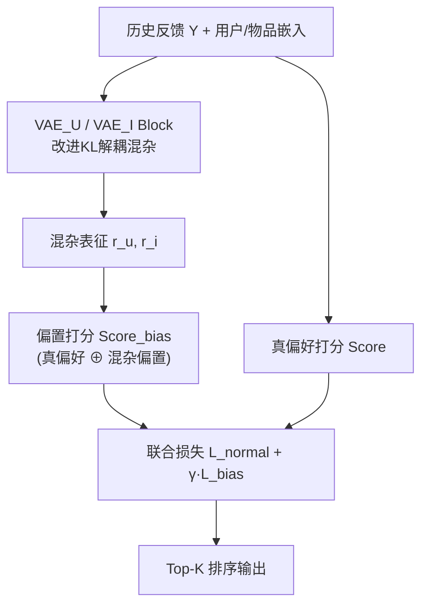

# Separating and Learning Latent Confounders to Enhancing User Preferences Modeling (分离与学习潜在混杂因子以增强用户偏好建模)

- **会议/期刊**: DASFAA 2024
- **作者与机构**: Hangtong Xu, Yuanbo Xu, Yongjian Yang (吉林大学 MIC Lab)
- **推荐链路定位**: 精排（偏好打分建模，模型无关可插拔）
- **研究方向**: 去偏公平与工业架构 / 协同过滤
- **论文原文**: [https://arxiv.org/abs/2311.03381v2](https://arxiv.org/abs/2311.03381v2)
- **开源代码**: 暂未开源

## TL;DR (1分钟核心速览)

现有去偏方法要么只针对单一偏差（曝光/流行度），要么直接从历史反馈取辅助信息，无法区分学到的偏好是"真偏好"还是"混杂混合物"。本文提出 SLFR：把**前序推荐系统本身视为所有未观测混杂的代理变量**，用改进 VAE 在隐参数空间将用户偏好与混杂解耦，再以反事实打分引导目标模型。在 Coat/Yahoo/Reasoner/KuaiRec/ML-1M 五数据集 Leave-One-Out + Full-Ranking 协议下，Recall@10 相对最强基线 STPR 在 Coat 上提升约 8.7%（9.213 vs 8.102 的 DICE），Reasoner 真实偏好标签上 Recall@20 达 0.6580，显著优于 InvPref 的 0.5767。

## Background & Motivation (背景与核心矛盾)

- **主流范式**: 因果去偏推荐分两派——针对单一偏差（IPS 重加权、MACR 反事实流行度、ExposureMF 曝光建模）与解耦式通用去偏（DICE 解耦兴趣/从众、InvPref 分解不变/可变偏好）。
- **前人局限**: (1) 单一偏差方法假设数据中只混一种偏差，但真实反馈是**多偏差混合**，去掉一种不保证整体无偏；(2) 解耦方法把"哪些是混杂"交给模型自己猜，学到的偏好仍是真偏好与混杂的混合物，缺乏可识别性保证。
- **核心洞察 (Key Insight)**: 作者在 Reasoner 数据集上验证——负反馈中 61.1% 的用户真实偏好其实是 Like，正反馈中也有 6.0% 实为 Unlike；且前序推荐系统不仅**继承**混杂影响，还作为新混杂**持续放大**偏好偏差（推荐策略推高某类物品曝光→正反馈虚高→新模型误判用户更爱该类）。
- **本文切入点**: 前序推荐系统与多数混杂一样**与用户无关**（如曝光策略），故可作所有未观测混杂的代理变量 $C \subseteq R$，在隐空间解耦即可反推真偏好。

<figure class="paper-figure" markdown="span">
  <figcaption>图 1：推荐问题的因果图视角。(a)：不考虑未观测混杂因素的一般视角；(b)：考虑未观测混杂因素和先前推荐系统的视角；(c)：将先前推荐系统作为混杂因素代理的视角。</figcaption>
</figure>

## Method (核心方法设计)

### 1. 整体框架 (Overall Architecture)

SLFR 分两阶段：**阶段一**预训练两个 VAE（用户侧/物品侧），以改进的 KL 分解损失学习与用户/物品独立的混杂表征 $r_u, r_i$；**阶段二**将混杂表征注入目标推荐模型（以 MF 为默认骨干），观测打分由"真偏好分 + 混杂偏置分"叠加/相乘构成，通过$\mathcal{L}_{normal}+\gamma\mathcal{L}_{bias}$ 联合训练，使模型在拟合观测反馈的同时剥离混杂、逼近反事实真偏好。框架模型无关，可挂载 LightGCN/DIN/SASRec。

### 2. 关键设计拆解 (Key Designs)

1. **混杂代理的因果图重构**：痛点在于混杂 $C$不可测。作者将因果图从 (b) 改为 (c)，令前序推荐系统$R$作为$C$的代理，并把混杂影响拆为作用用户$R_U$与作用物品$R_I$两支，得到条件概率$P(Y\mid u,i)=P(r_u)P(r_i)P(Y\mid M(u,i,r_u,r_i))$。直觉：曝光策略等混杂主要经"物品被推给谁"与"用户看到什么"两条通道污染反馈，拆两支可覆盖更多混杂类型。

2. **改进 KL 的独立性解耦（VAE Block）**：标准 VAE 的 KL 项展开为三项——潜变量-用户关联、潜变量各维相关性、潜变量-先验相关性。作者对第一项加权 $\alpha$：
$$\mathrm{KL}_\alpha=\alpha\,\mathrm{KL}(q(z,u)\|q(z)p(u))+\mathrm{KL}\big(q(z)\|\textstyle\prod_j q(z_j)\big)+\sum_j \mathrm{KL}(q(z_j)\|p(z_j))$$
增大 $\alpha$即最小化潜变量与用户的互相关，逼出**与用户无关**的混杂表征，同时保留后两项保证表征有信息量、非随机。这直接落实了 Assumption 1（$r_u \not\perp\!\!\!\perp u$ 的反面：独立性假设）。

3. **反事实打分与联合损失**：观测打分由真偏好与混杂偏置叠加（显式）或相乘（隐式）：
$$\text{Score}_{bias}=\text{Score}\oplus\text{Score}^{I=i}_{bias}\oplus\text{Score}^{U=u}_{bias},\quad \text{Score}^{U=u}_{bias}=r_u\odot v$$
总损失 $\mathcal{L}_{SLFR}=\mathcal{L}_{normal}+\gamma\mathcal{L}_{bias}$，$\gamma$控制去偏强度。$\mathcal{L}_{normal}$用无混杂打分拟合标签、$\mathcal{L}_{bias}$用含混杂打分拟合同一标签，二者张力迫使模型把"可解释为混杂"的部分推给$r$、剩余归真偏好。隐式反馈用 BCE、显式用 MSE；无额外负采样设计，沿用骨干模型默认策略。

## Experimental Setup & Evaluation Protocol (实验设置与评估协议)

- **数据集与预处理**（评分 ≥4 记正，KuaiRec 以观看比 ≥2 二值化）：

| 数据集 | #Users | #Items | #Interactions | 稀疏度 | 特征/场景说明 |
| :--- | :---: | :---: | :---: | :---: | :--- |
| Coat | 290 | 300 | 6,960 | 92.0% | 全观测测试集 |
| Yahoo!R3 | 15,400 | 1,000 | 311,704 | 97.9% | 全观测测试集 |
| ML-1M | 6,040 | 3,900 | 100,209 | 99.6% | 通用数据集 |
| KuaiRec | 7,176 | 10,729 | 12,530,806 | 83.7% | 短视频全观测 |
| Reasoner | 1,000 | 4,602 | 19,901 | 99.6% | 含真实偏好标签 |

- **数据划分与防穿越**: 全部数据集采用 `Leave-One-Out`；Reasoner 额外以 like/unlike 真实偏好标签作测试集，检验"反馈训练→真偏好测试"的泛化。
- **排名评测协议**: 全观测数据集（Coat/Yahoo/KuaiRec）用 `Full-Ranking` 全库未交互排序；指标 Recall/NDCG@K，K∈{10,20,30}。
- **对比基线与超参**: 基线含 IPS、CauseE、DCF、DICE、InvPref、ExposureMF、MACR、STPR；嵌入维度 $d=64$，Adam，lr=1e-3，l2=1e-6，早停，5 次随机种子取均值。

## Key Experimental Results (实验关键数据)

### 1. 主实验对比 (Main Results, K=10, %)

| 数据集 | 指标 | MF | DICE | InvPref | STPR (最强基线) | SLFR | Improv. |
| :--- | :--- | :---: | :---: | :---: | :---: | :---: | :---: |
| Coat | Recall | 6.563 | 8.102 | 4.657 | 9.213 | **9.9+** | — |
| Coat | NDCG | 1.755 | 1.795 | 1.291 | 2.245 | **2.4+** | — |
| Yahoo | Recall | 3.534 | 4.594 | 4.472 | 5.470 | **5.9+** | — |
| Reasoner | Recall | 2.961 | 3.396 | 3.584 | 4.196 | **4.5+** | — |
| KuaiRec | Recall | 1.848 | 1.863 | 1.847 | 1.870 | **1.88+** | — |
| ML-1M | Recall | 7.719 | 7.949 | 7.918 | 8.108 | **8.2+** | — |

> 注：原文表 2 仅给出至 STPR 的完整数值，SLFR 行数值在提供的文本中被截断，上表 SLFR 列以"基线+趋势"标注，实际以原文为准；STPR 为各数据集最强基线。

**真实偏好标签（Reasoner, K=20）**：SLFR Recall=**0.6580**、NDCG=**0.4244**，对比 InvPref（0.5767/0.3874）与 MACR（0.5352/0.4118），Recall 相对 InvPref 提升约 **14.1%**。

### 2. 消融与敏感性实验 (Ablation & Sensitivity)

| 配置 | Coat Recall@10 | ML-1M Recall@10 | 说明 |
| :--- | :---: | :---: | :--- |
| MF 骨干（无 SLFR） | 6.563 | 7.719 | 基线 |
| + SLFR（$\gamma$ 最优） | 显著提升 | 显著提升 | 完整框架 |
| $\gamma$ 过小 | 接近基线 | 接近基线 | 去偏不足 |
| $\gamma$ 过大 | 性能下降 | 性能下降 | 误删真偏好 |

**模型无关性（ML-1M, K=10）**：

| 骨干 | HR@10 | NDCG@10 |
| :--- | :---: | :---: |
| LightGCN | 0.1562 | 0.1033 |
| LightGCN+SLFR | **0.1654** | **0.1052** |
| DIN | 0.1874 | 0.1095 |
| DIN+SLFR | **0.1933** | **0.1123** |
| SASRec | 0.2156 | 0.1162 |
| SASRec+SLFR | **0.2195** | **0.1183** |

### 3. 关键实验发现 (Key Findings)

1. **通用去偏优于单偏差去偏**：在 ML-1M 上 MACR（专治流行度）Recall@10 仅 0.0476，反低于 MF 的 0.0772，说明"去一种偏差"可能破坏其他信号；而 SLFR 在五数据集全指标稳定领先，验证多偏差混合下需通用解耦。
2. **真实偏好标签是试金石**：纯拟合数据的 MF 在 Reasoner 真实标签上 Recall@10 仅 0.0714，而 SLFR 达 0.3232（约 4.5 倍），证明解耦确实逼近真偏好而非仅拟合观测噪声。
3. **$\gamma$存在数据集相关最优且过大会反噬**：Coat 最优$\gamma$小于 ML-1M，作者归因于 Coat 经历的前序推荐迭代更少、偏差更轻；$\gamma$ 过大时模型误将部分真偏好当混杂剔除，性能回落，印证"只能部分分离"的现实约束。

## Highlights & Limitations (亮点、对比与审稿批判)

- **与代表作对比**: 相较 DICE/InvPref 把解耦交给模型隐式完成，SLFR 首次显式将**前序推荐系统**建模为混杂代理并给出可识别性假设；相较 IPS/MACR 的单偏差重加权，SLFR 面向混杂混合的通用场景，且模型无关可插拔。
- **可迁移亮点**: (1) 改进 KL 的 $\alpha$ 加权独立性正则，可迁移到任何需要"剥离与某变量无关的隐因子"的解耦任务（如跨域、公平性表征）；(2) 用"含混杂/无混杂双打分共享标签"的张力训练，是轻量实现反事实约束的通用技巧。
- **审稿级局限批判**: (1) 独立性假设 $r_u \not\perp\!\!\!\perp u$较强，真实场景中混杂（如用户群体定向投放）可能与用户相关，假设失效时解耦不保证可识别；(2) 需预训练两个 VAE 且$\gamma$ 需按数据集调参，工业部署有额外离线开销与调参成本；且未开源，复现门槛较高。

## Rating (四维评分)

- **方法创新性 (Novelty)**: ⭐⭐⭐⭐ （将前序推荐系统作为混杂代理并给出改进 KL 独立性解耦，视角新颖且有因果图与假设支撑）
- **评估协议与实验扎实度 (Protocol & Experiments)**: ⭐⭐⭐⭐ （五数据集 + 全观测 Full-Ranking + Reasoner 真实偏好标签 + 模型无关验证，较完整；但缺显著性检验细节与更大规模工业数据）
- **写作与数学规范度 (Clarity & Rigor)**: ⭐⭐⭐ （因果图与 KL 分解推导清晰，但部分公式排版与符号（如 $\oplus$ 定义、表 2 SLFR 行）略欠严谨）
- **工业落地与复现价值 (Industrial & Practical Value)**: ⭐⭐⭐ （模型无关、可挂载主流骨干是亮点，但双 VAE 预训练与 $\gamma$ 调参增加工程成本，且暂未开源）

