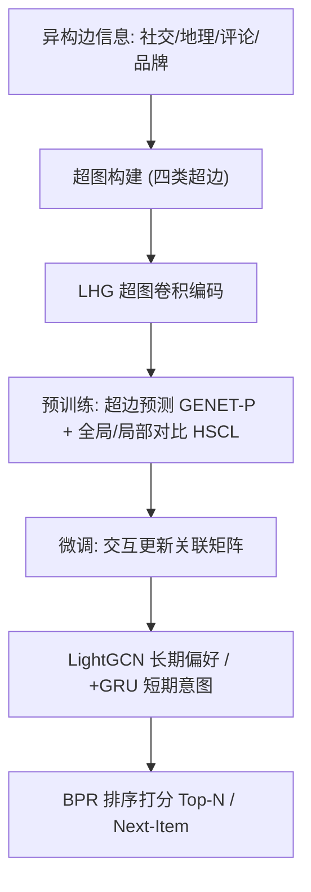
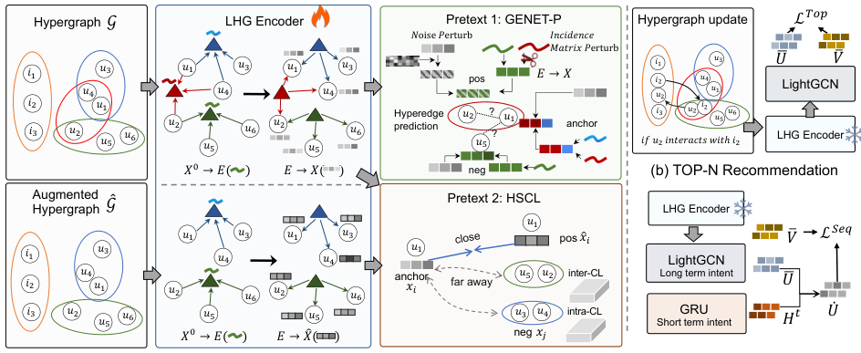

# GENET: Unleashing the Power of Side Information for Recommendation via Hypergraph Pre-training (基于边信息超图预训练的推荐框架)

- **会议/期刊**: DASFAA 2025
- **作者与机构**: Yang Li, Qi'ao Zhao, Chen Lin, Zhenjie Zhang, Xiaomin Zhu, Jinsong Su（厦门大学、新加坡 Neuron Mobility、军事科学院、上海人工智能实验室）
- **推荐链路定位**: 召回（表征预训练 + 下游微调）
- **研究方向**: 图神经网络与知识图谱推荐 / 冷启动与长尾推荐
- **论文原文**: [https://arxiv.org/abs/2311.13121v2](https://arxiv.org/abs/2311.13121v2)
- **开源代码**: [https://anonymous.4open.science/r/GENET-D582/](https://anonymous.4open.science/r/GENET-D582/)

## TL;DR (1分钟核心速览)

现有边信息推荐方法（特征拼接、附加图模型、多任务监督）在跨域跨类型边信息下普遍失效——论文图 1 显示 FREEDOM、SPEX 等接入 LightGCN/SimRec 后 NDCG@10 反而下降 2.6%–46%。GENET 提出将社交网络、POI 地理、评论情感、品牌类目四类异构边信息统一构建为超图，在**与反馈无关的边信息上预训练**（超边预测 + 超图全局/局部对比），再在用户-物品二部图上用 LightGCN/GRU 微调。在 Gowalla/Foursquare/Books 三数据集、Leave-One-Out 全库排序协议下，Top-N 的 NDCG@10 最高提升 14.98%，序列推荐最高提升 37.88%，冷启动场景提升 175% 以上。

## Background & Motivation (背景与核心矛盾)

- **主流范式**: 边信息利用分三派——特征级（HIRE/FDSA 直接相加或注意力融合）、模型级（FREEDOM/Flashback 构建附加 item 图）、信号级（SPEX 多任务学习引入社交监督）。
- **前人局限**: 其一，边信息体量常超过用户/物品本身与反馈数据，直接参与训练会**淹没 ID 特征与反馈信号**，导致负迁移；其二，现有方法多为单一格式（序列或图）量身定制，面对文本序列、数值特征、关系数据混合的异构边信息时表征能力不足。
- **核心洞察 (Key Insight)**: 论文图 1 的实证极具说服力——在 Gowalla 上 FREEDOM 接入 SimRec 后 NDCG@10 仍比无侧信息的 SimRec 低 34.3%，说明问题不在"信息不够"而在"融合方式错误"。预训练-微调范式可将边信息知识与反馈学习解耦，从根源上避免 overshadowing。
- **本文切入点**: 用超图这一天然支持多节点超边的结构统一承载异构边信息，并设计超图专属的预训练任务，让表征在进入推荐任务前就已编码高阶多元关系。

## Method (核心方法设计)

### 1. 整体框架 (Overall Architecture)

GENET 分两阶段。**预训练阶段**：将四类边信息分别构建为超图（社交圈超边、k-means 聚类的地理区域超边、品牌粉丝超边、品牌/类目超边），用轻量超图卷积编码器 LHG 在节点-超边间双向传播得到用户/物品表征，再以超边预测（GENET-P）与超图自对比（HSCL）联合优化。**微调阶段**：依据用户-物品交互更新关联矩阵，把交互关系"注入"预训练超图，再以 LightGCN 捕获长期偏好（Top-N）或叠加 GRU 捕获短期意图（序列推荐），用 BPR 式排序损失训练。

<figure class="paper-figure" markdown="span">
  <figcaption>图 3. GENET 预训练阶段与微调阶段的框架</figcaption>
</figure>

### 2. 关键设计拆解 (Key Designs)

1. **LHG 轻量超图编码器（去非线性以保信息聚合）**：HGNN+ 中的非线性激活在超图传播中会削弱高阶信息的线性叠加性。GENET 移除激活函数，采用节点→超边→节点的两步线性传播：$\mathbf{E} = \mathbf{D}_e^{-1}\mathbf{H}^{\top}\mathbf{X}_0\Theta_0,\ \mathbf{X} = \mathbf{D}_v^{-1}\mathbf{H}\mathbf{E}$。线性化使多层超图传播退化为可预计算的矩阵乘，既保留高阶邻域聚合又大幅降低预训练开销。

2. **保高阶结构的正样本扰动（NP + IMP 双扰动）**：图预训练惯用的"删边造子图"在超图上不可行——超边不可分解，删边即破坏超边语义。GENET 改为：节点扰动 $\tilde{\mathbf{x}}_j^{g} = \mathcal{N}(\mathbf{x}_j, \lambda\mathbf{I})$注入高斯噪声；关联矩阵扰动令$h(x_j, e_h)=0$后重新传播得$\mathbf{x}_j^{a} = (\hat{\mathbf{D}}_v^{-1}\hat{\mathbf{H}}\mathbf{W}\mathbf{E})_j$，二者相加得扰动正样本$\tilde{\mathbf{x}}_j$。超边预测损失为$\mathcal{L}_P = -\sum_{i,j,k}\sigma(\mathbf{x}_i\cdot\tilde{\mathbf{x}}_j - \mathbf{x}_i\cdot\mathbf{x}_k)$。IMP 切断锚点与条件超边的连接以防信息泄漏，使模型必须真正学习超边内的高阶依赖而非"抄近路"。

3. **全局-局部双层超图自对比与训练目标**：仅有超边预测只能学到局部邻接，GENET 补充 inter-hyperedge 对比（锚点 vs 增广超图正样本，负样本为 batch 内其他节点，刻画全局结构）与 intra-hyperedge 对比（负样本限定为同一超边内其他节点，刻画超边内局部差异性），总损失 $\mathcal{L}_{Pre} = \mathcal{L}_P + \beta_1\mathcal{L}_{intra} + \beta_2\mathcal{L}_{inter}$，$\beta_1=0.005,\beta_2=0.01$。微调阶段负采样为标准 BPR 随机负采样，无需额外难负样本挖掘；预训练 500 epoch、嵌入 64 维、batch 4096，微调仅 10 epoch 且前 3 epoch 学习率放大 10 倍以加速知识迁移。

## Experimental Setup & Evaluation Protocol (实验设置与评估协议)

- **数据集与预处理**:

| 数据集 | #Users | #Items | #Interactions | 稀疏度/密度 | 特征/场景说明 |
| :--- | :---: | :---: | :---: | :---: | :--- |
| Gowalla | 10,671 | 48,587 | 1,195,532 | 0.23% | 社交关系 + POI 经纬度 |
| Foursquare | 22,065 | 9,891 | 182,044 | 0.08% | 社交关系 + POI 经纬度 |
| Books | 28,898 | 85,188 | 3,233,028 | 0.13% | 商品评论 + 类目（1.6 亿条关系） |

- **数据划分与防穿越**: 采用 `Leave-One-Out`（与 SPEX 一致），每个用户最后一条交互作测试、倒数第二条作验证；微调阶段更新超图时**仅使用训练集交互**，避免测试信息泄漏。
- **排名评测协议**: 无偏 `Full-Ranking`（全库未交互物品排序），指标 NDCG@{10,20} 与 Recall@{10,20}。
- **对比基线与超参设置**: 覆盖四类共 17 个基线——无侧信息（NGCF/LightGCN/SGL/HCCF/SASRec/BERT4Rec/CBiT）、仅预训练（SimRec）、有侧信息无预训练（SPEX/HIRE/FREEDOM/Flashback/HGNN+/S³-Rec）、有侧信息有预训练（Graph-Flashback）。嵌入维度 64，LightGCN 层数 K=2，Adam 优化器，预训练学习率 5e-4、微调 5e-4。

## Key Experimental Results (实验关键数据)

### 1. 主实验对比 (Main Results)

**Top-N 推荐（NDCG@10 / Recall@10）**:

| 模型 | Gowalla N@10 | Gowalla R@10 | Foursquare N@10 | Foursquare R@10 | Books N@10 | Books R@10 |
| :--- | :---: | :---: | :---: | :---: | :---: | :---: |
| LightGCN | 0.2782 | 0.4257 | 0.6091 | 0.7709 | 0.5792 | 0.8303 |
| SGL | 0.5607 | 0.7501 | 0.6192 | 0.7597 | 0.6689 | 0.8433 |
| SimRec | 0.6132 | 0.8682 | 0.6274 | 0.7984 | 0.6026 | 0.8552 |
| FREEDOM | 0.5916 | 0.8536 | 0.6151 | 0.7740 | N/A | N/A |
| HGNN+ | 0.6256 | 0.7244 | 0.3859 | 0.5013 | 0.1914 | 0.2904 |
| Graph-Flashback | 0.2052 | 0.3384 | 0.5398 | 0.6999 | N/A | N/A |
| **GENET** | **0.7193** | **0.9412** | **0.7081** | **0.8835** | **0.7009** | **0.9159** |
| Improv.% | +14.98% | +8.41% | +12.86% | +10.66% | +4.79% | +7.10% |

**序列推荐（NDCG@10 / Recall@10）**:

| 模型 | Gowalla N@10 | Gowalla R@10 | Foursquare N@10 | Foursquare R@10 | Books N@10 | Books R@10 |
| :--- | :---: | :---: | :---: | :---: | :---: | :---: |
| SASRec | 0.2516 | 0.3784 | 0.6425 | 0.7906 | 0.2474 | 0.4489 |
| BERT4Rec | 0.2693 | 0.4188 | 0.6988 | 0.8424 | 0.4329 | 0.6288 |
| CBiT | 0.6591 | 0.8592 | 0.6460 | 0.8485 | 0.4356 | 0.6440 |
| S³-Rec | 0.5819 | 0.8308 | 0.6634 | 0.8241 | 0.4239 | 0.6738 |
| Graph-Flashback | 0.7282 | 0.8939 | 0.7368 | 0.8508 | N/A | N/A |
| **GENET** | **0.7505** | **0.9468** | **0.7561** | **0.9040** | **0.6006** | **0.8057** |
| Improv.% | +3.06% | +5.92% | +2.62% | +6.25% | +37.88% | +19.58% |

### 2. 消融实验 (Ablation Study)

| 变体 | Gowalla N@10 | Gowalla R@10 | 相对完整模型变化 |
| :--- | :---: | :---: | :---: |
| w/o NP（去节点扰动） | — | 0.9290 | N@10 −0.0185, R@10 −0.0124 |
| w/o IMP（去关联矩阵扰动） | — | 0.9233 | N@10 −0.0332, R@10 −0.0181 |
| w/o HSCL（去超图自对比） | — | 0.9311 | N@10 −0.0196, R@10 −0.0103 |
| **GENET 完整** | **0.7193** | **0.9412** | — |

### 3. 关键实验发现 (Key Findings)

1. **IMP 是预训练的核心引擎**：移除关联矩阵扰动后 NDCG@10 下降 0.0332，降幅约为移除 NP 的 1.8 倍。原因在于仅保留 NP 时超边预测任务过于简单，模型无需学习超边内的高阶依赖即可区分正负样本，印证了"防信息泄漏"设计的必要性。
2. **预训练任务选择上"对比优于生成、链接优于重建"**：在 FourSquare 上 GENET-P 相比最佳图预训练基线 LP-C 的 Recall@10 提升 28.24%、NDCG@10 提升 30.86%；且 GENET-P 在**不微调**直接算相似度时，Books 上 Recall@10 已达 0.8946，而所有对比预训练任务均低于 0.5379，说明超图预训练本身已编码了强判别性表征。
3. **冷启动收益远超常规场景**：用户冷启动下 NDCG@10 相比 SimRec 提升 321.50%–869.53%，物品冷启动下最高达 5191.67%。这直接验证了社交超边对用户偏好建模、地理/品牌超边对物品属性建模的有效性——当反馈信号缺失时，边信息预训练表征成为唯一可靠信号源。

## Highlights & Limitations (亮点、对比与审稿批判)

- **与代表作对比 (vs. Prior Work)**: 与 FREEDOM（item-item 图 + 特征融合）相比，GENET 不把边信息塞进推荐损失，而是隔离到预训练阶段，从根本上规避负迁移；与 Graph-Flashback（图预训练）相比，超图天然支持多节点超边，能表达"一个社交圈/一个地理区域"这类多元高阶关系，而非仅成对边；与 SimRec（反馈数据自监督预训练）相比，GENET 在反馈稀疏时仍能从边信息中获得监督，冷启动优势悬殊。
- **可迁移亮点**: 其一，"关联矩阵扰动 + 重传播"的正样本增广思路可迁移到任何超图/异构图对比学习场景，避免破坏高阶结构；其二，微调阶段"前 3 epoch 学习率放大 10 倍"的预热策略是低成本加速预训练知识迁移的实用技巧。
- **审稿级局限批判**: 其一，超图构建依赖领域先验（k-means 聚类数、粉丝判定阈值、情感挖掘规则），跨域迁移时这些超参需重新调优，论文未给出敏感性分析；其二，预训练 500 epoch + 超图传播的离线开销未量化，且 Books 数据集 1.6 亿条关系使 FREEDOM/Flashback 等基线直接 OOM（24GB 显存），公平性对比存疑；其三，冷启动实验仅取交互最少的 1% 用户/物品，极端稀疏下的方差未报告。

## Rating (四维评分)

- **方法创新性 (Novelty)**: ⭐⭐⭐⭐ （超图统一异构边信息 + 保高阶结构的双扰动预训练任务组合新颖，但预训练-微调范式本身非首创）
- **评估协议与实验扎实度 (Protocol & Experiments)**: ⭐⭐⭐⭐ （三数据集两任务 17 基线覆盖全面、Leave-One-Out 全库排序规范，但缺超参敏感性与方差报告）
- **写作与数学规范度 (Clarity & Rigor)**: ⭐⭐⭐⭐ （公式简洁、动机实证图 1 极具说服力，但部分符号如 $\mathbf{W}$与$\Theta$ 的关系交代略含糊）
- **工业落地与复现价值 (Industrial & Practical Value)**: ⭐⭐⭐⭐ （LHG 线性化降低开销、微调仅 10 epoch，代码已匿名开源，但超图构建的领域规则工程化成本较高）

