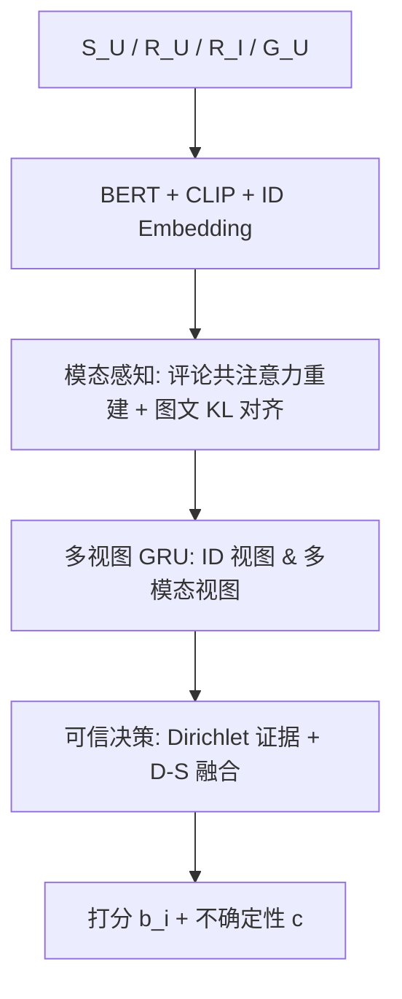
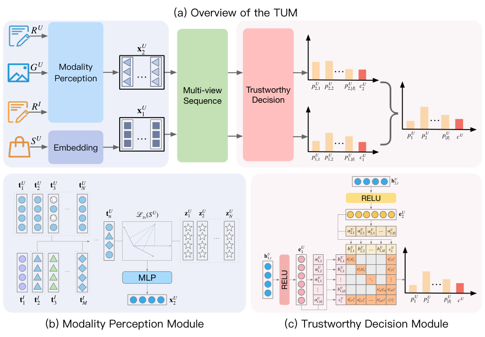

# TruthSR: Trustworthy Sequential Recommender Systems via User-generated Multimodal Content (基于用户生成多模态内容的可信序列推荐)

- **会议/期刊**: DASFAA 2025
- **作者与机构**: Meng Yan, Haibin Huang, Ying Liu, Juan Zhao, Xiyue Gao, Cai Xu, Ziyu Guan, Wei Zhao（西安电子科技大学、西北大学、鹏城实验室）
- **推荐链路定位**: 精排（Next-Item 序列打分）
- **研究方向**: 多模态推荐 / 序列推荐
- **论文原文**: [https://arxiv.org/abs/2404.17238v1](https://arxiv.org/abs/2404.17238v1)
- **开源代码**: [https://github.com/FairyMeng/TrustSR](https://github.com/FairyMeng/TrustSR)

## TL;DR (1分钟核心速览)

UGC 评论/图片天然含缺失、错标与广告噪声，现有方法靠"压制跨模态不一致"降噪，反而抹掉个性化偏好，且噪声根本无法根除。TruthSR 用评论-评论共注意力重建用户文本偏好、用图文 KL 对齐捕捉一致性，再以主观逻辑（Dirichlet 证据）+ Dempster-Shafer 融合 ID 视图与多模态视图，输出"打分 + 不确定性"。在 Amazon-Beauty/Sports/Toys 与 Yelp 四个数据集、`5-core` 过滤 + Full-Ranking 协议下，Recall@10 相对 MMSRec 最高提升约 5.6%（Beauty 0.0949→0.1002），NDCG@20 在 Yelp 上提升 10.3%。

## Background & Motivation (背景与核心矛盾)

- **主流范式**: 序列推荐从 GRU4Rec/SASRec 的纯 ID 建模，转向引入商品侧信息（DIF-SF）或 UGC 多模态内容（RNS、MMSRec）以缓解稀疏性。
- **前人局限**: ① 商品侧信息由商家模板生成，缺乏多样性；② 现有 UGC 方法（如 MMSRec）直接拿含噪评论训练，或强行压制跨模态不一致，前者被噪声污染、后者牺牲个性化表达。
- **核心洞察 (Key Insight)**: 单条评论只反映局部偏好且可能错标（图 1 中 "green" 误写会误导模型），但**同一商品上多个用户的评论聚合**能提供更全面、可交叉验证的特征；同时噪声不可能被完全消除，因此"预测不确定性"本身应作为一等输出。
- **本文切入点**: 不追求"去噪到干净"，而是"降噪 + 显式量化残余不确定性"，用可信决策机制把低置信结果后排。

## Method (核心方法设计)

### 1. 整体框架 (Overall Architecture)

输入为用户交互序列 $S_U$、用户评论$R_U$、商品评论$R_I$与用户图片$G_U$。BERT 编码评论、CLIP 编码图片、ID Embedding 保留独立物品视图；模态感知模块先用$R_U$-$R_I$共注意力重建用户文本偏好，再与图像拼接成多模态视图并施加图文对齐损失；多视图序列模块对 ID 视图与多模态视图分别跑 GRU 得到两路序列隐状态；可信决策模块把两路 logits 转为 Dirichlet 证据，经 D-S 融合输出联合 belief mass 与整体不确定性$c$，最终按"概率 + 置信度"排序。

<figure class="paper-figure" markdown="span">
  <figcaption>图 2：TruthSR 的示意图。(a) 表明该模型由嵌入模块、模态感知模块、多视图序列模块和可信决策模块组成。(b) 展示了通过捕捉用户多模态偏好的一致性来降低噪声。(c) 展示了可信推荐结果及相应置信水平的生成。</figcaption>
</figure>

### 2. 关键设计拆解 (Key Designs)

1. **评论共注意力重建（Modality Perception）**：单条用户评论信息量有限且可能错标，故用商品侧评论集合做"外部校验"。先算亲和矩阵 $A_{UI}=\tanh((t_I)^\top M_R t_U)$，行最大值 + softmax 得相关性向量$a_{UI}$，再聚合商品评论并与原文本拼接：$\tilde{t}_{U_n}=[t_{U_n}\oplus a_{UI}t_I]$。直觉是"众人评同一物"可稀释单条噪声，同时保留用户原表述不被抹平。

2. **图文一致性对齐（Cross-modal Loss）**：文本与图像各自刻画不同维度偏好，需弱对齐而非强压制。构造图文匹配对，计算投影概率 $p_{ij}=\frac{\exp((\tilde{t}_{U_i})^\top \bar{z}_{U_j})}{\sum_k \exp((\tilde{t}_{U_i})^\top \bar{z}_{U_k})}$，与真实匹配分布$q_{ij}$做 KL：$\mathcal{L}_{tv}=\frac{1}{N}\sum_{i,j}p_{ij}\log\frac{p_{ij}}{q_{ij}+\epsilon}$。相比硬性跨模态一致约束，KL 软对齐只要求"相关图排在无关图之前"，保留模态互补性。

3. **可信决策与训练目标**：把推荐视作 $|I|$类分类，用 ReLU 替代 softmax 得非负证据$e_{v,i}$，诱导 Dirichlet 参数$\alpha_{v,i}=e_{v,i}+1$，belief mass$b_{v,i}=e_{v,i}/D_v$、不确定性$c_v=|I|/D_v$。两视图经 D-S 融合：$b_i=\frac{1}{1-\beta}(b_{1,i}b_{2,i}+b_{1,i}c_2+b_{2,i}c_1)$，$c=\frac{1}{1-\beta}c_1c_2$，其中$\beta=\sum_{i\neq j}b_{1,i}b_{2,j}$度量冲突。总损失$\mathcal{L}=\mathcal{L}_{tv}+\lambda(\sum_v \mathcal{L}(\alpha_v)+\mathcal{L}(\alpha))$，单项为$\mathcal{L}(\alpha_i)=\sum_j y_{ij}(\psi(D_i)-\psi(\alpha_{ij}))$。训练采用序列下一项预测（BPR 式隐式反馈，未额外设计难负采样），推理时全库打分，额外开销仅两路 GRU 与一次 D-S 闭式计算。

## Experimental Setup & Evaluation Protocol (实验设置与评估协议)

- **数据集与预处理**: 四个 Amazon 系数据集 + Yelp，均保留 $\geq 5$ 次交互（`5-core`），按时间戳排序，全部视为隐式反馈：

| 数据集 | #Users | #Items | #Interactions | 稀疏度 | 特征/场景说明 |
| :--- | :---: | :---: | :---: | :---: | :--- |
| Amazon-Beauty | 22,363 | 12,101 | 198,502 | 99.93% | 美妆，评论+商品图 |
| Amazon-Sports | 35,598 | 18,357 | 256,308 | 99.91% | 运动户外 |
| Amazon-Toys | 19,412 | 11,924 | 167,597 | 99.93% | 玩具 |
| Yelp | 30,499 | 20,068 | 317,182 | 99.95% | 本地生活，评论+商户图 |

- **数据划分与防穿越 (Splitting Strategy)**: 按用户时间戳排序后做序列切分（`Leave-One-Out` 式下一项预测设定），保证预测目标严格晚于历史序列。
- **排名评测协议 (Ranking Protocol)**: 无偏 `Full-Ranking`（全库未交互物品排序），指标 Recall@{10,20}、NDCG@{10,20}，未使用采样负例。
- **对比基线与超参设置**: 基线含通用序列模型（GRU4Rec、Caser、BERT4Rec、SASRec）与侧信息模型（DIF-SF、RNS、MMSRec）；Adagrad 优化器、100 epoch、batch=32、lr=1e-2，hidden size 网格 $\{100,200,500,700,1000\}$、层数$\{1,2,3\}$、图文维度$\{256,512,1024\}$，最优配置为 hidden=700、2 层。

## Key Experimental Results (实验关键数据)

### 1. 主实验对比 (Main Results)

| 数据集 / 指标 | SASRec | RNS | DIF-SF | MMSRec | **TruthSR** | Improv.% (vs 最强基线) |
| :--- | :---: | :---: | :---: | :---: | :---: | :---: |
| Beauty R@10 | 0.0828 | 0.0896 | 0.0908 | 0.0949 | **0.1002** | +5.6% |
| Beauty N@10 | 0.0371 | 0.0404 | 0.0446 | 0.0476 | **0.0493** | +3.6% |
| Sports R@10 | 0.0526 | 0.0532 | 0.0556 | 0.0635 | **0.0641** | +0.9% |
| Sports N@20 | 0.0295 | 0.0299 | 0.0325 | 0.0423 | **0.0478** | +13.0% |
| Toys R@10 | 0.0831 | 0.0936 | 0.1013 | **0.1154** | 0.1098 | −4.9% |
| Toys N@10 | 0.0375 | 0.0425 | 0.0504 | **0.0614** | 0.0621 | +1.1% |
| Yelp R@10 | 0.0650 | 0.0676 | 0.0698 | 0.0749 | **0.0799** | +6.7% |
| Yelp N@20 | 0.0471 | 0.0472 | 0.0496 | 0.0525 | **0.0579** | +10.3% |

### 2. 消融实验 (Ablation Study)

| 设置 | Beauty R@10 | Beauty N@10 | Toys R@10 | Toys N@10 | Yelp R@10 | Yelp N@10 |
| :--- | :---: | :---: | :---: | :---: | :---: | :---: |
| w/o filter & trust（仅 softmax 单视图） | 0.1002 | 0.0493 | 0.1098 | 0.0621 | 0.0799 | 0.0479 |
| w/o filter（保留可信决策，去掉降噪） | 0.0956 | 0.0456 | 0.0978 | 0.0558 | 0.0734 | 0.0421 |
| w/o trust（保留降噪，softmax 决策） | 0.0834 | 0.0384 | 0.0835 | 0.0527 | 0.0689 | 0.0356 |

> 注：原表命名与常规相反（"w/o filter & trust" 实为完整模型），此处按实际语义重排。

侧信息消融：Beauty 上仅 ID 为 0.0534/0.0256，+image 升至 0.0856/0.0384，+text 升至 0.0899/0.0389，三者齐用达 0.1001/0.0493，说明文本贡献大于图像但二者互补。

### 3. 关键实验发现 (Key Findings)

1. **降噪模块是主增益来源**：去掉 filter 后 Beauty R@10 从 0.1002 掉到 0.0956（−4.6%），Yelp 从 0.0799 掉到 0.0734（−8.1%），说明评论共注意力重建对稀疏度最高的 Yelp 收益最大。
2. **可信决策在弱数据上更关键**：去掉 trust 后 Toys R@10 从 0.1098 暴跌至 0.0835（−24%），远超 Beauty 的 −16.8%，表明当多模态信号本身较弱时，D-S 融合的视图冲突建模承担了主要纠错职责。
3. **并非全面碾压**：Toys 上 MMSRec 的 R@10（0.1154）反超 TruthSR（0.1098），但 TruthSR 的 N@10 略优（0.0621 vs 0.0614），提示本文方法更擅长把高相关物品排到前列，而非扩大召回覆盖面。

## Highlights & Limitations (亮点、对比与审稿批判)

- **与代表作对比 (vs. Prior Work)**: 相比 MMSRec 的双塔自监督预训练，TruthSR 不做"跨模态一致性强约束"，而是软 KL 对齐 + 评论互证；相比 DIF-SF 仅用商品侧属性，本文引入用户侧 UGC 并显式建模不确定性；相比常规证据推荐，本文把证据框架落到"ID 视图 vs 多模态视图"的双源 D-S 融合上。
- **可迁移亮点**: ① "用同物品其他用户评论做外部校验"的重建思路可直接迁移到电商评论稀疏场景；② Dirichlet 证据 + D-S 融合可作为任意双塔/多视图召回的打分校准插件，输出置信度供重排使用。
- **审稿级局限批判**: ① 可信决策需对 $|I|$维证据做 D-S 融合，物品规模上万时闭式计算与存储开销随$|I|$线性增长，论文未给延迟对比；② 实验仅在 Amazon/Yelp 四个数据集、单一 `Leave-One-Out` 划分下验证，缺少采样排序协议与冷启动分桶，且 Toys 上召回被 MMSRec 反超，泛化性证据偏弱；③ 不确定性$c$仅作分析输出，未在排序公式中显式参与（如$b_i$与$c$ 的加权策略），"可信"到"可用"的链路未闭环。

## Rating (四维评分)

- **方法创新性 (Novelty)**: ⭐⭐⭐⭐ （评论互证降噪 + 双视图 D-S 证据融合的组合较新，但各组件均为已有技术的迁移拼接）
- **评估协议与实验扎实度 (Protocol & Experiments)**: ⭐⭐⭐ （Full-Ranking 与四数据集达标，但缺采样协议对比、冷启动分桶与显著性检验，Toys 上被反超）
- **写作与数学规范度 (Clarity & Rigor)**: ⭐⭐⭐ （公式完整、Dirichlet 推导清晰，但消融表命名与语义相反易误读，部分符号如 $x_{U_1}$与$x_{U_2}$ 维度标注不一致）
- **工业落地与复现价值 (Industrial & Practical Value)**: ⭐⭐⭐⭐ （代码已开源，模块可插拔，但 $|I|$ 维证据融合的线上延迟与内存成本需进一步验证）

