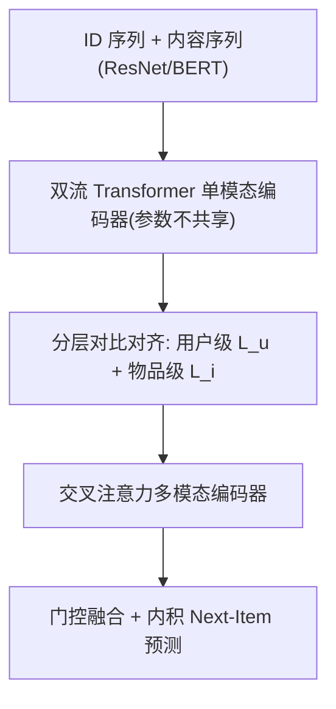
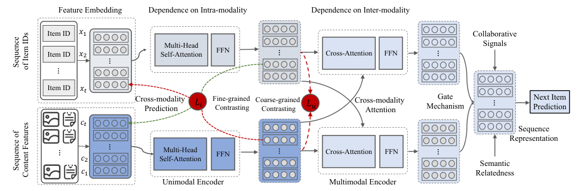

# Empowering Sequential Recommendation from Collaborative Signals and Semantic Relatedness (融合协同信号与语义相关性的序列推荐)

- **会议/期刊**: DASFAA 2024
- **作者与机构**: Mingyue Cheng, Hao Zhang, Qi Liu, Fajie Yuan, Zhi Li, Zhenya Huang, Enhong Chen, Jun Zhou, Longfei Li（中国科学技术大学、西湖大学、清华大学、蚂蚁集团）
- **推荐链路定位**: 召回（Next-Item 序列召回）
- **研究方向**: 序列与会话推荐 / 多模态推荐
- **论文原文**: [https://arxiv.org/abs/2403.07623v2](https://arxiv.org/abs/2403.07623v2)
- **开源代码**: [https://github.com/Mingyue-Cheng/TSSR](https://github.com/Mingyue-Cheng/TSSR)

## TL;DR (1分钟核心速览)

纯 ID 序列模型受交互稀疏所困，而内容特征（图像/文本）蕴含的语义相关性未被有效利用。本文指出简单拼接 ID 与内容嵌入反而掉点，根源是两模态嵌入存在巨大**语义鸿沟**。为此提出端到端双流架构 TSSR：两条独立 Transformer 编码 ID 序列与内容序列，再用**用户级粗粒度 + 物品级细粒度分层对比损失**对齐跨模态表征，并以交叉注意力建模跨模态依赖、门控融合输出。在 5 个公开数据集、Leave-One-Out + Full-Ranking 协议下，NDCG@10 相对 SASRec-ID 提升 3.74%–15.44%。

## Background & Motivation (背景与核心矛盾)

- **主流范式**: 序列推荐以 SASRec 类自注意力模型为主，仅从 ID 交互序列中学习协同信号；内容增强路线（FDSA、MFN4Rec、MV-RNN）则把图像/文本特征作为辅助序列输入。
- **前人局限**: 其一，纯 ID 模型在交互稀疏时表征质量差；其二，内容增强方法只是把内容特征"塞进"同一编码器，忽略了 ID 嵌入（共现协同信号）与内容嵌入（具体属性描述）在潜空间中天然不对齐，简单拼接（SASRec-Hybrid）在 Yelp 上 NDCG@10 从 0.0463 掉到 0.0425。
- **核心洞察 (Key Insight)**: 作者用 t-SNE 可视化（图 1）证实两模态嵌入分布显著分离；同时表 1 显示 **SASRec-Content 在 5 个数据集上全部不弱于甚至优于 SASRec-ID**（如 H&M 0.1035 vs 0.0963），说明内容序列本身携带强判别信号，问题不在"内容无用"，而在"融合方式错误"。
- **本文切入点**: 把 ID 与内容视为两种模态，先各自建模序列内依赖，再用分层对比显式拉近跨模态表征，最后交叉注意力建模模态间交互。

## Method (核心方法设计)

### 1. 整体框架 (Overall Architecture)

输入为同一用户行为的 ID 序列 $\mathbf{x}=[x_1,\dots,x_t]$与内容序列$\mathbf{c}=[c_1,\dots,c_t]$（图像经 ResNet、文本经 BERT 编码，可端到端微调）。两路各自加位置编码后送入**参数不共享**的 Transformer 单模态编码器（共享参数经实验验证更差，因两模态转移模式差异大），得到$\mathbf{F}_{id},\mathbf{F}_{con}$；随后经分层对比模块对齐，再进入以交叉注意力替代自注意力的多模态编码器（ID 作 Query、内容作 Key/Value，反之亦然），最后门控融合并做内积打分。

<figure class="paper-figure" markdown="span">
  <figcaption>图 2. TSSR 模型示意图，这是一种用于执行序列推荐的双流架构，其中协同信号和语义相关性被统一在一起。</figcaption>
</figure>

### 2. 关键设计拆解 (Key Designs)

1. **用户级粗粒度对比 ($\mathcal{L}_u$)**：把同一用户行为的 ID 序列表征与内容序列表征视为同一语义的两个视角（无需数据增广），做对称 InfoNCE。序列级表征由各时间步均值池化得到$\bar{\mathbf{F}}_{id}^u,\bar{\mathbf{F}}_{con}^u$，相似度用余弦：
$\mathcal{L}_u=-\frac{1}{|U|}\sum_{u}\left[\log\frac{\exp(s(\bar{\mathbf{F}}_{id}^u,\bar{\mathbf{F}}_{con}^u)/\tau)}{\sum_{j\in K}\exp(s(\bar{\mathbf{F}}_{id}^u,\bar{\mathbf{F}}_{con}^j)/\tau)}+\log\frac{\exp(s(\bar{\mathbf{F}}_{con}^u,\bar{\mathbf{F}}_{id}^u)/\tau)}{\sum_{j\in K}\exp(s(\bar{\mathbf{F}}_{con}^u,\bar{\mathbf{F}}_{id}^j)/\tau)}\right]$
   直觉：在"用户兴趣"这一粗粒度上先把两个模态拉到同一语义邻域，为细粒度对齐提供良好初值。

2. **物品级细粒度对比 ($\mathcal{L}_i$)**：用户级对齐过于粗糙，故引入跨模态预测任务——用 ID 模态第$l$步表征去预测内容模态第$l+1$ 步的物品嵌入，反之亦然，相似度改用内积：
$\mathcal{L}_i=-\frac{1}{|U|}\sum_{u}\sum_{l=1}^{t-1}\left[\log\frac{\exp(s(\mathbf{F}_{id}^{u,l},\mathbf{E}_{con}^{u,(l+1)})/\tau)}{\sum_{j\in G}\exp(s(\mathbf{F}_{id}^{u,l},\mathbf{E}_{con}^{j})/\tau)}+\log\frac{\exp(s(\mathbf{F}_{con}^{u,l},\mathbf{E}_{id}^{u,(l+1)})/\tau)}{\sum_{j\in G}\exp(s(\mathbf{F}_{con}^{u,l},\mathbf{E}_{id}^{j})/\tau)}\right]$
   直觉：逐步级对齐迫使模型学到"同一物品在另一模态中的表示"，等价于优化两模态互信息下界，直接缓解语义鸿沟。

3. **门控融合、训练目标与推理开销**：融合用逐维门控 $\mathbf{S}=\sigma(\mathbf{W}[\mathbf{F}_{id}',\mathbf{F}_{con}']+\mathbf{b})$，$\mathbf{F}=(\mathbf{S}\odot\mathbf{F}_{id}')+((1-\mathbf{S})\odot\mathbf{F}_{con}')$，让模型按样本自适应分配两模态权重。总损失$\mathcal{L}=\lambda_1\mathcal{L}_u+\lambda_2\mathcal{L}_i+\lambda_3\mathcal{L}_{ce}$，$\mathcal{L}_{ce}$ 为自回归交叉熵；对比负样本采用 **in-batch 共享**策略（同 batch 其他样本即负例），无额外负采样器。推理时仅需前向两路编码器 + 门控融合，但训练显存开销极大（H&M 上约 120G，而 SASRec-ID 仅约 2G）。

## Experimental Setup & Evaluation Protocol (实验设置与评估协议)

- **数据集与预处理**: 统一过滤交互数少于 5 的用户与物品（`5-core`）；H&M 随机采样 10 万用户。

| 数据集 | #Users | #Items | #Interactions | 平均交互/物品 | 内容模态 |
| :--- | :---: | :---: | :---: | :---: | :--- |
| H&M | 100,000 | 61,574 | 692,413 | 11.2 | 图像 |
| Yelp | 173,318 | 36,208 | 1,348,192 | 37.2 | 图像 |
| Phone | 128,647 | 42,675 | 841,657 | 19.7 | 图像 |
| Toy | 141,303 | 55,285 | 996,576 | 18.0 | 图像 |
| MIND | 768,079 | 81,496 | 10,437,301 | 128.1 | 文本(标题) |

- **数据划分与防穿越 (Splitting Strategy)**: `Leave-One-Out`（最后一项测试、倒数第二项验证），序列长度 H&M/Yelp/Phone/Toy 为 10、MIND 为 20。
- **排名评测协议 (Ranking Protocol)**: 无偏 `Full-Ranking`（全库未交互物品排序），指标 Recall@10/20 与 NDCG@10/20。
- **对比基线与超参设置**: 基线含 PopRec、ItemKNN、BPR-MF、GRU4Rec、CL4SRec、FDSA、MFN4Rec、MV-RNN、MV-TRM、SASRec-ID、SASRec-Content；嵌入维度 $d=128$，Adam，学习率$1\times10^{-4}$，batch size 256，自注意力头数 4，单模态编码器深度对齐基线、多模态编码器 1 层，温度$\tau$在$\{0.1,\dots,1.0\}$搜索，$\lambda_1=\lambda_2=\lambda_3=1$。

## Key Experimental Results (实验关键数据)

### 1. 主实验对比 (Main Results)

| 方法 | H&M R@10 | Yelp R@10 | Phone R@10 | Toy R@10 | MIND R@10 | H&M N@10 | Yelp N@10 | Phone N@10 | Toy N@10 | MIND N@10 |
| :--- | :---: | :---: | :---: | :---: | :---: | :---: | :---: | :---: | :---: | :---: |
| GRU4Rec | 0.0605 | 0.0661 | 0.0459 | 0.0421 | 0.2004 | 0.0416 | 0.0346 | 0.0318 | 0.0288 | 0.1100 |
| CL4SRec | 0.1249 | 0.0668 | 0.0590 | 0.0635 | 0.1931 | 0.0991 | 0.0367 | 0.0416 | 0.0464 | 0.1059 |
| FDSA | 0.1104 | 0.0658 | 0.0549 | 0.0572 | 0.1940 | 0.0879 | 0.0348 | 0.0389 | 0.0425 | 0.1067 |
| MFN4Rec | 0.0877 | 0.0655 | 0.0524 | 0.0520 | 0.1883 | 0.0603 | 0.0345 | 0.0350 | 0.0360 | 0.1040 |
| MV-TRM | 0.1280 | 0.0628 | 0.0646 | 0.0657 | 0.2024 | 0.0967 | 0.0335 | 0.0445 | 0.0470 | 0.1118 |
| SASRec-ID | 0.1179 | 0.0687 | 0.0593 | 0.0617 | 0.1949 | 0.0930 | 0.0364 | 0.0414 | 0.0450 | 0.1075 |
| SASRec-Content | 0.1292 | 0.0697 | 0.0632 | 0.0654 | 0.2041 | 0.0978 | 0.0366 | 0.0428 | 0.0466 | 0.1123 |
| **TSSR** | **0.1419** | **0.0733** | **0.0684** | **0.0688** | **0.2107** | **0.1129** | **0.0387** | **0.0458** | **0.0485** | **0.1165** |
| Improv. vs SASRec-ID | +9.83% | +5.16% | +8.23% | +5.20% | +3.23% | +15.44% | +5.74% | +7.01% | +4.08% | +3.74% |

### 2. 消融实验 (Ablation Study)

在 H&M 上移除对齐模块（原文图 3，Recall@20/NDCG@20 趋势）：

| 变体 | 说明 | 性能趋势 |
| :--- | :--- | :--- |
| none | 完全去掉分层对比 | 最低 |
| w/o item-level | 仅保留用户级 $\mathcal{L}_u$ | 中等 |
| w/o user-level | 仅保留物品级 $\mathcal{L}_i$ | 中等偏上 |
| full | 两级对比全保留 | 最优 |

### 3. 关键实验发现 (Key Findings)

1. **两级对比缺一不可，且细粒度贡献更大**：去掉任一级均掉点，full 模型最优；但有趣的是对齐性/均匀性指标更好的变体并不必然带来更高推荐精度——作者归因于物品级对比与自回归生成目标高度相似、且推荐本质是排序而非分类问题。
2. **图像域收益显著高于文本域**：H&M（服装图像）NDCG@10 提升 15.44%，而 MIND（仅新闻标题文本）仅 3.74%，说明视觉内容在服饰类决策中信息量更大，文本侧表征提取仍是瓶颈。
3. **稀疏场景鲁棒性更强**：Toy 数据集仅用 20% 训练数据时，TSSR 相对基线 Recall@20 提升达 +25.8%（80%/50% 分别为 +17.4%/+10.5%），印证对比自监督信号提升了数据利用效率；此外 batch size 从 16 增至 128 时性能单调上升，因 in-batch 负例数量随之增加。

## Highlights & Limitations (亮点、对比与审稿批判)

- **与代表作对比 (vs. Prior Work)**: 相比 FDSA/MFN4Rec 把内容当"辅助特征"喂入同一编码器，TSSR 明确将 ID 与内容视为**对等双模态**并显式对齐；相比 CL4SRec 依赖序列裁剪/掩码等数据增广构造对比视图，TSSR 直接以跨模态天然双视角构造正例，无需增广策略；相比 MV-TRM 仅做多视图融合，TSSR 额外引入分层对比解决语义鸿沟。
- **可迁移亮点**: ①"用户级均值池化 + 物品级逐步跨模态预测"的两级对比范式可迁移到任何双塔/双模态召回对齐；②门控逐维融合比拼接更稳健，可直接替换现有多模态融合层。
- **审稿级局限批判**: ①训练成本过高，H&M 上需约 120G 显存（ID-only 仅 2G），端到端微调 ResNet/BERT 使工业部署代价大，作者仅以 adapter 微调作为未来方向；②对比负采样仅用 in-batch 共享，未探索 hard negative，且 MIND 上文本模态增益有限，内容编码器选型对结论影响未被系统消融。

## Rating (四维评分)

- **方法创新性 (Novelty)**: ⭐⭐⭐⭐ （双流 + 分层跨模态对比的组合思路清晰，用户级/物品级两级对齐有明确动机与互信息解释，但单点技术均为已有组件的巧妙重组）
- **评估协议与实验扎实度 (Protocol & Experiments)**: ⭐⭐⭐⭐ （5 个数据集、11 个基线、Full-Ranking 无偏评测、消融与稀疏/批大小分析齐全，但缺少显著性检验与多随机种子方差报告）
- **写作与数学规范度 (Clarity & Rigor)**: ⭐⭐⭐⭐ （公式与符号定义完整、动机实验（表 1 + 图 1）说服力强，但部分符号如 $\mathbf{E}_{con}^{u,(l+1)}$ 的下标含义需结合上下文推断）
- **工业落地与复现价值 (Industrial & Practical Value)**: ⭐⭐⭐ （代码已开源、思路易复现，但 120G 显存训练开销与端到端内容编码使其难以直接上线，需 adapter/预计算特征改造）

