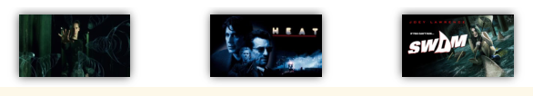
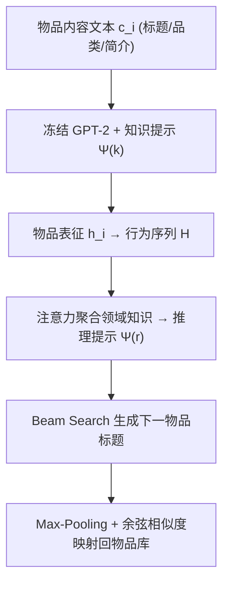
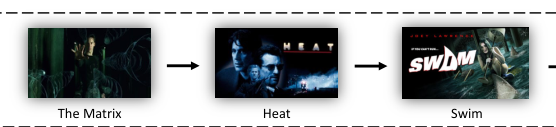

# Reformulating Sequential Recommendation: Learning Dynamic User Interest with Content-enriched Language Modeling (内容增强语言建模的序列推荐重构)

- **会议/期刊**: DASFAA 2025
- **作者与机构**: Junzhe Jiang, Shang Qu, Mingyue Cheng, Qi Liu 等（中国科学技术大学认知智能全国重点实验室；中国科大附一院）
- **推荐链路定位**: 端到端生成式（Next-Item 生成 + 文本到物品映射）
- **研究方向**: 序列与会话推荐 / 大语言模型推荐
- **论文原文**: [https://arxiv.org/abs/2309.10435v4](https://arxiv.org/abs/2309.10435v4)
- **开源代码**: [https://github.com/Gnimixy/lancer](https://github.com/Gnimixy/lancer)

## TL;DR (1分钟核心速览)

现有序列推荐把 PLM 仅当作文本编码器外挂，仍沿用传统序列建模范式，且语言模型缺乏领域知识（如把电影 *The Matrix* 理解为"数学矩阵"）。LANCER 将序列推荐直接改写为**文本生成任务**：用可训练的**知识提示**让冻结 GPT-2 吸收物品内容与领域知识，再用**推理提示**以用户历史为 Query 注意力聚合领域知识，自回归生成下一物品标题并经余弦相似度映射回物品库。在 MovieLens/MIND/Goodreads 三数据集、Leave-One-Out + Full-Ranking 协议下，Recall@5 较最强基线最高相对提升约 12.5%（MovieLens 0.0967→0.1086）。

## Background & Motivation (背景与核心矛盾)

- **主流范式**: ID-based 序列模型（SASRec/BERT4Rec/CL4SRec）靠交互序列学转移模式；content-based 方法（FDSA/SASRec+）把标题、品类等文本特征拼接进 ID 表征。
- **前人局限**: ① 纯 ID 模型无法理解物品语义，标题歧义（"The Matrix"）导致误判；② 已有 PLM 方案只是"加个文本编码器"，未真正利用语言模型的**世界知识与推理能力**；③ 直接把 ID/标题喂给 LLM 做生成（如 P5 类工作）反而落后于 SOTA，因为模型缺乏推荐领域知识与物品内容细节。
- **核心洞察 (Key Insight)**: 语言模型生成推荐失败并非架构问题，而是**领域知识缺失 + 内容信息不足**——图 1 显示，补充 genre/synopsis 后，"The Matrix→Heat→Swim" 这类序列的语义歧义显著降低。
- **本文切入点**: 不改主干参数，仅用连续提示（prefix-tuning 思路）注入领域知识，并把用户行为作为 Query 去"检索"领域知识，形成个性化推理提示。

<figure class="paper-figure" markdown="span">
  <figcaption>图 1：有内容增强信息与无内容增强信息的序列推荐对比。可以看出，丰富的内容信息提供了更多关于电影内容的信息，有助于减少歧义并提高推荐准确性。</figcaption>
</figure>

## Method (核心方法设计)

### 1. 整体框架 (Overall Architecture)

对历史中每个物品 $i$，拼接其标题、品类、剧情简介等文本$c_i$输入**冻结的 GPT-2**，在每层注意力的 K/V 前拼接可训练的**知识提示**，取末位 token 隐状态得物品表征$h_i$，构成行为序列$H=[h_1,\dots,h_{n-1}]$。随后以$H$为 Query、领域知识为 Key/Value 做注意力，生成用户专属**推理提示**$\Psi^{(r)}$，驱动语言模型自回归生成下一物品标题；最后将生成文本经 Max-Pooling 得定长向量$\gamma$，与全库物品标题表征做余弦相似度取 argmax 完成映射。训练分两阶段：先训知识提示（下一 token 预测），再训推理提示（生成目标物品文本）。

<figure class="paper-figure" markdown="span">
  <figcaption>图 2：所提出的 LANCER 示意图，其中虚线表示可训练参数，实线表示冻结参数。</figcaption>
</figure>

### 2. 关键设计拆解 (Key Designs)

1. **知识提示 (Knowledge Prompt)**：解决"冻结 LLM 不懂推荐领域"的痛点。设 $\theta$个知识 token$\varepsilon^{(k)}$，经 MLP 映射为每层独立的 K/V 前缀并与原 K/V 拼接：
$\mathbf{Z}'_{\ell,K}=[\Psi^{(k)}_{\ell,K};\mathbf{Z}_{\ell,K}],\quad \mathbf{Z}'_{\ell,V}=[\Psi^{(k)}_{\ell,V};\mathbf{Z}_{\ell,V}]$
仅更新 Emb 与 MLP，主干冻结。直觉：以极小参数量（约 0.1% 级）实现领域适配，规避灾难性遗忘，且前缀作用于全部 Transformer 层，影响可传播至后续所有 token。

2. **推理提示 (Reasoning Prompt)**：解决"领域知识是全局的、用户偏好是个性化的"矛盾。以用户历史表征为 Query、领域知识为 Key/Value 做注意力得 $\mathbf{A}$，再经线性层与激活得$\Psi^{(r)}=\sigma(\mathbf{W}_r\mathbf{A}+\mathbf{b}_r)$。直觉：相当于在生成前为每个用户"检索"其关心的那部分领域知识子空间，把协同信号注入纯文本生成流程。

3. **训练目标、负采样与推理效率**：第一阶段损失为下一 token 负对数似然 $\mathcal{L}=\sum_j -\log p(e_j\mid e_1,\dots,e_{j-1};\Theta_{LM})$；第二阶段以目标物品文本为监督。**全程无负采样**（生成式范式天然规避了 BPR/InfoNCE 的负样本构造）。推理用 beam search（宽度$w$）解码，物品库标题表征只需离线计算一次，在线仅需一次余弦检索，但自回归解码本身是主要延迟来源。

## Experimental Setup & Evaluation Protocol (实验设置与评估协议)

- **数据集与预处理**: 按时间排序，序列长度限制 5–10，短于 5 剔除、超长截断：

| 数据集 | #Users | #Items | #Interactions | 稀疏度 | 场景说明 |
| :--- | :---: | :---: | :---: | :---: | :--- |
| MovieLens | 6,040 | 3,231 | 72,480 | 99.63% | 电影（标题+品类+简介） |
| MIND | 91,935 | 44,908 | 2,248,027 | 99.94% | 英文新闻 |
| Goodreads | 120,968 | 28,480 | 1,095,758 | 99.97% | 图书评论 |

- **数据划分与防穿越**: `Leave-One-Out`（最后一项测试、倒数第二项验证），严格按用户时间序，无未来信息泄漏。
- **排名评测协议**: 无偏 `Full-Ranking`（全库未交互物品排序），指标 Recall@{5,10} 与 NDCG@{5,10}。
- **对比基线与超参设置**: ID-based（Caser、GRU4Rec、SASRec、BERT4Rec、S3Rec、CL4SRec）与 content-based（FDSA、MV-RNN、SASRec+）共 9 个基线；主干 GPT-2，batch size 16，语言模型输入上限 512 token、单物品文本上限 32 token，Adam + 线性学习率衰减，A100 40GB 训练。

## Key Experimental Results (实验关键数据)

### 1. 主实验对比 (Main Results)

| Model | ML R@5 | ML R@10 | ML N@5 | ML N@10 | MIND R@5 | MIND R@10 | MIND N@5 | MIND N@10 | GR R@5 | GR R@10 | GR N@5 | GR N@10 |
| :--- | :---: | :---: | :---: | :---: | :---: | :---: | :---: | :---: | :---: | :---: | :---: | :---: |
| GRU4Rec | 0.0737 | 0.1316 | 0.0450 | 0.0635 | 0.0981 | 0.1589 | 0.0628 | 0.0816 | 0.1871 | 0.2472 | 0.1394 | 0.1587 |
| SASRec | 0.0967 | 0.1589 | 0.0624 | 0.0823 | 0.1087 | 0.1707 | 0.0714 | 0.0913 | 0.2043 | 0.2641 | 0.1536 | 0.1729 |
| BERT4Rec | 0.0776 | 0.1391 | 0.0466 | 0.0664 | 0.0853 | 0.1359 | 0.0544 | 0.0706 | 0.1892 | 0.2487 | 0.1391 | 0.1583 |
| S3Rec | 0.0821 | 0.1469 | 0.0509 | 0.0716 | 0.0990 | 0.1586 | 0.0639 | 0.0830 | 0.1753 | 0.2478 | 0.1207 | 0.1442 |
| CL4SRec | 0.0996 | 0.1527 | 0.0683 | 0.0853 | 0.0964 | 0.1543 | 0.0625 | 0.0811 | 0.1986 | 0.2599 | 0.1477 | 0.1675 |
| FDSA | 0.0901 | 0.1407 | 0.0595 | 0.0757 | 0.1063 | 0.1728 | 0.0682 | 0.0896 | 0.1713 | 0.2351 | 0.1195 | 0.1400 |
| SASRec+ | 0.0944 | 0.1454 | 0.0618 | 0.0781 | **0.1107** | **0.1753** | 0.0723 | **0.0930** | 0.2045 | 0.2663 | 0.1533 | 0.1733 |
| **LANCER** | **0.1086** | **0.1616** | **0.0712** | **0.0884** | **0.1168** | 0.1675 | **0.0766** | **0.0930** | **0.2121** | **0.2673** | **0.1600** | **0.1779** |
| **Improv.%** | +9.0% | +1.7% | +4.2% | +3.6% | +5.5% | −4.4% | +5.9% | 0.0% | +3.7% | +0.4% | +4.2% | +2.7% |

（ML=MovieLens，GR=Goodreads；Improv.% 相对最强基线 SASRec+ 或 CL4SRec 计算。）

### 2. 消融实验 (Ablation Study)

原文未提供标准组件消融表，但通过数据集规模与指标位置可间接归因：

| 配置/场景 | 关键观察 | 说明 |
| :--- | :--- | :--- |
| MovieLens（小库、内容丰富） | R@5 +9.0%，N@5 +4.2% | 小物品库 + 丰富文本，PLM 世界知识被充分释放 |
| MIND（大库、新闻） | R@5 +5.5%，R@10 −4.4% | 生成式模型前几位生成质量高，长尾生成衰减 |
| Goodreads（超大库、稀疏） | R@5 +3.7%，N@5 +4.2% | 稀疏场景下语义泛化优于 ID 共现 |
| @5 vs @10 增益 | 所有数据集 @5 增益 > @10 | 自回归生成"越往后越飘" |

### 3. 关键实验发现 (Key Findings)

1. **小库 + 富文本是 LANCER 的最优区间**：MovieLens 上 R@5 从 0.0967 提升到 0.1086（+9.0%），而 MIND 的 R@10 反而下降 4.4%，说明生成式范式对物品库规模与文本信息密度高度敏感——库越大、标题信息越单薄，映射歧义越严重。
2. **生成质量随解码步数衰减**：三个数据集上 @5 增益系统性大于 @10，印证 beam search 前几位候选更可靠，这与"生成式 LM 早期 token 置信度高"的直觉一致，也解释了为何作者选 GPT-2 而非双向编码器。
3. **案例研究显示语义合理性优于精确命中**：图 3 中 Case 3 虽未命中目标，但 Top-5 中 *Welcome to the Dollhouse*、*Hero*、*The Godfather* 均与目标同属 Comedy/Drama 品类，说明模型学到的是**内容语义邻域**而非 ID 共现，具备一定可解释性。

## Highlights & Limitations (亮点、对比与审稿批判)

- **与代表作对比 (vs. Prior Work)**: 相比 SASRec+/FDSA 这类"文本特征拼接进 ID 塔"的做法，LANCER 彻底放弃 ID 表征，把推荐变成纯文本生成 + 语义检索；相比 P5 类"ID/标题直接喂 LLM"的生成式工作，本文的关键增量是**知识提示注入领域知识 + 推理提示注入用户行为**，这正是其能反超 ID 基线的原因。
- **可迁移亮点**: ① "冻结主干 + 双层连续提示（全局知识 + 个性化推理）"的两阶段提示设计，可低成本迁移到任何 PLM-based 推荐；② 生成文本 → Max-Pooling → 余弦映射的物品对齐方案，绕开了生成式推荐中昂贵的语义 ID 码本构建。
- **审稿级局限批判**: ① 自回归 beam search 在线解码延迟远高于 SASRec 类点积检索，论文未报告推理时延与吞吐；② 物品映射依赖标题文本唯一性，标题重复或缺失的数据集（如匿名会话、纯 ID 场景）会直接失效；③ 缺少知识提示/推理提示的定量消融与提示 token 数 $\theta$、beam 宽度$w$ 的敏感性分析，MIND 上 R@10 的负增益也未被深入解释。

## Rating (四维评分)

- **方法创新性 (Novelty)**: ⭐⭐⭐⭐ （将序列推荐重构为"知识提示+推理提示"的文本生成任务，思路清晰，但 prefix-tuning 与生成式推荐均非首创，属组合式创新）
- **评估协议与实验扎实度 (Protocol & Experiments)**: ⭐⭐⭐ （Leave-One-Out + Full-Ranking 协议规范、基线覆盖 ID 与 content 两类，但缺组件消融与超参敏感性分析，MIND 指标存在负增益）
- **写作与数学规范度 (Clarity & Rigor)**: ⭐⭐⭐⭐ （公式简洁、符号定义清楚，知识提示与推理提示的动机链条完整，但部分实现细节如两阶段训练切换点描述略简）
- **工业落地与复现价值 (Industrial & Practical Value)**: ⭐⭐⭐ （代码已开源、冻结主干训练成本可控，但自回归解码延迟与标题映射依赖使其难以直接用于大规模在线召回）

