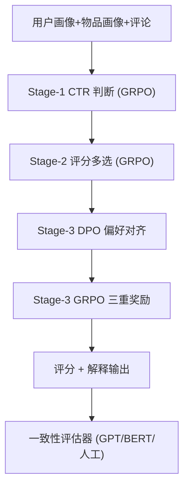
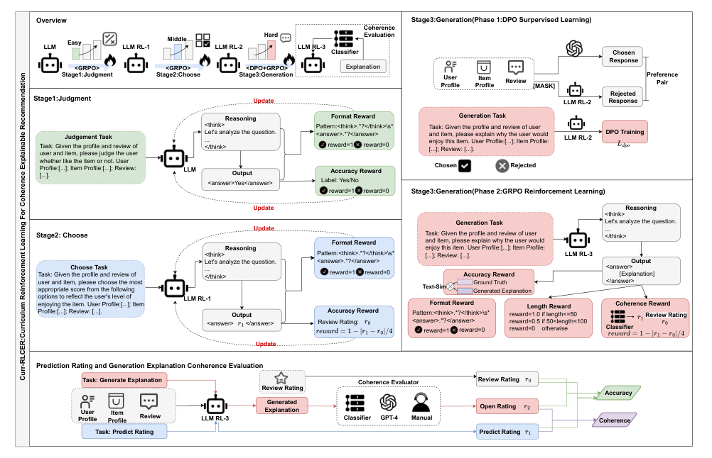
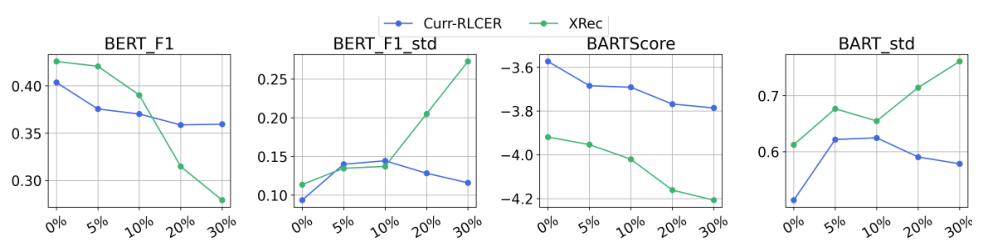

# Curr-RLCER: Curriculum Reinforcement Learning For Coherence Explainable Recommendation (面向一致性可解释推荐的课程强化学习)

- **会议/期刊**: DASFAA 2026
- **作者与机构**: Xiangchen Pan, Wei Wei（华中科技大学）
- **推荐链路定位**: 端到端生成式（评分预测 + 解释生成）
- **研究方向**: 对话推荐与智能体仿真 / 大语言模型推荐
- **论文原文**: [https://arxiv.org/abs/2604.05341v1](https://arxiv.org/abs/2604.05341v1)
- **开源代码**: [https://github.com/pxcstart/Curr-RLCER](https://github.com/pxcstart/Curr-RLCER)

## TL;DR (1分钟核心速览)

可解释推荐的主流多任务范式（PETER/CER）联合预测评分与生成解释，却忽视二者"自说自话"的不一致：解释读起来像 5 星、评分却给 2 星。Curr-RLCER 把该任务重构为 LLM 的三阶段课程强化学习——先 CTR 二分类、再评分多选、最后开放式解释生成，并在末阶段引入"解释情感分 vs 真值评分"的一致性奖励。在 Amazon Baby/Sports/Clothing 三数据集上，RMSE 相对最优基线降低 27.1%–42.5%，一致性指标 Acc 达 0.90+，且对输入噪声更鲁棒。

## Background & Motivation (背景与核心矛盾)

- **主流范式**: 以 PETER、CER 为代表的多任务模型共享编码器，一端回归评分、一端用 Transformer/RNN 生成解释文本，靠模板或情感四元组监督。
- **前人局限**: ① CER 的一致性对齐依赖 Sentires-Guide 抽取情感四元组，抽取质量差则训练信号被污染；② 现有对齐与评估只比较"生成解释 vs 预测评分"，当**预测评分与解释同时偏离真值**时，二者仍可能"一致地错"，一致性指标虚高。
- **核心洞察 (Key Insight)**: DeepSeek-R1-Zero 证明无需 SFT、仅靠 GRPO 分组相对奖励即可让基座模型习得推理能力；而多任务联合训练易触发灾难性遗忘与损失震荡，课程学习可缓解。
- **本文切入点**: 用"由易到难"的三阶段 RL 课程替代多任务联合微调，并把一致性显式写进第三阶段奖励与评估公式。

## Method (核心方法设计)

### 1. 整体框架 (Overall Architecture)

输入统一为「用户画像 + 物品画像 + 评论」拼接的指令 prompt，基座为 Qwen2.5-3B-Instruct。三阶段共享同一 LLM 并逐阶段热启动：Stage-1 判断"用户是否喜欢该物品"（二分类），Stage-2 从 1–5 选项中选评分（多分类），Stage-3 先 DPO 学习"如何写出高质量解释"，再用 GRPO 联合优化长度/准确/一致性三重奖励。每阶段输出均强制 `<think>...</think><answer>...</answer>` 格式，格式奖励贯穿始终。推理时 Stage-2 给评分、Stage-3 给解释，二者共同进入一致性评估器。

<figure class="paper-figure" markdown="span">
  <figcaption>图1：Curr-RLCER的总体框架。</figcaption>
</figure>

### 2. 关键设计拆解 (Key Designs)

1. **课程式三阶段奖励（缓解遗忘与奖励冲突）**：若直接把评分与生成混在一个 RL 目标里，奖励项互相拉扯导致训练震荡。本文按难度递进设计奖励：Stage-1 用 0/1 正确性奖励 $R_{\text{Judgment}}=\mathbb{I}[o_{\text{ans}}=o_{\text{gt}}]$；Stage-2 用距离衰减奖励$R_{\text{Choose}}=1-\frac{|r_{\text{ans}}-r_{\text{gt}}|}{4}$，把 5 分类误差平滑成连续信号；Stage-3 才引入生成类奖励。直觉是让模型先在判别任务上"读懂"推荐数据分布，再承担开放式生成。

2. **一致性奖励机制（Coherence Reward）**：这是全文核心增量。用 BERT 情感分类器 $C(\cdot)$ 对生成解释打情感分，再与真值评分比对：
$$R_{\text{Coherence}}(t_{\text{ans}},r_{\text{gt}})=1-\frac{|C(t_{\text{ans}})-r_{\text{gt}}|}{4}$$
与 Stage-3 的长度奖励 $R_{\text{Length}}$（<50 词得 1、50–100 得 0.5、否则 0）和语义准确奖励$R_{\text{Accuracy}}=\text{Sim}(T(t_{\text{ans}}),T(t_{\text{gt}}))$ 加权合成总奖励。关键点在于一致性奖励锚定的是**真值评分**而非模型预测评分，从根上堵住"一致地错"的漏洞。

3. **训练目标、负采样与推理效率**：Stage-3 先用 DPO 做偏好对齐，偏好对构造为「GPT-3.5-turbo 回答作 chosen，对输入有效信息随机 mask 后喂给 Stage-2 模型、语义相似度低于阈值者作 rejected」，DPO 损失为标准的 $\mathcal{L}_{\text{DPO}}=-\mathbb{E}\log\sigma(\beta\log\frac{\pi_\theta(y_w|x)}{\pi_0(y_w|x)}-\beta\log\frac{\pi_\theta(y_l|x)}{\pi_0(y_l|x)})$，$\beta=0.1$。随后 GRPO 以组内归一化优势$A_i=\frac{r_i-\text{mean}(r_{1..N})}{\text{std}(r_{1..N})}$更新，每组采样$N=4$ 条回答，无需 critic 模型。每阶段 3000 样本训练约 12 小时（8×RTX-4090），1000 条测试推理约半小时。

## Experimental Setup & Evaluation Protocol (实验设置与评估协议)

- **数据集与预处理**: 取自 Amazon Review 的 Baby / Sports / Clothing 三个子集，用户与物品画像及标准解释由 GPT-3.5-Turbo 依据元数据与评论生成。

| 数据集 | #Users | #Items | #Train (u-i) | #Test (u-i) | 特征/场景说明 |
| :--- | :---: | :---: | :---: | :---: | :--- |
| Baby | 19,445 | 7,050 | 3,000 | 1,000 | 母婴，评论短、情感极性弱 |
| Sports | 35,598 | 18,357 | 3,000 | 1,000 | 运动户外，物品极稀疏 |
| Clothing | 39,387 | 23,033 | 3,000 | 1,000 | 服饰鞋履，评分分布偏正 |

- **数据划分与防穿越 (Splitting Strategy)**: 随机 `3:1:1` 比例划分训练/验证/测试；三阶段各自从源数据采样但沿用同一划分方式。
- **排名评测协议 (Ranking Protocol)**: 本文为评分回归 + 文本生成任务，不涉及全库排序；评分侧用 RMSE/MAE，解释侧用 GPTScore/BERTScore/BARTScore/BLEURT/USR 及其标准差，一致性侧用自定义 Acc 指标。
- **对比基线与超参设置**: 基线含 NRT、Att2Seq、PETER、CER（均用 Sentires-Guide 抽取四元组复现）、XRec-3B，以及同系列 Qwen2.5-7B/14B-Instruct 作为规模对照；基座 Qwen2.5-3B-Instruct，GRPO 每组 4 样本、prompt 上限 512，显著性用配对 t 检验（$p<0.05$）。

## Key Experimental Results (实验关键数据)

### 1. 主实验对比 (Main Results)

评分预测（表 3，越低越好）：

| 模型 | Baby RMSE↓ | Baby MAE↓ | Sports RMSE↓ | Sports MAE↓ | Clothing RMSE↓ | Clothing MAE↓ |
| :--- | :---: | :---: | :---: | :---: | :---: | :---: |
| NRT | 1.1164 | 0.8018 | 1.0680 | 0.7308 | 1.0528 | 0.7828 |
| PETER | 1.0625 | 0.7982 | 0.9490 | 0.7217 | 1.0615 | 0.8218 |
| CER | 1.0613 | 0.8343 | 0.9518 | 0.7382 | 1.0612 | 0.8349 |
| Qwen2.5-7B | 0.8426 | 0.5480 | 1.0154 | 0.7010 | 0.9143 | 0.5840 |
| Qwen2.5-14B | 0.8277 | 0.5197 | 0.8915 | 0.6660 | 0.8882 | 0.5818 |
| **Curr-RLCER-3B** | **0.6899** | **0.3300** | **0.6943** | **0.3340** | **0.6099** | **0.3080** |
| Improv.% (vs 最优基线) | 16.6% | 36.5% | 22.1% | 49.8% | 31.3% | 47.1% |

解释质量与一致性（表 2/表 4 摘选）：

| 模型 | Baby GPTScore↑ | Baby BERT-F1↑ | Baby BLEURT↑ | Baby Acc↑ | Clothing Acc↑ |
| :--- | :---: | :---: | :---: | :---: | :---: |
| PETER | 45.11 | 0.2784 | -0.8737 | 0.7013 | 0.7191 |
| CER | 46.11 | 0.2716 | -0.8669 | 0.6988 | 0.7025 |
| XRec-3B | 82.38 | 0.4354 | -0.0987 | — | — |
| Qwen2.5-14B | 85.10 | 0.3074 | 0.1045 | — | — |
| **Curr-RLCER-3B** | **86.98** | 0.4054 | **0.2377** | **0.8334** | **0.8679** |

### 2. 消融实验 (Ablation Study)

| 变体 | Baby MAE↓ | Baby RMSE↓ | Baby BERT-F1↑ | Baby Acc↑ | Clothing MAE↓ | Clothing Acc↑ |
| :--- | :---: | :---: | :---: | :---: | :---: | :---: |
| Curr-RLCER 完整 | 0.3300 | 0.6899 | 0.4054 | 0.9191 | 0.3080 | 0.9187 |
| w/o Coherence Reward | **0.3140** | **0.6588** | **0.4224** | 0.8307 | 0.3350 | 0.8489 |
| w/o DPO Training | 0.3350 | 0.7036 | 0.3834 | 0.8934 | 0.3270 | 0.9072 |

### 3. 关键实验发现 (Key Findings)

1. **一致性奖励是"以精度换可信"的显式开关**：去掉一致性奖励后 Baby 的 BERT-F1 反升（0.4054→0.4224）、RMSE 反降（0.6899→0.6588），但 Acc 从 0.9191 骤降至 0.8307（-9.6%）。说明该奖励并非提升文本质量，而是把模型从"写漂亮话"拉回"写与评分相符的话"，代价是轻微精度损失。
2. **DPO 是 GRPO 生成阶段的前置稳定器**：去掉 DPO 后 BERT-F1 掉至 0.3834、RMSE 恶化至 0.7036，验证了作者关于"缺乏高质量解释先验时，GRPO 只优化长度与准确奖励会触发灾难性遗忘、侵蚀 Stage-2 学到的评分能力"的判断。
3. **小模型 + 课程 RL 可越级挑战大模型**：3B 的 Curr-RLCER 在 RMSE 上全面优于 14B 的 Qwen2.5-Instruct（Baby 0.6899 vs 0.8277），且图 2 显示在 30% 实体掩码噪声下 XRec 各指标显著下滑而本模型基本平稳，说明奖励驱动训练带来了额外鲁棒性。

<figure class="paper-figure" markdown="span">
  <figcaption>图2：不同噪声比例下Curr-RLCER与XRec的鲁棒性实验对比</figcaption>
</figure>

## Highlights & Limitations (亮点、对比与审稿批判)

- **与代表作对比 (vs. Prior Work)**: PETER/CER 走"多任务监督 + 情感四元组对齐"，一致性锚点是模型自身预测分；XRec 走"GNN 协同信号注入 LLM 各层"，强在文本语义但依赖交互图。Curr-RLCER 的差异在于用 RL 奖励替代监督对齐、用真值评分作一致性锚点，且不依赖四元组抽取工具。
- **可迁移亮点**: ① "判别→多分类→生成"的课程顺序可作为任意 LLM 多任务推荐（如评分+评论摘要+对话追问）的通用训练配方；② 把一致性评估拆成 Accuracy 与 Coherence 两项再加权（式 8），可直接迁移到任何"结构化预测 + 自由文本"双输出任务的评测。
- **审稿级局限批判**: ① 每阶段仅 3000 训练样本、单卡 12 小时×3 阶段，且 GRPO 每组需 4 条采样，在线推理与再训练成本对工业场景偏高；② 一致性奖励仍依赖 BERT 情感分类器作为"裁判"，分类器自身偏差会直接注入奖励信号，论文未报告该分类器在 1–5 星上的校准误差；③ 数据集划分是随机 3:1:1 而非时间切分，存在未来交互泄漏风险，且未做全库排序评估，无法反映真实推荐场景的排序能力。

## Rating (四维评分)

- **方法创新性 (Novelty)**: ⭐⭐⭐⭐ （首次将课程 RL + GRPO 引入可解释推荐的一致性对齐，把"一致地错"这一被忽视的失效模式形式化进奖励与评估）
- **评估协议与实验扎实度 (Protocol & Experiments)**: ⭐⭐⭐ （三数据集 + GPT/BERT/人工三路一致性评估较完整，但随机划分、无排序指标、无分类器校准分析削弱说服力）
- **写作与数学规范度 (Clarity & Rigor)**: ⭐⭐⭐⭐ （三阶段奖励公式与评估式 8 定义清晰，DPO/GRPO 推导规范；但主表指标列过多、部分基线缺一致性数值）
- **工业落地与复现价值 (Industrial & Practical Value)**: ⭐⭐⭐⭐ （代码与数据全开源，3B 模型即可部署；但三阶段串行训练与组采样推理的算力开销需在工程上进一步压缩）

