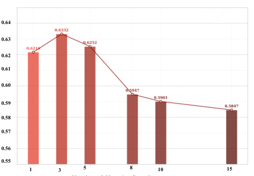
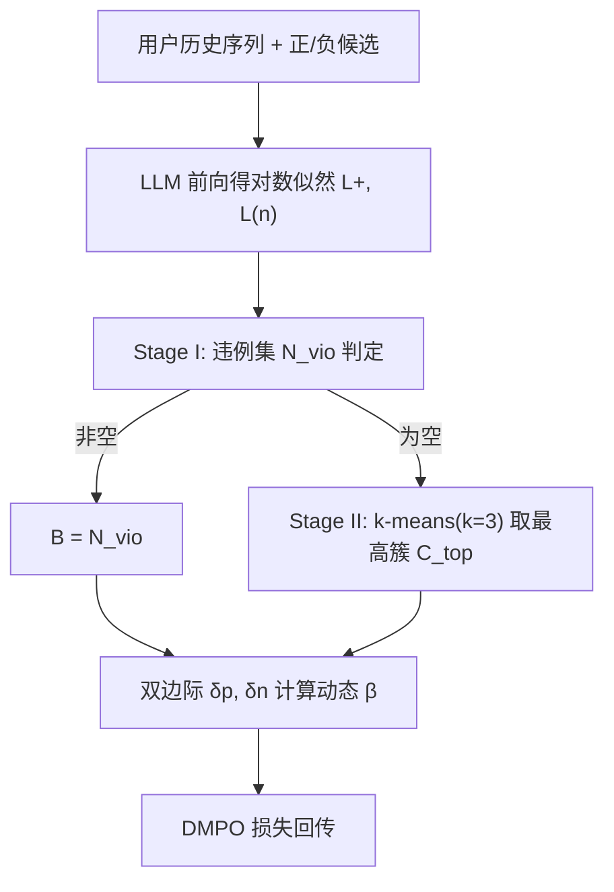

# DynamicPO: Dynamic Preference Optimization for Recommendation (面向推荐的动态偏好优化)

- **会议/期刊**: DASFAA 2026 (Best Paper)
- **作者与机构**: Xingyu Hu, Kai Zhang, Jiancan Wu, Xiang Wang 等（中国科学技术大学、上海创智学院、美团）
- **推荐链路定位**: 精排（LLM 生成式重排 / 候选打分）
- **研究方向**: 大语言模型推荐 / 序列推荐
- **论文原文**: [论文原文链接](https://arxiv.org/abs/2605.00327v4)
- **开源代码**: [开源代码仓库链接](https://github.com/xingyuHuxingyu/DynamicPO)

## TL;DR (1分钟核心速览)

LLM 推荐中多负样本 DPO（如 DMPO）随负样本数增加会出现"偏好优化坍缩"：训练损失持续下降但 HitRatio@1 反而暴跌。本文从梯度抑制角度证明，易判别负样本 $S$在梯度中压倒边界关键负样本$B$，导致决策边界退化。DynamicPO 用在线聚类动态挑选边界负样本、并按双边际为每个样本定制$\beta$，即插即用。在 LastFM/Goodreads/Steam 上以 20 负样本采样排序协议评估，Llama2-7b 下 LastFM HitRatio@1 从 58.47% 提升至 66.61%（+8.14pt），训练开销仅增 0.85%。

## Background & Motivation (背景与核心矛盾)

- **主流范式**: LLM 推荐普遍采用两阶段管线——先 SFT 蒸馏物品知识，再用 DPO/DMPO 类偏好优化对齐用户偏好；隐式反馈天然提供海量负样本，多负样本目标被视作锐化偏好边界的利器。
- **前人局限**: ① 负样本数超过临界阈值后性能不升反降，且训练损失仍在下降，优化目标与真实排序目标脱钩；② 现有动态 $\beta$ 方案（如 β-DPO）面向开放文本生成设计，直接迁移到推荐反而掉点 0.32%。
- **核心洞察 (Key Insight)**: 按似然差 $\Delta=\log\pi_\theta(y_w|x)-\log\pi_\theta(y_l|x)$可将负样本分为易判别集$S$（$\Delta\gg0$）与边界关键集$B$（$\Delta\le0$或$\approx0$）。实测$|S|\gg|B|$，且训练中$B$ 占比不降反升（6.3%→7.6%），说明模型在"抄近路"过度优化平凡区分。
- **本文切入点**: 梯度可分解为 $S$与$B$两部分加权和，$|S|/k$ 主导导致边界信号被稀释；因此只需"选对负样本 + 调对强度"即可破局。

<figure class="paper-figure" markdown="span">
  <figcaption>图 1：基于 LLM 的推荐器中偏好优化与坍缩现象的演示。</figcaption>
</figure>

## Method (核心方法设计)

### 1. 整体框架 (Overall Architecture)

DynamicPO 作为 DMPO 的外挂模块，在每次前向得到正样本与 $k$个负样本的对数似然后介入两步：先由**动态边界负样本选择**从负样本池中筛出边界关键子集$B$，再由**双边际动态$\beta$调整**为$B$ 中每个样本计算专属正则强度，最后代入标准 DMPO 损失回传。全流程在线完成、无需预处理，推理阶段与原始 DMPO 完全一致（仅训练期生效），因此不引入任何在线延迟。

### 2. 关键设计拆解 (Key Designs)

1. **动态边界负样本选择（两级在线筛选）**：固定 Top-K 截断缺乏分布感知，会误删边界模糊但信息量大的样本。Stage I 先取违例集 $N_{vio}=\{n\in\mathcal{N}\mid L(n)>L_p\}$，若非空则全取（模型当前排序已错，必须重点纠偏）；若为空则对负样本似然做$k=3$的 k-means，取质心最高的簇$C_{top}$作为$B$。直觉是：违例样本暴露边界缺陷，无违例时最高似然簇即最贴近边界的难负样本，聚类自适应替代了刚性阈值。

2. **双边际动态 $\beta$调整（样本级塑性/稳定性权衡）**：定义正-边界边际$\delta_p=L_+-L_b$（边界模糊度）与边界-易负边际$\delta_n=L_b-L_e$（相对易负样本的信息量对比），则
$$\beta=\beta_0\cdot\left(1+\alpha\cdot\tanh\frac{\delta_p-\delta_n-\gamma}{|\delta_p|+|\delta_n|}\right)$$
其中 $\gamma$为固有偏好边际。对高模糊（小$\delta_p$）、高对比（大$\delta_n$）的难样本，分子为负 →$\beta$减小 → KL 正则放松 → 模型获得塑性去锐化边界；对平凡样本$\beta$增大 → 强制稳定、防止过拟合非关键信号。$\tanh$将$\beta$ 约束在稳定区间，分母归一化使调整对相对似然分布敏感。

3. **训练目标、负采样与推理效率**：总损失即把 DMPO 中的 $\beta$替换为上述样本级$\beta_j$、并把负样本求和范围从全部$k$个收缩到选中集$B$：
$$\mathcal{L}=-\mathbb{E}\log\sigma\Big(\beta\log\tfrac{\pi_\theta(y_w|x)}{\pi_{ref}(y_w|x)}-\tfrac{1}{|B|}\sum_{j\in B}\beta_j\log\tfrac{\pi_\theta(y_j|x)}{\pi_{ref}(y_j|x)}\Big)$$
负样本来自隐式反馈中用户未交互物品（免额外负采样器），默认 $k=15$，$\alpha=0.5,\gamma=6,\beta_0=1$。实测平均每样本仅选 3.4 个负样本，训练时间仅增 0.85%（62.58h→63.11h A100）。

## Experimental Setup & Evaluation Protocol (实验设置与评估协议)

- **数据集与预处理**: 沿用 LLaRA 的预处理与按时间顺序 8:1:1 划分：

| 数据集 | #Sequences | #Items | #Interactions | 场景说明 |
| :--- | :---: | :---: | :---: | :--- |
| LastFM | 1,220 | 4,606 | 73,510 | 音乐推荐（最稀疏） |
| Goodreads | 6,031 | 4,500 | 220,100 | 图书评分评论 |
| Steam | 11,938 | 3,581 | 274,726 | 视频游戏 |

- **数据划分与防穿越 (Splitting Strategy)**: 按时间顺序 `8:1:1` 比例划分（chronological split），测试集为各序列末段，严格防穿越。
- **排名评测协议 (Ranking Protocol)**: `Sampled Ranking`——每个测试序列构造 1 个 ground-truth + 20 个负样本的候选集，模型重排后取 HitRatio@1；同时报告 ValidRatio（指令遵循率，均 >0.95）。注意此协议非 Full-Ranking，绝对数值偏高。
- **对比基线与超参设置**: 传统基线 GRU4Rec/Caser/SASRec，LLM 基线 MoRec/TALLRec/LLaRA，偏好优化基线 DMPO/MPPO/S-DPO；主实验 backbone 为 Llama2-7b-hf，另在 Llama3-8B-Instruct、Qwen2.5-7B-Instruct 上验证；4×A100，SFT 5 epoch + 偏好对齐 3 epoch。

## Key Experimental Results (实验关键数据)

### 1. 主实验对比 (Main Results)

| 类别 | 方法 | LastFM HR@1 | Goodreads HR@1 | Steam HR@1 |
| :--- | :--- | :---: | :---: | :---: |
| 传统 | GRU4Rec | 0.2616 | 0.3867 | 0.4168 |
| 传统 | SASRec | 0.2233 | 0.3581 | 0.4010 |
| LLM | TALLRec | 0.4180 | 0.4983 | 0.4637 |
| LLM | LLaRA | 0.4508 | 0.5292 | 0.4949 |
| PO | DMPO | 0.5848 | 0.5349 | 0.6383 |
| PO | **DynamicPO** | **0.6661** | **0.6728** | **0.6990** |
| | Improv. vs DMPO | +13.9% | +25.8% | +9.5% |

跨 backbone 与跨目标泛化（LastFM / Goodreads）：Llama3-8B 上 DMPO 0.6232/0.6645 → DynamicPO 0.7331/0.7641（+17.6%/+15.0%）；Qwen2.5-7B 上 0.5892/0.6617 → 0.6433/0.7359（+9.2%/+11.2%）。迁移到 MPPO：LastFM 0.6597→0.6906、Steam 0.7614→0.8069；迁移到 S-DPO：LastFM 0.6617→0.6666。

### 2. 消融实验 (Ablation Study)

| 配置 | LastFM | Goodreads | Steam |
| :--- | :---: | :---: | :---: |
| DMPO (baseline) | 0.5848 | 0.5349 | 0.6383 |
| **DynamicPO (full)** | **0.6661** | **0.6728** | **0.6990** |
| w/o Stage (I) | 0.6621 | 0.6644 | 0.6914 |
| w/o Stage (II) | 0.6549 | 0.6594 | 0.6830 |
| w/o Stage (I & II) | 0.5884 | 0.5365 | 0.6383 |
| w/o dynamic $\beta$ | 0.6593 | 0.6678 | 0.6913 |

### 3. 关键实验发现 (Key Findings)

1. **坍缩确实存在且被有效逆转**：DMPO 在 LastFM 上负样本从 1 增至 15 时 HR@1 由 0.6218 跌至 0.5847，而 DynamicPO 随负样本数单调上升，15 负样本下达 0.6661；附录扩展到 19 负样本时 DynamicPO 仍将 DMPO 从 0.5936 拉至 0.6854，甚至超过 DMPO 自身最优曲线峰值，证明退化源于"负样本不加区分"而非负样本池本身。
2. **Stage II 是主力、Stage I 是保险**：去掉 Stage II 掉点最多（LastFM −1.12pt），去掉 Stage I 掉 0.40pt，两者全去则几乎退回 DMPO 水平（0.5884），说明聚类式边界增强承担主要增益，违例纠偏提供兜底；动态 $\beta$ 单独贡献约 0.68pt。
3. **自适应选择优于刚性 Top-K**：在等信号密度下（DynamicPO 平均选 3.4 个），Top-K 的 $k=2/3/4$ 在 LastFM 上分别为 0.6452/0.6492/0.6476，均低于 DynamicPO 的 0.6661（最大差距 3.2%），且奖励胜率从 DMPO 的 42.8% 提升至 70.5%（+27.7%），印证固定阈值会漏掉边界模糊样本。

## Highlights & Limitations (亮点、对比与审稿批判)

- **与代表作对比 (vs. Prior Work)**: 相比 DMPO/MPPO/S-DPO 这些"无差别聚合全部负样本"的多负样本目标，DynamicPO 首次把负样本按边界信息量分层并差异化赋权；相比 β-DPO 的全局/粗粒度动态 $\beta$，本文做到样本级$\beta$ 且专为推荐的隐式反馈多负样本场景设计（直接套用 β-DPO 会掉 0.32%）。
- **可迁移亮点**: ① "似然差分层 + 聚类选边界样本"的选择器可无缝挂到任何 listwise/多负样本对比损失上；② 双边际 $\tanh$ 归一化的动态温度/正则系数设计，可直接迁移到 RLHF 的难样本加权与课程学习。
- **审稿级局限批判**: ① 评测采用 20 负样本 Sampled Ranking 而非 Full-Ranking，绝对数值与真实全库排序存在差距，且未报告 NDCG/MRR 等多指标；② 每步需对 $k$个负样本做 k-means 与逐样本$\beta$计算，虽训练开销仅 +0.85%，但 Stage II 的聚类在$k$极大或 batch 极小时稳定性与超参（$\alpha,\gamma$）敏感性仍缺乏理论刻画，且仅在 7B–8B 规模验证，未触及更大模型或在线 RL 场景。

## Rating (四维评分)

- **方法创新性 (Novelty)**: ⭐⭐⭐⭐ （首次形式化"偏好优化坍缩"并给出梯度抑制分解，双机制设计简洁且有物理直觉）
- **评估协议与实验扎实度 (Protocol & Experiments)**: ⭐⭐⭐⭐ （三数据集、三 backbone、三目标泛化 + 完整消融与 Top-K 对照，但仅 Sampled Ranking 与单一 HR@1 指标略欠）
- **写作与数学规范度 (Clarity & Rigor)**: ⭐⭐⭐⭐ （梯度分解与 $\beta$ 公式推导清晰，符号统一；坍缩的理论刻画仍偏一阶近似，缺收敛性分析）
- **工业落地与复现价值 (Industrial & Practical Value)**: ⭐⭐⭐⭐⭐ （即插即用、免预处理、训练开销 +0.85%、推理零额外成本，代码与 checkpoint 全开源，美团工业背景加持）

