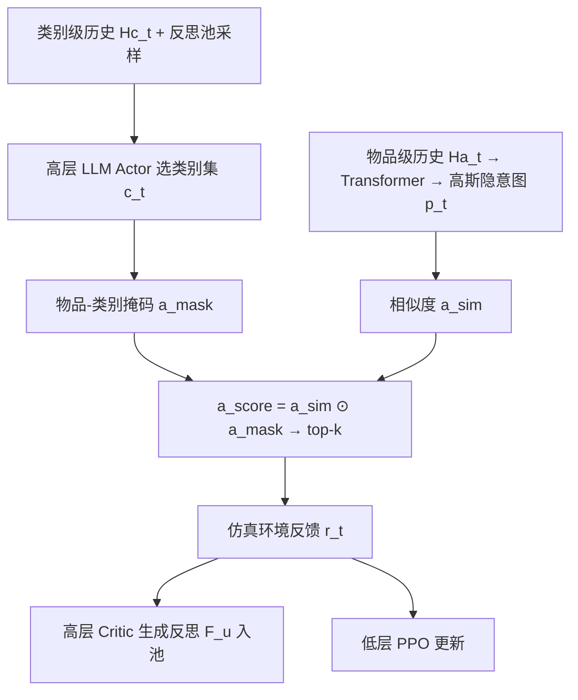
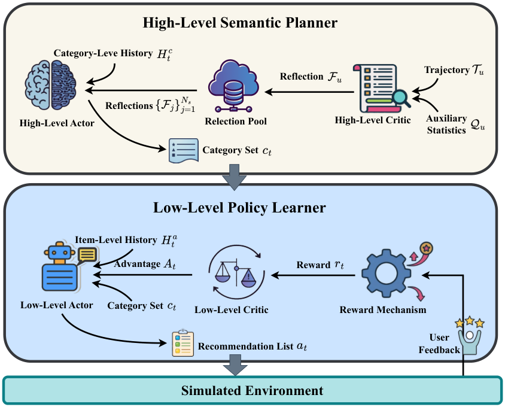
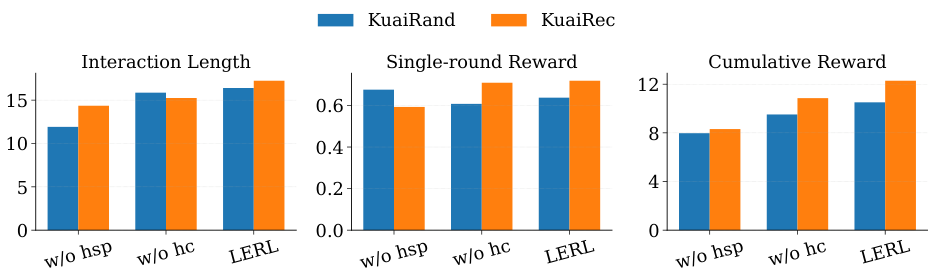

# LLM-Enhanced Reinforcement Learning for Long-Term User Satisfaction in Interactive Recommendation (LLM 增强强化学习的交互推荐长期满意度优化)

- **会议/期刊**: DASFAA 2026 (LNCS vol. 16535)
- **作者与机构**: Chongjun Xia, Yanchun Peng, Xianzhi Wang（University of Technology Sydney / University of Shanghai for Science and Technology）
- **推荐链路定位**: 重排（会话级交互决策，端到端策略）
- **研究方向**: 强化学习与动态探索推荐 / 大语言模型推荐
- **论文原文**: [https://arxiv.org/abs/2601.19585v2](https://arxiv.org/abs/2601.19585v2)
- **开源代码**: [https://github.com/1163710212/LERL](https://github.com/1163710212/LERL)

## TL;DR (1分钟核心速览)

交互推荐中 RL 直接在全物品空间做长程优化，受稀疏长尾交互与缺乏语义规划能力双重制约，容易陷入内容同质化与过滤气泡。本文提出 LERL 分层框架：高层由 Llama-3-8B 作为语义规划器，依据类别级历史与"反思池"采样选择类别子集；低层用 PPO 在类别掩码约束下做物品级打分。在 KuaiSim 全会话仿真（KuaiRand/KuaiRec）上，交互长度 $T_{int}$相对最强基线 DNaIR 提升 27.7%/25.1%，累计奖励$R_{cum}$ 提升 25.0%/13.8%。

## Background & Motivation (背景与核心矛盾)

- **主流范式**: 缓解过滤气泡的路线分两支——静态多样性重排/多样性感知表征（TD-VAE-CF、DOR），以及把多样性信号塞进 RL 奖励的交互式方法（CIRS 饱和惩罚、DNaIR 多样性内在奖励）。
- **前人局限**: ①静态/一次性方法不建模用户兴趣的动态演化，长会话中仍会累积冗余；②RL 方法在稀疏长尾物品空间上泛化差、缺乏语义级规划，手工设计的多样性奖励是"短视"的，长程收益有限。
- **核心洞察 (Key Insight)**: LLM 具备结构化世界知识与多步语义推理，适合做"选什么类别"的宏观规划；但它难以把抽象计划落地到超大物品空间。RL 恰好相反——细粒度可适应但不会规划。二者能力互补且作用粒度天然不同。
- **本文切入点**: 把动作空间按"类别 → 物品"两级分解，LLM 负责语义多样性规划以压缩动作空间，RL 负责在压缩后的空间内做偏好对齐。

## Method (核心方法设计)

### 1. 整体框架 (Overall Architecture)

每一决策步 $t$，高层 actor 读取用户的类别级交互历史$H^c_t=\{(c_i,r_i)\}_{i=1}^t$与从反思池中按累计奖励采样出的若干条反思文本，经提示词让 LLM 输出类别集合$c_t\subseteq\mathcal{C}$；该集合经二值映射矩阵转为物品级掩码，对低层 actor 的相似度打分做软过滤，取 top-$k$组成推荐列表$a_t$；仿真环境返回点击奖励并推进状态。会话结束后，高层 critic 生成文本反思$F_u$ 写入反思池供后续用户复用；低层 actor/critic 用 PPO 在线更新。整体形成"LLM 慢规划 + RL 快适应"的双时间尺度闭环。

<figure class="paper-figure" markdown="span">
  <figcaption>图 1：LERL 框架概览。</figcaption>
</figure>

### 2. 关键设计拆解 (Key Designs)

1. **奖励加权反思采样（Reflection Sampling）**：反思池 $R=\{(F_u,S_u)\}$会随用户数膨胀，超出 LLM 上下文。本文不截断也不全量塞入，而是按累计奖励做 softmax 采样$P(u)=\exp(\alpha S_u)/\sum_v \exp(\alpha S_v)$，取$N_s=3$条。直觉是让"高长期满意度用户的行为总结"以更高概率进入提示词，相当于用文本形式的离线经验做非参数化的策略先验，且温度$\alpha$ 可调探索强度；冷启动期池为空则用空占位符，保证提示词模板不变。
2. **类别掩码软过滤（Category Mask as Action-Space Pruning）**：低层不再对全库打分，而是 $a_{mask}=W\cdot c_t$（$W\in\{0,1\}^{|\mathcal{I}|\times|\mathcal{C}|}$为物品-类别二值映射），最终$a_{score}=a_{sim}\odot a_{mask}$。这一步把 RL 的有效动作空间从$|\mathcal{I}|$压到$|c_t|$ 覆盖的子集，既降低稀疏长尾下的探索方差，又让"类别多样性"由高层显式保证而非靠奖励塑形间接诱导——这是与 DNaIR 类方法最本质的算子差异。
3. **随机隐意图 + PPO 训练目标**：Transformer 编码物品级历史得 $e^p_t$，经 MLP 参数化高斯分布并采样虚拟物品向量$p_t\sim\mathcal{N}(\mu_t,\sigma_t^2)$，以$a^{sim}_j=\langle p_t,i_j\rangle$打分。随机潜变量提供策略空间内的连续探索，避免过早收敛。低层用 PPO 裁剪目标$\mathcal{L}_a=-\mathbb{E}_t[\min(\rho_t\hat{A}_t,\mathrm{clip}(\rho_t,1-\epsilon,1+\epsilon)\hat{A}_t)]$与价值回归$\mathcal{L}_v=\mathbb{E}_t[(V_\phi(s_t)-R_t)^2]$，$R_t=r_t+\gamma V_{\phi'}(s_{t+1})$；无需负采样，奖励即点击信号。

## Experimental Setup & Evaluation Protocol (实验设置与评估协议)

- **数据集与预处理**: 基于 KuaiSim 用户模拟器构建离线仿真环境，奖励字段为 `is_click`。

| 数据集 | #Users | #Items | #Interactions | 密度 | 场景说明 |
| :--- | :---: | :---: | :---: | :---: | :--- |
| KuaiRand (pure, 15 policies) | 27,077 | 7,551 | 1,436,609 | 0.70% | 短视频，稀疏长尾 |
| KuaiRec (big matrix) | 7,176 | 10,728 | 12,530,806 | 16.3% | 稠密子矩阵，近似全观测 |

- **数据划分与防穿越**: 非传统切分，而是**全会话（whole-session）仿真**：每用户单会话最多 20 步交互，推荐列表长度 $k=6$，环境按历史行为动态演化用户状态。
- **排名评测协议**: 非 Full-Ranking / Sampled Ranking，而是会话级指标——交互长度 $T_{int}$、累计奖励$R_{cum}=\sum_{t=1}^{T_{int}}r_t$、单轮奖励$R_{sin}=R_{cum}/T_{int}$。关键设计是**多样性感知退出机制**：连续推荐同类别列表则剩余交互次数减一，模拟同质内容导致的用户厌倦早退，因此$T_{int}$ 直接编码多样性。
- **对比基线与超参**: 8 个基线覆盖 PG / A2C / DDPG / TD3 / PPO 通用 RL 与 HAC / SAC4IR / DNaIR 推荐专用 RL。LERL 用 Llama-3-8B，反思池 $N_r=200$、采样$N_s=3$；PPO 裁剪阈值 0.8。结果报告均值±标准差。

## Key Experimental Results (实验关键数据)

### 1. 主实验对比 (Main Results)

| Env | Method | $T_{int}$|$R_{sin}$|$R_{cum}$ |
| :--- | :--- | :---: | :---: | :---: |
| KuaiRand | PPO | 14.352 | 0.593 | 8.310 |
| | HAC | 11.795 | 0.671 | 7.902 |
| | SAC4IR | 11.895 | 0.650 | 7.751 |
| | DNaIR | 13.500 | **0.720** | 9.824 |
| | **LERL** | **17.238** | 0.719 | **12.284** |
| | Improv. vs DNaIR | +27.7% | -0.1% | +25.0% |
| KuaiRec | PPO | 11.914 | 0.676 | 7.969 |
| | TD3 | 11.043 | **0.800** | 8.771 |
| | SAC4IR | 11.167 | 0.522 | 5.781 |
| | DNaIR | 13.105 | 0.710 | 9.235 |
| | **LERL** | **16.400** | 0.637 | **10.507** |
| | Improv. vs DNaIR | +25.1% | -10.3% | +13.8% |

### 2. 消融实验 (Ablation Study)

| 变体 | $T_{int}$|$R_{sin}$|$R_{cum}$ | 说明 |
| :--- | :---: | :---: | :---: | :--- |
| w/o hsp | 显著下降 | 略降 | 显著下降 | 去掉 LLM 高层规划器，退化为纯 PPO |
| w/o hc | 下降 | 下降 | 下降 | 去掉高层反思 critic，提示词无经验先验 |
| LERL (full) | 最优 | 最优/持平 | 最优 | 两组件均正向贡献 |

<figure class="paper-figure" markdown="span">
  <figcaption>图 5：消融实验结果。</figcaption>
</figure>

### 3. 关键实验发现 (Key Findings)

1. **长程指标与单轮指标出现系统性背离**：KuaiRec 上 TD3 的 $R_{sin}$高达 0.800 却只有 11.043 的$T_{int}$，LERL 的$R_{sin}$仅 0.637 但$T_{int}$达 16.400。说明贪图即时点击的策略会加速同质化早退，而 LERL 用类别多样性"牺牲"单步收益换取会话存续，$R_{cum}$ 反而高出 19.8%（10.507 vs 8.771）。
2. **多样性奖励塑形的边际收益远小于动作空间结构化**：DNaIR 已把物品相似度、多样性、质量信号编入奖励，$T_{int}$仅从 PPO 的 14.352 提到 13.500（KuaiRand 上甚至略降），而 LERL 通过高层硬约束把$T_{int}$ 推到 17.238。归因在于奖励塑形是"事后惩罚"，无法阻止策略在长尾物品上反复试探；类别掩码是"事前剪枝"。
3. **两个高层组件缺一不可且作用不同**：去掉 hsp 时 $T_{int}$与$R_{cum}$ 跌幅最大，说明类别级规划是多样性的主要来源；去掉 hc 时三项指标全面下滑，说明反思文本提供的是跨用户的长程经验先验，而非简单的提示词装饰。案例研究（图 4）进一步显示 LERL 连续三轮推荐零类别重叠，PPO 则出现 3–5 次类别重叠。

## Highlights & Limitations (亮点、对比与审稿批判)

- **与代表作对比 (vs. Prior Work)**: 相比 DNaIR/CIRS 这类"奖励里加多样性项"的 RL 方法，LERL 把多样性从奖励层上移到动作空间层，用 LLM 做硬约束；相比纯 LLM 推荐（ICL/fine-tuning 直接出物品），LERL 不让 LLM 碰超大物品空间，只做类别级规划，规避了 LLM 在细粒度落地上的短板；相比 HAC 的隐超动作，LERL 的超动作具有自然语言语义可解释性。
- **可迁移亮点**: ①"LLM 选粗粒度桶 + RL 在桶内精排"的分层动作分解，可直接迁移到广告多级出价、多场景流量分配；②按累计回报加权的反思池采样，是一种低成本的非参数化经验复用机制，可替代部分离线预训练。
- **审稿级局限批判**: ①评估完全依赖 KuaiSim 仿真器，奖励为 `is_click` 二值信号，LLM 规划器在真实线上分布漂移下的鲁棒性未验证；②每步都要调用 Llama-3-8B 做类别规划，推理延迟与成本对实时推荐链路是硬约束，论文未给出时延对比；③反思池的 $\alpha$、$N_s$等超参敏感性分析缺失，且$R_{sin}$ 在 KuaiRec 上明显低于 TD3，说明精度-多样性权衡尚未做帕累托层面的讨论。

## Rating (四维评分)

- **方法创新性 (Novelty)**: ⭐⭐⭐⭐ （分层动作分解 + 反思池采样的组合有新意，但 LLM-as-planner 与 PPO 均为成熟组件，创新在架构编排而非单点算子）
- **评估协议与实验扎实度 (Protocol & Experiments)**: ⭐⭐⭐ （多样性感知退出机制设计巧妙，但仅两个仿真数据集、无真实线上 A/B、无显著性检验与超参敏感性分析）
- **写作与数学规范度 (Clarity & Rigor)**: ⭐⭐⭐⭐ （两级 MDP 形式化清晰、提示词模板完整给出、PPO 目标规范；但高层 LLM 决策缺乏可微/可学习的理论刻画）
- **工业落地与复现价值 (Industrial & Practical Value)**: ⭐⭐⭐ （代码已开源、基于 KuaiSim 易复现；但每步 8B 模型推理的时延与算力开销是线上部署的主要障碍）

