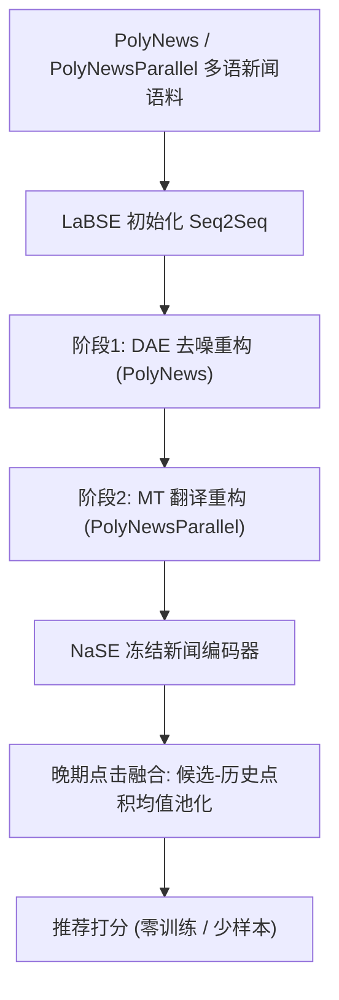

# News Without Borders: Domain Adaptation of Multilingual Sentence Embeddings for Cross-lingual News Recommendation (无国界新闻：面向跨语言新闻推荐的多语种句子嵌入领域适配)

- **会议/期刊**: ECIR 2025
- **作者与机构**: Andreea Iana, Heiko Paulheim (曼海姆大学)；Fabian David Schmidt, Goran Glavaš (维尔茨堡大学 CAIDAS)
- **推荐链路定位**: 召回（新闻编码器 / 冷启动零样本召回）
- **研究方向**: 冷启动与长尾推荐 / 大语言模型推荐
- **论文原文**: [https://arxiv.org/abs/2406.12634v2](https://arxiv.org/abs/2406.12634v2)
- **开源代码**: [https://github.com/andreeaiana/nase](https://github.com/andreeaiana/nase)（模型权重见 [HuggingFace](https://huggingface.co/aiana94/NaSE)）

## TL;DR (1分钟核心速览)

针对多语新闻推荐中两大痛点——多语 LM 骨干在零样本跨语言迁移 (ZS-XLT) 下性能骤降、且点击行为微调在冷启动/少样本场景不可行——本文构建 PolyNews / PolyNewsParallel 两个多语新闻语料，以去噪自编码 (DAE) + 机器翻译 (MT) 目标对 LaBSE 做任务无关的领域适配，得到 NaSE。配合**冻结 NaSE 嵌入 + 非参数化晚期点击融合 (LFRec-SCL)**，在 xMIND 14 语种 Full-Ranking 协议下 nDCG@10 较冻结 LaBSE 平均提升 4.17%，且无需任何任务特定训练即超越需训练用户编码器的 NAML/MINS/CAUM。

## Background & Motivation (背景与核心矛盾)

- **主流范式**: 神经新闻推荐器 (NNR) 由新闻编码器、用户编码器、点击预测器三段组成，通常以多语 LM（XLM-RoBERTa、LaBSE）为骨干，并在点击日志上端到端微调。
- **前人局限一**: 即便骨干是多语 LM，ZS-XLT 下目标语性能仍显著低于源语（英文），因为通用 LM 未针对新闻语义做跨语言对齐。
- **前人局限二**: 微调需更新数亿参数且强依赖点击数据；在低资源语种或真冷启动（无新闻/无用户行为）场景下，连用户编码器都无法训练出有意义的表征。
- **核心洞察 (Key Insight)**: 多语**句子编码器**（如 LaBSE）天生做跨语言句义对齐，却几乎未被用作新闻编码骨干；其缺的只是"新闻领域知识"，而这一知识可通过任务无关的领域适配注入，从而绕开推荐任务的监督微调。
- **本文切入点**: 用大规模多语新闻语料对 LaBSE 做 DAE+MT 领域适配，得到可直接冻结使用的 NaSE，并质疑"新闻推荐必须微调 LM"的范式。

## Method (核心方法设计)

### 1. 整体框架 (Overall Architecture)

先离线构建 PolyNews（3.91M 文本 / 77 语种 / 19 种文字，来源 WikiNews、MasakhaNews、MAFAND、WMT-News、GlobalVoices，经语言识别、去短文本、MinHash 近重复去重）与 PolyNewsParallel（5.39M 文本 / 833 语言对 / 64 语种）。随后以 LaBSE 权重初始化编码器-解码器（参数共享），先在 PolyNews 上做 DAE，再在 PolyNewsParallel 上做 MT，顺序训练得 NaSE。下游推荐时冻结 NaSE 编码新闻，用户表征由"候选-历史新闻点积分数的均值池化"这一**非参数化晚期融合**直接给出，无需训练任何用户编码器。

### 2. 关键设计拆解 (Key Designs)

1. **DAE 去噪自编码领域适配**：通用 SE 缺乏新闻领域语义。沿用 TSDAE，对输入句加 token 删除噪声（比例 0.6）得 $\tilde{x}$，令解码器重构原句：
$$\mathcal{J}_{\text{TSDAE}}(\Theta)=\mathbb{E}_{x\sim\mathcal{D}}\Big[\sum_{t=1}^{l}\log\frac{\exp(\mathbf{h}_t^{\top}\mathbf{e}_t)}{\sum_{i=1}^{|V|}\exp(\mathbf{h}_t^{\top}\mathbf{e}_i)}\Big]$$
与 TSDAE 的差别在于：以 LaBSE 初始化并**移除其池化层**（因起点已是句子编码器而非普通 LM）。直觉是重构压力迫使编码器吸收新闻文体与实体分布。

2. **MT 翻译重构 + 顺序组合**：把源语输入视作目标语句子的"噪声版本"，用 PolyNewsParallel 做 seq2seq 翻译，从而在新闻平行语料上强化跨语言对齐。四种变体（DAE、MT、DAE+MT 交替、DAE→MT 顺序）中，顺序版 NaSE 因先后见过两个语料、数据暴露最多而最优。关键现象：MT 目标对**未出现在 PolyNewsParallel 的语种**（如 THA）乃至 LaBSE 预训练未见的语种（如 GRN）同样增益，说明领域适配具有语言无关的迁移性。

3. **训练目标、采样与推理效率**：总目标即 DAE 与 MT 的重构交叉熵（分阶段）。语料分布极度倾斜，按 $p(L)\propto|L|^{\alpha}$（$\alpha=0.3$）平滑采样，仅保留 ≥100 文本的语种/语言对，上采样低资源语种。训练 50K 步、lr$3\times10^{-5}$、AdamW、每 5K 步在 xMIND 验证集上以冻结编码器+晚期融合选 checkpoint。推理侧 NaSE 仅做一次前向编码，无用户编码器、无负采样、无任务微调，冷启动下可直接上线。

## Experimental Setup & Evaluation Protocol (实验设置与评估协议)

- **数据集与预处理**: MIND (small) 与 xMIND (small)，xMIND 为 MIND 新闻机器翻译至 14 语种，通过 news ID 与 MIND 点击行为耦合。

| 数据集 | #Users | #Items(News) | #Interactions(Impressions) | 说明 |
| :--- | :---: | :---: | :---: | :--- |
| MIND small (Train) | 45,214 | 51,282 | 124,229 | 英文，前 4 天训练 |
| MIND small (Val) | 19,703 | 51,282 | 29,498 | 最后 1 天，兼作验证 |
| MIND small (Test) | 48,593 | 42,416 | 70,938 | 官方 Val 作 Test（官方 Test 标签未公开） |
| xMIND small | 同上（按语种复用） | 同上 | 同上 | 14 目标语种，每语种统计同上 |

- **数据划分与防穿越 (Splitting Strategy)**: 按**全局时间戳切分**——训练集前 4 天训练、最后 1 天作验证；官方验证集作测试集。ZS-XLT 设定下训练期用户历史与候选**仅英文**，推理期整体切换为某一目标语种（单语消费假设）。
- **排名评测协议 (Ranking Protocol)**: 采用 **Full-Ranking（全库未交互候选排序）**，指标 AUC、MRR、nDCG@10（nDCG@5 趋势一致故略）。训练期每正样本采 4 负样本。
- **对比基线与超参设置**: 基线含 NAML、MINS、CAUM、MANNeR 四个架构异构 NNR，及 LFRec-CE、LFRec-SCL、NAML_CAT（纯类别向量、文本无关）。骨干三选一：XLM-RoBERTa_large、LaBSE、NaSE。微调仅更新 LM 最后 4 层，历史长度 50，lr $10^{-5}$，SCL 温度 0.38，3 seeds {42,43,44} 取均值与标准差。

## Key Experimental Results (实验关键数据)

### 1. 主实验对比 (Main Results)

**表 A：冻结新闻编码器下的 ZS-XLT（节选，nDCG@10 / AUC，AVG 为 14 语种均值）**

| Model (frozen backbone) | 可训练参数 | AUC ENG | AUC AVG | nDCG@10 ENG | nDCG@10 AVG |
| :--- | :---: | :---: | :---: | :---: | :---: |
| LFRec-SCL + XLM-R_large | 0 | 50.00 | 50.00 | 28.44 | 28.71 |
| LFRec-SCL + LaBSE | 0 | 50.47 | 50.98 | 34.83 | 32.95 |
| **LFRec-SCL + NaSE** | **0** | **64.19** | **63.79** | **39.01** | **38.23** |
| NAML + LaBSE | 0.156M | 61.17 | 58.78 | 39.21 | 38.19 |
| NAML + NaSE | 0.156M | 63.30 | 61.05 | 38.47 | 37.47 |
| MINS + LaBSE | 2.7M | 61.25 | 60.37 | 37.37 | 36.50 |
| CAUM + LaBSE | 3.7M | 62.82 | 61.35 | 38.40 | 37.61 |
| MANNeR + LaBSE | 1.7M | 64.54 | 61.97 | 38.51 | 35.82 |
| MANNeR + NaSE | 1.7M | 65.51 | **64.14** | 39.13 | 37.94 |

冻结 NaSE 相对冻结 LaBSE，跨全部 NNR 平均 nDCG@10 提升 **+2.58%（ENG）/ +4.17%（AVG）**；LFRec-SCL+NaSE 以**零可训练参数**在 AVG 上超过所有需训练用户编码器的复杂模型。

**表 B：微调新闻编码器下的 ZS-XLT（节选，nDCG@10）**

| Model (fine-tuned) | nDCG@10 ENG | nDCG@10 AVG | %∆ (AVG vs ENG) |
| :--- | :---: | :---: | :---: |
| LFRec-SCL + LaBSE | 41.14 | 39.65 | -3.62 |
| LFRec-SCL + NaSE | 41.07 | 39.35 | -4.17 |
| NAML + LaBSE | 41.25 | 40.42 | -1.99 |
| CAUM + LaBSE | 39.40 | 38.34 | -2.70 |
| MANNeR + LaBSE | 41.11 | 39.81 | -3.16 |

微调后 NaSE 与 LaBSE 基本持平——说明大规模推荐微调本身已起到领域适配作用，NaSE 的价值集中在**免微调**场景。

### 2. 消融实验 (Ablation Study)

**表 C：NaSE 训练策略消融（LFRec-SCL + 冻结嵌入，nDCG@10，节选语种）**

| 编码器配置 | ENG | THA | FIN | GRN | 相对 LaBSE 表现 |
| :--- | :---: | :---: | :---: | :---: | :--- |
| LaBSE (基线) | 34.83 | — | — | — | — |
| NaSE_DAE | 略高于 LaBSE | +0.19% | +12.90% | — | 15 语种中 12 胜 |
| NaSE_MT | 提升明显 | 最高 +20.22% vs LaBSE | — | 增益显著 | 全面优于 DAE |
| NaSE_DAE+MT | 略优于 DAE | — | — | — | 小幅提升 |
| **NaSE_DAE→MT (NaSE)** | **+11.99%** | **+21.33%** | — | — | **最优，ZHO +7.05%** |

### 3. 关键实验发现 (Key Findings)

1. **免微调即可 SOTA**：LFRec-SCL+冻结 NaSE 在 AVG 上 nDCG@10 达 38.23，超过需 2.7M–3.7M 可训练参数的 MINS/CAUM（36.50/37.61），直接证伪"新闻推荐必须微调 LM 并训练用户编码器"的范式。
2. **MT 目标贡献最大且具语言无关迁移性**：NaSE_MT 相对 NaSE_DAE 最高提升 19.99%，且对 PolyNewsParallel 未覆盖的 THA、LaBSE 预训练未见的 GRN 同样有效，说明领域适配的跨语言增益不依赖平行语料覆盖。
3. **少样本下优势更明显**：10-shot 时 NaSE 相对 LaBSE 的 nDCG@10 增益在 LFRec-SCL 上达 12.54%（AVG）/7.38%（ENG），100-shot 后差距收窄，印证 NaSE 主要补偿的是数据稀缺而非数据充足场景。

## Highlights & Limitations (亮点、对比与审稿批判)

- **与代表作对比 (vs. Prior Work)**: 相较 Wu et al. 的 xMIND 基准（多语 LM 微调仍大幅掉点），本文换用句子编码器骨干并做任务无关适配；相较 Iana et al. 的晚期融合工作，本文补上了"新闻编码器领域知识"这一环；相较通用 TSDAE/SimCSE 领域适配，本文首次将 DAE+MT 组合用于多语新闻 SE 并系统验证语言无关迁移。
- **可迁移亮点**: (1) "冻结领域适配 SE + 非参数化晚期融合"可作为冷启动/低资源推荐的极简强基线；(2) 用 MT 目标做领域适配可惠及平行语料未覆盖语种，可迁移至跨域/跨语种内容推荐。
- **审稿级局限批判**: (1) 实验仅在 MIND/xMIND（机器翻译新闻、单语消费假设）上验证，真实多语平台的多语混读与代码切换场景未覆盖；(2) 冻结方案虽省训练，但 NaSE 编码需对每条候选做一次大模型前向，全库召回时推理开销与向量索引成本未做量化分析，且 DAE→MT 顺序训练的超参（α、噪声比、步数）敏感性讨论不足。

## Rating (四维评分)

- **方法创新性 (Novelty)**: ⭐⭐⭐⭐ （以"任务无关领域适配 + 冻结嵌入"挑战微调范式，思路简洁但组合式创新，理论新意中等）
- **评估协议与实验扎实度 (Protocol & Experiments)**: ⭐⭐⭐⭐ （4 个异构 NNR × 3 骨干 × 15 语种 × 3 seeds，Full-Ranking 与少样本/消融齐全；受限于单一数据集族与 MT 新闻）
- **写作与数学规范度 (Clarity & Rigor)**: ⭐⭐⭐⭐ （公式精简、语料构建流程与训练细节交代清楚，附录仅 arXiv 版略影响可复现完整性）
- **工业落地与复现价值 (Industrial & Practical Value)**: ⭐⭐⭐⭐⭐ （代码、模型、两套语料全部开源，零训练冷启动上线路径清晰，工程价值突出）

