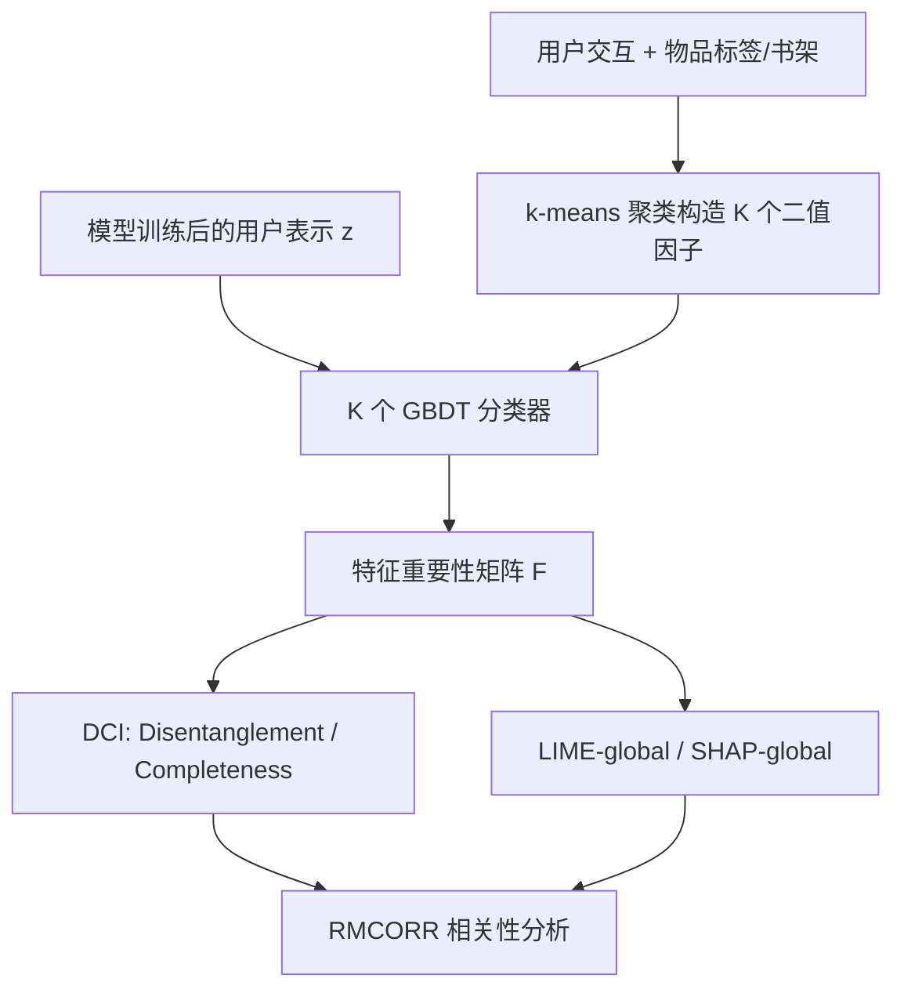

# Are Representation Disentanglement and Interpretability Linked in Recommendation Models? A Critical Review and Reproducibility Study (推荐模型中的表示解耦与可解释性是否相关？批判性综述与可复现性研究)

- **会议/期刊**: ECIR 2025
- **作者与机构**: Ervin Dervishaj, Tuukka Ruotsalo, Maria Maistro, Christina Lioma（哥本哈根大学、LUT 大学）
- **推荐链路定位**: 召回（用户表示学习层）
- **研究方向**: 去偏公平、可信隐私与工业架构 / 协同过滤
- **论文原文**: [https://arxiv.org/abs/2501.18805v1](https://arxiv.org/abs/2501.18805v1)
- **开源代码**: [https://github.com/edervishaj/disentanglement-interpretability-recsys](https://github.com/edervishaj/disentanglement-interpretability-recsys)

## TL;DR (1分钟核心速览)

本文是推荐系统领域首个针对"表示解耦"的系统性可复现研究：在 4 个数据集上复现 5 个模型（含 MacridVAE、β-VAE 等显式解耦模型与 PureSVD、MultiVAE 等非解耦基线），首次用 DCI 框架量化解耦度、并改造 LIME/SHAP 为全局指标量化表示可解释性。核心结论颠覆了领域共识：解耦与推荐效果**无**一致显著相关（MacridVAE 效果最优却解耦度最低之一），但与表示可解释性呈强正相关（RMCORR 达 0.51–0.95）。同时复现发现原论文效果指标在 GoodReads-Children 上偏差高达 43%。

## Background & Motivation (背景与核心矛盾)

- **主流范式**: 推荐领域近年大量工作（MacridVAE、β-VAE 系）通过在 VAE 的 ELBO 上加入 KL 惩罚项 $\beta \gg 1$ 强制潜在维度解耦，声称每个维度对应一个语义因子（如电影类型、用户意图），从而同时提升效果与可解释性。
- **前人局限**: (1) 解耦优势几乎只做**定性**验证——把表示降到 2 维做可视化目测，缺乏客观量化；(2) 解耦正则对重建能力的损害（其他领域已证实的 trade-off）在推荐场景被长期忽视，效果与解耦的真实关系不明。
- **核心洞察 (Key Insight)**: 推荐数据缺乏 ground-truth 变化因子，导致解耦度无法直接度量；但可借物品内容（标签/书架）聚类反推用户级二值因子，从而用 DCI 框架客观量化。
- **本文切入点**: 用统一的量化协议 + 重复测量相关性分析（RMCORR），把"解耦—效果—可解释性"三角关系首次放到统计检验下审视。

## Method (核心方法设计)

### 1. 整体框架 (Overall Architecture)

本文不是提出新模型，而是构建一套**评测管线**：对每个模型训练后取用户潜在表示 $\mathbf{z}\in\mathbb{R}^M$，先用物品内容聚类构造$K$个二值 ground-truth 因子，再训练$K$个梯度提升树分类器$f_j:\mathbb{R}^M\to\{0,1\}$从$\mathbf{z}$预测各因子；分类器的特征重要性矩阵$\mathbf{F}\in\mathbb{R}^{M\times K}$ 同时喂给 DCI 解耦度量与改造后的 LIME/SHAP 全局可解释性度量；最后用 RMCORR 在模型内/数据集内两个视角做相关性检验。

### 2. 关键设计拆解 (Key Designs)

1. **DCI 解耦度量（Disentanglement & Completeness）**：痛点是无仿真函数无法用 β-VAE/FactorVAE 度量。本文采用 DCI 的两个熵基指标，把 $\mathbf{F}$按列归一化得$P_{ij}=F_{ij}/\sum_j F_{ij}$，则单维解耦度$D_i = 1 - H_K(P_i)$，加权得$D=\sum_i \alpha_i D_i$，其中$\alpha_i$ 为该维总重要性占比；Completeness 对称地在因子维度上计算。直觉：某维只对单一因子高重要 → 熵低 → 解耦度高。
2. **LIME-global / SHAP-global 表示可解释性度量**：痛点是 LIME/SHAP 只是局部方法，无法量化"表示整体是否可解释"。本文对每个分类器 $f_j$收集全体用户上的平均绝对 LIME/SHAP 维度重要性得列向量$\mathbf{s}_j$，拼成$\mathbf{S}\in\mathbb{R}^{M\times K}$，列归一化后取所有列对的 Jensen-Shannon 散度均值。直觉：不同因子若把重要性集中在**不同且稀疏**的维度子集上，JS 散度大 → 表示冗余低、可解释性高。
3. **训练与统计协议**：所有模型用官方实现 + hyperopt 贝叶斯搜索 50 轮，统一调参目标 NDCG@100，5 个随机种子取均值；相关性分析因同模型/同数据集内样本非独立，采用考虑组内相关的 RMCORR 而非 Pearson，并以 $p<0.05$ 标显著性。

## Experimental Setup & Evaluation Protocol (实验设置与评估协议)

- **数据集与预处理**（评分二值化：本文取 $>1$为 1，原工作取$>4$ 为 1，这是复现偏差主因之一）：

| 数据集 | #Users | #Items | #Interactions | 稀疏度 | 过滤/场景说明 |
| :--- | :---: | :---: | :---: | :---: | :--- |
| Amazon-CD | 23,024 | 19,444 | 570,747 | 99.877% | 10-core，CD 品类标签 |
| ML1M | 6,040 | 3,706 | 1,000,209 | 95.532% | 每用户 ≥20 交互 |
| Yelp | 99,011 | 56,441 | 2,762,098 | 99.953% | 10-core，商户类目 |
| GR-Children | 117,293 | 42,119 | 5,067,546 | 99.897% | 10-core，书架标签 |

- **数据划分与防穿越**: 随机**按用户 3:1:1** 划分 train/val/test（作者明确弃用时间戳切分，理由是用户表示模型需在训练期见到用户，时间切分会排除部分用户）。
- **排名评测协议**: 采用 **Full-Ranking 全库未交互排序**（NDCG/Recall/MRR/Coverage @10/50/100），无负采样。
- **对比基线与超参**: 5 个模型——Top-Popular（非个性化）、PureSVD（MF）、MultiDAE/MultiVAE（AE 系）、β-VAE 与 MacridVAE（显式解耦）；潜维 $d\in[2,20]$网格搜索，学习率 log-uniform$[e^{-10},e^{-2}]$，batch$\in\{128,256,512,1024\}$，最多 500 epoch 早停。

## Key Experimental Results (实验关键数据)

### 1. 主实验对比 (Main Results)

效果指标（NDCG@10，5 种子均值，原文表 4）：

| 数据集 | Top-Pop | PureSVD | MultiDAE | MultiVAE | β-VAE | MacridVAE |
| :--- | :---: | :---: | :---: | :---: | :---: | :---: |
| Amazon-CD | 0.0059 | 0.0288 | 0.0806 | 0.0853 | 0.0570 | **0.1621** |
| ML1M | 0.0533 | 0.3889 | 0.3806 | 0.3853 | 0.3553 | **0.3963** |
| Yelp | 0.0029 | 0.0304 | 0.0586 | 0.0569 | 0.0458 | **0.0650** |
| GR-Children | 0.0349 | 0.2300 | 0.3452 | 0.3432 | 0.2999 | **0.3764** |

解耦与可解释性（原文表 5，节选 Disentanglement / LIME-global）：

| 数据集 | PureSVD (D / LIME) | MultiVAE (D / LIME) | MacridVAE (D / LIME) |
| :--- | :---: | :---: | :---: |
| Amazon-CD | **0.2637** / 0.4586 | 0.2144 / 0.4246 | 0.2024 / **0.4669** |
| ML1M | 0.1565 / 0.3035 | **0.1859** / 0.3168 | 0.1207 / **0.3367** |
| Yelp | **0.2987** / **0.5200** | 0.2190 / 0.4884 | 0.2208 / 0.4473 |
| GR-Children | 0.1219 / 0.4131 | 0.1377 / 0.4361 | **0.1593** / **0.4782** |

复现偏差（原文表 3）：ML1M 上 NDCG@100 偏差在 ±10% 内，但 GR-Children 上 NDCG@100 低至 **28%**、Recall@50 低至 **43%**；解耦度复现偏差更极端，β-VAE 的 D 指标相对原报告下降 **74.8%**。

### 2. 消融实验 (Ablation Study)

本文为复现研究，无传统模块消融，其"消融"体现为**度量与协议敏感性分析**：

| 变体/敏感性设置 | 观察结果 |
| :--- | :--- |
| 二值化阈值 $>1$vs$>4$ | 效果指标系统性偏移，是 GR-Children 偏差主因 |
| 潜维固定 vs 调参搜索 | 调参后 NDCG 普遍上升（ML1M 最高 +8%） |
| 分类器 GBDT vs LR vs RF | 解耦度数值仍无法复现原报告，排除分类器选择因素 |
| 因子构造阈值 $M=0.4$ | 沿用原文设置，但作者承认该超参影响解耦度绝对值 |

### 3. 关键实验发现 (Key Findings)

1. **解耦 ≠ 效果**：MacridVAE 在全部 4 个数据集上 NDCG@10 最优（如 Amazon-CD 0.1621，比次优 MultiVAE 高 90%），但其解耦度在 3/4 数据集上低于 PureSVD；RMCORR 在按数据集分组时无一致显著相关，直接否定了"解耦带来效果提升"的领域叙事，也**不支持**其他领域报告的"解耦—效果 trade-off"。
2. **解耦 ≈ 可解释性**：解耦度与 LIME-global/SHAP-global 在所有数据集与模型上均呈强正相关（RMCORR $\in[0.51,0.95]$，多数$p<0.05$），首次为"解耦提升表示可解释性"提供了定量证据，支持 MacridVAE 原文的定性观察。
3. **复现脆弱性**：解耦度指标对 ground-truth 因子构造（聚类阈值、书架合并规则）高度敏感，且原作者代码未公开，导致即便严格照搬公式仍无法复现——说明该子领域的实验结论目前**不可独立验证**。

## Highlights & Limitations (亮点、对比与审稿批判)

- **与代表作对比 (vs. Prior Work)**: 相比 MacridVAE（提出解耦模型但仅 2 维可视化定性论证）与 Nema et al.（唯一尝试量化解耦但代码未公开），本文首次建立可复现的量化管线，并用统计检验替代目测；与一般 VAE 解耦文献（β-VAE/FactorVAE）相比，本文指出推荐场景缺乏仿真函数，必须走 DCI 路线。
- **可迁移亮点**: (1) 用"物品内容聚类 → 用户二值因子"反推 ground-truth 因子的构造法，可迁移到任何需要评估表示语义结构的推荐任务；(2) 把局部归因方法（LIME/SHAP）通过"跨因子 JS 散度"聚合为全局表示质量指标，是一个通用且低成本的诊断工具。
- **审稿级局限批判**: (1) ground-truth 因子本身由启发式聚类得到，解耦度的绝对值可信度存疑，结论更适合做**相对比较**而非绝对判定；(2) LIME/SHAP-global 继承了原方法的稳定性缺陷，且仅覆盖用户侧表示，未触及物品侧与整个模型输出的可解释性；(3) 未纳入近年基于图或对比学习的解耦工作，模型覆盖面偏窄。

## Rating (四维评分)

- **方法创新性 (Novelty)**: ⭐⭐⭐⭐ （不提出新模型，但 LIME/SHAP-global 量化表示可解释性 + RMCORR 统计检验的组合在推荐领域属首创）
- **评估协议与实验扎实度 (Protocol & Experiments)**: ⭐⭐⭐⭐ （4 数据集 × 5 模型 × 5 种子 + Full-Ranking + 显著性检验完备，但 ground-truth 因子构造的启发式削弱了绝对结论）
- **写作与数学规范度 (Clarity & Rigor)**: ⭐⭐⭐⭐ （DCI 与全局归因公式定义清晰、动机链条完整，复现偏差的归因分析坦诚透明）
- **工业落地与复现价值 (Industrial & Practical Value)**: ⭐⭐⭐⭐ （代码与全部结果开源，评测管线可直接复用为表示质量诊断工具；但结论对线上部署的直接指导有限）

