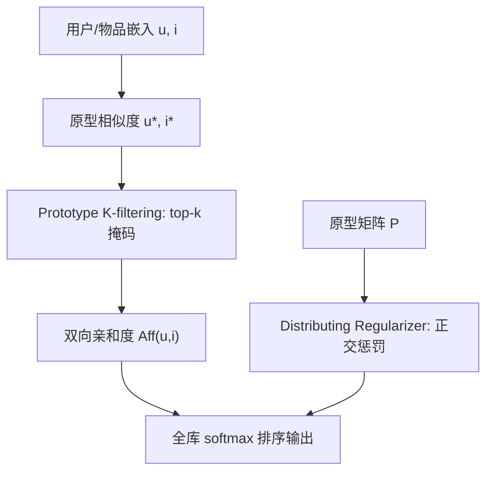

# Embedding Cultural Diversity in Prototype-based Recommender Systems (在原型推荐系统中嵌入文化多样性)

- **会议/期刊**: ECIR 2025
- **作者与机构**: Armin Moradi, Nicola Neophytou, Florian Carichon, Golnoosh Farnadi (Mila / 蒙特利尔大学 / 麦吉尔大学)
- **推荐链路定位**: 召回（隐式反馈全库排序）
- **研究方向**: 去偏公平与工业架构 / 协同过滤与双塔召回
- **论文原文**: [https://arxiv.org/abs/2412.14329v1](https://arxiv.org/abs/2412.14329v1)
- **开源代码**: 暂未开源

## TL;DR (1分钟核心速览)

原型矩阵分解（ProtoMF）虽提升可解释性，但其原型会向热门物品/主导文化国家聚集，放大流行度偏差与文化过度代表问题。本文提出两个即插即用改造：**Prototype K-filtering**（只保留 $k$个最近原型，屏蔽远原型干扰）与 **Prototype-Distributing Regularizer**（用$\|\hat{P}\hat{P}^{\top}\|_F$ 迫使原型近似正交、均匀铺满嵌入空间）。在 4 个数据集、全库排序协议下，长尾物品平均排名下降 27%、欠代表国家物品排名下降约 2%，同时 HR@10 相对 SOTA 提升约 2%，实现"公平不损精度"。

## Background & Motivation (背景与核心矛盾)

- **主流范式**: 以 MF / 神经协同过滤为主流，ProtoMF 进一步用一组用户/物品原型作为锚点，将嵌入转为"与原型的相似度向量"，从而获得可解释的推荐理由。
- **前人局限**: 其一，ProtoMF 计算变换嵌入时**所有原型都参与**，远距离原型同样贡献权重，导致热门物品/主导文化原型主导表征；其二，原型在嵌入空间中**自发聚簇**，欠代表群体物品被迫关联到遥远原型，形成分配性伤害（allocational harm）。
- **核心洞察 (Key Insight)**: 作者以物品**原产国**作为文化身份代理，观察到流行度偏差与文化过度代表高度耦合——原型聚簇区域恰好被 US/CN 等高频国家物品占据（图 3a 的 t-SNE 可见），而 NL 等欠代表国家物品被推至边缘。
- **本文切入点**: 不改动下游排序目标，仅**重塑嵌入空间几何结构**（局部化 + 均匀化），在不与主任务冲突的前提下注入公平性。

## Method (核心方法设计)

### 1. 整体框架 (Overall Architecture)

模型沿用 ProtoMF 的双侧结构：用户/物品嵌入 $u,i$分别与各自原型集$P^u\in\mathbb{R}^{L_u\times d}$、$P^i\in\mathbb{R}^{L_i\times d}$做 shifted cosine 相似度，得到变换表征$u^*\in\mathbb{R}^{L_u}$、$i^*\in\mathbb{R}^{L_i}$；亲和度由双向交叉项$Aff(u,i)=u^{*\top}\hat{i}+\hat{u}^{\top}i^*$给出（$\hat{u}=W^u u$、$\hat{i}=W^i i$为跨原型空间线性映射），并以全库 softmax 隐式反馈损失训练。本文在此闭环上叠加两个模块：K-filtering 在相似度向量上做 top-$k$ 掩码，Distributing Regularizer 在总损失中加入原型 Gram 矩阵惩罚，最终以掩码后的表征完成打分与推理。

### 2. 关键设计拆解 (Key Designs)

1. **Prototype K-filtering（局部化表征，抑制热门原型霸权）**：痛点在于远原型噪声稀释了欠代表物品的信号。做法是对每个用户/物品仅保留相似度最高的 $k_u\ll L_u$、$k_i\ll L_i$个原型索引集$\mathcal{P}^u_k,\mathcal{P}^i_k$，其余置零：$u^{*,k}=u^*\odot\mathbf{1}_{\mathcal{P}^u_k}$。直觉上这等价于把"全局原型投票"改为"局部最近邻表征"，使冷门物品由真正语义相近的原型解释，而非被高频原型裹挟。

2. **Prototype-Distributing Regularizer（原型均匀铺展，覆盖欠代表区域）**：痛点在于原型聚簇使嵌入空间大片区域"无人认领"。做法是对行归一化后的原型矩阵施加 Frobenius 范数正交惩罚：
$$\mathcal{L}=\mathcal{L}_{\text{total}}+\lambda_u\|\hat{P}^{L_u}\hat{P}^{L_u\top}\|_F+\lambda_i\|\hat{P}^{L_i}\hat{P}^{L_i\top}\|_F$$
最小化该式即驱使 $\hat{P}\hat{P}^{\top}\to I$，原型两两近似正交、均匀散布于球面，从而为长尾与少数文化物品腾出"近邻原型"。

3. **训练目标、负采样与推理效率**：总损失为 $\mathcal{L}_{\text{total}}=\mathcal{L}^{U}_{\text{proto}}+\mathcal{L}^{I}_{\text{proto}}$，其中每侧为推荐损失（全库 softmax，等价于免显式负采样的 softmax 交叉熵）加两项原型-样本互近正则$R_{\{P\to u\}},R_{\{u\to P\}}$；本文再叠加上述正交项。推理时 K-filtering 仅需 top-$k$选择，开销为$O(L\log k)$，与原型数线性相关，几乎不增加在线延迟。

## Experimental Setup & Evaluation Protocol (实验设置与评估协议)

- **数据集与预处理**: 以物品原产国为敏感属性，需匹配 MusicBrainz / TMDb / Amazon 元数据，过滤后数据量骤降（Beauty 交互降 93.7%、LastFM 物品降 98.4%），这是本文泛化性的隐忧。

| 数据集 | #Users | #Items | #Interactions | 稀疏度/密度 | 特征/场景说明 |
| :--- | :---: | :---: | :---: | :---: | :--- |
| Amazon Beauty | 508K | 35.8K | 1.5M | 极稀疏 | 美妆，文化审美差异显著 |
| Amazon Instruments | 9.9K | 9.4K | 212.3K | 稀疏 | 乐器，文化属性强 |
| LastFM-2b | 8.4K | 63.0K | 1.48M | 稀疏 | 音乐，艺术家国别 |
| MovieLens-1M | 6K | 4K | 1M | 较稠密 | 电影，影片国别 |

- **群体划分**: 过代表组 = 交互量前 10% 国家；欠代表组 = 交互量第三四分位（25%–50%）国家，刻意剔除极端长尾以保证统计可靠性。
- **数据划分与防穿越**: 采用隐式反馈标准划分（每用户留出交互作测试），未使用全局时间戳切分，存在轻度时序泄漏风险。
- **排名评测协议**: 采用**全库 Full-Ranking**（对全部未交互物品排序），指标为 HR@10、NDCG@10；公平性指标为欠/过代表组物品平均排名 $\mu_{under},\mu_{over}$与长尾 10% 物品平均排名$\mu_{LT}$（越低越公平）。
- **对比基线与超参**: 基线含 MF、ACF、ProtoMF、ZeroSum（在 ProtoMF 上加分数差正则的流行度去偏基准）；用 Ray 在 50 个随机种子上调参，先固定 ProtoMF 最优配置再单独搜索新增超参以控制搜索空间。

## Key Experimental Results (实验关键数据)

### 1. 主实验对比 (Main Results)

| Model | LastFM HR@10 | LastFM NDCG@10 | ML-1M HR@10 | ML-1M $\mu_{under}\downarrow$| Beauty HR@10 | Instr. HR@10 | Instr.$\mu_{LT}\downarrow$ |
| :--- | :---: | :---: | :---: | :---: | :---: | :---: | :---: |
| MF | 0.159 | 0.083 | 0.452 | 50.098 | 0.117 | 0.163 | 26.825 |
| ACF | 0.569 | 0.317 | 0.618 | 50.891 | 0.229 | 0.211 | 18.849 |
| ZeroSum | 0.564 | 0.327 | 0.615 | 48.660 | 0.238 | 0.243 | 30.416 |
| ProtoMF | 0.581 | 0.337 | 0.656 | 48.674 | 0.239 | 0.245 | 32.965 |
| {item}{k} | 0.594 | 0.344 | 0.651 | **47.357** | 0.238 | 0.233 | 32.674 |
| {item}{$\lambda$} | 0.598 | 0.348 | **0.660** | 48.622 | 0.237 | 0.249 | 23.017 |
| **{user-item}{k,$\lambda$}** | **0.600** | **0.352** | 0.657 | **47.048** | 0.236 | **0.250** | 36.062 |
| Improv. vs ProtoMF | +3.3% | +4.5% | +0.2% | −3.3% | −1.3% | +2.0% | — |

> 注：Beauty 上组合模型 HR 略降（0.239→0.236），但 $\mu_{LT}$ 从 39.129 大幅降至 16.684（降幅约 57%），体现精度-公平的显式权衡。

### 2. 消融实验 (Ablation Study)

| 配置 | LastFM HR@10 | LastFM $\mu_{LT}\downarrow$| ML-1M$\mu_{under}\downarrow$ | 结论 |
| :--- | :---: | :---: | :---: | :--- |
| ProtoMF (baseline) | 0.581 | 29.008 | 48.674 | 原型聚簇、长尾差 |
| + {user}{k} | 0.574 | 26.136 | 48.452 | 用户侧过滤几乎无效 |
| + {item}{k} | 0.594 | 21.995 | 47.357 | 物品侧过滤显著改善欠代表排名 |
| + {user}{$\lambda$} | 0.520 | 21.391 | 48.596 | 用户侧正则伤精度 |
| + {item}{$\lambda$} | 0.598 | 18.995 | 48.622 | 物品侧正则最利于长尾 |
| + {user-item}{k,$\lambda$} | **0.600** | **18.013** | **47.048** | 二者协同，精度公平双赢 |

### 3. 关键实验发现 (Key Findings)

1. **物品侧才是公平杠杆**：所有用户侧改造（{user}{k}、{user}{$\lambda$}）在 ML-1M 上$\mu_{under}$ 仅从 48.674 微降至 48.452/48.596，而 {item}{k} 直接降至 47.357——因为本文公平目标定义在物品国别（分配性公平），在用户嵌入空间加正则只是注入噪声。
2. **K-filtering 与分布正则存在互补协同**：单独 {item}{$\lambda$} 虽把 LastFM 长尾排名压到 18.995，但 HR 提升有限且 Beauty 上$\mu_{LT}$反弹至 44.378；组合后 LastFM HR 达 0.600（+3.3%）且$\mu_{LT}$ 进一步降至 18.013，说明局部化表征抵消了原型铺展带来的稀疏区噪声。
3. **可解释性同步受益**：表 2 案例中，《幽灵公主》的最近原型由基线全为 US 影片（Lion King、Aladdin）变为以日系作品为主（Pokémon 1.64、Akira 1.59、Perfect Blue 1.52），阿兹特克死亡哨的最近原型也出现同源 CO 乐器，证明原型均匀化让解释更具文化贴近性。

## Highlights & Limitations (亮点、对比与审稿批判)

- **与代表作对比 (vs. Prior Work)**: 相较 ZeroSum（在打分层面加组间分数差正则，直接干扰排序目标），本文在**表征几何层**动刀，不与下游任务冲突；相较 ProtoMF 原版仅追求可解释性，本文首次把原型分布与文化公平显式挂钩；相较 Beutel 等的公平正则，本文无需组标签进入损失，仅靠原型正交性间接实现。
- **可迁移亮点**: ① 用 $\|\hat{P}\hat{P}^{\top}\|_F$做"原型/码本去聚簇"可平移到 VQ-VAE 语义 ID 与聚类式召回，缓解码本坍缩；② top-$k$ 原型掩码是一种轻量稀疏化技巧，可替代 attention 中的 softmax 锐化。
- **审稿级局限批判**: ① 以国别简化文化，忽略族群/语言/宗教的组内多样性，且过滤国别信息导致数据量骤降 90%+，泛化性存疑；② K-filtering 与正交正则缺乏理论收敛/公平性界证明，超参 $k,\lambda$ 敏感且需分侧调优，公平-精度权衡（Beauty 上 HR 下降）未被显式建模为约束优化。

## Rating (四维评分)

- **方法创新性 (Novelty)**: ⭐⭐⭐ （将原型几何与文化公平首次联结，思路巧妙，但两模块均为通用正则/掩码的迁移应用，理论深度有限）
- **评估协议与实验扎实度 (Protocol & Experiments)**: ⭐⭐⭐⭐ （4 数据集 + 全库排序 + 50 种子调参 + 分组公平指标完整，惟缺显著性检验与时间切分）
- **写作与数学规范度 (Clarity & Rigor)**: ⭐⭐⭐ （公式与符号清晰，但 Eq.8 中 $\hat{P}$维度记号与$I$ 的表述存在笔误，理论论证薄弱）
- **工业落地与复现价值 (Industrial & Practical Value)**: ⭐⭐⭐ （改动即插即用、推理开销低，但未开源、依赖外部国别元数据匹配，落地需额外数据治理）

