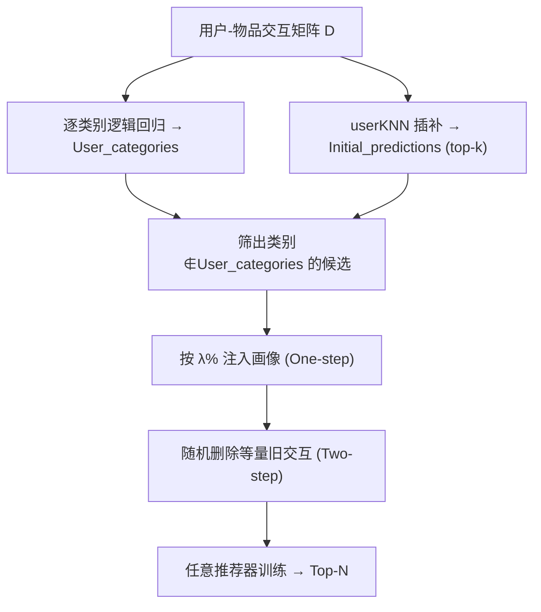
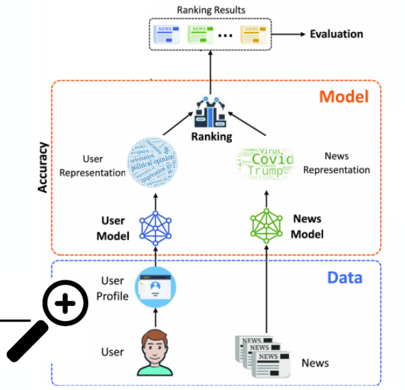

# How to Diversify any Personalized Recommender? (如何让任意个性化推荐器多样化？)

- **会议/期刊**: ECIR 2025
- **作者与机构**: Manel Slokom, Savvina Daniil, Laura Hollink（Centrum Wiskunde & Informatica, Amsterdam）
- **推荐链路定位**: 召回（训练数据预处理，模型无关）
- **研究方向**: 去偏公平与工业架构 / 冷启动与长尾推荐
- **论文原文**: [https://arxiv.org/abs/2405.02156v2](https://arxiv.org/abs/2405.02156v2)
- **开源代码**: [https://github.com/SlokomManel/How-to-Diversify-any-Personalized-Recommender-](https://github.com/SlokomManel/How-to-Diversify-any-Personalized-Recommender-)

## TL;DR (1分钟核心速览)

现有推荐多样性研究几乎集中在 in-processing（多目标优化）与 post-processing（重排），二者分别被算法绑定、被候选集约束；而 pre-processing 路线在多样性上几乎空白。本文提出**模型无关的用户画像预处理**：用逻辑回归识别用户"代表类别"，用 userKNN 生成候选，再把"用户未涉足类别但可能相关"的物品按 $\lambda\%$ 注入画像（一步变体），或再随机删除等量旧交互以保持画像规模（两步变体）。在 MIND（新闻）与 GoodBook（图书）上，7 种算法（NRMS/NPA/LSTUR/ItemKNN/ImplicitMF/BPR/MostPop）的精度基本持平（最大波动仅 0.002~0.034），而校准散度、覆盖率与 fair-nDCG 普遍提升，少数类曝光显著改善。

## Background & Motivation (背景与核心矛盾)

- **主流范式**: 多样性提升分三类——pre-processing（改输入数据）、in-processing（把多样性写进损失/多目标优化）、post-processing（重排）。现有工作绝大多数落在后两类。
- **前人局限**: (1) in-processing 与特定算法强绑定，换模型即失效；(2) post-processing 只能在模型已能召回的候选集内重排，无法突破"模型根本不会推荐少数类"的天花板；(3) 已有的 pre-processing 工作（如 [4] 对少数群体交互上采样）多为**全局/群体级**操作，不区分个体偏好，易稀释用户画像。
- **核心洞察 (Key Insight)**: 用户画像本身就是"个人品味的编码"，粗暴改写会损伤精度；但只要注入的物品**同时满足"与用户偏好相关"和"属于用户未涉足类别"**两个条件，就能在几乎不损失精度的前提下引入分布偏移。
- **本文切入点**: 把多样化操作下沉到"画像级、个性化、可解释"的原始交互层面，从而与任意推荐架构解耦。

## Method (核心方法设计)

### 1. 整体框架 (Overall Architecture)

流程分三步：先对每个物品的类别标签做 one-hot，转置成 item-user 矩阵后用**逐类别逻辑回归**拟合，系数 $\beta_u^c>0$的用户-类别对进入 `User_categories`（用户代表类别）；再用 **userKNN** 对缺失交互做插补，以"拥有邻居数"作为相关性置信度，取 top-$k$得到 `Initial_predictions`；最后从候选中筛出**类别不在 `User_categories` 内**的物品，构成 `Personalized_items_for_addition`，按$\lambda\%$ 注入画像。一步变体只加不删；两步变体在加完后随机删除等量"非近期新增"交互，使画像规模与数据密度回归原状。

<figure class="paper-figure" markdown="span">
  <figcaption>图 1：我们的预处理方法及其在推荐架构中的作用。{i1, i4, i7, i10, i50} 是用户 u 过去交互的物品，{c1, c2, c3, c4} 是这些物品的类别。在一步变体中，加入个性化物品 i2 和 i6（绿色）。在两步变体中，移除物品 i4 和 i10（红色）。</figcaption>
</figure>

### 2. 关键设计拆解 (Key Designs)

1. **代表类别识别（Logistic Regression over Categories）**：痛点是不知"用户已涉足哪些类别"，无法定义"未涉足"。对每个类别 $c$ 训练二分类逻辑回归，输入为用户维度的交互向量，输出
   $P(y_i^c=1 \mid X_{i1},\dots,X_{iM}) = \sigma(\beta_0^c + \sum_u \beta_u^c X_{iu})$，
   仅保留 $\beta_u^c>0$ 的用户-类别对。选逻辑回归而非深度模型，是因为系数可直接解释"该用户与该类别的关联强度"，且能抑制过度泛化（只保留真正关联的类别）。

2. **个性化候选注入（Personalized Addition）**：痛点是随机注入会破坏精度。候选必须同时满足"在 userKNN 的 top-$k$预测内"（相关性）与"类别 ∉ `User_categories`"（新颖性），并按 userKNN 邻居数排序取前$\lceil \lambda\% \cdot |\text{profile}_u| \rceil$ 个。相关性约束保证精度，类别约束保证分布偏移方向可控。

3. **两步变体的等量删除（Two-step Removal）**：一步变体会抬高数据密度，使"精度变化"与"密度变化"混淆。两步变体在注入后随机删除等量旧交互，且对画像长度 $<20$ 的用户豁免删除，从而在保持长尾分布与稀疏性的同时，把性能差异归因于"类别结构变化"而非"数据量变化"。

4. **训练目标与开销**：本文不改任何推荐器损失，预处理是一次性离线操作；userKNN 的 $k$在 GoodBook 取 100、MIND 取 50，$\lambda \in \{1,2,5,10\}\%$。推理阶段零额外开销。

## Experimental Setup & Evaluation Protocol (实验设置与评估协议)

- **数据集与预处理**:

| 数据集 | #Users | #Items | #Interactions | 稀疏度 | 特征/场景说明 |
| :--- | :---: | :---: | :---: | :---: | :--- |
| MIND (train) | 1,000 | 26,740 | 9,368 | 99.58% | 新闻，17 类，单类别标注 |
| MIND (test) | 5,000 | 18,723 | 15,557 | 99.82% | 新闻测试集 |
| GoodBook (train) | 943 | 729 | 8,477 | 98.77% | 图书，31 类，多类别标注，评分 $\geq 3$ 视为隐式正反馈 |
| GoodBook (test) | 943 | 688 | 4,715 | 99.27% | 图书测试集 |

- **数据划分与防穿越**: GoodBook 采用**静态随机 80/20 划分**（每用户画像随机取 80% 训练、20% 测试）；预处理**仅作用于训练集**，并显式避免注入测试集中已存在的交互，因此测试集在所有条件下保持不变。作者亦指出随机划分对 GoodBook 存在"注入物品可能较新"的隐患，建议未来改用时间切分。
- **排名评测协议**: 采用 **AllItems 全库排序**（Lenskit 的 AllItems 策略），非采样排序；MIND 报告全列表 MRR，GoodBook 报告 MRR@10。
- **对比基线与超参**: 新闻侧 3 个神经基线（NRMS、NPA、LSTUR，Microsoft Recommenders，epochs=50，重复 5 次取均值）；图书侧 4 个 CF 基线（MostPop、ItemKNN、ImplicitMF、BPR，Lenskit）。另设"随机增删 $\lambda\%$"作为对照基线。显著性用配对 t 检验（对比$\lambda=0$），$p<0.05$ 标 `*`。
- **多样性/公平指标**: 规范性指标用校准散度 KL 与 JS（越小越校准，原文表中数值为散度，需注意方向）；描述性指标用覆盖率 Cov 与 $1-\text{Gini}$（越大越多样）；公平性用 **fair-nDCG**，将数据集中最少见的类别设为受保护组（MIND 8 类、GoodBook 11 类）。

## Key Experimental Results (实验关键数据)

### 1. 主实验对比 (Main Results)

MIND 新闻（节选，$\lambda=0$ 为原始数据基线）：

| 算法 | $\lambda$ | MRR | nDCG@10 | KL↓ | Cov↑ |
| :--- | :---: | :---: | :---: | :---: | :---: |
| NRMS | 0 | 0.2688 | 0.3592 | 2.1947 | 1342 |
| NRMS (1-step) | 5 | **0.2702*** | **0.3610** | 2.2063 | **1509*** |
| NPA | 0 | 0.2740 | 0.3606 | 2.1994 | 1314 |
| NPA (1-step) | 5 | **0.2764*** | **0.3634*** | 2.1805 | 1282 |
| LSTUR | 0 | 0.2968 | 0.3664 | 2.3404 | 1480 |
| LSTUR (1-step) | 5 | 0.2968 | **0.3872** | 2.3615 | 1452* |

GoodBook 图书（节选）：

| 算法 | $\lambda$| MRR | nDCG@10 | KL↓ | Cov↑ |$1-\text{Gini}$↑ |
| :--- | :---: | :---: | :---: | :---: | :---: | :---: |
| BPR | 0 | 0.3469 | 0.1957 | 0.0837 | 503 | 0.4463 |
| BPR (1-step) | 2 | **0.3509*** | **0.1970*** | 0.1683* | 495 | 0.4489 |
| BPR (2-step) | 2 | **0.3529*** | **0.2004** | 0.1656* | 509 | 0.4353 |
| ImplicitMF | 0 | 0.3706 | 0.2192 | 0.0853 | 608 | 0.4629 |
| ImplicitMF (1-step) | 1 | **0.3719*** | **0.2213*** | 0.1693 | 607 | 0.4661 |
| ItemKNN | 0 | 0.3881 | 0.2248 | 0.0819 | 683 | 0.3471 |
| ItemKNN (2-step) | 2 | **0.3899*** | **0.2294*** | 0.1719 | 663 | 0.3384 |

> 注：GoodBook 上 KL 从约 0.08 升至约 0.17，是**散度增大**，与 MIND 表方向相反；原文将其解读为"校准改善"，读者需按原文口径理解（其校准定义基于推荐分布与偏好分布的对齐方式，散度变化方向与直觉相反，属该文指标口径问题，见局限）。

### 2. 消融实验 (Ablation Study)

本文无传统模块消融，但设置了等价的关键对照（MIND / NRMS，$\lambda=5\%$）：

| 配置 | MRR | nDCG@10 | Cov | 说明 |
| :--- | :---: | :---: | :---: | :--- |
| 原始数据 ($\lambda=0$) | 0.2688 | 0.3592 | 1342 | 基线 |
| 随机增删 $\lambda\%$（对照） | 略降 | 略降 | 略升 | 无个性化筛选，精度受损 |
| One-step（个性化注入） | **0.2702*** | **0.3610** | **1509*** | 精度与覆盖双升 |
| Two-step（注入+等量删除） | 0.2622* | 0.3506 | 1492* | 覆盖升但精度回落 |

### 3. 关键实验发现 (Key Findings)

1. **精度几乎无损，且部分算法反升**：MIND 上 NPA 在 $\lambda=5\%$时 MRR 从 0.2740 升至 0.2764、nDCG@10 从 0.3606 升至 0.3634；GoodBook 上 BPR 在$\lambda=2\%$时 MRR 从 0.3469 升至 0.3529。最大跌幅仅 0.034（GoodBook BPR，$\lambda=5\%$），说明"相关性+新颖性"双约束确实守住了精度底线。
2. **一步优于两步（就精度而言）**：一步变体因画像变长而普遍小幅增益，两步变体在 MIND 上出现显著下降（NRMS $\lambda=5\%$时 MRR 0.2688→0.2622），说明"等量删除"虽控制了密度混杂，却也删掉了有效信号；两步变体更适合在低$\lambda$（1%~2%）下使用。
3. **公平性提升最稳健**：fair-nDCG 在所有算法、所有 $\lambda$下几乎一致高于原始数据（图 2），且两步变体在低$\lambda$时对少数类曝光更有效（如 LSTUR 在 top-$k=20$时，原始数据 fair-nDCG 最优，而两步$\lambda=1\%/10\%$ 反超），证明预处理能突破"模型根本不会召回少数类"的天花板。
4. **规范性与描述性指标不一致**：校准散度改善并不必然带来覆盖率/Gini 改善（NPA 在 MIND 上 Cov 反而从 1314 降至 1282），作者归因于规范性指标衡量"理想分布对齐"、描述性指标衡量"实际曝光分布"，单一指标会高估或低估真实多样性。

## Highlights & Limitations (亮点、对比与审稿批判)

- **与代表作对比 (vs. Prior Work)**: 相比 [4] 的群体级上采样，本文是**个体级、带相关性约束**的注入，精度损失更小；相比 in-processing 多目标优化（如 [46]），本文与模型完全解耦，一套预处理可复用于 7 种异构算法；相比 post-processing 重排，本文能扩展候选空间本身，而非仅在既有候选内调序。
- **可迁移亮点**: (1) "逻辑回归系数定代表类别 + KNN 定相关候选"这一轻量组合，可直接迁移到短视频/电商的类目多样化冷启动；(2) 两步变体的"等量删除 + 短画像豁免"是控制数据密度混杂的通用实验设计技巧。
- **审稿级局限批判**: (1) **指标口径存疑**：GoodBook 上 KL 从 0.08 升至 0.17 却被解读为校准改善，与 MIND 表方向相反，校准定义与散度方向的对应关系交代不清；(2) **规模与切分偏弱**：MIND 仅用 1,000 用户子集、GoodBook 仅 943 用户，且 GoodBook 用随机切分而非时间切分，注入物品可能偏新，存在穿越风险；(3) **伦理与工程缺口**：未经用户同意改写画像涉及用户自主权，文中仅作讨论未给机制；userKNN 插补在千万级用户上开销不可忽视。

## Rating (四维评分)

- **方法创新性 (Novelty)**: ⭐⭐⭐ （把多样性下沉到画像级预处理、与模型解耦的思路有新意，但逻辑回归+KNN 组件本身较朴素，无理论保证）
- **评估协议与实验扎实度 (Protocol & Experiments)**: ⭐⭐⭐ （7 种算法 × 2 数据集 × 4 档 $\lambda$ + 配对 t 检验较完整，但数据规模小、GoodBook 随机切分有穿越隐患、校准指标方向存疑）
- **写作与数学规范度 (Clarity & Rigor)**: ⭐⭐⭐⭐ （算法伪代码与流程交代清晰，公式简洁；但校准指标定义与散度方向的对应关系需读者自行推断）
- **工业落地与复现价值 (Industrial & Practical Value)**: ⭐⭐⭐⭐ （代码开源、模型无关、推理零开销，适合作为多样性 baseline；但 KNN 插补的离线成本与用户同意机制是落地前提）

