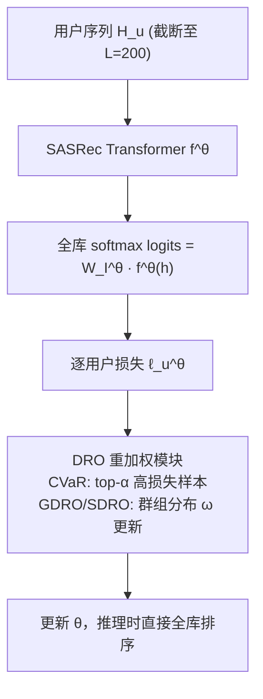

# Improving Minimax Group Fairness in Sequential Recommendation (提升序列推荐中的极小极大群组公平性)

- **会议/期刊**: ECIR 2025 (IR for Good Track)
- **作者与机构**: Krishna Acharya (Georgia Tech, 实习于 Amazon), David Wardrope / Timos Korres / Anders Uhrenholt (Amazon), Aleksandr Petrov (University of Glasgow, 实习于 Amazon)
- **推荐链路定位**: 召回 (Next-Item 检索)
- **研究方向**: 去偏公平与可信推荐 / 序列推荐
- **论文原文**: [https://arxiv.org/abs/2501.18117v1](https://arxiv.org/abs/2501.18117v1)
- **开源代码**: [https://github.com/krishnacharya/sequentialrec-fairness](https://github.com/krishnacharya/sequentialrec-fairness)

## TL;DR (1分钟核心速览)

序列推荐器（SASRec）用 ERM 均匀加权训练时，整体 NDCG 尚可，但小众内容消费者与短序列用户的体验显著劣化。本文首次将 **CVaR-DRO** 引入推荐：每个 mini-batch 只对损失最高的 $\alpha$ 比例样本做最坏情况优化，**无需任何群组标注**，天然支持重叠群组。在 Retailrocket 与 Movielens-1M 上采用 Leave-One-Out + Full-Ranking 协议，CVaR 在整体 NDCG@20 上相对 ERM 提升约 5–6%，且在小众/短序列组上提升幅度最大（最高约 17%），全面优于 Group DRO 与 Streaming DRO。

## Background & Motivation (背景与核心矛盾)

- **主流范式**: SASRec 类 Transformer 序列推荐器以 ERM（全库 softmax + 交叉熵）训练，对所有用户样本等权最小化平均损失，追求整体指标最优。
- **前人局限**: (1) 平均损失最优不等于每组最优——主流用户/长序列用户主导梯度，小众内容消费者与短序列用户（冷启动邻近群体）被系统性牺牲；(2) 已有的 GDRO/SDRO 依赖**预定义、互斥的群组标注**，无法处理一个用户同时属于"小众 × 短序列"这类**交叉群组**，且年龄、族裔等受 GDPR 保护的属性根本不可得。
- **核心洞察 (Key Insight)**: 公平性提升不必依赖群组标签——**"高损失样本"本身就是最差群体的代理信号**。CVaR 只需在 batch 内挑出损失最高的 $\alpha$ 比例样本并对其优化，即可逼近极小极大（minimax）目标，且对重叠群组天然免疫。
- **本文切入点**: 把 CVaR-DRO 作为即插即用的损失替换，系统对比 GDRO / SDRO / CVaR 在**不同群组规模**与**交叉群组**两种现实设定下的表现。

## Method (核心方法设计)

### 1. 整体框架 (Overall Architecture)

模型骨架完全沿用 SASRec（Transformer decoder，序列截断/补齐至 $L=200$，取最后位置表征$f^\theta(\mathbf{h})$与物品嵌入矩阵$W_I^\theta$做全库内积得 logits），**唯一改动在训练损失层**：每个 mini-batch 内先算各用户平均交叉熵$\ell_u^\theta$，再由 DRO 模块重新分配样本权重（CVaR 按损失排序取 top-$\alpha$；GDRO/SDRO 按群组损失做指数梯度上升更新群组分布$\omega$），最后反传更新$\theta$。推理阶段与标准 SASRec 完全一致，无额外开销。

### 2. 关键设计拆解 (Key Designs)

1. **CVaR-DRO 损失（本文核心增量，免群组标注）**：痛点在于 ERM 的均匀权重让高损失群体被平均掉。CVaR 在概率单纯形上求解最坏情况重加权：

$$\mathcal{L}^{\theta}_{\text{CVaR}(\alpha)} = \sup_{\mathbf{q}\in\Delta_B}\Big\{\sum_{u=1}^{B} q_u \cdot \ell_u^\theta \;\Big|\; \|\mathbf{q}\|_\infty \le \tfrac{1}{\alpha B}\Big\}$$

其闭式解即"对 batch 内损失最高的 $m=\alpha B$个样本取平均损失"。直觉：把梯度预算强制倾斜给当前最难学的用户，等价于在经验分布附近的最坏分布上做鲁棒优化，从而抬升最差组表现；且$\mathbf{q}$ 的构造完全不读取群组 ID，故交叉群组、未知受保护属性均可覆盖。

2. **Group / Streaming DRO（对照组，暴露标注依赖）**：维护互斥群组上的分布 $\omega$，用指数梯度上升（步长$\eta$）更新后加权求和：

$$\mathcal{L}^{\theta}_{g/sdro} = \sum_{g\in\mathcal{G}} \omega_g^t \cdot L_g^t$$

SDRO 用滑动估计 $\tilde{L}_g^t=(1-\beta)L_g^{t-1}+\beta L_g^t$ 平滑群组损失。二者必须"选一个群组维度"来算损失，这正是交叉群组场景下性能敏感、需训练多份模型的根源。

3. **训练目标、负采样与推理效率**：采用**全库 softmax 多类交叉熵、免负采样**（区别于原版 SASRec 的 BCE + 负采样，遵循 gSASRec/BERT4Rec 复现结论）。仅调 DRO 超参（CVaR 的 $\alpha\in\{0.1,\dots,0.95\}$共 10 组；GDRO/SDRO 的$\eta\in\{10^{-3},\dots,0.1\}$ 共 5 组），架构与 epoch 预算固定以保证公平对比。推理零额外成本。

## Experimental Setup & Evaluation Protocol (实验设置与评估协议)

- **数据集与预处理**（迭代 `5-core` 过滤）：

| 数据集 | #Users | #Items | #Interactions | 稀疏度/密度 | 特征/场景说明 |
| :--- | :---: | :---: | :---: | :---: | :--- |
| Retailrocket (views) | 22,178 | 17,803 | 364,943 | 密度 ≈ 0.09% | 电商浏览行为，强长尾 |
| Movielens-1M | 6,040 | 3,416 | 999,611 | 密度 ≈ 4.8% | 电影评分，稠密 |

- **群组构造**: $G_{pop}=\{$niche, diverse, popular$\}$按用户序列中热门物品（top 0.2 分位）占比$r_u$的三分位切分；$G_{seq}=\{$short, medium, long$\}$ 按序列长度三分位切分。每组再设 balanced (33/33/33)、semi-balanced (20/60/20)、imbalanced (10/80/10) 三种规模。
- **数据划分与防穿越**: `Leave-One-Out`——每用户最后一项测试、倒数第二项验证。
- **排名评测协议**: 无偏 `Full-Ranking`（全库未交互物品排序），明确**不做负采样评估**（遵循 Krichene & Rendle 的 sampled metrics 警示）。
- **对比基线与超参**: ERM、CB / CBlog（按物品频率反比加权）、IPW / IPWlog（按群组频率反比加权）、GDRO、SDRO、CVaR；SASRec 嵌入维 $d=256$、3 层、1 头，RR dropout 0.2 / ML1M 0.5；显著性用 paired T-test（$p<0.05$）。

## Key Experimental Results (实验关键数据)

### 1. 主实验对比 (Main Results)

Retailrocket 交叉群组场景（每用户同时属于一个流行度组与一个序列长度组，balanced 切分），NDCG@20：

| Method | Niche | Diverse | Popular | Short | Medium | Long | Overall |
| :--- | :---: | :---: | :---: | :---: | :---: | :---: | :---: |
| ERM | 0.2122 | 0.2080 | 0.2381 | 0.1859 | 0.3418 | 0.2364 | 0.2230 |
| CB | 0.2115 | 0.2036 | 0.2280* | 0.1861 | 0.3195* | 0.2161* | 0.2175* |
| CBlog | 0.2154* | 0.2126 | 0.2424* | 0.1927* | 0.3378 | 0.2258 | 0.2269* |
| IPWpop | 0.2137 | 0.2102 | 0.2432* | 0.1905* | 0.3415 | 0.2327 | 0.2262* |
| GDROpop | 0.2163* | 0.2139* | 0.2473* | 0.1940* | 0.3441 | 0.2402 | 0.2296* |
| SDROpop | 0.2181* | 0.2135* | 0.2459* | 0.1938* | 0.3445 | 0.2446 | 0.2297* |
| GDROseq | 0.2242* | 0.2245* | 0.2508* | 0.2009* | 0.3465* | 0.2654* | 0.2360* |
| SDROseq | 0.2249* | 0.2264* | 0.2528* | 0.2021* | 0.3474* | 0.2801* | 0.2374* |
| **CVaR** | **0.2278*** | **0.2286*** | **0.2574*** | **0.2068*** | **0.3475*** | **0.2787*** | **0.2409*** |

单群组设定下（表 2/3），CVaR 在 $G_{pop}$三种规模上整体 NDCG@20 分别为 0.239 / 0.239 / 0.237（ERM 为 0.225 / 0.224 / 0.227），在$G_{seq}$ 上为 0.240 / 0.237 / 0.237（ERM 为 0.225 / 0.225 / 0.229），**从平衡到极不平衡规模均稳定领先**。

### 2. 消融实验 (Ablation Study)

本文以"损失函数替换"为消融维度（同一 SASRec 骨架、同一 epoch 预算），Retailrocket 交叉群组整体 NDCG@20 相对 ERM 的变化：

| 变体 | 是否需群组标注 | 支持交叉群组 | Overall NDCG@20 | 相对 ERM |
| :--- | :---: | :---: | :---: | :---: |
| ERM (baseline) | 否 | 是 | 0.2230 | — |
| CB (硬频率加权) | 否 | 是 | 0.2175 | −2.5% |
| CBlog (log 软加权) | 否 | 是 | 0.2269 | +1.7% |
| IPWpop | 是 | 否 | 0.2262 | +1.4% |
| GDROpop | 是 | 否 | 0.2296 | +3.0% |
| GDROseq | 是 | 否 | 0.2360 | +5.8% |
| SDROseq | 是 | 否 | 0.2374 | +6.5% |
| **CVaR** | **否** | **是** | **0.2409** | **+8.0%** |

### 3. 关键实验发现 (Key Findings)

1. **免标注反而最强**：CVaR 在交叉群组整体 NDCG@20 上达 0.2409，比最强需标注基线 SDROseq（0.2374）再高 1.5%，比 ERM 高 8.0%；在小众组上 0.2278 vs ERM 0.2122（+7.4%），短序列组 0.2068 vs 0.1859（+11.2%），说明"高损失样本"确实是比人工群组更精准的最差组代理。
2. **群组依赖方法对"选哪个群组算损失"高度敏感**：同一数据上 GDROpop/SDROpop 整体仅 0.2296/0.2297，而 GDROseq/SDROseq 达 0.2360/0.2374——差距近 3 个百分点；图 1 显示 pop 变体在小众组上的相对提升明显低于 seq 变体。现实中群组维度成百上千，逐一试训不可行，这是 GDRO/SDRO 的结构性缺陷。
3. **硬频率加权会反噬**：CB 在 Retailrocket 整体掉 2.5%，在 Movielens-1M 上更从 0.196 暴跌至 0.121（表 5），说明过度补偿长尾物品会破坏序列语义；而 CVaR 在 ML1M 交叉群组上仍取得整体 0.2037（ERM 0.1966，+3.6%）与 niche 组 0.1994（+7.3%），跨数据集稳健。

## Highlights & Limitations (亮点、对比与审稿批判)

- **与代表作对比 (vs. Prior Work)**: 相比 Wen et al. (WWW'22) 在**非序列双塔召回**上用 GDRO/SDRO，本文将战场移到 Transformer 序列推荐并首次引入 CVaR；相比 FairSR 等多任务公平序列推荐，本文不改架构、只换损失，工程侵入性极低；相比 GDRO/SDRO，CVaR 的核心优势是**零群组标注 + 原生支持交叉群组**。
- **可迁移亮点**: (1) CVaR 重加权可作为任意推荐模型（CTR、生成式推荐）的即插即用公平性正则；(2) "用 batch 内 top-$\alpha$ 高损失样本代理最差群体"这一思路，可直接迁移到冷启动用户扶持与长尾物品曝光提升。
- **审稿级局限批判**: (1) 群组仅限"可从交互历史推断"的流行度与序列长度，未验证年龄/地域等真实受保护属性下的效果，公平性主张的覆盖面有限；(2) 仅两个中等规模数据集、单一 SASRec 骨架，且 CVaR 的 $\alpha$需在 10 档网格中搜索，缺少对$\alpha$ 敏感性与训练稳定性的分析；此外全库 softmax 训练本身在超大物品库上的开销未被讨论。

## Rating (四维评分)

- **方法创新性 (Novelty)**: ⭐⭐⭐ （CVaR-DRO 本身是已有优化工具，创新在于首次迁移到序列推荐并系统揭示群组依赖方法的敏感性，属扎实的应用型贡献而非理论突破）
- **评估协议与实验扎实度 (Protocol & Experiments)**: ⭐⭐⭐⭐ （Leave-One-Out + Full-Ranking 免负采样、paired T-test 显著性、三种群组规模 + 交叉群组 + 双数据集，消融维度清晰；扣分在仅两个数据集与单骨架）
- **写作与数学规范度 (Clarity & Rigor)**: ⭐⭐⭐⭐ （CVaR 的单纯形约束形式与闭式直觉交代清楚，各损失统一记号；但部分表格排版拥挤、附录与正文结论重复度较高）
- **工业落地与复现价值 (Industrial & Practical Value)**: ⭐⭐⭐⭐⭐ （仅替换损失、推理零开销、无需群组标注即可上线，代码已开源，对受 GDPR 约束的真实业务场景极具吸引力）

